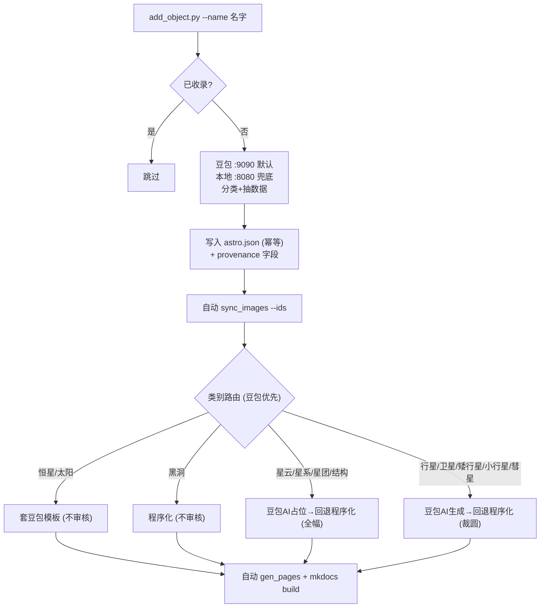

# 星野笔记 · 天体数据库

基于 MkDocs + Material for MkDocs 的**静态天体数据工具站**：**152 个天体、11 类**（恒星 56 / 卫星 21 / 星系 18 / 星云 16 / 星团 11 / 行星 8 / 黑洞 8 / 大尺度结构 7 / 矮行星 5 / 小行星 1 / 彗星 1）的结构化数据（质量 / 半径 / 密度 / 温度 / 轨道 / 卫星 / 光谱型等），覆盖太阳系天体到恒星、星云、星系、黑洞；首页支持搜索、分类筛选、按任意数值排序；每个天体有独立详情页（完整数据表 + 可选科普文章）；另有独立 `/compare/` 对比页做多天体尺寸/参数对比。

> **维护者看这里**：[维护指南.md](维护指南.md) —— 自助维护全流程（AI 录入 / 图片编排 / NASA 真图 / 数据校验 / 收尾构建），含端到端流程图与命令速查，每条都是可直接复制的命令。**任何代码改动都必须同步更新该指南与本文档**（见文末「文档维护约定」）。

---

## 一、它是什么

- **数据站为主、文章附属**：以 `docs/data/astro.json` 为唯一事实源，所有页面/CSV/贴图从它生成。
- **可追溯**：每个对象带 `data_source` / `data_verified` / `image_source` / `image_locked`，可一条命令筛出"AI 吐的数据""未校验的数据""程序化占位图""真实照片"。
- **AI 编排录入**：只给一个名字，`add_object.py` 让豆包自动定位类型、抽数据、写库，并**自动出图 + 自动生成页面/构建**。

---

## 二、目录结构

```text
.
├─ mkdocs.yml            # 站点配置（nav/主题/插件）
├─ 维护指南.md           # 自助维护全流程（命令速查 + 踩坑 + 流程图）
├─ requirements.txt      # 锁定 mkdocs-material==9.7.7
├─ articles/             # 科普文章源（合成进详情页，不在 docs/ 内）
├─ scripts/
│  ├─ add_object.py      # 【AI 编排层】只给名字 → 自动分类/抽数据/写库 + 自动出图
│  ├─ sync_images.py     # 【图片编排】按类别路由 + 豆包AI优先/程序化兜底
│  ├─ query.py           # 来源/校验筛选器（人工校验用: --unverified/--data-source/--image-source/--missing）
│  ├─ migrate_provenance.py # 一次性回填 provenance 字段（已跑过, 日常不用）
│  ├─ fetch_astro_data.py# 太阳系权威核查: status/--propose/--apply
│  ├─ nasa_image.py      # NASA 真实影像: <id> <url> 手动安装 / --search / --auto-batch
│  ├─ lint_data.py       # 数据 lint: 结构+派生量校验（不过则阻断）
│  ├─ gen_pages.py       # 页面生成器 v1.6（--check 校验同步）
│  ├─ star_types.py      # 恒星 9 光谱型定义 + 映射 + 色相偏移
│  ├─ gen_star_types_doubao.py # 每型 1 张豆包 AI 代表图（--sun 生成太阳底图）
│  ├─ build_star_images.py# 恒星套模板 + limb 圆拟合 + 色相微调
│  ├─ gen_bigscale_image.py   # 黑洞/星云/星系/星团/结构 程序化生成
│  ├─ venus_circle.py    # 金星特例：NASA 雷达图内切圆
│  ├─ cdp_shot.js        # 移动端真机布局验证（CDP 设备模拟）
│  ├─ serve_nocache.py   # 本地预览（带 Cache-Control:no-cache 头）
│  ├─ test_fetch_astro.py# 解析器+合库回归测试
│  └─ insert_*.py        # 历史一次性批录入（insert_stars/insert_bigscale/insert_bigscale2，已不再日常使用）
└─ docs/
   ├─ index.md           # 【生成】天体总览工具页（勿手改）
   ├─ objects/           # 【生成】152 个天体详情页 + index.md 总表（勿手改）
   ├─ data.md            # 【生成】数据集下载页（不挂导航，仅 URL/sitemap 可达）
   ├─ data/astro.json    # 天体数据库（唯一事实源）
   ├─ data/nasa_images.json # NASA 真实影像登记表
   ├─ data/astro_flat.csv# 【生成】扁平 CSV
   ├─ js/astro-explore.js# 首页交互（筛选/排序/搜索）
   ├─ js/compare.js      # 独立对比页 /compare/ 逻辑
   ├─ stylesheets/site.css
   └─ assets/planets/*.webp  # 星球贴图（152/152，透明背景 600px）
```

---

## 三、完整工作流（新增一个天体）



**最简用法**：

```bash
python scripts/add_object.py --name "南河三"     # 只给名字，自动分类/抽数据/写库/出图/生成页面/构建
python scripts/add_object.py --name "参宿四" --dry-run  # 先看草稿不落盘、不出图
```
> 默认一条命令搞定「数据→出图→页面→构建」；`--no-sync` 关闭出图、`--no-pages` 关闭页面/构建（关闭后需手动 `gen_pages + mkdocs build` 才能在网页看到）。

写入后如需把程序化占位换成 NASA 真图（尤其行星/卫星）：

```bash
python scripts/nasa_image.py <id> <NASA图片URL>   # 你给地址 → 下载+校验标题+自适应裁图+锁定
```

收尾校验与构建（每次维护必跑）：

```bash
python scripts/lint_data.py && python scripts/gen_pages.py --check && mkdocs build --strict
```

---

## 四、快速开始（本地）

```bash
pip install -r requirements.txt
python scripts/serve_nocache.py 8001 site   # 带 no-cache 头，避免本地缓存旧资源
# 或
mkdocs serve -a 127.0.0.1:8001              # 8000 端口被御风 Home 占用时换端口
```

---

## 五、数据源与许可

- **数值数据**：太阳系天体整理自 NASA NSSDC Planetary/Satellite Fact Sheets、NASA/JPL SBDB API（美国政府作品，公共领域）；恒星/星系/星云/黑洞等经 `add_object.py` 检索 SIMBAD、NASA Exoplanet Archive 及各权威文献后录入（`llm_doubao` 来源，**未经权威源对拍，建议人工校验**）。
- **星球影像**：行星/卫星多为 NASA 真实影像（公共领域，详情页署名可溯源 PIA 编号，`image_source=nasa`）；恒星为豆包 AI 模板（`doubao_template`）；黑洞为程序化示意图（`programmatic`）；星云/星系/星团/结构及行星/矮行星/卫星/小行星/彗星默认由**豆包 AI 生成**（`doubao`，失败回退程序化 `programmatic`）。
- **一句话简介**为本站原创。
- 每个天体详情页标注来源标识与核对日期；数据错误欢迎到 GitHub Issues 反馈。

---

## 六、部署到 Cloudflare Pages

1. 代码推送到 GitHub 仓库
2. Cloudflare Pages → Connect to Git，选中仓库
3. 构建设置：Framework preset `MkDocs`；Build command `pip install -r requirements.txt && mkdocs build`；output `site`
4. 保存后每次 push 自动构建上线

> 页面是构建前生成并提交的，CF 端只跑 `mkdocs build`。如需 CF 构建时生成，把 build command 换成
> `pip install -r requirements.txt && python scripts/gen_pages.py --check && mkdocs build`（`--check` 会校验产物与 JSON 同步）。

---

## 七、文档维护约定

**硬规则**：本站任何脚本或工作流变更（新增/修改/删除脚本、增删命令参数、改图片路由、改数据字段、改 LLM 路由），都**必须在同一轮改动中同步更新 [维护指南.md](维护指南.md) 与本文档**（对应章节 + 流程图），并随代码一起提交。**不依赖任何人提醒。** 详细清单见维护指南第十一章。
