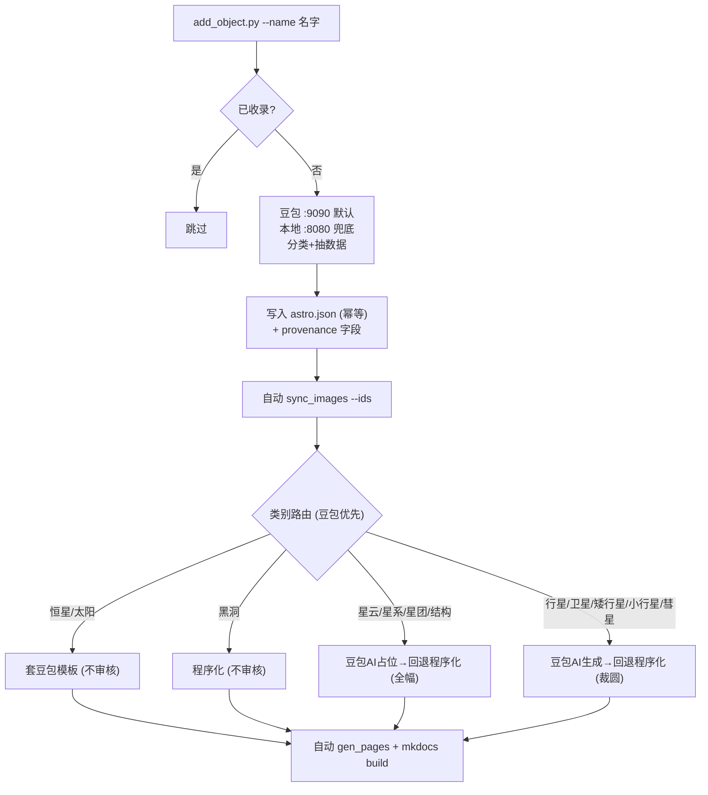
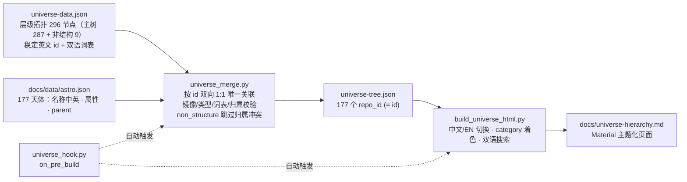
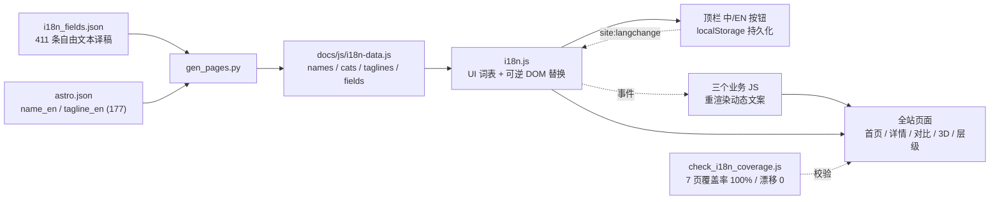

# 星野笔记 · 天体数据库

基于 MkDocs + Material for MkDocs 的**静态天体数据工具站**：**177 个天体、11 类**（恒星 56 / 卫星 23 / 行星 19 / 星系 18 / 星云 16 / 黑洞 12 / 星团 11 / 矮行星 9 / 大尺度结构 7 / 小行星 5 / 彗星 1）的结构化数据（质量 / 半径 / 密度 / 温度 / 轨道 / 卫星 / 光谱型等），覆盖太阳系天体到恒星、星云、星系、黑洞；首页支持搜索、分类筛选、按任意数值排序；每个天体有独立详情页（完整数据表 + 可选科普文章）；另有独立 `/compare/` 对比页做多天体尺寸/参数对比。

> **维护者看这里**：[维护指南.md](维护指南.md) —— 自助维护全流程（AI 录入 / 图片编排 / NASA 真图 / 数据校验 / 收尾构建），含端到端流程图与命令速查，每条都是可直接复制的命令。**任何代码改动都必须同步更新该指南与本文档**（见文末「文档维护约定」）。

---

## 一、它是什么

- **数据站为主、文章附属**：以 `docs/data/astro.json` 为唯一事实源，所有页面/CSV/贴图从它生成。
- **可追溯**：每个对象带 `data_source` / `data_verified` / `image_source` / `image_locked`，可一条命令筛出"AI 吐的数据""未校验的数据""程序化占位图""真实照片"。
- **AI 编排录入**：只给一个名字，`add_object.py` 让豆包自动定位类型、抽数据、写库，并**自动出图 + 自动生成页面/构建**。
- **详情页三段式布局（v1.7）**：hero 只留 2 项单行速览，物理/轨道/其他特征三表在桌面双列、移动单列；空值行直接不渲染，正文列去掉右侧 TOC 后铺满，为后续 3D 头像/轨道嵌入预留栅格位。详见[维护指南](维护指南.md)。
- **展示单位统一（v1.8）**：全站口径从"半径"改为"直径 = 2 × 半径"，主单位按量级自动切换 km / 光年，辅单位给地球/太阳直径倍数或 M⊕ / M☉；温度统一 K、有表面温度的固态天体括注 ℃；黑洞称"事件视界直径"。单位字符串由 `gen_pages.py` 唯一实现，对比页（`compare.js`）改读预生成 `*_text` 字段，消除两套口径。详见[维护指南](维护指南.md)。
- **详情页 3D 可视化（v1.9 重构）**：每个天体详情页在 hero 正下方、参数表之前**条件渲染**「3D 交互可视化」块——有 `viz-manifest.json` 覆盖才渲染、无则优雅降级（不占位置）。本仓库只做「消费者」：提供 iframe 窗口 + `go.html?body=<id>&embed=1` 地址，把天体 id 透传给外部仓库 `astro-solar-3d`（真实三维太阳系，130 天体支持 `?body=<id>` 直达外链），**绝不硬编码场景**；契约（哪些天体有 3D）来自外部仓库的 `links.json` 快照（`--sync` 刷新）。当前 69/177 有覆盖。size-of-space 待部署 CF Pages 后再接入。详见[维护指南](维护指南.md)。

---

## 二、目录结构

```text
.
├─ mkdocs.yml            # 站点配置（nav/主题/插件）
├─ 维护指南.md           # 自助维护全流程（命令速查 + 踩坑 + 流程图）
├─ viz-manifest.json     # 3D 覆盖契约（gen_viz_manifest.py 生成；消费外部 links.json 快照；go.html?body=<id> 透传；详情页条件嵌入）
├─ universe-data.json    # 【宇宙层级】层级拓扑事实源（主树 287 + 非结构 9 = 296 节点；稳定英文 id + 双语词表 + _convention 11 条；非结构存 non_structure 数组）
├─ universe-tree.json    # 【宇宙层级】融合产物（主树 170 + 非结构 7 个 repo_id = id；页面唯一事实源，universe_merge.py 生成）
├─ requirements.txt      # 锁定 mkdocs-material==9.7.7
├─ articles/             # 科普文章源（合成进详情页，不在 docs/ 内）
├─ scripts/
│  ├─ add_object.py      # 【AI 编排层】只给名字 → 自动分类/抽数据/写库 + 自动出图
│  ├─ sync_images.py     # 【图片编排】按类别路由 + 豆包AI优先/程序化兜底
│  ├─ query.py           # 来源/校验筛选器（人工校验用: --unverified/--data-source/--image-source/--missing）
│  ├─ migrate_provenance.py # 一次性回填 provenance 字段（已跑过, 日常不用）
│  ├─ fetch_astro_data.py# 太阳系权威核查: status/--propose/--apply
│  ├─ nasa_image.py      # NASA 真实影像: <id> <url> 手动安装 / --search / --auto-batch
│  ├─ lint_data.py       # 数据 lint: 结构+派生量校验（不过则阻断）
│  ├─ gen_pages.py       # 页面生成器 v1.9（--check 校验同步；HTML 参数表 + 双列 grid；直径口径/单位统一唯一实现；详情页 3D 块按 viz-manifest 条件嵌入；产出 i18n-data.js 的 names/cats/taglines/fields 四表）
│  ├─ gen_viz_manifest.py # 生成 viz-manifest.json（消费 scripts/solar3d_links.json 快照；go.html?body=<id>&embed=1 透传；--sync 刷新快照；size-of-space 待接入）
│  ├─ universe_merge.py   # 【宇宙层级】骨架 + astro.json → universe-tree.json（按英文 id 双向 1:1 唯一关联 + 镜像/类型/词表/归属校验；non_structure 单独校验、跳过归属冲突）
│  ├─ build_universe_html.py # 【宇宙层级】universe-tree.json → docs/universe-hierarchy.md（中文/EN 切换、按 category 着色、双语搜索；非结构·宇宙学现象独立区块）
│  ├─ universe_hook.py    # 【宇宙层级】MkDocs 构建钩子：build 前自动跑上面两步，JSON 改动即同步页面
│  ├─ check_universe_dom.js # 【宇宙层级】jsdom 32 项回归（id 唯一 / 双语切换 / 英文名搜索 / 非结构区块渲染与双语）
│  ├─ check_site_i18n.js # 【全站双语】jsdom 54 项回归（顶栏开关 / 语言持久化 / 可逆恢复 / 署名链接保留 / 对比页）
│  ├─ check_i18n_coverage.js # 【全站双语】jsdom 7 页英文覆盖率 + 译表漂移检测（当前 100% / 漂移 0）
│  ├─ translate_fields.py # 【全站双语】把 astro.json 自由文本字段译成英文（增量 / 断点续跑，产出 i18n_fields.json）
│  ├─ star_types.py      # 恒星 9 光谱型定义 + 映射 + 色相偏移
│  ├─ gen_star_types_doubao.py # 每型 1 张豆包 AI 代表图（--sun 生成太阳底图）
│  ├─ build_star_images.py# 恒星套模板 + limb 圆拟合 + 色相微调
│  ├─ gen_bigscale_image.py   # 黑洞/星云/星系/星团/结构 程序化生成
│  ├─ venus_circle.py    # 金星特例：NASA 雷达图内切圆
│  ├─ cdp_shot.js        # 移动端真机布局验证（CDP 设备模拟）
│  ├─ serve_nocache.py   # 本地预览（带 Cache-Control:no-cache 头）
│  ├─ test_fetch_astro.py# 解析器+合库回归测试
│  └─ insert_*.py        # 历史一次性批录入（insert_stars/insert_bigscale/insert_bigscale2，已不再日常使用）
└─ docs/
   ├─ index.md           # 【生成】天体总览工具页（勿手改）
   ├─ objects/           # 【生成】177 个天体详情页 + index.md 总表（勿手改）
   ├─ data.md            # 【生成】数据集下载页（不挂导航，仅 URL/sitemap 可达）
   ├─ data/astro.json    # 天体数据库（唯一事实源）
   ├─ data/nasa_images.json # NASA 真实影像登记表
   ├─ data/astro_flat.csv# 【生成】扁平 CSV
   ├─ data/i18n_fields.json # 数据层自由文本英文译稿（411 条去重，按 id + 字段索引，可人工审阅）
   ├─ js/i18n-data.js    # 【生成】全站双语数据（names/cats/taglines/fields 四表，按 id 索引）
   ├─ js/i18n.js         # 全站双语运行时：UI 词表 + 可逆 DOM 替换 + 顶栏语言按钮
   ├─ js/astro-explore.js# 首页交互（筛选/排序/搜索）+ 全局表格横滚包裹（按列数分宽/窄表）
   ├─ js/compare.js      # 独立对比页 /compare/ 逻辑
   ├─ js/solar-embed.js  # 3D 嵌入块：全屏切换 + 移动端横屏提示 + 多来源切换按钮
   ├─ stylesheets/site.css   # 含 .solar-embed 嵌入块样式
   ├─ solar-demo.md      # 【手写】太阳系 3D 交互站主页（导航卡片 iframe）
   ├─ universe-hierarchy.md    # 【生成】宇宙层级思维导图（主题化 MkDocs 页面，JSON 内嵌，中文/EN 切换；导航直接指向）
   └─ assets/planets/*.webp  # 星球贴图（152/152，透明背景 600px）
```

---

## 三、完整工作流（新增一个天体）



**最简用法**：

```bash
python scripts/add_object.py --name "南河三"     # 只给名字，自动分类/抽数据/写库/出图/生成页面/构建
python scripts/add_object.py --name "参宿四" --dry-run  # 先看草稿不落盘、不出图
python scripts/add_object.py --batch names.txt  # 批量录入：names.txt 每行一个名字，豆包两发一致性对拍
python scripts/add_object.py --batch names.txt --dry-run  # 先预览将写入的对象，不落盘
python scripts/add_object.py --recheck --category all    # AI 复校：全量重新抽数，争议字段置空、空缺补填
python scripts/add_object.py --recheck --category star   # 只复校恒星（也支持 planet / 具体名 --name / 名单 --batch）
python scripts/add_object.py --recheck --dry-run         # 先预览将置空/填充的字段，不落盘
```
> 默认一条命令搞定「数据→出图→页面→构建」；`--no-sync` 关闭出图、`--no-pages` 关闭页面/构建（关闭后需手动 `gen_pages + mkdocs build` 才能在网页看到）。批量模式三阶段解耦（并发抽数→写盘一次→统一出图+build），豆包 `:9090` 两发对拍筛掉随机幻觉；**两发不一致时逐字段合并——一致字段保留、争议字段置 null 不误填**。复校模式（`--recheck`）对已有对象重新抽数做数据清洗：相同字段级规则（争议置空、空缺补填），可按 `--category/--name/--batch` 筛选，官方 API 来源（`data_source=official_api`）默认跳过、`--force` 强制，整批可反复重跑（幂等）。

写入后如需把程序化占位换成 NASA 真图（尤其行星/卫星）：

```bash
python scripts/nasa_image.py <id> <NASA图片URL>   # 你给地址 → 下载+校验标题+自适应裁图+锁定
python scripts/nasa_image.py 智神星 ai             # 豆包图不满意/失败时，按名重试豆包出图(默认重试3次)
python scripts/nasa_image.py 共工星 ai --retries 5  # 改重试次数；--no-pages 可不自动重建站点
```

收尾校验与构建（每次维护必跑）：

```bash
python scripts/lint_data.py && python scripts/gen_pages.py --check && mkdocs build --strict
node scripts/check_site_i18n.js      # 全站双语回归（须先 build，读 site/ 产物）
node scripts/check_i18n_coverage.js  # 7 页英文覆盖率 + 译表漂移（须先 build）
```

---

## 四、快速开始（本地）

```bash
pip install -r requirements.txt
python scripts/serve_nocache.py 8001 site   # 带 no-cache 头，避免本地缓存旧资源
# 或
mkdocs serve -a 127.0.0.1:8001              # 8000 端口被御风 Home 占用时换端口
```

---

## 五、数据源与许可

- **数值数据**：太阳系天体整理自 NASA NSSDC Planetary/Satellite Fact Sheets、NASA/JPL SBDB API（美国政府作品，公共领域）；恒星/星系/星云/黑洞等经 `add_object.py`（AI 编排层）录入——`--name` 模式把名字发给豆包/本地模型，**由 LLM 凭训练记忆给出知名天体的最佳近似真值**（`llm_doubao` / `llm_local` 来源，**不查权威 API、无对拍闸，建议人工校验**）；`--facts` 可喂检索文本、`--json` 可直接录入权威值。
- **星球影像**：行星/卫星多为 NASA 真实影像（公共领域，详情页署名可溯源 PIA 编号，`image_source=nasa`）；恒星为豆包 AI 模板（`doubao_template`）；黑洞为程序化示意图（`programmatic`）；星云/星系/星团/结构及行星/矮行星/卫星/小行星/彗星默认由**豆包 AI 生成**（`doubao`，失败回退程序化 `programmatic`）。网页署名面向访客只显示短文案：「AI 生成」/「程序化示意图」。
- **一句话简介**为本站原创。
- 每个天体详情页标注来源标识与核对日期；数据错误欢迎到 GitHub Issues 反馈。

---

## 六、部署到 Cloudflare Pages

1. 代码推送到 GitHub 仓库
2. Cloudflare Pages → Connect to Git，选中仓库
3. 构建设置：Framework preset `MkDocs`；Build command `pip install -r requirements.txt && mkdocs build`；output `site`
4. 保存后每次 push 自动构建上线

> 页面是构建前生成并提交的，CF 端只跑 `mkdocs build`。如需 CF 构建时生成，把 build command 换成
> `pip install -r requirements.txt && python scripts/gen_pages.py --check && mkdocs build`（`--check` 会校验产物与 JSON 同步）。

> **太阳系 3D 页面不在本仓库**：它们是另一个 Cloudflare Pages 站点，以 iframe 形式嵌进来，详见下一章。

---

## 七、太阳系 3D 交互站（外站 iframe）

### 7.1 太阳系 3D 导航页（solar-demo.md）

本站只有 **1 个** 3D 导航页（`/solar-demo/`，左侧导航叫「太阳系3D模型」），但**3D 工程本身不在本仓库**——它是独立仓库 + 独立 Cloudflare Pages 站点。
该页用 `iframe` 嵌入 3D 站点的**导航主页**（卡片式，列出全部 8 个系统），在 iframe 内点任意卡片即可直接打开对应系统；顶部「↺ 重新选择」按钮可一键退回主页换看别的系统。

| 项 | 值 |
|---|---|
| 3D 工程仓库 | https://github.com/yufengwolf/astro-solar-3d |
| 3D 导航主页（iframe 源） | https://astro-solar-3d.pages.dev |
| 部署方式 | CF Pages 连 GitHub；`npm ci && npm run build`，输出 `dist`，环境变量 `NODE_VERSION=20` |

**URL 说明**（CF Pages 会把 `/xxx.html` 308 重定向到 `/xxx`，所以统一用无扩展名写法）：

- 3D 站根路径 `https://astro-solar-3d.pages.dev/` 是导航主页（卡片，列出全部系统）
- 各系统：`/overview`（太阳系总览）、`/earth-moon`、`/mars`、`/jupiter`、`/saturn`、`/uranus`、`/neptune`、`/pluto`

**改哪里**：

- 改 3D 内容（天体、轨道、贴图）→ 去 3D 仓库改并 push，CF 自动部署，**本站无需任何改动**
- 改嵌入样式 / 全屏 / 横屏提示 / 重新选择按钮 → 本仓库的 `docs/js/solar-embed.js` 与 `site.css` 的 `.solar-embed`
- 改页面上下说明文字 → 本仓库 `docs/solar-demo.md`
- 改导航显示名 → 本仓库 `mkdocs.yml` 的 `nav`

**为什么不放本站目录**：产物约 20MB / 57 个文件。塞进本仓库会让每次 push 都带上这些静态文件，
并连带触发 mkdocs 全量重建。拆开后两边构建彻底解耦，各自独立缓存。

**全屏实现**：按钮在本站页面上，调的是本站元素的 `requestFullscreen()`（同源，无需授权）；
iframe 上的 `allow="fullscreen"` 只是兜底。移动端全屏会尝试锁定横屏，仍竖屏则显示旋转提示；
iOS Safari 不支持元素全屏时回退为新标签打开独立页。

### 7.2 详情页 3D 可视化块（P3：viz-manifest 契约）

P3 给**每个天体详情页**加了一个条件渲染的「3D 交互可视化」块（hero 正下方、参数表之前），与 7.1 的导航页是两回事：导航页是太阳系总入口，而**详情页块是按天体就近展示它的 3D**。

**架构原则（用户拍板）**：本仓库只做「消费者」——
- 提供**窗口（iframe）** + **地址（`go.html?body=<id>&embed=1`）**；
- **绝不硬编码**「某天体 → 某场景 HTML」。具体渲染成什么（地球单独 / 地月系统 / 太阳专属视角……）完全由外部仓库 `astro-solar-3d` 决定。
- `viz-manifest.json` 就是这份「契约表格」：本仓库只声明「哪些天体有 3D、透传哪个 id」，外部仓库按 id 填充内容。

- **契约来源 `viz-manifest.json`**（仓库根）：由 `scripts/gen_viz_manifest.py` **消费**外部仓库发布的 `links.json` 快照（仓库内 `scripts/solar3d_links.json`，`--sync` 可从线上刷新）机械派生。即「哪些天体有 3D」这张表由外部仓库填充，本仓库只读它；`gen_pages` 渲染详情页前读 `viz-manifest.json`，无条目就不渲染（优雅降级）。
- **外链格式**（astro-solar-3d 规定）：万能入口 `go.html?body=<ID>` 只给 id，外部仓库自动落到正确页面（太阳系/卫星系/银河系…）；追加 `&embed=1` 隐藏导航/菜单只留天体特写（适合 iframe）；详情页块还附「打开完整交互版 ↗」链接（去掉 `embed=1` 的新标签地址）。
- **当前唯一外部 3D 源**：`astro-solar-3d`（Cloudflare Pages `astro-solar-3d.pages.dev`，我方自有，真实三维太阳系），其 `links.json` 含 **130** 个天体（行星/卫星/冥王星/深空恒星星云），支持 `?body=<id>` 直达外链。详情页匹配我库 177 天体后，当前 **69 个**（39%）有 3D 覆盖。
- **size-of-space 暂未接入**：用户尚未把它部署到 CF Pages（fork 带 `deploy.yml` 但未开 Pages），待部署后再作为第二个来源加回 `gen_viz_manifest.py`。

> 改 3D 覆盖度：外部仓库新增天体后，运行 `python scripts/gen_viz_manifest.py --sync` 刷新 `solar3d_links.json` 快照（或手动复制其部署产物的 `links.json`），再重跑 `gen_viz_manifest.py` + `gen_pages` 即可，无需改代码。仅当**我库 id 与外部 id 命名不一致**时才需在 `gen_viz_manifest.py` 的 `ALIASES` 里加一条（如 `sgr_a_star→sagA`、`cyg_x1→cygx1`）。

---

## 八、宇宙天体层级思维导图

主题化页面 `docs/universe-hierarchy.md`（左侧导航「宇宙层级」**直接打开**，融入 Material 主题，含侧边栏 / 站内字体 / 配色），以可折叠树呈现天体的**层级 / 从属关系**。**事实源分工**：`universe-data.json` 只定义层级拓扑与容器；`docs/data/astro.json` 是天体名称（中 / 英）、物理属性与来源的唯一事实源；两者靠**稳定英文 id 唯一关联**，不靠中文名匹配（翻译或改名都不会断链）。

### 数据契约（硬约束，写在骨架顶层 `_convention` 10 条）

| 字段 | 规则 |
|---|---|
| `id` | 每节点必有，全局唯一、仅 ASCII `[a-z0-9._-]`、一经确定不改。本站天体 `id == astro.json.id`（177 个）；层级容器与本站未收录天体用 `c.` 前缀（105 个） |
| `name` / `name_en` | 天体节点是 `astro.json` 的展示镜像（融合脚本字节级强校验）；容器节点在骨架定义标准天文学英文名。全 282 节点 `name_en` 齐备 |
| `type_i18n` / `category_i18n` | 顶层共用词表（105 条类型 / 12 条大类），页面按语言查表切换，融合脚本校验覆盖率 |
| `alias` | 通用编号（`M42`、`Sgr A*`），只用于展示与搜索，**不参与关联** |

规范涵盖：事实源分工、稳定 id、唯一匹配、编号命名、大小写语义、格式、受控 `type` / `category`、双语、归属严格。

### 生成链

- `universe-data.json`：**层级拓扑事实源**（主树 287 + 非结构 9 = 296 节点）。引力束缚结构走 `children` 层级树；宇宙微波背景、引力波并合事件、遥远类星体与活动星系核等**非引力束缚对象**单独放 `non_structure` 数组（仍按 id 与 astro.json 关联，但刻意移出层级树，避免与真实空间归属混淆）。归属严格，无确证依据的放进标注「归属未细化」的容器，不按类别臆测。
- `universe-tree.json`：`scripts/universe_merge.py` **只按 id** 做双向 1:1 关联，打上 `repo_id`（等于 id），并校验「名称镜像 / `category` / 中英词表覆盖 / 仓库 `parent` 链与骨架祖先链容器兼容」。**`non_structure` 节点同样参与 id / `category` / 词表校验，但跳过 parent 链归属冲突检查**（它们被刻意移出层级树）。**禁止** `lower()`、去空白、去括号、星尾差异、`alias` 兜底等任何名称模糊匹配；id 缺失、重复、孤立立即报错（EXIT=1）。
- `docs/universe-hierarchy.md`：`scripts/build_universe_html.py` 生成主题化页面，支持**中文 / EN 一键切换**（节点名、说明、类型徽章、大类 chips、图例、搜索提示、空态文案），中文名 / 英文名 / M·NGC 编号 / id 搜索、大类筛选、展开折叠、面包屑；层级树下方另设**「非结构 · 宇宙学现象」独立区块**（CMB / 引力波并合事件 / 类星体-AGN），带独立标题与说明，同样支持双语与搜索过滤。**展开状态与筛选状态按 id / 受控 `category` 存储，切换语言不丢失**；170 个主树带 `repo_id` 的节点行尾「↗」直达 `objects/<id>/`。
- `universe_hook.py`：构建钩子，`mkdocs build` 前自动跑上面两步；两个生成脚本写前比对内容，无变化跳过写入，避免 `mkdocs serve` 死循环。



刷新流程（改 `astro.json` / `universe-data.json` 后；**新增天体必须在骨架补同 id 节点，容器一律 `c.` 前缀**）：

```bash
python scripts/universe_merge.py       # 必须 177 id 精确命中 / 0 镜像不一致 / 0 词表缺项 / 0 归属冲突
python scripts/build_universe_html.py  # universe-tree.json → docs/universe-hierarchy.md
python scripts/gen_pages.py --check && mkdocs build --strict
# 注：上面两步已接入 universe_hook.py，随 mkdocs build 自动执行；手动跑用于单独调试
node scripts/check_universe_dom.js     # jsdom 实跑 32 项：id 唯一 / 双语切换 / 英文名搜索 / 非结构区块渲染与双语
node scripts/check_site_i18n.js        # jsdom 实跑 54 项：全站双语 / 顶栏开关 / 可逆恢复
node scripts/check_i18n_coverage.js    # 7 页英文覆盖率 100% / 译表漂移 0
```

## 九、全站中英双语（顶栏切换）

站点所有页面共用**一个语言状态**：顶栏 **中 / EN** 按钮位于 Material 明暗模式切换**左侧**，选择写入 `localStorage['astro-site-lang']`，刷新与跨页面均保持；`<html data-lang>` / `<html lang>` 同步切换。

| 层 | 事实源 | 职责 |
|---|---|---|
| 数据 | `astro.json` 的 `name_en` / `tagline_en`（177/177，`lint_data.py` 强制必填） | `gen_pages.py` 产出 `docs/js/i18n-data.js`，按 **id** 索引名称 / 分类 / 简介的中英双份 |
| 数据译稿 | `docs/data/i18n_fields.json`（411 条去重「中文原文 → 英文」，按 **id + 字段** 索引） | 覆盖 `subtype` / `note` / `atmosphere` / `spectral_type` / `constellation` / `image_credit` / `members` / `host_star`，以及数据集页来源清单与待补充；`gen_pages.py` 拼成 `i18n-data.js` 的 `fields` 表，运行时按**整串精确**替换（不做名称匹配） |
| 词表 | `docs/js/i18n.js` 的 `UI` + `CATS` | 站点名、导航、表头、字段、按钮、提示、单位的中英对照（与 `universe-data.json` 的 `category_i18n` 同口径） |
| 运行时 | `docs/js/i18n.js` | 可逆文本节点替换（WeakMap 存原文）、`BLOCKS` 静态块译表、`PATTERNS` / `CELL_SUB` 有界替换、`data-en` / `data-en-html` 精确属性、名称主次互换、`site:langchange` 事件、顶栏按钮注入、译表漂移检测 |
| 业务脚本 | `astro-explore.js` / `compare.js` / `solar-embed.js` | 动态生成的计数 / 对比表 / 全屏按钮改用 `siteT()`，并监听语言变更重渲染 |
| 层级页 | `build_universe_html.py` | 页内「中文 / EN」按钮改调 `setSiteLang()`，与全站同源；独立打开或 jsdom 单测时降级为页内切换 |

**边界**：仅 `articles/` 科普长文正文仍保留中文（内容本地化，不做界面 i18n）；数据层自由文本已由 `i18n_fields.json` 全量翻译，实测 7 个主要页面英文模式中文残留 **0**。`data-en` 用于纯文本整块替换；**含 `<a>` 链接的块必须改用 `data-en-html`**（`textContent` 赋值会抹掉链接）。新增 UI 文案同步 `i18n.js` 的 `UI`；改任一 CSS/JS 必须递增 `mkdocs.yml` 的 `?v=2.2`。



验证：`node scripts/check_site_i18n.js`（jsdom 实跑 54 项：顶栏位置、语言持久化、中文↔英文可逆、名称互换、徽章、简介、表头、影像署名链接保留、对比页表格）+ `node scripts/check_i18n_coverage.js`（7 页英文覆盖率 ≥99%、译表漂移 0），必须先 `mkdocs build --strict`。

## 十、文档维护约定

**硬规则**：本站任何脚本或工作流变更（新增/修改/删除脚本、增删命令参数、改图片路由、改数据字段、改 LLM 路由），都**必须在同一轮改动中同步更新 [维护指南.md](维护指南.md) 与本文档**（对应章节 + 流程图），并随代码一起提交。**不依赖任何人提醒。** 详细清单见维护指南第十一章。
