

  <h1>天体数据库</h1>
  
152 个天体的质量、半径、密度、温度

  
<a href="#articles">科普文章</a>·<a href="objects/">天体库总表</a>

  <input type="search" id="astro-search" placeholder="搜索天体…" aria-label="搜索天体">
  

    <button type="button" class="chip active" data-filter="all">全部 152</button>
    <button type="button" class="chip" data-filter="star">恒星 56</button>
    <button type="button" class="chip" data-filter="planet">行星 8</button>
    <button type="button" class="chip" data-filter="dwarf_planet">矮行星 5</button>
    <button type="button" class="chip" data-filter="moon">卫星 21</button>
    <button type="button" class="chip" data-filter="galaxy">星系 18</button>
    <button type="button" class="chip" data-filter="nebula">星云 16</button>
    <button type="button" class="chip" data-filter="cluster">星团 11</button>
    <button type="button" class="chip" data-filter="black_hole">黑洞 8</button>
    <button type="button" class="chip" data-filter="structure">大尺度结构 7</button>
    <button type="button" class="chip" data-filter="asteroid">小行星 1</button>
    <button type="button" class="chip" data-filter="comet">彗星 1</button>
  

  <label class="astro-sort-label">排序
    <select id="astro-sort" aria-label="排序方式">
      <option value="name">名称</option>
      <option value="mass">质量 ↓</option>
      <option value="radius">半径 ↓</option>
      <option value="density">密度 ↓</option>
      <option value="temp">表面温度 ↓</option>
      <option value="period">轨道周期 ↓</option>
      <option value="moons">卫星数量 ↓</option>
    </select>
  </label>

  <article class="astro-card" data-category="star" data-name="太阳 Sun" data-mass="1.9884e+30" data-radius="695700" data-density="1.408" data-temp="5499" data-period="" data-moons="">
    <a class="astro-card-link" href="objects/sun/">
      

      

        
太阳Sun

        
太阳系的中心恒星，独占太阳系总质量的 99.86%

        
1 M☉1 R☉1 L☉

      

      恒星
    </a>
  </article>
  <article class="astro-card" data-category="planet" data-name="水星 Mercury" data-mass="3.301e+23" data-radius="2439.7" data-density="5.429" data-temp="167" data-period="87.97" data-moons="0">
    <a class="astro-card-link" href="objects/mercury/">
      

      

        
水星Mercury

        
离太阳最近的行星，一个太阳日比一个水星年还长

        
3.3×10²³ kg2,440 km167 °C

      

      行星
    </a>
  </article>
  <article class="astro-card" data-category="planet" data-name="金星 Venus" data-mass="4.8685e+24" data-radius="6051.8" data-density="5.243" data-temp="464" data-period="224.7" data-moons="0">
    <a class="astro-card-link" href="objects/venus/">
      

      

        
金星Venus

        
被浓厚二氧化碳大气包裹的炽热世界，太阳系表面最热的行星

        
4.87×10²⁴ kg6,052 km464 °C

      

      行星
    </a>
  </article>
  <article class="astro-card" data-category="planet" data-name="地球 Earth" data-mass="5.9724e+24" data-radius="6371.0" data-density="5.514" data-temp="15" data-period="365.26" data-moons="1">
    <a class="astro-card-link" href="objects/earth/">
      

      

        
地球Earth

        
目前已知唯一存在生命的行星，约 71% 表面被液态水覆盖

        
5.97×10²⁴ kg6,371 km15 °C

      

      行星
    </a>
  </article>
  <article class="astro-card" data-category="planet" data-name="火星 Mars" data-mass="6.4169e+23" data-radius="3389.5" data-density="3.934" data-temp="-59" data-period="686.98" data-moons="2">
    <a class="astro-card-link" href="objects/mars/">
      

      

        
火星Mars

        
红色的沙漠行星，拥有太阳系最高的火山与最深的峡谷

        
6.42×10²³ kg3,390 km-59 °C

      

      行星
    </a>
  </article>
  <article class="astro-card" data-category="planet" data-name="木星 Jupiter" data-mass="1.89813e+27" data-radius="69911" data-density="1.326" data-temp="-110" data-period="4332.59" data-moons="95">
    <a class="astro-card-link" href="objects/jupiter/">
      

      

        
木星Jupiter

        
太阳系最大的行星，质量超过其余七颗行星的总和

        
1.9×10²⁷ kg69,911 km-110 °C

      

      行星
    </a>
  </article>
  <article class="astro-card" data-category="planet" data-name="土星 Saturn" data-mass="5.6832e+26" data-radius="58232" data-density="0.687" data-temp="-140" data-period="10755.7" data-moons="274">
    <a class="astro-card-link" href="objects/saturn/">
      

      

        
土星Saturn

        
以壮观环系闻名的气态巨行星，平均密度比水还小

        
5.68×10²⁶ kg58,232 km-140 °C

      

      行星
    </a>
  </article>
  <article class="astro-card" data-category="planet" data-name="天王星 Uranus" data-mass="8.6813e+25" data-radius="25559" data-density="1.27" data-temp="-195" data-period="30589" data-moons="28">
    <a class="astro-card-link" href="objects/uranus/">
      

      

        
天王星Uranus

        
躺着自转的冰巨星，自转轴倾角约 98 度

        
8.68×10²⁵ kg25,559 km-195 °C

      

      行星
    </a>
  </article>
  <article class="astro-card" data-category="planet" data-name="海王星 Neptune" data-mass="1.0241e+26" data-radius="24764" data-density="1.638" data-temp="-200" data-period="59800" data-moons="16">
    <a class="astro-card-link" href="objects/neptune/">
      

      

        
海王星Neptune

        
太阳系最外侧的行星，风速可达每小时 2100 公里

        
1.02×10²⁶ kg24,764 km-200 °C

      

      行星
    </a>
  </article>
  <article class="astro-card" data-category="dwarf_planet" data-name="冥王星 Pluto" data-mass="1.303e+22" data-radius="1188.3" data-density="1.85" data-temp="-225" data-period="90560" data-moons="5">
    <a class="astro-card-link" href="objects/pluto/">
      

      

        
冥王星Pluto

        
曾被列为第九大行星，与卫星卡戎构成双天体系统

        
1.3×10²² kg1,188 km-225 °C

      

      矮行星
    </a>
  </article>
  <article class="astro-card" data-category="dwarf_planet" data-name="谷神星 Ceres" data-mass="9.3846e+20" data-radius="469.7" data-density="2.162" data-temp="" data-period="1682.0" data-moons="0">
    <a class="astro-card-link" href="objects/ceres/">
      

      

        
谷神星Ceres

        
小行星带中最大的天体，唯一位于内太阳系的矮行星

        
9.38×10²⁰ kg469.7 km2.162 g/cm³

      

      矮行星
    </a>
  </article>
  <article class="astro-card" data-category="dwarf_planet" data-name="鸟神星 Makemake" data-mass="3e+21" data-radius="715.9" data-density="" data-temp="" data-period="112364.81" data-moons="1">
    <a class="astro-card-link" href="objects/makemake/">
      

      

        
鸟神星Makemake

        
柯伊伯带最大的经典天体之一，表面覆盖甲烷冰

        
3×10²¹ kg715.9 km

      

      矮行星
    </a>
  </article>
  <article class="astro-card" data-category="dwarf_planet" data-name="妊神星 Haumea" data-mass="4e+21" data-radius="780.0" data-density="" data-temp="" data-period="103208.12" data-moons="2">
    <a class="astro-card-link" href="objects/haumea/">
      

      

        
妊神星Haumea

        
自转极快的椭球状矮行星，拥有光环

        
4×10²¹ kg780.0 km

      

      矮行星
    </a>
  </article>
  <article class="astro-card" data-category="dwarf_planet" data-name="阋神星 Eris" data-mass="1.6e+22" data-radius="1163.0" data-density="" data-temp="" data-period="204516.66" data-moons="1">
    <a class="astro-card-link" href="objects/eris/">
      

      

        
阋神星Eris

        
质量最大的矮行星，它的发现促使冥王星降级

        
1.6×10²² kg1,163 km

      

      矮行星
    </a>
  </article>
  <article class="astro-card" data-category="moon" data-name="月球 Moon" data-mass="7.346e+22" data-radius="1737.4" data-density="3.344" data-temp="-20" data-period="27.3217" data-moons="0">
    <a class="astro-card-link" href="objects/moon/">
      

      

        
月球Moon

        
地球唯一的天然卫星，潮汐锁定使它永远以同一面朝向地球

        
7.35×10²² kg1,737 km-20 °C

      

      卫星
    </a>
  </article>
  <article class="astro-card" data-category="moon" data-name="火卫一 Phobos" data-mass="1.06e+16" data-radius="11.27" data-density="1.9" data-temp="" data-period="0.31891" data-moons="0">
    <a class="astro-card-link" href="objects/phobos/">
      

      

        
火卫一Phobos

        
火星较大的卫星，正以每百年约 1.8 米的速度靠近火星

        
1.06×10¹⁶ kg11.3 km1.9 g/cm³

      

      卫星
    </a>
  </article>
  <article class="astro-card" data-category="moon" data-name="火卫二 Deimos" data-mass="2400000000000000.0" data-radius="6.3" data-density="1.75" data-temp="" data-period="1.26244" data-moons="0">
    <a class="astro-card-link" href="objects/deimos/">
      

      

        
火卫二Deimos

        
火星较小的卫星，形状极不规则，表面覆盖细腻的风化层

        
2.4×10¹⁵ kg6.3 km1.75 g/cm³

      

      卫星
    </a>
  </article>
  <article class="astro-card" data-category="moon" data-name="木卫一 Io" data-mass="8.932e+22" data-radius="1821.5" data-density="3.53" data-temp="" data-period="1.769138" data-moons="0">
    <a class="astro-card-link" href="objects/io/">
      

      

        
木卫一Io

        
太阳系火山活动最剧烈的天体，表面遍布硫磺沉积物

        
8.93×10²² kg1,822 km3.53 g/cm³

      

      卫星
    </a>
  </article>
  <article class="astro-card" data-category="moon" data-name="木卫二 Europa" data-mass="4.8e+22" data-radius="1560.8" data-density="3.01" data-temp="" data-period="3.551181" data-moons="0">
    <a class="astro-card-link" href="objects/europa/">
      

      

        
木卫二Europa

        
冰壳之下藏有全球性液态海洋，搜寻地外生命的热门目标

        
4.8×10²² kg1,561 km3.01 g/cm³

      

      卫星
    </a>
  </article>
  <article class="astro-card" data-category="moon" data-name="木卫三 Ganymede" data-mass="1.4819e+23" data-radius="2631.2" data-density="1.94" data-temp="" data-period="7.154553" data-moons="0">
    <a class="astro-card-link" href="objects/ganymede/">
      

      

        
木卫三Ganymede

        
太阳系最大的卫星，比水星还大，且拥有自己的磁场

        
1.48×10²³ kg2,631 km1.94 g/cm³

      

      卫星
    </a>
  </article>
  <article class="astro-card" data-category="moon" data-name="木卫四 Callisto" data-mass="1.0759e+23" data-radius="2410.3" data-density="1.83" data-temp="" data-period="16.689017" data-moons="0">
    <a class="astro-card-link" href="objects/callisto/">
      

      

        
木卫四Callisto

        
太阳系撞击坑最密集的天体之一，表面几乎未被地质活动改造

        
1.08×10²³ kg2,410 km1.83 g/cm³

      

      卫星
    </a>
  </article>
  <article class="astro-card" data-category="moon" data-name="土卫一 Mimas" data-mass="3.79e+19" data-radius="198.7" data-density="1.15" data-temp="" data-period="0.9424218" data-moons="0">
    <a class="astro-card-link" href="objects/mimas/">
      

      

        
土卫一Mimas

        
被称为'死星'的卫星，赫歇尔撞击坑占其表面的三分之一

        
3.79×10¹⁹ kg198.7 km1.15 g/cm³

      

      卫星
    </a>
  </article>
  <article class="astro-card" data-category="moon" data-name="土卫二 Enceladus" data-mass="1.08e+20" data-radius="252.1" data-density="1.61" data-temp="" data-period="1.370218" data-moons="0">
    <a class="astro-card-link" href="objects/enceladus/">
      

      

        
土卫二Enceladus

        
南极喷泉将地下海洋的物质直接送入太空的冰质小卫星

        
1.08×10²⁰ kg252.1 km1.61 g/cm³

      

      卫星
    </a>
  </article>
  <article class="astro-card" data-category="moon" data-name="土卫三 Tethys" data-mass="6.18e+20" data-radius="530.7" data-density="0.985" data-temp="" data-period="1.887802" data-moons="0">
    <a class="astro-card-link" href="objects/tethys/">
      

      

        
土卫三Tethys

        
冰质卫星，表面的伊萨卡峡谷绵延约 2000 公里

        
6.18×10²⁰ kg530.7 km0.985 g/cm³

      

      卫星
    </a>
  </article>
  <article class="astro-card" data-category="moon" data-name="土卫四 Dione" data-mass="1.1e+21" data-radius="561.4" data-density="1.478" data-temp="" data-period="2.736915" data-moons="0">
    <a class="astro-card-link" href="objects/dione/">
      

      

        
土卫四Dione

        
冰质卫星，纵横的冰壳悬崖记录着古老的地质活动

        
1.1×10²¹ kg561.4 km1.478 g/cm³

      

      卫星
    </a>
  </article>
  <article class="astro-card" data-category="moon" data-name="土卫五 Rhea" data-mass="2.31e+21" data-radius="763.8" data-density="1.236" data-temp="" data-period="4.5175" data-moons="0">
    <a class="astro-card-link" href="objects/rhea/">
      

      

        
土卫五Rhea

        
土星第二大卫星，由约三分之二的冰与三分之一的岩石构成

        
2.31×10²¹ kg763.8 km1.236 g/cm³

      

      卫星
    </a>
  </article>
  <article class="astro-card" data-category="moon" data-name="土卫六 Titan" data-mass="1.3455e+23" data-radius="2575.5" data-density="1.881" data-temp="-179" data-period="15.945421" data-moons="0">
    <a class="astro-card-link" href="objects/titan/">
      

      

        
土卫六Titan

        
太阳系唯一拥有浓厚大气的卫星，地表有液态甲烷的湖泊与河流

        
1.35×10²³ kg2,576 km-179 °C

      

      卫星
    </a>
  </article>
  <article class="astro-card" data-category="moon" data-name="土卫七 Hyperion" data-mass="5.6e+18" data-radius="138.7" data-density="0.55" data-temp="" data-period="21.276609" data-moons="0">
    <a class="astro-card-link" href="objects/hyperion/">
      

      

        
土卫七Hyperion

        
形状极不规则的卫星，混沌自转使它的朝向无法预测

        
5.6×10¹⁸ kg138.7 km0.55 g/cm³

      

      卫星
    </a>
  </article>
  <article class="astro-card" data-category="moon" data-name="土卫八 Iapetus" data-mass="1.81e+21" data-radius="734.5" data-density="1.088" data-temp="" data-period="79.330183" data-moons="0">
    <a class="astro-card-link" href="objects/iapetus/">
      

      

        
土卫八Iapetus

        
'阴阳脸'卫星，一面亮如雪一面黑如炭，赤道还有一道奇异山脊

        
1.81×10²¹ kg734.5 km1.088 g/cm³

      

      卫星
    </a>
  </article>
  <article class="astro-card" data-category="moon" data-name="海卫一 Triton" data-mass="2.14e+22" data-radius="1353.4" data-density="2.05" data-temp="-235" data-period="5.876854" data-moons="0">
    <a class="astro-card-link" href="objects/triton/">
      

      

        
海卫一Triton

        
沿逆行轨道运行的卫星，或为被俘获的柯伊伯带天体

        
2.14×10²² kg1,353 km-235 °C

      

      卫星
    </a>
  </article>
  <article class="astro-card" data-category="moon" data-name="天卫五 Miranda" data-mass="6.6e+19" data-radius="235.8" data-density="1.2" data-temp="" data-period="1.413479" data-moons="0">
    <a class="astro-card-link" href="objects/miranda/">
      

      

        
天卫五Miranda

        
天王星系统中地质最奇特的卫星，断崖与沟槽密布

        
6.6×10¹⁹ kg235.8 km1.2 g/cm³

      

      卫星
    </a>
  </article>
  <article class="astro-card" data-category="moon" data-name="天卫一 Ariel" data-mass="1.29e+21" data-radius="578.9" data-density="1.59" data-temp="" data-period="2.520379" data-moons="0">
    <a class="astro-card-link" href="objects/ariel/">
      

      

        
天卫一Ariel

        
天王星系统中最明亮的卫星，表面峡谷纵横

        
1.29×10²¹ kg578.9 km1.59 g/cm³

      

      卫星
    </a>
  </article>
  <article class="astro-card" data-category="moon" data-name="天卫二 Umbriel" data-mass="1.22e+21" data-radius="584.7" data-density="1.46" data-temp="" data-period="4.144176" data-moons="0">
    <a class="astro-card-link" href="objects/umbriel/">
      

      

        
天卫二Umbriel

        
天王星系统中最暗的卫星，表面古老撞击坑密布

        
1.22×10²¹ kg584.7 km1.46 g/cm³

      

      卫星
    </a>
  </article>
  <article class="astro-card" data-category="moon" data-name="天卫三 Titania" data-mass="3.42e+21" data-radius="788.9" data-density="1.66" data-temp="" data-period="8.705867" data-moons="0">
    <a class="astro-card-link" href="objects/titania/">
      

      

        
天卫三Titania

        
天王星最大的卫星，表面有巨大的地堑系统

        
3.42×10²¹ kg788.9 km1.66 g/cm³

      

      卫星
    </a>
  </article>
  <article class="astro-card" data-category="moon" data-name="天卫四 Oberon" data-mass="2.88e+21" data-radius="761.4" data-density="1.56" data-temp="" data-period="13.463234" data-moons="0">
    <a class="astro-card-link" href="objects/oberon/">
      

      

        
天卫四Oberon

        
天王星最外侧的大卫星，表面遍布撞击坑与深色物质

        
2.88×10²¹ kg761.4 km1.56 g/cm³

      

      卫星
    </a>
  </article>
  <article class="astro-card" data-category="star" data-name="手枪星 Pistol Star" data-mass="5.4681e+31" data-radius="214275600.0" data-density="1.3269e-06" data-temp="11526.9" data-period="" data-moons="">
    <a class="astro-card-link" href="objects/pistol_star/">
      
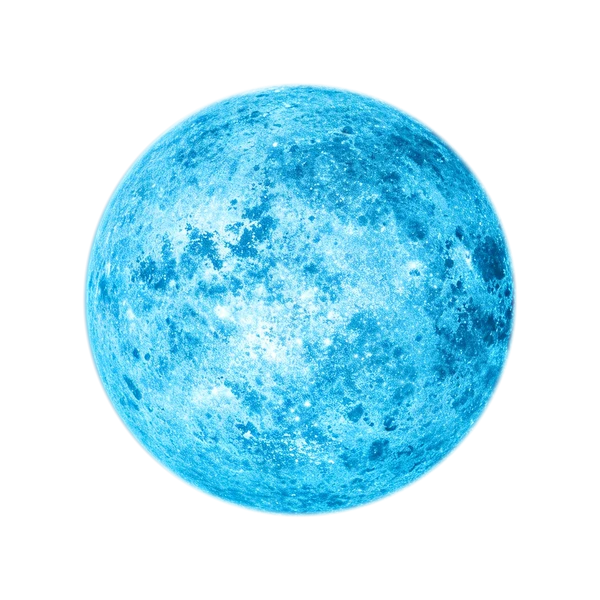

      

        
手枪星Pistol Star

        
银河系中心附近的蓝色特超巨星，曾抛出手枪星云，是已知最明亮的恒星之一

        
27.5 M☉308 R☉1.66×10⁶ L☉

      

      恒星
    </a>
  </article>
  <article class="astro-card" data-category="star" data-name="史蒂文森 2-18 Stephenson 2-18" data-mass="2.38608e+31" data-radius="1495755000.0" data-density="1.7e-09" data-temp="2926.8" data-period="" data-moons="">
    <a class="astro-card-link" href="objects/stephenson_2_18/">
      

      

        
史蒂文森 2-18Stephenson 2-18

        
位于盾牌座方向的红超巨星，是目前已知体积最大的恒星之一

        
12 M☉2,150 R☉4.37×10⁵ L☉

      

      恒星
    </a>
  </article>
  <article class="astro-card" data-category="star" data-name="大角星 Arcturus" data-mass="2.1474720000000002e+30" data-radius="17670780.0" data-density="9.2912e-05" data-temp="4016.8" data-period="" data-moons="">
    <a class="astro-card-link" href="objects/arcturus/">
      
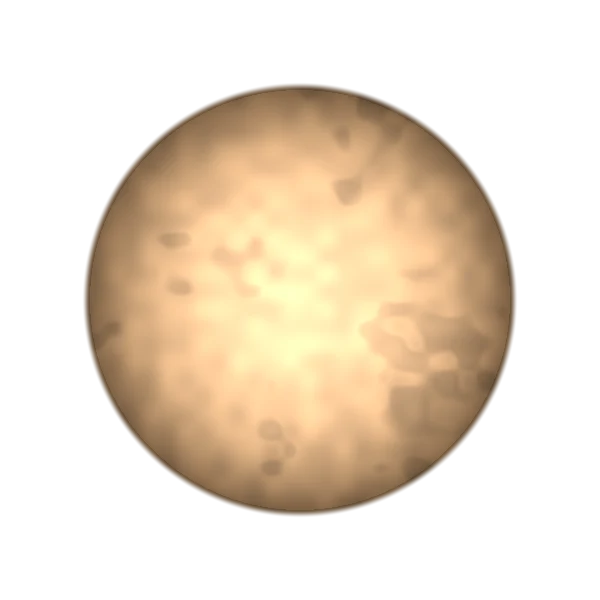

      

        
大角星Arcturus

        
牧夫座的最亮星，一颗橙色的红巨星，是夜空中最亮的恒星之一

        
1.08 M☉25.4 R☉170 L☉

      

      恒星
    </a>
  </article>
  <article class="astro-card" data-category="star" data-name="心宿二 Antares" data-mass="3.08202e+31" data-radius="473076000.0" data-density="6.95e-08" data-temp="3126.8" data-period="" data-moons="">
    <a class="astro-card-link" href="objects/antares/">
      

      

        
心宿二Antares

        
天蝎座α，代表“蝎子的心脏”，一颗明亮的红超巨星（“大火”）

        
15.5 M☉680 R☉7.59×10⁴ L☉

      

      恒星
    </a>
  </article>
  <article class="astro-card" data-category="star" data-name="参宿七 Rigel" data-mass="4.17564e+31" data-radius="54264600.0" data-density="6.23856e-05" data-temp="11826.9" data-period="" data-moons="">
    <a class="astro-card-link" href="objects/rigel/">
      
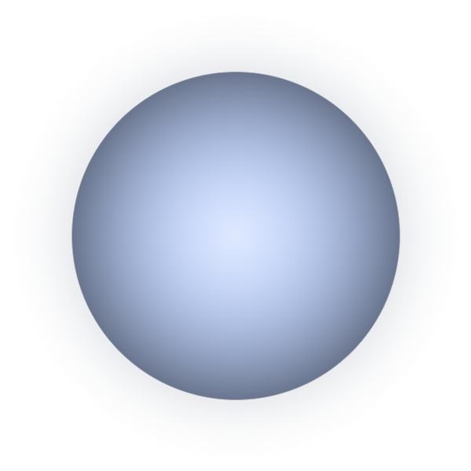

      

        
参宿七Rigel

        
猎户座β，全天第七亮星，一颗蓝白色的蓝超巨星

        
21 M☉78 R☉1.2×10⁵ L☉

      

      恒星
    </a>
  </article>
  <article class="astro-card" data-category="star" data-name="参宿四 Betelgeuse" data-mass="2.78376e+31" data-radius="531514800.0" data-density="4.43e-08" data-temp="3326.8" data-period="" data-moons="">
    <a class="astro-card-link" href="objects/betelgeuse/">
      

      

        
参宿四Betelgeuse

        
猎户座α，一颗著名的红超巨星，亮度不规则变化，最接近地球的红超巨星之一

        
14 M☉764 R☉8.71×10⁴ L☉

      

      恒星
    </a>
  </article>
  <article class="astro-card" data-category="star" data-name="织女星 Vega" data-mass="4.2551760000000005e+30" data-radius="1641852.0" data-density="0.2295233635" data-temp="9326.9" data-period="" data-moons="">
    <a class="astro-card-link" href="objects/vega/">
      
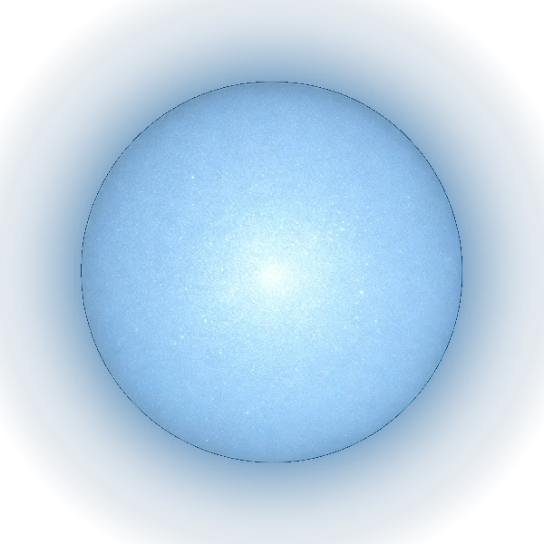

      

        
织女星Vega

        
天琴座α，夏季大三角的顶点，一颗 A 型主序星，曾是北极星

        
2.14 M☉2.36 R☉40 L☉

      

      恒星
    </a>
  </article>
  <article class="astro-card" data-category="star" data-name="天狼星 A Sirius A" data-mass="4.096104e+30" data-radius="1189647.0" data-density="0.5808018945" data-temp="9666.9" data-period="" data-moons="">
    <a class="astro-card-link" href="objects/sirius_a/">
      
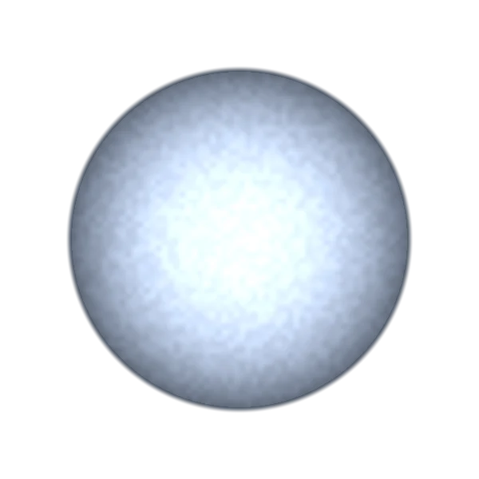

      

        
天狼星 ASirius A

        
大犬座α的主星，夜空中最亮的恒星，一颗 A 型主序星

        
2.06 M☉1.71 R☉25 L☉

      

      恒星
    </a>
  </article>
  <article class="astro-card" data-category="star" data-name="比邻星 Proxima Centauri" data-mass="2.425848e+29" data-radius="107137.8" data-density="47.0919639904" data-temp="2766.8" data-period="" data-moons="">
    <a class="astro-card-link" href="objects/proxima_centauri/">
      
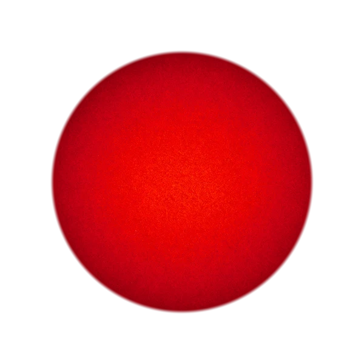

      

        
比邻星Proxima Centauri

        
半人马座α三星系统的成员，距离太阳最近的恒星，一颗暗弱的红矮星

        
0.122 M☉0.154 R☉0.0017 L☉

      

      恒星
    </a>
  </article>
  <article class="astro-card" data-category="black_hole" data-name="M87* M87*" data-mass="1.29246e+40" data-radius="19196125520.0" data-density="" data-temp="" data-period="" data-moons="">
    <a class="astro-card-link" href="objects/m87_star/">
      
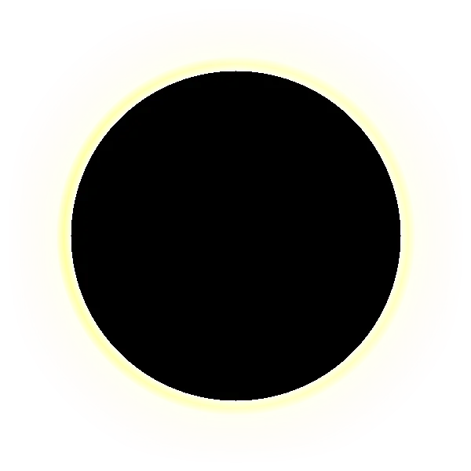

      

        
M87*M87*

        
人类拍下的第一张黑洞照片主角，室女座星系团中心的超大质量黑洞

        
6.5×10⁹ M☉128 AU

      

      黑洞
    </a>
  </article>
  <article class="astro-card" data-category="black_hole" data-name="人马座 A* Sagittarius A*" data-mass="8.5441548e+36" data-radius="12690115.59376" data-density="" data-temp="" data-period="" data-moons="">
    <a class="astro-card-link" href="objects/sgr_a_star/">
      
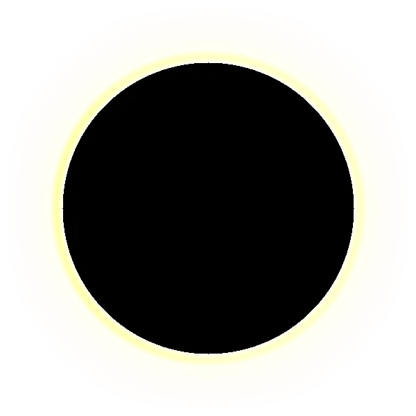

      

        
人马座 A*Sagittarius A*

        
银河系中心的超大质量黑洞，2022 年人类拍下第二张黑洞照片

        
4.3×10⁶ M☉12,690,116 km

      

      黑洞
    </a>
  </article>
  <article class="astro-card" data-category="black_hole" data-name="TON 618 TON 618" data-mass="1.312344e+41" data-radius="194914505280.0" data-density="" data-temp="" data-period="" data-moons="">
    <a class="astro-card-link" href="objects/ton618/">
      
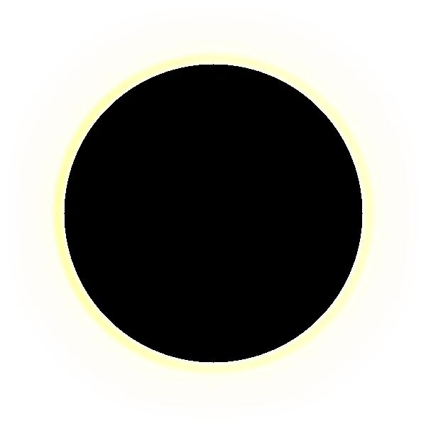

      

        
TON 618TON 618

        
已知质量最大的黑洞之一，660 亿倍太阳质量的类星体引擎

        
6.6×10¹⁰ M☉1.3e+03 AU

      

      黑洞
    </a>
  </article>
  <article class="astro-card" data-category="black_hole" data-name="IC 1101 中心黑洞 IC 1101 black hole" data-mass="9.942e+40" data-radius="147662504000.0" data-density="" data-temp="" data-period="" data-moons="">
    <a class="astro-card-link" href="objects/ic1101_bh/">
      
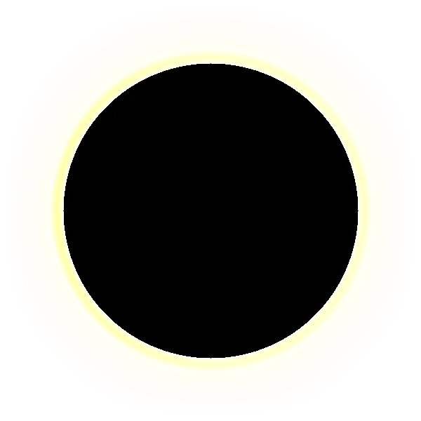

      

        
IC 1101 中心黑洞IC 1101 black hole

        
IC 1101 星系核心的黑洞，质量估值在天文界争议极大

        
5×10¹⁰ M☉987 AU

      

      黑洞
    </a>
  </article>
  <article class="astro-card" data-category="black_hole" data-name="GW190521 GW190521" data-mass="2.823528e+32" data-radius="419.36151136" data-density="" data-temp="" data-period="" data-moons="">
    <a class="astro-card-link" href="objects/gw190521/">
      
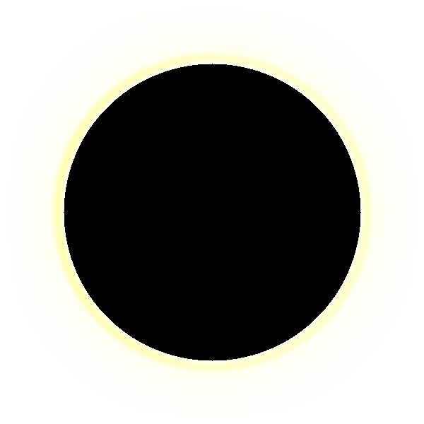

      

        
GW190521GW190521

        
人类确认的第一个中等质量黑洞，双黑洞并合的产物

        
142 M☉419 km

      

      黑洞
    </a>
  </article>
  <article class="astro-card" data-category="black_hole" data-name="天鹅座 X-1 Cygnus X-1" data-mass="4.215408e+31" data-radius="62.608901696000004" data-density="" data-temp="" data-period="" data-moons="">
    <a class="astro-card-link" href="objects/cyg_x1/">
      
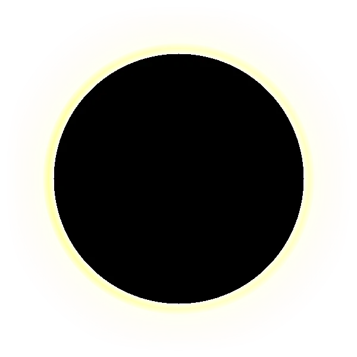

      

        
天鹅座 X-1Cygnus X-1

        
人类确认的第一个恒星级黑洞，霍金打赌输掉的那位

        
21.2 M☉63 km

      

      黑洞
    </a>
  </article>
  <article class="astro-card" data-category="black_hole" data-name="V404 天鹅座 V404 Cygni" data-mass="1.7895599999999999e+31" data-radius="26.57925072" data-density="" data-temp="" data-period="" data-moons="">
    <a class="astro-card-link" href="objects/v404_cyg/">
      
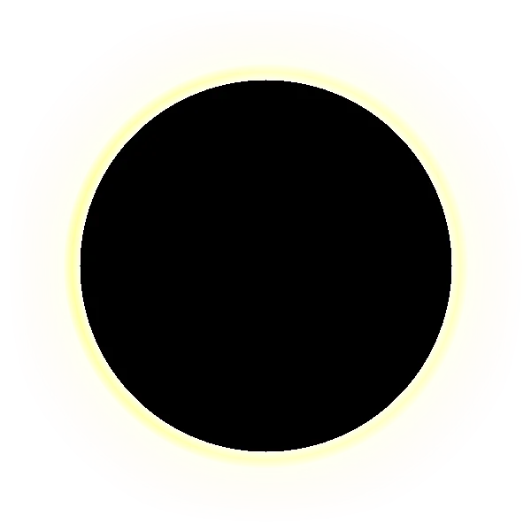

      

        
V404 天鹅座V404 Cygni

        
低质量 X 射线双星，2015 年剧烈爆发出名的黑洞

        
9 M☉27 km

      

      黑洞
    </a>
  </article>
  <article class="astro-card" data-category="nebula" data-name="猎户座大星云 Orion Nebula (M42)" data-mass="" data-radius="113528400000000.0" data-density="" data-temp="9727" data-period="" data-moons="">
    <a class="astro-card-link" href="objects/m42/">
      
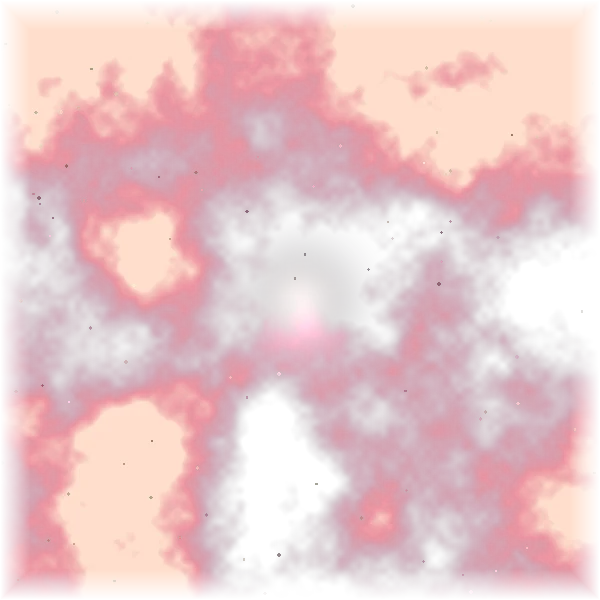

      

        
猎户座大星云Orion Nebula (M42)

        
冬夜最亮的星云，银河系最近的恒星摇篮之一

        
12 光年10000 K

      

      星云
    </a>
  </article>
  <article class="astro-card" data-category="nebula" data-name="蟹状星云 Crab Nebula (M1)" data-mass="" data-radius="52033850000000.0" data-density="" data-temp="" data-period="" data-moons="">
    <a class="astro-card-link" href="objects/m1/">
      
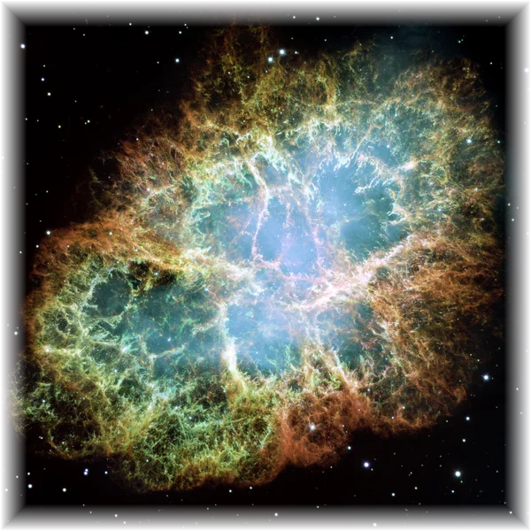

      

        
蟹状星云Crab Nebula (M1)

        
北宋天文学家见证的超新星残骸，宇宙中最著名的遗迹星云

        
6 光年

      

      星云
    </a>
  </article>
  <article class="astro-card" data-category="nebula" data-name="鹰状星云 Eagle Nebula (M16)" data-mass="" data-radius="331124500000000.0" data-density="" data-temp="" data-period="" data-moons="">
    <a class="astro-card-link" href="objects/m16/">
      
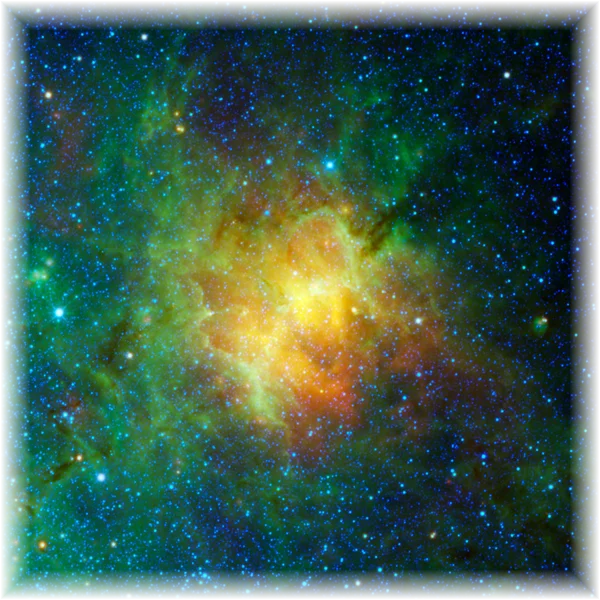

      

        
鹰状星云Eagle Nebula (M16)

        
哈勃「创生之柱」的故乡，巨蛇座里的恒星工厂

        
35 光年

      

      星云
    </a>
  </article>
  <article class="astro-card" data-category="nebula" data-name="三叶星云 Trifid Nebula (M20)" data-mass="" data-radius="189214000000000.0" data-density="" data-temp="" data-period="" data-moons="">
    <a class="astro-card-link" href="objects/m20/">
      
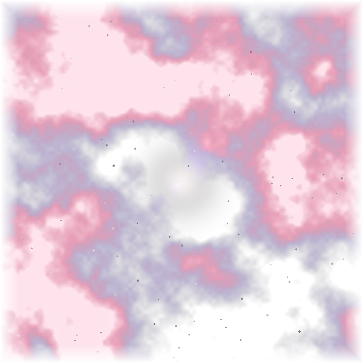

      

        
三叶星云Trifid Nebula (M20)

        
发射、反射与暗带三合一的彩色星云，人马座里的调色盘

        
20 光年

      

      星云
    </a>
  </article>
  <article class="astro-card" data-category="nebula" data-name="礁湖星云 Lagoon Nebula (M8)" data-mass="" data-radius="425731500000000.0" data-density="" data-temp="" data-period="" data-moons="">
    <a class="astro-card-link" href="objects/m8/">
      
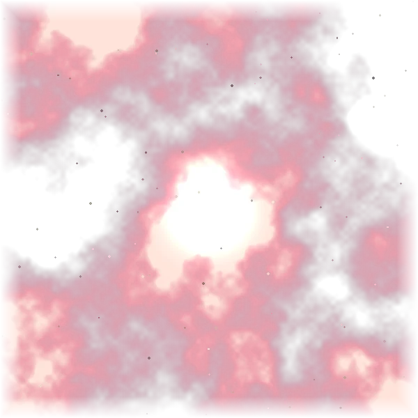

      

        
礁湖星云Lagoon Nebula (M8)

        
人马座里的巨大发射星云，肉眼可见的银河宝库

        
45 光年

      

      星云
    </a>
  </article>
  <article class="astro-card" data-category="nebula" data-name="马头星云 Horsehead Nebula" data-mass="" data-radius="16556225000000.0" data-density="" data-temp="" data-period="" data-moons="">
    <a class="astro-card-link" href="objects/horsehead/">
      
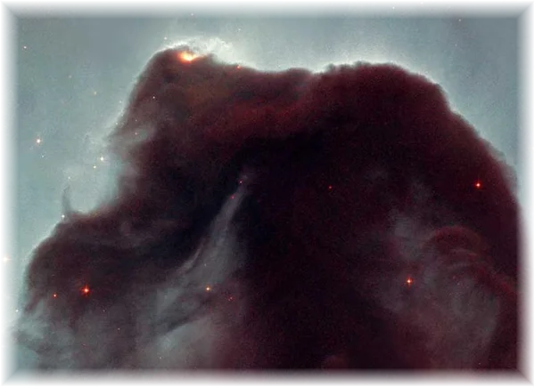

      

        
马头星云Horsehead Nebula

        
猎户座腰带旁的暗尘埃剪影，夜空最 recognizable 的剪影

        
2 光年

      

      星云
    </a>
  </article>
  <article class="astro-card" data-category="nebula" data-name="环状星云 Ring Nebula (M57)" data-mass="" data-radius="12298910000000.0" data-density="" data-temp="" data-period="" data-moons="">
    <a class="astro-card-link" href="objects/m57/">
      
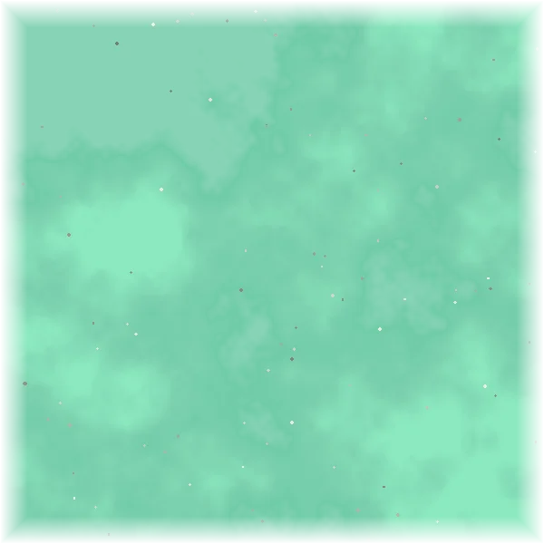

      

        
环状星云Ring Nebula (M57)

        
天琴座里的太空烟圈，恒星暮年的典型肖像

        
1 光年

      

      星云
    </a>
  </article>
  <article class="astro-card" data-category="nebula" data-name="螺旋星云 Helix Nebula (NGC 7293)" data-mass="" data-radius="27152209000000.0" data-density="" data-temp="" data-period="" data-moons="">
    <a class="astro-card-link" href="objects/ngc7293/">
      
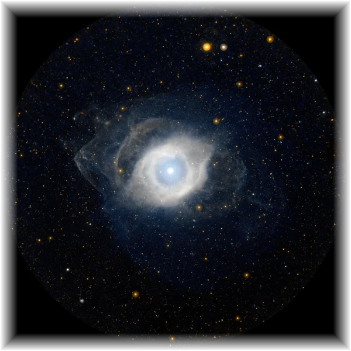

      

        
螺旋星云Helix Nebula (NGC 7293)

        
宝瓶座里的「上帝之眼」，离地球最近的行星状星云

        
3 光年

      

      星云
    </a>
  </article>
  <article class="astro-card" data-category="nebula" data-name="双喷射星星云 M2-9 (Twin Jet Nebula)" data-mass="" data-radius="6622490000000.0" data-density="" data-temp="" data-period="" data-moons="">
    <a class="astro-card-link" href="objects/m2_9/">
      
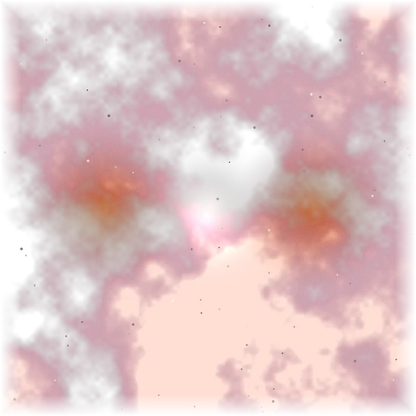

      

        
双喷射星星云M2-9 (Twin Jet Nebula)

        
蛇夫座里的蝶翼状星云，双极喷流的活样本

        
1 光年

      

      星云
    </a>
  </article>
  <article class="astro-card" data-category="nebula" data-name="玫瑰星云 Rosette Nebula" data-mass="" data-radius="614945500000000.0" data-density="" data-temp="" data-period="" data-moons="">
    <a class="astro-card-link" href="objects/rosette/">
      
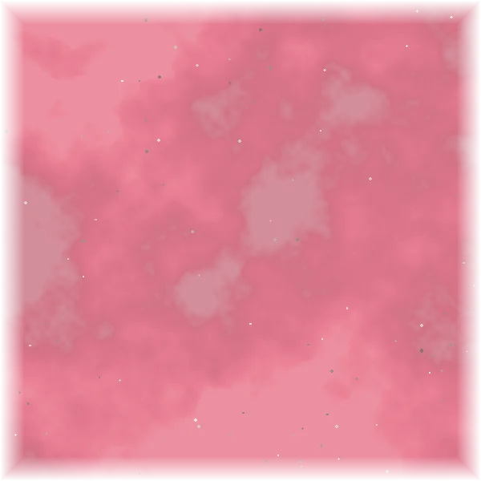

      

        
玫瑰星云Rosette Nebula

        
麒麟座里盛开的宇宙玫瑰，直径逾百光年的发射星云

        
65 光年

      

      星云
    </a>
  </article>
  <article class="astro-card" data-category="nebula" data-name="巴纳德环 Barnard's Loop" data-mass="" data-radius="1419105000000000.0" data-density="" data-temp="" data-period="" data-moons="">
    <a class="astro-card-link" href="objects/barnards_loop/">
      
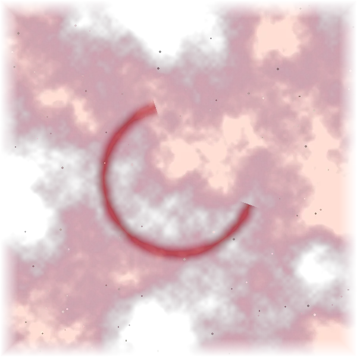

      

        
巴纳德环Barnard's Loop

        
横跨猎户座大半边的巨大圆弧，可能源于数百万年前的一次超新星

        
150 光年

      

      星云
    </a>
  </article>
  <article class="astro-card" data-category="nebula" data-name="蜘蛛星云 Tarantula Nebula (30 Doradus)" data-mass="" data-radius="4730350000000000.0" data-density="" data-temp="" data-period="" data-moons="">
    <a class="astro-card-link" href="objects/tarantula/">
      
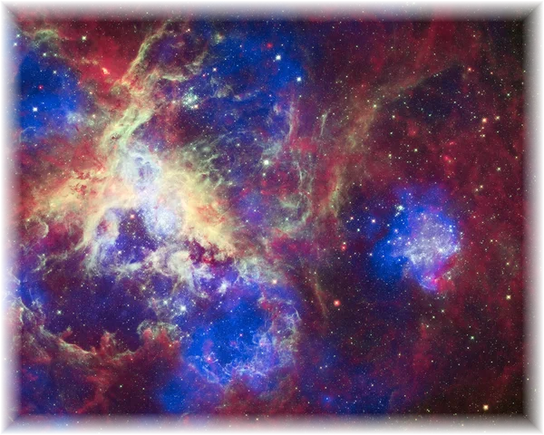

      

        
蜘蛛星云Tarantula Nebula (30 Doradus)

        
大麦哲伦云里的巨型恒星工厂，本星系群最活跃的星云

        
500 光年

      

      星云
    </a>
  </article>
  <article class="astro-card" data-category="galaxy" data-name="银河系 Milky Way" data-mass="2.9826e+42" data-radius="4.73035e+17" data-density="" data-temp="" data-period="" data-moons="">
    <a class="astro-card-link" href="objects/milky_way/">
      
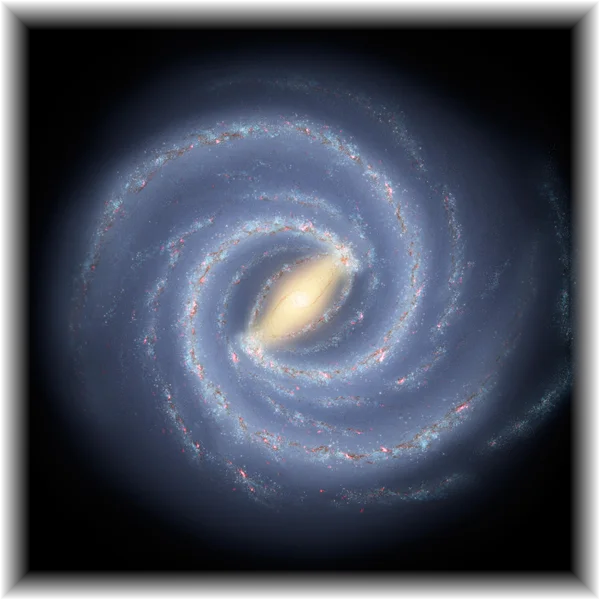

      

        
银河系Milky Way

        
我们的家园星系，太阳系所在的棒旋星系

        
1.5×10¹² M☉50,000 光年2.5×10¹⁰ L☉

      

      星系
    </a>
  </article>
  <article class="astro-card" data-category="galaxy" data-name="仙女座星系 Andromeda Galaxy (M31)" data-mass="2.9826e+42" data-radius="1.040677e+18" data-density="" data-temp="" data-period="" data-moons="">
    <a class="astro-card-link" href="objects/m31/">
      
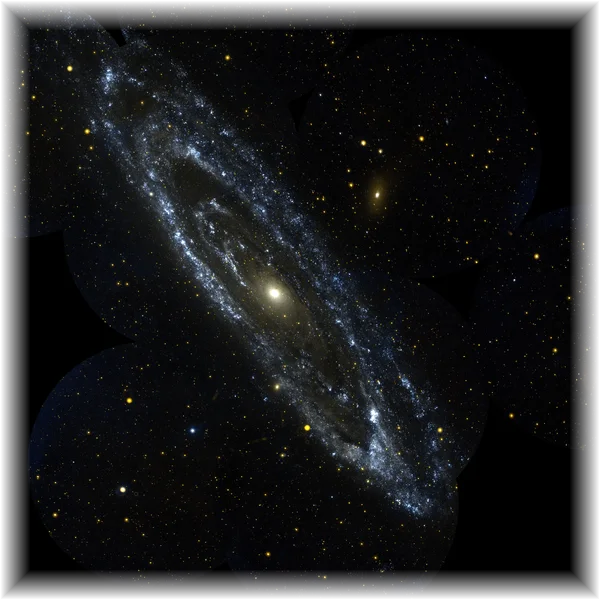

      

        
仙女座星系Andromeda Galaxy (M31)

        
本星系群最大的星系，肉眼可见的银河系近邻

        
1.5×10¹² M☉110,000 光年

      

      星系
    </a>
  </article>
  <article class="astro-card" data-category="galaxy" data-name="三角座星系 Triangulum Galaxy (M33)" data-mass="9.942e+40" data-radius="2.89118992e+17" data-density="" data-temp="" data-period="" data-moons="">
    <a class="astro-card-link" href="objects/m33/">
      
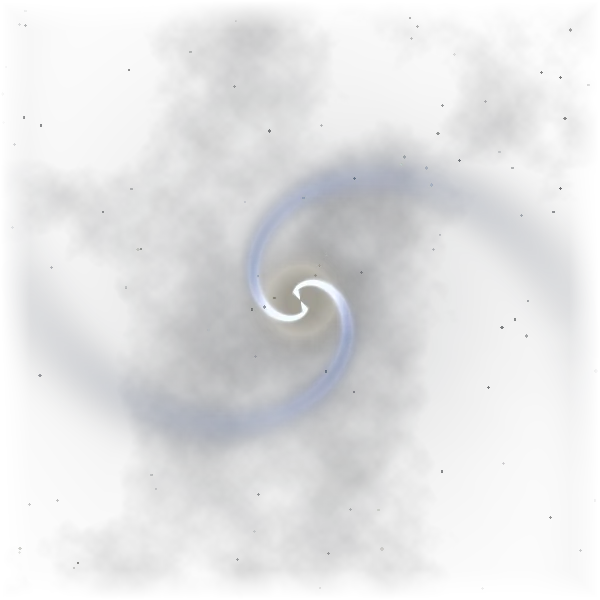

      

        
三角座星系Triangulum Galaxy (M33)

        
本星系群第三大星系，肉眼极限的松散旋涡

        
5×10¹⁰ M☉30,560 光年

      

      星系
    </a>
  </article>
  <article class="astro-card" data-category="galaxy" data-name="大麦哲伦云 Large Magellanic Cloud" data-mass="1.9884e+40" data-radius="6.62249e+16" data-density="" data-temp="" data-period="" data-moons="">
    <a class="astro-card-link" href="objects/lmc/">
      
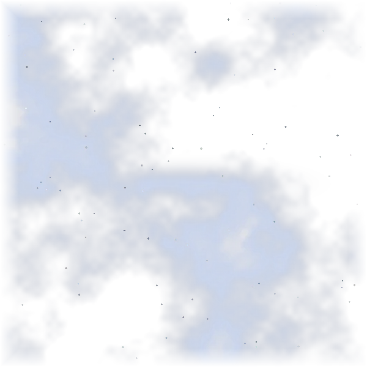

      

        
大麦哲伦云Large Magellanic Cloud

        
银河系最大的卫星星系，南天夜空中挂着的模糊云块

        
1×10¹⁰ M☉7,000 光年

      

      星系
    </a>
  </article>
  <article class="astro-card" data-category="galaxy" data-name="小麦哲伦云 Small Magellanic Cloud" data-mass="1.29246e+40" data-radius="3.311245e+16" data-density="" data-temp="" data-period="" data-moons="">
    <a class="astro-card-link" href="objects/smc/">
      
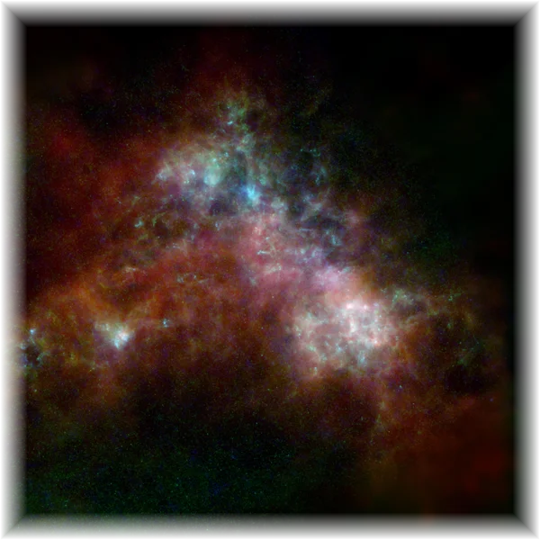

      

        
小麦哲伦云Small Magellanic Cloud

        
大麦哲伦云的伴侣，南天第二矮星系

        
6.5×10⁹ M☉3,500 光年

      

      星系
    </a>
  </article>
  <article class="astro-card" data-category="galaxy" data-name="室女座 A（M87） Messier 87" data-mass="4.77216e+42" data-radius="1.135284e+18" data-density="" data-temp="" data-period="" data-moons="">
    <a class="astro-card-link" href="objects/m87/">
      
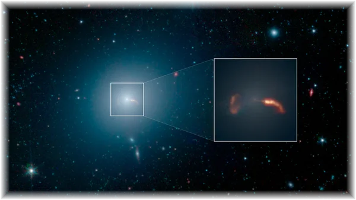

      

        
室女座 A（M87）Messier 87

        
室女座星系团中心的巨型椭圆星系，万亿级恒星都会

        
2.4×10¹² M☉120,000 光年

      

      星系
    </a>
  </article>
  <article class="astro-card" data-category="galaxy" data-name="草帽星系 Sombrero Galaxy (M104)" data-mass="1.59072e+42" data-radius="2.365175e+17" data-density="" data-temp="" data-period="" data-moons="">
    <a class="astro-card-link" href="objects/m104/">
      
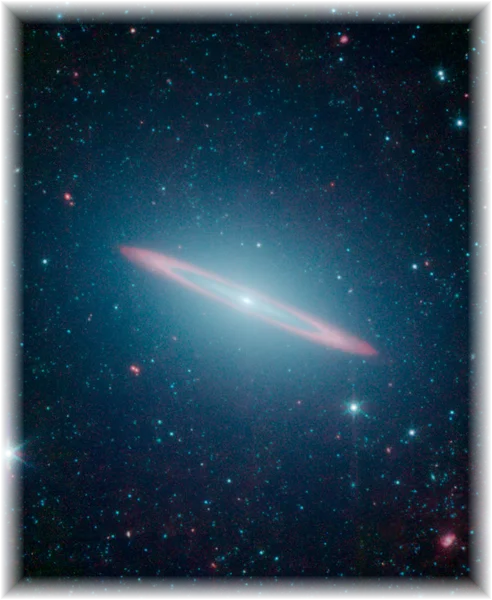

      

        
草帽星系Sombrero Galaxy (M104)

        
侧视的旋涡星系，草帽外形来自它巨大的核球与尘埃环

        
8×10¹¹ M☉25,000 光年

      

      星系
    </a>
  </article>
  <article class="astro-card" data-category="galaxy" data-name="涡状星系 Whirlpool Galaxy (M51)" data-mass="3.18144e+41" data-radius="3.63763915e+17" data-density="" data-temp="" data-period="" data-moons="">
    <a class="astro-card-link" href="objects/m51/">
      
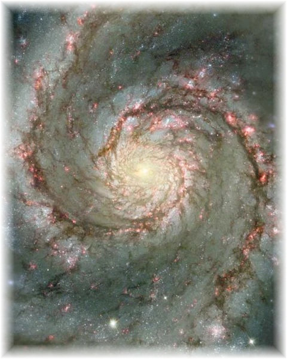

      

        
涡状星系Whirlpool Galaxy (M51)

        
人类发现旋涡结构的第一个星系，与伴星系共舞的经典标范

        
1.6×10¹¹ M☉38,450 光年

      

      星系
    </a>
  </article>
  <article class="astro-card" data-category="galaxy" data-name="波德星系 Messier 81" data-mass="" data-radius="4.446529e+17" data-density="" data-temp="" data-period="" data-moons="">
    <a class="astro-card-link" href="objects/m81/">
      
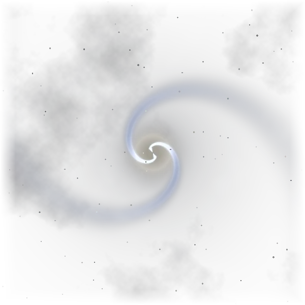

      

        
波德星系Messier 81

        
北斗七星附近的完美旋涡，与 M82 组成经典相互作用对

        
47,000 光年

      

      星系
    </a>
  </article>
  <article class="astro-card" data-category="galaxy" data-name="雪茄星系 Messier 82 (Cigar Galaxy)" data-mass="" data-radius="1.7502295e+17" data-density="" data-temp="" data-period="" data-moons="">
    <a class="astro-card-link" href="objects/m82/">
      
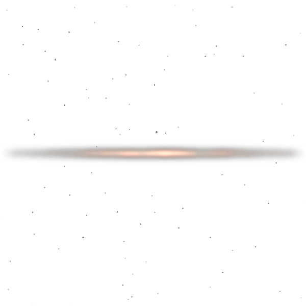

      

        
雪茄星系Messier 82 (Cigar Galaxy)

        
著名的星暴星系，恒星诞生的速度是银河系的十倍

        
18,500 光年

      

      星系
    </a>
  </article>
  <article class="astro-card" data-category="galaxy" data-name="NGC 1300 NGC 1300" data-mass="" data-radius="5.203385e+17" data-density="" data-temp="" data-period="" data-moons="">
    <a class="astro-card-link" href="objects/ngc1300/">
      
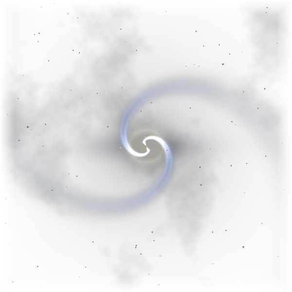

      

        
NGC 1300NGC 1300

        
棒旋星系的教科书标本，波江座里的巨大风车

        
55,000 光年

      

      星系
    </a>
  </article>
  <article class="astro-card" data-category="galaxy" data-name="IC 1101 IC 1101" data-mass="" data-radius="8.041595e+18" data-density="" data-temp="" data-period="" data-moons="">
    <a class="astro-card-link" href="objects/ic1101/">
      
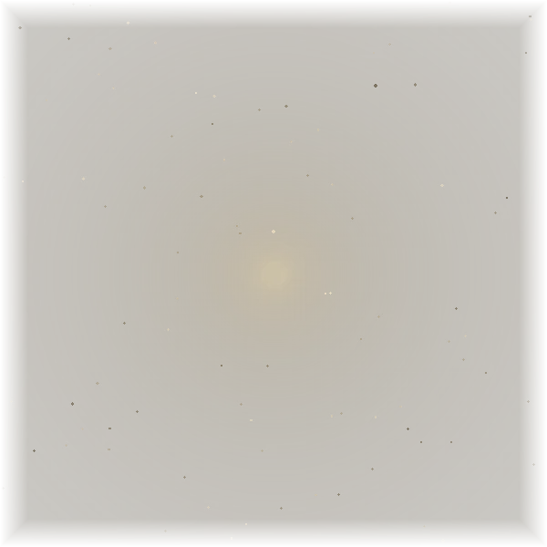

      

        
IC 1101IC 1101

        
已知直径最大的星系之一，宇宙中的巨型椭圆巨兽

        
850,000 光年

      

      星系
    </a>
  </article>
  <article class="astro-card" data-category="galaxy" data-name="斯蒂芬五重星系 Stephan's Quintet" data-mass="" data-radius="1.6556225e+18" data-density="" data-temp="" data-period="" data-moons="">
    <a class="astro-card-link" href="objects/stephens_quintet/">
      
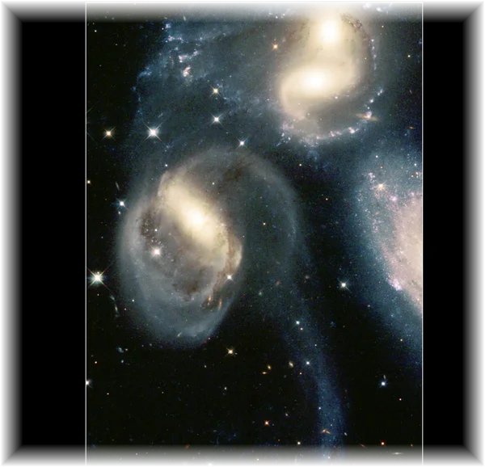

      

        
斯蒂芬五重星系Stephan's Quintet

        
五个星系的引力共舞，韦布镜头下的宇宙慢镜头并合

        
175,000 光年

      

      星系
    </a>
  </article>
  <article class="astro-card" data-category="cluster" data-name="昴星团 Pleiades (M45)" data-mass="1.59072e+33" data-radius="67170970000000.0" data-density="" data-temp="" data-period="" data-moons="">
    <a class="astro-card-link" href="objects/m45/">
      
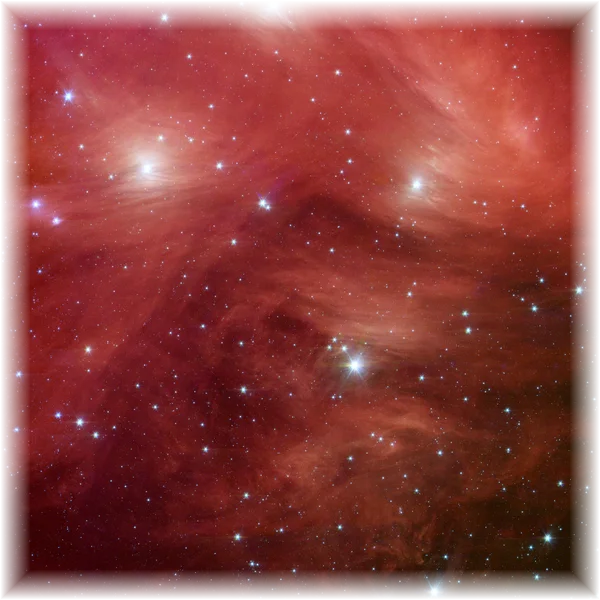

      

        
昴星团Pleiades (M45)

        
七姐妹星团，冬夜最易辨认的蓝色小勺

        
800 M☉7 光年

      

      星团
    </a>
  </article>
  <article class="astro-card" data-category="cluster" data-name="毕星团 Hyades" data-mass="7.9536e+32" data-radius="69536145000000.0" data-density="" data-temp="" data-period="" data-moons="">
    <a class="astro-card-link" href="objects/hyades/">
      
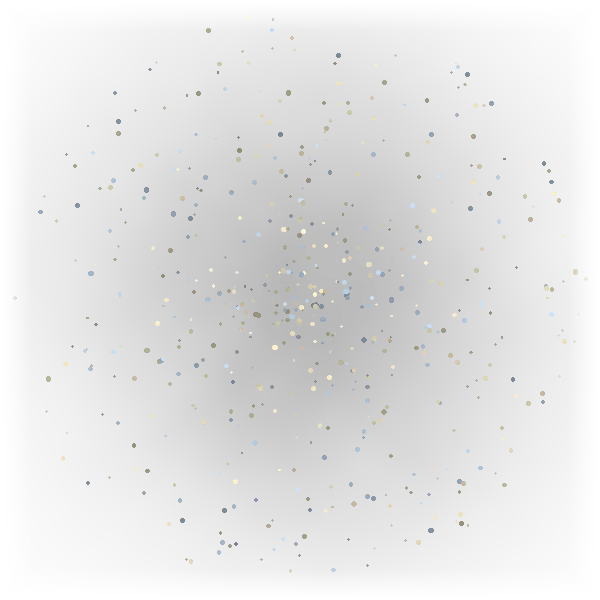

      

        
毕星团Hyades

        
金牛座的 V 形头部，离太阳最近的疏散星团之一

        
400 M☉7 光年

      

      星团
    </a>
  </article>
  <article class="astro-card" data-category="cluster" data-name="蜂巢星团 Beehive Cluster (M44)" data-mass="1.09362e+33" data-radius="75685600000000.0" data-density="" data-temp="" data-period="" data-moons="">
    <a class="astro-card-link" href="objects/m44/">
      
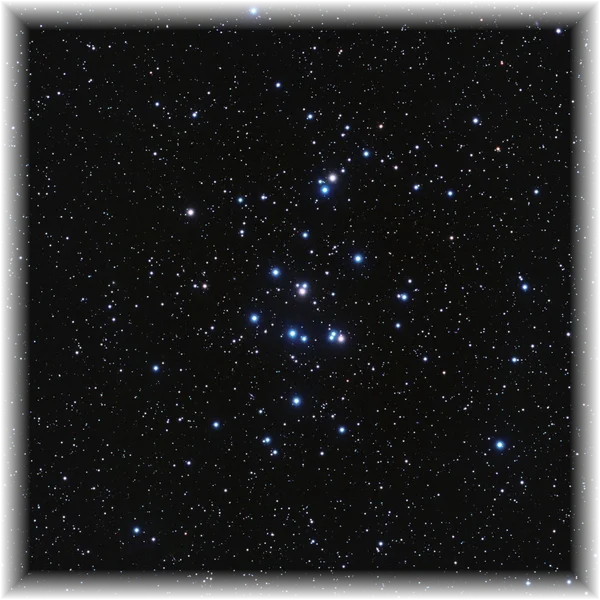

      

        
蜂巢星团Beehive Cluster (M44)

        
巨蟹座腹中的蜂巢，双筒望远镜里的经典星团

        
550 M☉8 光年

      

      星团
    </a>
  </article>
  <article class="astro-card" data-category="cluster" data-name="梅西耶 67 Messier 67" data-mass="2.18724e+33" data-radius="94607000000000.0" data-density="" data-temp="" data-period="" data-moons="">
    <a class="astro-card-link" href="objects/m67/">
      
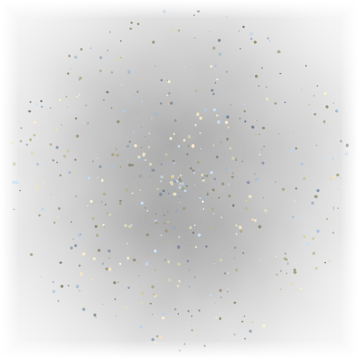

      

        
梅西耶 67Messier 67

        
著名的古老疏散星团，曾被猜想为太阳的出生地

        
1.1×10³ M☉10 光年

      

      星团
    </a>
  </article>
  <article class="astro-card" data-category="cluster" data-name="R136 星团 R136" data-mass="1.9884e+35" data-radius="47303500000000.0" data-density="" data-temp="" data-period="" data-moons="">
    <a class="astro-card-link" href="objects/r136/">
      
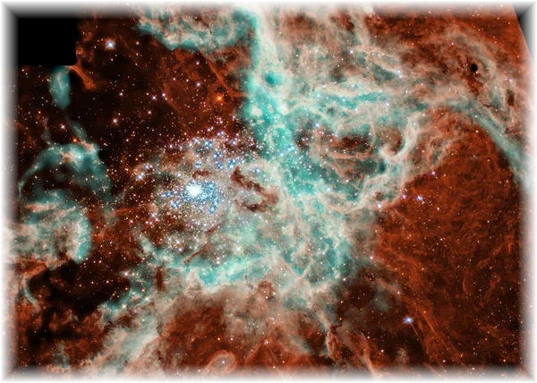

      

        
R136 星团R136

        
蜘蛛星云核心的超级星团，已知最亮恒星的故乡

        
1×10⁵ M☉5 光年

      

      星团
    </a>
  </article>
  <article class="astro-card" data-category="cluster" data-name="武仙座球状星团 Messier 13" data-mass="1.19304e+36" data-radius="685900750000000.0" data-density="" data-temp="" data-period="" data-moons="">
    <a class="astro-card-link" href="objects/m13/">
      
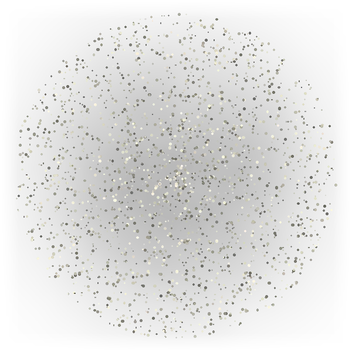

      

        
武仙座球状星团Messier 13

        
北天最壮观的球状星团，武仙座里的 30 万颗恒星球

        
6×10⁵ M☉72 光年

      

      星团
    </a>
  </article>
  <article class="astro-card" data-category="cluster" data-name="梅西耶 22 Messier 22" data-mass="" data-radius="473035000000000.0" data-density="" data-temp="" data-period="" data-moons="">
    <a class="astro-card-link" href="objects/m22/">
      
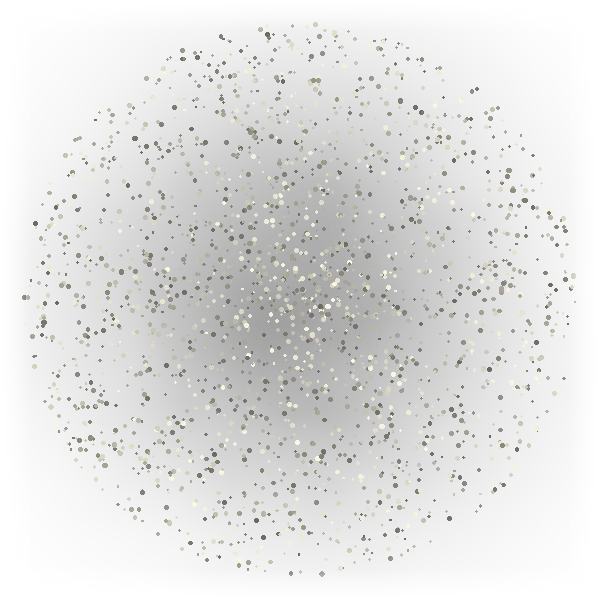

      

        
梅西耶 22Messier 22

        
人马座里的明亮球状星团，肉眼可见的古老恒星城

        
50 光年

      

      星团
    </a>
  </article>
  <article class="astro-card" data-category="cluster" data-name="半人马座 ω Omega Centauri" data-mass="7.9536e+36" data-radius="785238100000000.0" data-density="" data-temp="" data-period="" data-moons="">
    <a class="astro-card-link" href="objects/omega_cen/">
      
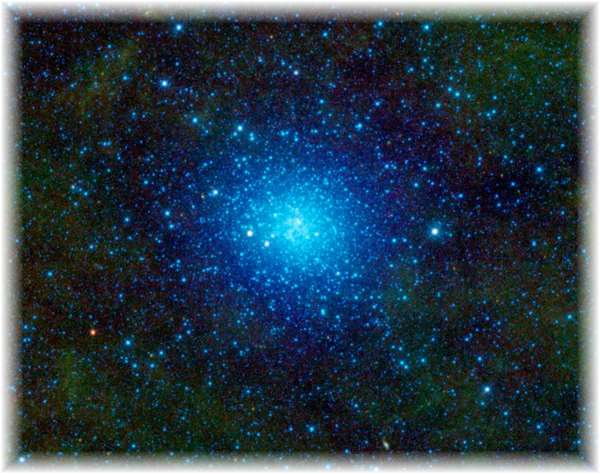

      

        
半人马座 ωOmega Centauri

        
银河系最大的球状星团，疑为被吞噬矮星系的残核

        
4×10⁶ M☉83 光年

      

      星团
    </a>
  </article>
  <article class="astro-card" data-category="structure" data-name="本星系群 Local Group" data-mass="5.9652e+42" data-radius="4.73035e+19" data-density="" data-temp="" data-period="" data-moons="">
    <a class="astro-card-link" href="objects/local_group/">
      
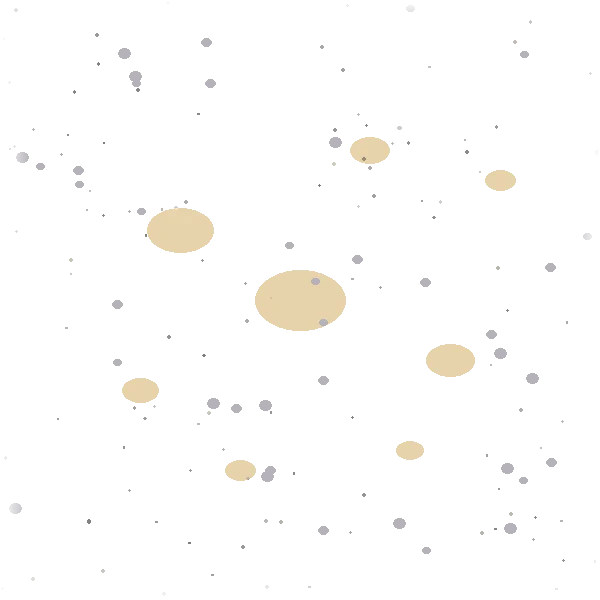

      

        
本星系群Local Group

        
银河系所属的星系社群，80 多个星系的小团体

        
3×10¹² M☉5,000,000 光年

      

      大尺度结构
    </a>
  </article>
  <article class="astro-card" data-category="structure" data-name="室女座星系团 Virgo Cluster" data-mass="2.38608e+45" data-radius="7.095525e+19" data-density="" data-temp="" data-period="" data-moons="">
    <a class="astro-card-link" href="objects/virgo_cluster/">
      
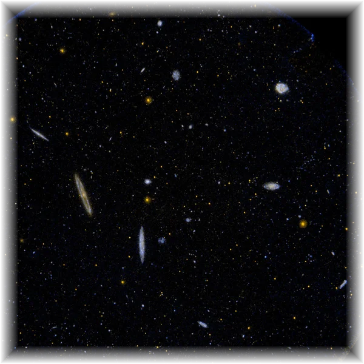

      

        
室女座星系团Virgo Cluster

        
离我们最近的大型星系团，上千个星系的引力都会

        
1.2×10¹⁵ M☉7,500,000 光年

      

      大尺度结构
    </a>
  </article>
  <article class="astro-card" data-category="structure" data-name="拉尼亚凯亚超星系团 Laniakea Supercluster" data-mass="1.9884e+47" data-radius="2.459782e+21" data-density="" data-temp="" data-period="" data-moons="">
    <a class="astro-card-link" href="objects/laniakea/">
      
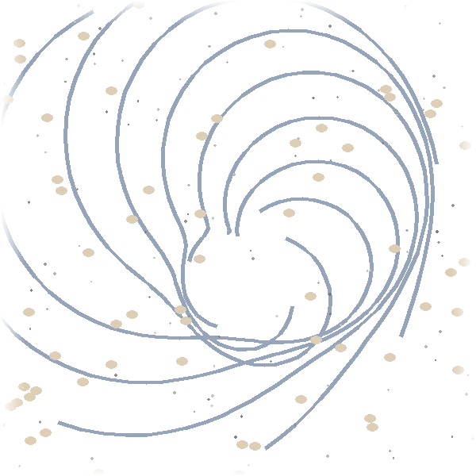

      

        
拉尼亚凯亚超星系团Laniakea Supercluster

        
银河系所在的家园超星系团，十万个星系的洪流盆地

        
1×10¹⁷ M☉260,000,000 光年

      

      大尺度结构
    </a>
  </article>
  <article class="astro-card" data-category="structure" data-name="巨引源 Great Attractor" data-mass="1.9884e+46" data-radius="1.89214e+21" data-density="" data-temp="" data-period="" data-moons="">
    <a class="astro-card-link" href="objects/great_attractor/">
      
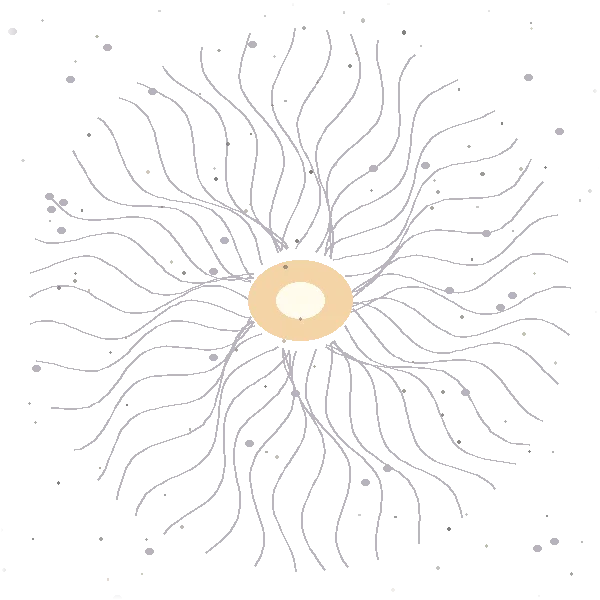

      

        
巨引源Great Attractor

        
隐匿在银河盘面背后的引力深渊，牵引着本超星系团

        
1×10¹⁶ M☉200,000,000 光年

      

      大尺度结构
    </a>
  </article>
  <article class="astro-card" data-category="structure" data-name="武仙-北冕座长城 Hercules–Corona Borealis Great Wall" data-mass="1.9884e+48" data-radius="4.73035e+22" data-density="" data-temp="" data-period="" data-moons="">
    <a class="astro-card-link" href="objects/hercules_corona_wall/">
      

      

        
武仙-北冕座长城Hercules–Corona Borealis Great Wall

        
已知最大的宇宙结构之一，横跨百亿光年的星系巨墙

        
1×10¹⁸ M☉5,000,000,000 光年

      

      大尺度结构
    </a>
  </article>
  <article class="astro-card" data-category="structure" data-name="宇宙微波背景 Cosmic Microwave Background" data-mass="" data-radius="4.3235399e+23" data-density="" data-temp="-270.425" data-period="" data-moons="">
    <a class="astro-card-link" href="objects/cmb/">
      

      

        
宇宙微波背景Cosmic Microwave Background

        
大爆炸的余晖，宇宙最古老的光（最后散射面）

        
45,700,000,000 光年3 K

      

      大尺度结构
    </a>
  </article>
  <article class="astro-card" data-category="structure" data-name="可观测宇宙 Observable Universe" data-mass="1.5e+53" data-radius="4.3992255e+23" data-density="" data-temp="-270.42" data-period="" data-moons="">
    <a class="astro-card-link" href="objects/observable_universe/">
      

      

        
可观测宇宙Observable Universe

        
以地球为球心的粒子视界，人类信息的全部边疆

        
7.54×10²² M☉46,500,000,000 光年3 K

      

      大尺度结构
    </a>
  </article>
  <article class="astro-card" data-category="nebula" data-name="天鹅星云 Omega Nebula" data-mass="" data-radius="189214000000000.0" data-density="" data-temp="" data-period="" data-moons="">
    <a class="astro-card-link" href="objects/m17/">
      

      

        
天鹅星云Omega Nebula

        
银河系中最亮的发射星云之一，形似一只展翅的天鹅

        
20 光年

      

      星云
    </a>
  </article>
  <article class="astro-card" data-category="nebula" data-name="哑铃星云 Dumbbell Nebula" data-mass="" data-radius="11825875000000.0" data-density="" data-temp="" data-period="" data-moons="">
    <a class="astro-card-link" href="objects/m27/">
      

      

        
哑铃星云Dumbbell Nebula

        
人类发现的第一个行星状星云，形似一只哑铃

        
1 光年

      

      星云
    </a>
  </article>
  <article class="astro-card" data-category="nebula" data-name="船底座星云 Carina Nebula" data-mass="" data-radius="2175961000000000.0" data-density="" data-temp="" data-period="" data-moons="">
    <a class="astro-card-link" href="objects/ngc3372/">
      

      

        
船底座星云Carina Nebula

        
全天最大最亮的星云之一，藏着最不稳定的巨星海山二

        
230 光年

      

      星云
    </a>
  </article>
  <article class="astro-card" data-category="nebula" data-name="北美洲星云 North America Nebula" data-mass="" data-radius="425731500000000.0" data-density="" data-temp="" data-period="" data-moons="">
    <a class="astro-card-link" href="objects/ngc7000/">
      

      

        
北美洲星云North America Nebula

        
形状酷似北美洲大陆的发射星云

        
45 光年

      

      星云
    </a>
  </article>
  <article class="astro-card" data-category="galaxy" data-name="风车星系 Pinwheel Galaxy" data-mass="" data-radius="8.041595e+17" data-density="" data-temp="" data-period="" data-moons="">
    <a class="astro-card-link" href="objects/m101/">
      

      

        
风车星系Pinwheel Galaxy

        
正面朝我们的旋涡星系，旋臂上缀满红色恒星育婴室

        
85,000 光年2.6×10¹⁰ L☉

      

      星系
    </a>
  </article>
  <article class="astro-card" data-category="galaxy" data-name="黑眼星系 Black Eye Galaxy" data-mass="" data-radius="2.554389e+17" data-density="" data-temp="" data-period="" data-moons="">
    <a class="astro-card-link" href="objects/m64/">
      

      

        
黑眼星系Black Eye Galaxy

        
壮丽旋臂前横着一条暗尘埃带，像一只乌黑的眼睛

        
27,000 光年

      

      星系
    </a>
  </article>
  <article class="astro-card" data-category="galaxy" data-name="南风车星系 Southern Pinwheel Galaxy" data-mass="" data-radius="2.6016925e+17" data-density="" data-temp="" data-period="" data-moons="">
    <a class="astro-card-link" href="objects/m83/">
      

      

        
南风车星系Southern Pinwheel Galaxy

        
南天最亮的旋涡星系之一，恒星爆发此起彼伏

        
27,500 光年

      

      星系
    </a>
  </article>
  <article class="astro-card" data-category="galaxy" data-name="半人马 A Centaurus A" data-mass="" data-radius="2.83821e+17" data-density="" data-temp="" data-period="" data-moons="">
    <a class="astro-card-link" href="objects/ngc5128/">
      

      

        
半人马 ACentaurus A

        
被一条厚重尘埃带拦腰横穿的并合遗迹星系

        
30,000 光年

      

      星系
    </a>
  </article>
  <article class="astro-card" data-category="galaxy" data-name="天线星系 Antennae Galaxies" data-mass="" data-radius="2.365175e+18" data-density="" data-temp="" data-period="" data-moons="">
    <a class="astro-card-link" href="objects/ngc4038/">
      

      

        
天线星系Antennae Galaxies

        
两个正在撕扯合并的旋涡星系，甩出两条长长的潮汐尾

        
250,000 光年

      

      星系
    </a>
  </article>
  <article class="astro-card" data-category="cluster" data-name="野鸭星团 Wild Duck Cluster" data-mass="" data-radius="236517500000000.0" data-density="" data-temp="" data-period="" data-moons="">
    <a class="astro-card-link" href="objects/m11/">
      

      

        
野鸭星团Wild Duck Cluster

        
数千颗恒星挤成三角阵，像一群列队飞翔的野鸭

        
25 光年

      

      星团
    </a>
  </article>
  <article class="astro-card" data-category="cluster" data-name="托勒密星团 Ptolemy Cluster" data-mass="" data-radius="108798050000000.0" data-density="" data-temp="" data-period="" data-moons="">
    <a class="astro-card-link" href="objects/m7/">
      

      

        
托勒密星团Ptolemy Cluster

        
两千年前就被古人记进星表的疏散星团

        
12 光年

      

      星团
    </a>
  </article>
  <article class="astro-card" data-category="cluster" data-name="珠宝盒星团 Jewel Box Cluster" data-mass="" data-radius="87984510000000.0" data-density="" data-temp="" data-period="" data-moons="">
    <a class="astro-card-link" href="objects/ngc4755/">
      

      

        
珠宝盒星团Jewel Box Cluster

        
蓝超巨星与红超巨星挤在一起，像一匣彩色宝石

        
9 光年

      

      星团
    </a>
  </article>
  <article class="astro-card" data-category="black_hole" data-name="GW150914 并合黑洞 GW150914" data-mass="1.232808e+32" data-radius="183.10150496" data-density="" data-temp="" data-period="" data-moons="">
    <a class="astro-card-link" href="objects/gw150514/">
      

      

        
GW150914 并合黑洞GW150914

        
人类第一个直接探测到的引力波事件：双黑洞并合

        
62 M☉183 km

      

      黑洞
    </a>
  </article>
  <article class="astro-card" data-category="star" data-name="海山二 Eta Carinae" data-mass="" data-radius="41742000.0" data-density="" data-temp="" data-period="" data-moons="">
    <a class="astro-card-link" href="objects/eta_carinae/">
      

      

        
海山二Eta Carinae

        
银河系内最亮的高光度蓝变星，随时可能爆发为超新星

        
60 R☉5×10⁶ L☉

      

      恒星
    </a>
  </article>
  <article class="astro-card" data-category="asteroid" data-name="灶神星 4 Vesta" data-mass="2.59076e+20" data-radius="262.7" data-density="3.456" data-temp="-60" data-period="1325.5" data-moons="">
    <a class="astro-card-link" href="objects/vesta/">
      

      

        
灶神星4 Vesta

        
小行星带的巨型原行星，南极有一个直径 500 公里的超级撞击坑

        
2.59×10²⁰ kg262.7 km-60 °C

      

      小行星
    </a>
  </article>
  <article class="astro-card" data-category="comet" data-name="哈雷彗星 1P/Halley" data-mass="220000000000000.0" data-radius="5.5" data-density="0.6" data-temp="" data-period="27509" data-moons="">
    <a class="astro-card-link" href="objects/halley/">
      

      

        
哈雷彗星1P/Halley

        
每 76 年回归一次的著名周期彗星，肉眼可见的脏雪球

        
2.2×10¹⁴ kg5.5 km0.6 g/cm³

      

      彗星
    </a>
  </article>
  <article class="astro-card" data-category="star" data-name="天狼 B Sirius B" data-mass="2.0241912e+30" data-radius="5634.0" data-density="2702168.3024109127" data-temp="24726.85" data-period="" data-moons="">
    <a class="astro-card-link" href="objects/sirius_b/">
      

      

        
天狼 BSirius B

        
质量与太阳相当，体积却只有地球大小——最早被发现的白矮星

        
1.02 M☉0.0081 R☉0.0245 L☉

      

      恒星
    </a>
  </article>
  <article class="astro-card" data-category="star" data-name="波江座 40A 40 Eridani A" data-mass="1.550952e+30" data-radius="559342.8" data-density="2.1158047682469387" data-temp="4852.85" data-period="" data-moons="">
    <a class="astro-card-link" href="objects/eridani_40a/">
      

      

        
波江座 40A40 Eridani A

        
《星际迷航》中瓦肯人的太阳，一颗宁静的橙黄矮星

        
0.78 M☉0.804 R☉0.4 L☉

      

      恒星
    </a>
  </article>
  <article class="astro-card" data-category="star" data-name="波江座 40B 40 Eridani B" data-mass="1.1095272000000001e+30" data-radius="9099.756" data-density="351528.1447195368" data-temp="16926.85" data-period="" data-moons="">
    <a class="astro-card-link" href="objects/eridani_40b/">
      

      

        
波江座 40B40 Eridani B

        
肉眼不可见的白矮星，人类最早确认的白矮星之一

        
0.558 M☉0.0131 R☉0.0135 L☉

      

      恒星
    </a>
  </article>
  <article class="astro-card" data-category="star" data-name="蟹云脉冲星 Crab Pulsar" data-mass="2.78376e+30" data-radius="10.0" data-density="664573746572241.9" data-temp="1599726.85" data-period="" data-moons="">
    <a class="astro-card-link" href="objects/crab_pulsar/">
      

      

        
蟹云脉冲星Crab Pulsar

        
蟹状星云中心高速自转的中子星，每 33 毫秒转一圈

        
1.4 M☉1.44×10⁻⁵ R☉1.6×10⁶ K

      

      恒星
    </a>
  </article>
  <article class="astro-card" data-category="star" data-name="船帆脉冲星 Vela Pulsar" data-mass="2.78376e+30" data-radius="10.0" data-density="664573746572241.9" data-temp="" data-period="" data-moons="">
    <a class="astro-card-link" href="objects/vela_pulsar/">
      

      

        
船帆脉冲星Vela Pulsar

        
船帆座超新星遗迹中心的中子星，自转突变的经典样本

        
1.4 M☉1.44×10⁻⁵ R☉

      

      恒星
    </a>
  </article>
  <article class="astro-card" data-category="star" data-name="SGR 1806-20 SGR 1806-20" data-mass="" data-radius="10.0" data-density="" data-temp="" data-period="" data-moons="">
    <a class="astro-card-link" href="objects/sgr_1806_20/">
      

      

        
SGR 1806-20SGR 1806-20

        
银河系最强的磁星，一次巨耀斑曾照亮半个银河

        
1.44×10⁻⁵ R☉

      

      恒星
    </a>
  </article>
  <article class="astro-card" data-category="star" data-name="南门二 A Alpha Centauri A" data-mass="2.18724e+30" data-radius="851119.38" data-density="0.8469083051441878" data-temp="5516.85" data-period="" data-moons="">
    <a class="astro-card-link" href="objects/alphacen_a/">
      

      

        
南门二 AAlpha Centauri A

        
距太阳系最近的恒星系统主星，与太阳宛如孪生

        
1.1 M☉1.22 R☉1.52 L☉

      

      恒星
    </a>
  </article>
  <article class="astro-card" data-category="star" data-name="南门二 B Alpha Centauri B" data-mass="1.8034788e+30" data-radius="600528.24" data-density="1.9880263075929232" data-temp="4986.85" data-period="" data-moons="">
    <a class="astro-card-link" href="objects/alphacen_b/">
      

      

        
南门二 BAlpha Centauri B

        
南门二系统的橙矮星伴星，肉眼与主星不可分

        
0.907 M☉0.863 R☉0.5 L☉

      

      恒星
    </a>
  </article>
  <article class="astro-card" data-category="star" data-name="北河二 Castor" data-mass="4.7144964e+30" data-radius="1453317.3" data-density="0.36666154925252775" data-temp="10012.85" data-period="" data-moons="">
    <a class="astro-card-link" href="objects/castor/">
      

      

        
北河二Castor

        
六颗恒星组成的聚星系统，冬季大三角的一角

        
2.37 M☉2.09 R☉30 L☉

      

      恒星
    </a>
  </article>
  <article class="astro-card" data-category="star" data-name="北河三 Pollux" data-mass="3.7978439999999995e+30" data-radius="6122160.000000001" data-density="0.003951249791118462" data-temp="4312.85" data-period="" data-moons="">
    <a class="astro-card-link" href="objects/pollux/">
      

      

        
北河三Pollux

        
双子座最亮的星，一颗拥有系外行星的橙巨星

        
1.91 M☉8.8 R☉32.7 L☉

      

      恒星
    </a>
  </article>
  <article class="astro-card" data-category="star" data-name="五车二 Capella" data-mass="5.110187999999999e+30" data-radius="8348400.0" data-density="0.002096710742367298" data-temp="4696.85" data-period="" data-moons="">
    <a class="astro-card-link" href="objects/capella/">
      

      

        
五车二Capella

        
御夫座最亮的星，四星系统金光耀眼

        
2.57 M☉12 R☉78.7 L☉

      

      恒星
    </a>
  </article>
  <article class="astro-card" data-category="star" data-name="毕宿五 Aldebaran" data-mass="2.3065439999999998e+30" data-radius="30701241.0" data-density="1.902853449951671e-05" data-temp="3636.85" data-period="" data-moons="">
    <a class="astro-card-link" href="objects/aldebaran/">
      

      

        
毕宿五Aldebaran

        
金牛座的红眼睛，一颗正在充气膨胀的红巨星

        
1.16 M☉44.1 R☉439 L☉

      

      恒星
    </a>
  </article>
  <article class="astro-card" data-category="star" data-name="角宿一 Spica" data-mass="2.2727411999999997e+31" data-radius="5196879.0" data-density="0.038657481795493776" data-temp="22126.85" data-period="" data-moons="">
    <a class="astro-card-link" href="objects/spica/">
      

      

        
角宿一Spica

        
室女座最亮的星，蓝白双星四天互绕一周

        
11.4 M☉7.47 R☉1.21×10⁴ L☉

      

      恒星
    </a>
  </article>
  <article class="astro-card" data-category="star" data-name="轩辕十四 Regulus" data-mass="7.55592e+30" data-radius="3026294.9999999995" data-density="0.06508260996577071" data-temp="12186.85" data-period="" data-moons="">
    <a class="astro-card-link" href="objects/regulus/">
      

      

        
轩辕十四Regulus

        
狮子座的心脏，一颗飞速自转的蓝白恒星

        
3.8 M☉4.35 R☉316 L☉

      

      恒星
    </a>
  </article>
  <article class="astro-card" data-category="star" data-name="北落师门 Fomalhaut" data-mass="3.817728e+30" data-radius="1280088.0" data-density="0.43450711740662584" data-temp="8316.85" data-period="" data-moons="">
    <a class="astro-card-link" href="objects/formalhaut/">
      

      

        
北落师门Fomalhaut

        
南天孤独的亮星，拥有著名的尘埃碎屑盘

        
1.92 M☉1.84 R☉16.6 L☉

      

      恒星
    </a>
  </article>
  <article class="astro-card" data-category="star" data-name="河鼓二 Altair" data-mass="3.698424e+30" data-radius="1391400.0" data-density="0.32777218204415787" data-temp="7426.85" data-period="" data-moons="">
    <a class="astro-card-link" href="objects/altair/">
      

      

        
河鼓二Altair

        
牛郎星，夏季大三角的一角，扁球状飞速自转

        
1.86 M☉2 R☉10.6 L☉

      

      恒星
    </a>
  </article>
  <article class="astro-card" data-category="star" data-name="天津四 Deneb" data-mass="3.77796e+31" data-radius="141227100.0" data-density="3.2019505631847814e-06" data-temp="8251.85" data-period="" data-moons="">
    <a class="astro-card-link" href="objects/deneb/">
      

      

        
天津四Deneb

        
夏季大三角最远的一角，已知最亮的蓝白超巨星之一

        
19 M☉203 R☉1.96×10⁵ L☉

      

      恒星
    </a>
  </article>
  <article class="astro-card" data-category="star" data-name="天船三 Mirfak" data-mass="1.69014e+31" data-radius="47307600.0" data-density="3.81102083152135e-05" data-temp="6076.85" data-period="" data-moons="">
    <a class="astro-card-link" href="objects/mirfak/">
      

      

        
天船三Mirfak

        
英仙座最亮的星，年轻星团核心的黄白超巨星

        
8.5 M☉68 R☉5×10³ L☉

      

      恒星
    </a>
  </article>
  <article class="astro-card" data-category="star" data-name="娄宿三 Hamal" data-mass="2.843412e+30" data-radius="10567683.0" data-density="0.0005751906939725946" data-temp="4279.85" data-period="" data-moons="">
    <a class="astro-card-link" href="objects/hamal/">
      

      

        
娄宿三Hamal

        
白羊座最亮的星，一颗步入暮年的橙巨星

        
1.43 M☉15.2 R☉76.2 L☉

      

      恒星
    </a>
  </article>
  <article class="astro-card" data-category="star" data-name="室宿一 Markab" data-mass="7.9536e+30" data-radius="1947959.9999999998" data-density="0.25688280357076865" data-temp="10726.85" data-period="" data-moons="">
    <a class="astro-card-link" href="objects/markab/">
      

      

        
室宿一Markab

        
飞马座四边形的一角，正值暮年的蓝白巨星

        
4 M☉2.8 R☉160 L☉

      

      恒星
    </a>
  </article>
  <article class="astro-card" data-category="star" data-name="壁宿二 Alpheratz" data-mass="7.217892e+30" data-radius="2045358.0" data-density="0.2013788094075996" data-temp="11676.85" data-period="" data-moons="">
    <a class="astro-card-link" href="objects/alpheratz/">
      

      

        
壁宿二Alpheratz

        
仙女座与飞马座共用的一角，蓝白亚巨星

        
3.63 M☉2.94 R☉158 L☉

      

      恒星
    </a>
  </article>
  <article class="astro-card" data-category="star" data-name="奎宿九 Mirach" data-mass="6.9594e+30" data-radius="69570000.0" data-density="4.9342048909873235e-06" data-temp="3526.85" data-period="" data-moons="">
    <a class="astro-card-link" href="objects/mirach/">
      

      

        
奎宿九Mirach

        
仙女座第二亮的星，通往仙女座大星系的路标

        
3.5 M☉100 R☉1.8×10³ L☉

      

      恒星
    </a>
  </article>
  <article class="astro-card" data-category="star" data-name="弧矢一 Wezen" data-mass="2.962716e+31" data-radius="130791600.0" data-density="3.161271934468102e-06" data-temp="5876.85" data-period="" data-moons="">
    <a class="astro-card-link" href="objects/wezen/">
      

      

        
弧矢一Wezen

        
大犬座第二亮星，直径约太阳 188 倍的黄白超巨星

        
14.9 M☉188 R☉4.4×10⁴ L☉

      

      恒星
    </a>
  </article>
  <article class="astro-card" data-category="star" data-name="弧矢七 Adhara" data-mass="2.505384e+31" data-radius="9670230.0" data-density="0.0066141688778469186" data-temp="22626.85" data-period="" data-moons="">
    <a class="astro-card-link" href="objects/adhara/">
      

      

        
弧矢七Adhara

        
470 万年前它曾是夜空最亮的星，强极紫外光源

        
12.6 M☉13.9 R☉3.87×10⁴ L☉

      

      恒星
    </a>
  </article>
  <article class="astro-card" data-category="star" data-name="弧矢二 Aludra" data-mass="3.8157396e+31" data-radius="39167910.0" data-density="0.00015159990364814935" data-temp="14726.85" data-period="" data-moons="">
    <a class="astro-card-link" href="objects/aludra/">
      

      

        
弧矢二Aludra

        
大犬座的蓝白超巨星，将以超新星结束一生

        
19.2 M☉56.3 R☉1.05×10⁵ L☉

      

      恒星
    </a>
  </article>
  <article class="astro-card" data-category="star" data-name="造父四 Mu Cephei" data-mass="3.817728e+31" data-radius="876582000.0" data-density="1.3531275249818263e-08" data-temp="3476.85" data-period="" data-moons="">
    <a class="astro-card-link" href="objects/mu_cephei/">
      

      

        
造父四Mu Cephei

        
血红色的特超巨星，肉眼可见的最大恒星之一

        
19.2 M☉1,260 R☉3.1×10⁵ L☉

      

      恒星
    </a>
  </article>
  <article class="astro-card" data-category="star" data-name="盾牌座 UY UY Scuti" data-mass="1.69014e+31" data-radius="632391300.0" data-density="1.5954250663497506e-08" data-temp="3276.85" data-period="" data-moons="">
    <a class="astro-card-link" href="objects/uy_scuti/">
      

      

        
盾牌座 UYUY Scuti

        
体积最大的已知恒星之一，盾牌座的红超巨星

        
8.5 M☉909 R☉1.24×10⁵ L☉

      

      恒星
    </a>
  </article>
  <article class="astro-card" data-category="star" data-name="仙王座 RW RW Cephei" data-mass="2.763876e+31" data-radius="765270000.0" data-density="1.4722646342110935e-08" data-temp="3726.85" data-period="" data-moons="">
    <a class="astro-card-link" href="objects/rw_cephei/">
      

      

        
仙王座 RWRW Cephei

        
会不规则变暗的特超巨星，2022 年经历创纪录变暗

        
13.9 M☉1,100 R☉3.5×10⁵ L☉

      

      恒星
    </a>
  </article>
  <article class="astro-card" data-category="star" data-name="英仙座 S S Persei" data-mass="3.9768e+31" data-radius="834840000.0" data-density="1.6316815115698818e-08" data-temp="3226.85" data-period="" data-moons="">
    <a class="astro-card-link" href="objects/s_persei/">
      

      

        
英仙座 SS Persei

        
英仙座双星团方向的红超巨星，半规则变星

        
20 M☉1,200 R☉1.5×10⁵ L☉

      

      恒星
    </a>
  </article>
  <article class="astro-card" data-category="star" data-name="蒭藁增二 Mira" data-mass="2.3463119999999997e+30" data-radius="255321900.0" data-density="3.365371012591315e-08" data-temp="2776.85" data-period="" data-moons="">
    <a class="astro-card-link" href="objects/mira/">
      

      

        
蒭藁增二Mira

        
人类发现的第一颗变星，约 332 天完成一次呼吸

        
1.18 M☉367 R☉8.88×10³ L☉

      

      恒星
    </a>
  </article>
  <article class="astro-card" data-category="star" data-name="天鹅座 P P Cygni" data-mass="7.35708e+31" data-radius="52873200.0" data-density="0.00011882561817016417" data-temp="18426.85" data-period="" data-moons="">
    <a class="astro-card-link" href="objects/p_cygni/">
      

      

        
天鹅座 PP Cygni

        
1600 年无预警增亮的'新星'，至今仍在抛射物质

        
37 M☉76 R☉6.1×10⁵ L☉

      

      恒星
    </a>
  </article>
  <article class="astro-card" data-category="star" data-name="弧矢增二十二 Zeta Puppis" data-mass="7.9536e+31" data-radius="9739800.0" data-density="0.020550624285661484" data-temp="41726.85" data-period="" data-moons="">
    <a class="astro-card-link" href="objects/naos/">
      

      

        
弧矢增二十二Zeta Puppis

        
船尾座最亮的星，肉眼可见最热的恒星之一

        
40 M☉14 R☉5×10⁵ L☉

      

      恒星
    </a>
  </article>
  <article class="astro-card" data-category="star" data-name="R136a1 R136a1" data-mass="5.786244e+32" data-radius="29706390.000000004" data-density="0.005269367627358669" data-temp="45726.85" data-period="" data-moons="">
    <a class="astro-card-link" href="objects/r136a1/">
      

      

        
R136a1R136a1

        
目前已知质量最大的恒星，藏在蜘蛛星云核心

        
291 M☉42.7 R☉7.24×10⁶ L☉

      

      恒星
    </a>
  </article>
  <article class="astro-card" data-category="star" data-name="大陵五 Algol" data-mass="6.303228e+30" data-radius="1899261.0" data-density="0.21964456240174957" data-temp="12726.85" data-period="" data-moons="">
    <a class="astro-card-link" href="objects/algol/">
      

      

        
大陵五Algol

        
中国古代记为会变亮的'魔星'，实为相互遮挡的食双星

        
3.17 M☉2.73 R☉182 L☉

      

      恒星
    </a>
  </article>
  <article class="astro-card" data-category="star" data-name="渐台二 Beta Lyrae" data-mass="5.905548e+30" data-radius="10574640.0" data-density="0.001192270560693877" data-temp="13026.85" data-period="" data-moons="">
    <a class="astro-card-link" href="objects/sheliak/">
      

      

        
渐台二Beta Lyrae

        
物质正从一颗星流向另一颗的食双星

        
2.97 M☉15.2 R☉6.5×10³ L☉

      

      恒星
    </a>
  </article>
  <article class="astro-card" data-category="star" data-name="御夫座 ε Epsilon Aurigae" data-mass="" data-radius="99485100.0" data-density="" data-temp="7476.85" data-period="" data-moons="">
    <a class="astro-card-link" href="objects/almaaz/">
      

      

        
御夫座 εEpsilon Aurigae

        
每 27 年才发生一次罕见星食的'柱一'

        
143 R☉3.79×10⁴ L☉

      

      恒星
    </a>
  </article>
  <article class="astro-card" data-category="star" data-name="开普勒 452 Kepler-452" data-mass="2.0619707999999997e+30" data-radius="772227.0000000001" data-density="1.0689538483393863" data-temp="5483.85" data-period="" data-moons="">
    <a class="astro-card-link" href="objects/kepler_452/">
      

      

        
开普勒 452Kepler-452

        
拥有'地球表哥' Kepler-452b 的类太阳恒星

        
1.04 M☉1.11 R☉1.1 L☉

      

      恒星
    </a>
  </article>
  <article class="astro-card" data-category="star" data-name="开普勒 22 Kepler-22" data-mass="1.7040588e+30" data-radius="604563.3" data-density="1.8410713835994599" data-temp="5322.85" data-period="" data-moons="">
    <a class="astro-card-link" href="objects/kepler_22/">
      

      

        
开普勒 22Kepler-22

        
拥有首颗宜居带系外行星的类太阳恒星

        
0.857 M☉0.869 R☉0.79 L☉

      

      恒星
    </a>
  </article>
  <article class="astro-card" data-category="star" data-name="特拉比斯特 1 TRAPPIST-1" data-mass="1.7855832000000002e+29" data-radius="82927.44" data-density="74.74750579876563" data-temp="2292.85" data-period="" data-moons="">
    <a class="astro-card-link" href="objects/trappist_1/">
      

      

        
特拉比斯特 1TRAPPIST-1

        
拥有七颗地球大小行星的红矮星，系外行星研究圣地

        
0.0898 M☉0.119 R☉5.66×10⁻⁴ L☉

      

      恒星
    </a>
  </article>
  <article class="astro-card" data-category="star" data-name="格利泽 581 Gliese 581" data-mass="6.16404e+29" data-radius="208710.0" data-density="16.18628059477323" data-temp="3206.85" data-period="" data-moons="">
    <a class="astro-card-link" href="objects/gliese_581/">
      

      

        
格利泽 581Gliese 581

        
拥有多颗系外行星的红矮星，宜居性争论的经典目标

        
0.31 M☉0.3 R☉0.013 L☉

      

      恒星
    </a>
  </article>
  <article class="astro-card" data-category="star" data-name="开普勒 186 Kepler-186" data-mass="1.0816896e+30" data-radius="363851.10000000003" data-density="5.36096495458673" data-temp="3481.85" data-period="" data-moons="">
    <a class="astro-card-link" href="objects/kepler_186/">
      

      

        
开普勒 186Kepler-186

        
拥有宜居带'地球大小'行星的红矮星

        
0.544 M☉0.523 R☉0.055 L☉

      

      恒星
    </a>
  </article>
  <article class="astro-card" data-category="star" data-name="巨蟹座 55 55 Cancri" data-mass="1.88898e+30" data-radius="800054.9999999999" data-density="0.8806010912774288" data-temp="5099.85" data-period="" data-moons="">
    <a class="astro-card-link" href="objects/cancri_55/">
      

      

        
巨蟹座 5555 Cancri

        
已发现五颗行星的双星系统，含一颗'岩浆海'超级地球

        
0.95 M☉1.15 R☉0.63 L☉

      

      恒星
    </a>
  </article>
  <article class="astro-card" data-category="star" data-name="飞马座 51 51 Pegasi" data-mass="2.207124e+30" data-radius="855711.0" data-density="0.8409240622011027" data-temp="5519.85" data-period="" data-moons="">
    <a class="astro-card-link" href="objects/pegasi_51/">
      

      

        
飞马座 5151 Pegasi

        
人类发现第一颗系外行星的恒星，2019 年诺贝尔物理学奖

        
1.11 M☉1.23 R☉1.5 L☉

      

      恒星
    </a>
  </article>
  <article class="astro-card" data-category="star" data-name="绘架座 β Beta Pictoris" data-mass="3.559236e+30" data-radius="1064421.0" data-density="0.7045760452821527" data-temp="7780.85" data-period="" data-moons="">
    <a class="astro-card-link" href="objects/beta_pictoris/">
      

      

        
绘架座 βBeta Pictoris

        
第一个被直接拍到碎屑盘的恒星，年轻星群的命名来源

        
1.79 M☉1.53 R☉8.7 L☉

      

      恒星
    </a>
  </article>
  <article class="astro-card" data-category="star" data-name="南河三 Procyon" data-mass="2.98e+30" data-radius="990000" data-density="0.73319934950028" data-temp="6256.85" data-period="" data-moons="">
    <a class="astro-card-link" href="objects/procyon_a/">
      

      

        
南河三Procyon

        
夜空中第八亮的恒星，距离太阳系最近的恒星系统之一

        
1.5 M☉1.42 R☉6.93 L☉

      

      恒星
    </a>
  </article>

没有匹配的天体，换个关键词或分类试试。

<section class="astro-articles" id="articles">
  <h2>科普文章</h2>
  
每颗天体的数据页之下，附一篇深度科普：

  <ul class="astro-article-list">
    <li><a href="objects/mercury/">水星（Mercury）</a></li>
    <li><a href="objects/venus/">金星（Venus）</a></li>
    <li><a href="objects/mars/">火星（Mars）</a></li>
    <li><a href="objects/jupiter/">木星（Jupiter）</a></li>
    <li><a href="objects/saturn/">土星（Saturn）</a></li>
    <li><a href="objects/pluto/">冥王星（Pluto）</a></li>
  </ul>
</section>

<section class="astro-note">
  <h2>数据说明</h2>
  
全部数值整理自 NASA / JPL / Wikipedia 等公开天文资料，每个天体页面均标注来源与核对日期（最近核对：2026-10-26）。发现数据错误？欢迎到 <a href="https://github.com/yufengwolf/astro-blog/issues">GitHub Issues</a> 反馈。

</section>

数据版本 v1.6 · 收录 152 个天体（全部配图）

