

  <h1>天体数据库</h1>
  
213 个天体的质量、直径、密度、温度

  
<a href="#articles">科普文章</a>·<a href="objects/">天体库总表</a>

  <input type="search" id="astro-search" placeholder="搜索天体…" aria-label="搜索天体">
  

    <button type="button" class="chip active" data-filter="all">全部 213</button>
    <button type="button" class="chip" data-filter="star">恒星 68</button>
    <button type="button" class="chip" data-filter="star_system">聚星系统 3</button>
    <button type="button" class="chip" data-filter="planet">行星 32</button>
    <button type="button" class="chip" data-filter="dwarf_planet">矮行星 9</button>
    <button type="button" class="chip" data-filter="moon">卫星 33</button>
    <button type="button" class="chip" data-filter="galaxy">星系 18</button>
    <button type="button" class="chip" data-filter="nebula">星云 16</button>
    <button type="button" class="chip" data-filter="cluster">星团 11</button>
    <button type="button" class="chip" data-filter="black_hole">黑洞 10</button>
    <button type="button" class="chip" data-filter="structure">大尺度结构 7</button>
    <button type="button" class="chip" data-filter="asteroid">小行星 5</button>
    <button type="button" class="chip" data-filter="comet">彗星 1</button>
  

  <label class="astro-sort-label">排序
    <select id="astro-sort" aria-label="排序方式">
      <option value="name">名称</option>
      <option value="mass">质量 ↓</option>
      <option value="radius">直径 ↓</option>
      <option value="density">密度 ↓</option>
      <option value="temp">表面温度 ↓</option>
      <option value="period">轨道周期 ↓</option>
      <option value="moons">卫星数量 ↓</option>
    </select>
  </label>

  <article class="astro-card" data-category="star" data-name="太阳 Sun" data-mass="1.9884e+30" data-radius="695700" data-density="1.409772825996378" data-temp="5499.0" data-period="" data-moons="">
    <a class="astro-card-link" href="objects/sun/">
      
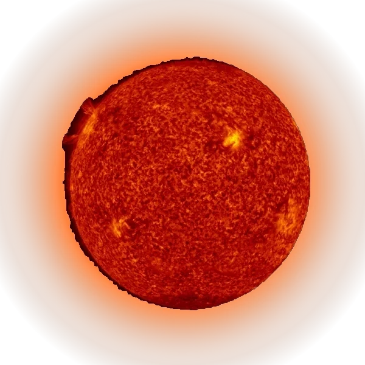

      

        
太阳Sun

        
太阳系的中心恒星，独占太阳系总质量的 99.86%

        
1.99×10³⁰ kg1,391,400 km3.83×10²⁶ W

      

      恒星
    </a>
  </article>
  <article class="astro-card" data-category="planet" data-name="水星 Mercury" data-mass="3.301e+23" data-radius="2439.7" data-density="5.429" data-temp="167" data-period="87.97" data-moons="0">
    <a class="astro-card-link" href="objects/mercury/">
      
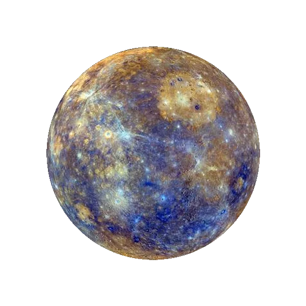

      

        
水星Mercury

        
离太阳最近的行星，一个太阳日比一个水星年还长

        
3.3×10²³ kg4,879 km440 K

      

      行星
    </a>
  </article>
  <article class="astro-card" data-category="planet" data-name="金星 Venus" data-mass="4.8685e+24" data-radius="6051.8" data-density="5.243" data-temp="464" data-period="224.7" data-moons="0">
    <a class="astro-card-link" href="objects/venus/">
      
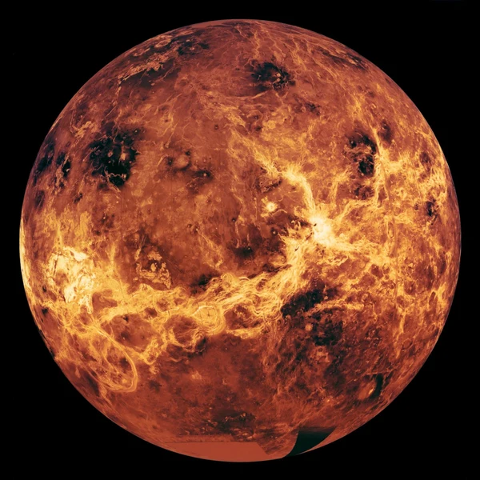

      

        
金星Venus

        
被浓厚二氧化碳大气包裹的炽热世界，太阳系表面最热的行星

        
4.87×10²⁴ kg12,104 km737 K

      

      行星
    </a>
  </article>
  <article class="astro-card" data-category="planet" data-name="地球 Earth" data-mass="5.9724e+24" data-radius="6371.0" data-density="5.514" data-temp="15" data-period="365.26" data-moons="1">
    <a class="astro-card-link" href="objects/earth/">
      
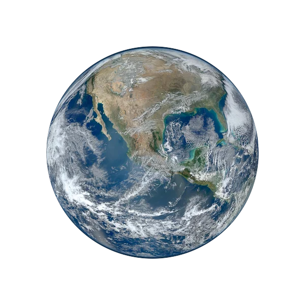

      

        
地球Earth

        
目前已知唯一存在生命的行星，约 71% 表面被液态水覆盖

        
5.97×10²⁴ kg12,742 km288 K

      

      行星
    </a>
  </article>
  <article class="astro-card" data-category="planet" data-name="火星 Mars" data-mass="6.4169e+23" data-radius="3389.5" data-density="3.934" data-temp="-59" data-period="686.98" data-moons="2">
    <a class="astro-card-link" href="objects/mars/">
      
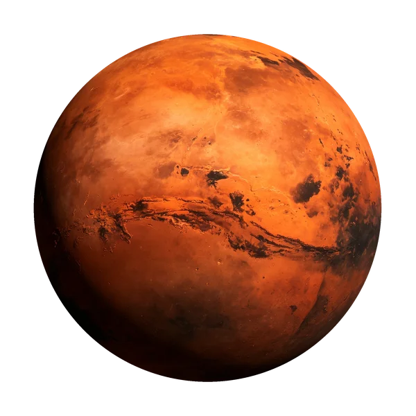

      

        
火星Mars

        
红色的沙漠行星，拥有太阳系最高的火山与最深的峡谷

        
6.42×10²³ kg6,779 km214 K

      

      行星
    </a>
  </article>
  <article class="astro-card" data-category="planet" data-name="木星 Jupiter" data-mass="1.89813e+27" data-radius="69911" data-density="1.326" data-temp="-110" data-period="4332.59" data-moons="95">
    <a class="astro-card-link" href="objects/jupiter/">
      
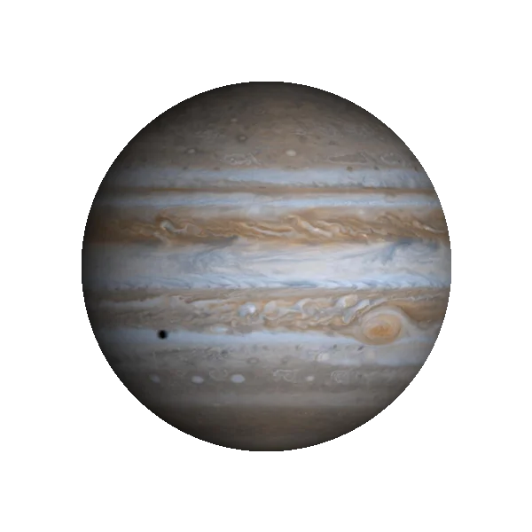

      

        
木星Jupiter

        
太阳系最大的行星，质量超过其余七颗行星的总和

        
1.9×10²⁷ kg139,822 km163 K

      

      行星
    </a>
  </article>
  <article class="astro-card" data-category="planet" data-name="土星 Saturn" data-mass="5.6832e+26" data-radius="58232" data-density="0.687" data-temp="-140" data-period="10755.7" data-moons="274">
    <a class="astro-card-link" href="objects/saturn/">
      
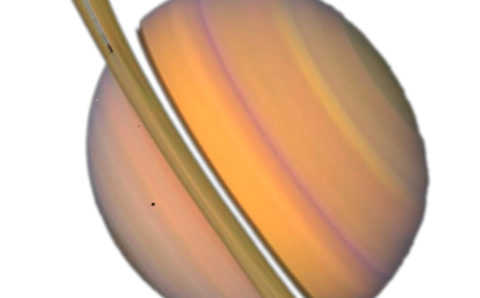

      

        
土星Saturn

        
以壮观环系闻名的气态巨行星，平均密度比水还小

        
5.68×10²⁶ kg116,464 km133 K

      

      行星
    </a>
  </article>
  <article class="astro-card" data-category="planet" data-name="天王星 Uranus" data-mass="8.6813e+25" data-radius="25559" data-density="1.27" data-temp="-195" data-period="30589" data-moons="28">
    <a class="astro-card-link" href="objects/uranus/">
      
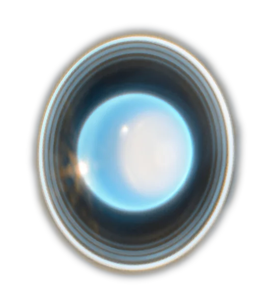

      

        
天王星Uranus

        
躺着自转的冰巨星，自转轴倾角约 98 度

        
8.68×10²⁵ kg51,118 km78 K

      

      行星
    </a>
  </article>
  <article class="astro-card" data-category="planet" data-name="海王星 Neptune" data-mass="1.0241e+26" data-radius="24764" data-density="1.638" data-temp="-200" data-period="59800" data-moons="16">
    <a class="astro-card-link" href="objects/neptune/">
      
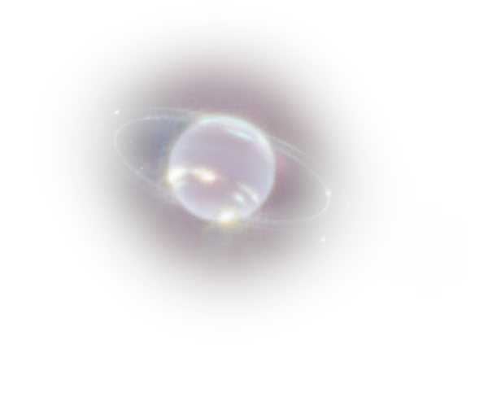

      

        
海王星Neptune

        
太阳系最外侧的行星，风速可达每小时 2100 公里

        
1.02×10²⁶ kg49,528 km73 K

      

      行星
    </a>
  </article>
  <article class="astro-card" data-category="dwarf_planet" data-name="冥王星 Pluto" data-mass="1.303e+22" data-radius="1188.3" data-density="1.85" data-temp="-225" data-period="90560" data-moons="5">
    <a class="astro-card-link" href="objects/pluto/">
      
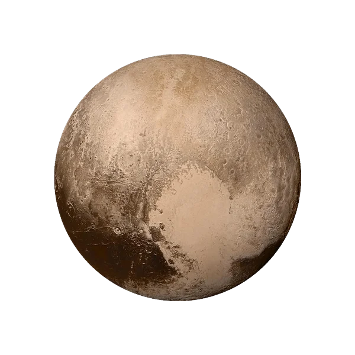

      

        
冥王星Pluto

        
曾被列为第九大行星，与卫星卡戎构成双天体系统

        
1.3×10²² kg2,377 km48 K

      

      矮行星
    </a>
  </article>
  <article class="astro-card" data-category="dwarf_planet" data-name="谷神星 Ceres" data-mass="9.3846e+20" data-radius="469.7" data-density="2.162" data-temp="" data-period="1682.0" data-moons="0">
    <a class="astro-card-link" href="objects/ceres/">
      
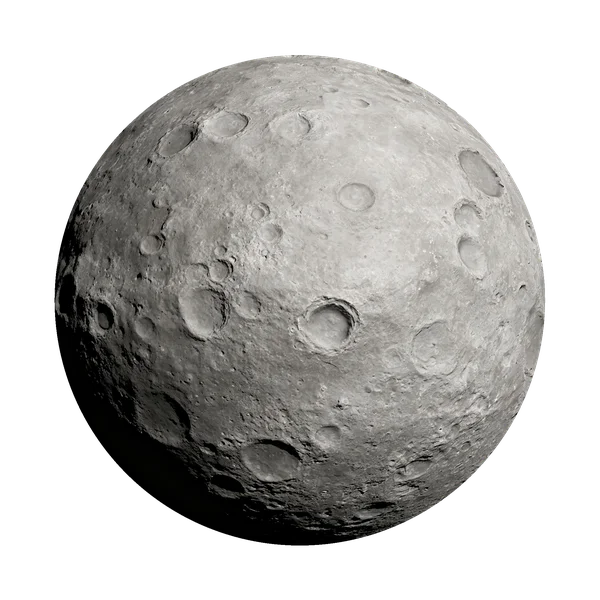

      

        
谷神星Ceres

        
小行星带中最大的天体，唯一位于内太阳系的矮行星

        
9.38×10²⁰ kg939.4 km2.162 g/cm³

      

      矮行星
    </a>
  </article>
  <article class="astro-card" data-category="dwarf_planet" data-name="鸟神星 Makemake" data-mass="3e+21" data-radius="715.9" data-density="" data-temp="" data-period="112364.81" data-moons="1">
    <a class="astro-card-link" href="objects/makemake/">
      
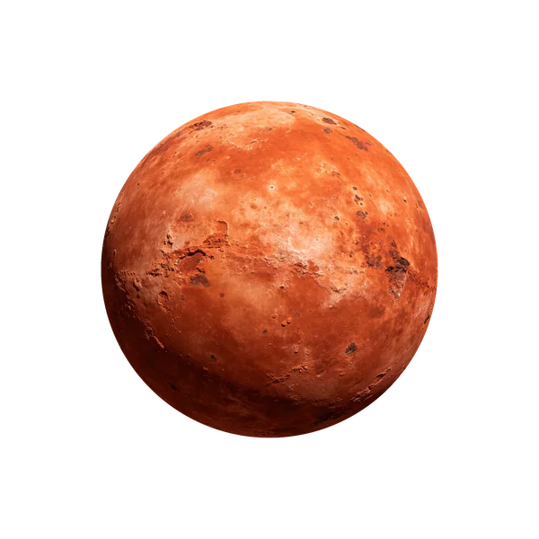

      

        
鸟神星Makemake

        
柯伊伯带最大的经典天体之一，表面覆盖甲烷冰

        
3×10²¹ kg1,432 km

      

      矮行星
    </a>
  </article>
  <article class="astro-card" data-category="dwarf_planet" data-name="妊神星 Haumea" data-mass="4e+21" data-radius="780.0" data-density="" data-temp="" data-period="103208.12" data-moons="2">
    <a class="astro-card-link" href="objects/haumea/">
      
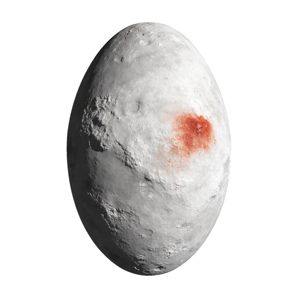

      

        
妊神星Haumea

        
自转极快的椭球状矮行星，拥有光环

        
4×10²¹ kg1,560 km

      

      矮行星
    </a>
  </article>
  <article class="astro-card" data-category="dwarf_planet" data-name="阋神星 Eris" data-mass="1.6e+22" data-radius="1163.0" data-density="" data-temp="" data-period="204516.66" data-moons="1">
    <a class="astro-card-link" href="objects/eris/">
      
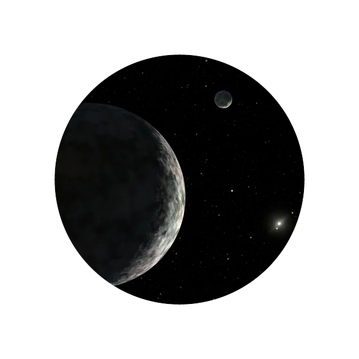

      

        
阋神星Eris

        
质量最大的矮行星，它的发现促使冥王星降级

        
1.6×10²² kg2,326 km

      

      矮行星
    </a>
  </article>
  <article class="astro-card" data-category="moon" data-name="月球 Moon" data-mass="7.346e+22" data-radius="1737.4" data-density="3.344" data-temp="-20" data-period="27.3217" data-moons="0">
    <a class="astro-card-link" href="objects/moon/">
      
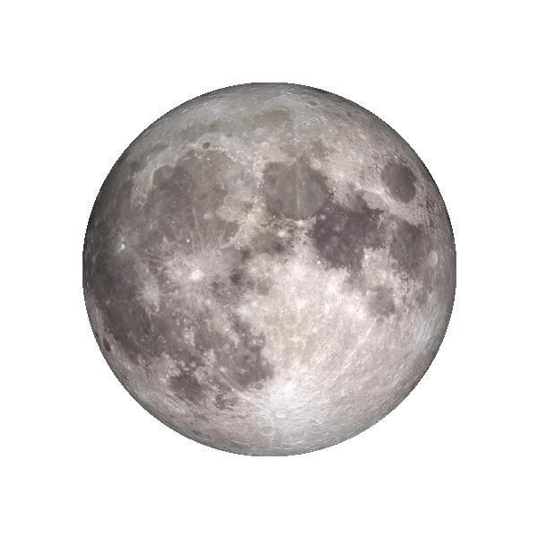

      

        
月球Moon

        
地球唯一的天然卫星，潮汐锁定使它永远以同一面朝向地球

        
7.35×10²² kg3,475 km253 K

      

      卫星
    </a>
  </article>
  <article class="astro-card" data-category="moon" data-name="火卫一 Phobos" data-mass="1.06e+16" data-radius="11.27" data-density="1.9" data-temp="" data-period="0.31891" data-moons="0">
    <a class="astro-card-link" href="objects/phobos/">
      
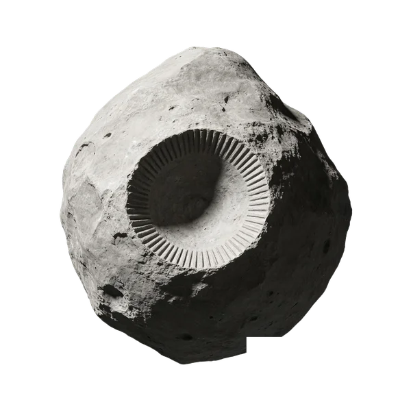

      

        
火卫一Phobos

        
火星较大的卫星，正以每百年约 1.8 米的速度靠近火星

        
1.06×10¹⁶ kg22.5 km1.9 g/cm³

      

      卫星
    </a>
  </article>
  <article class="astro-card" data-category="moon" data-name="火卫二 Deimos" data-mass="2400000000000000.0" data-radius="6.3" data-density="1.75" data-temp="" data-period="1.26244" data-moons="0">
    <a class="astro-card-link" href="objects/deimos/">
      
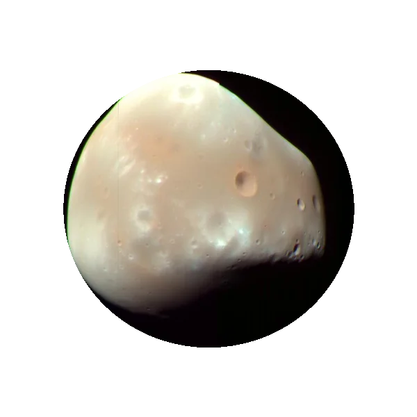

      

        
火卫二Deimos

        
火星较小的卫星，形状极不规则，表面覆盖细腻的风化层

        
2.4×10¹⁵ kg12.6 km1.75 g/cm³

      

      卫星
    </a>
  </article>
  <article class="astro-card" data-category="moon" data-name="木卫一 Io" data-mass="8.932e+22" data-radius="1821.5" data-density="3.53" data-temp="" data-period="1.769138" data-moons="0">
    <a class="astro-card-link" href="objects/io/">
      
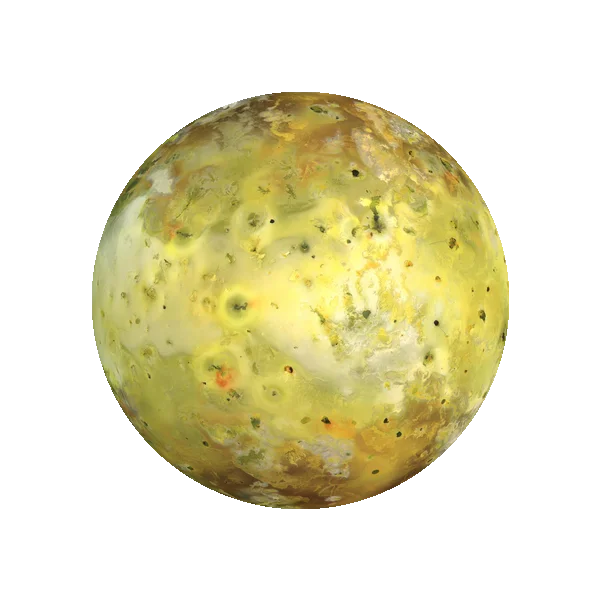

      

        
木卫一Io

        
太阳系火山活动最剧烈的天体，表面遍布硫磺沉积物

        
8.93×10²² kg3,643 km3.53 g/cm³

      

      卫星
    </a>
  </article>
  <article class="astro-card" data-category="moon" data-name="木卫二 Europa" data-mass="4.8e+22" data-radius="1560.8" data-density="3.01" data-temp="" data-period="3.551181" data-moons="0">
    <a class="astro-card-link" href="objects/europa/">
      
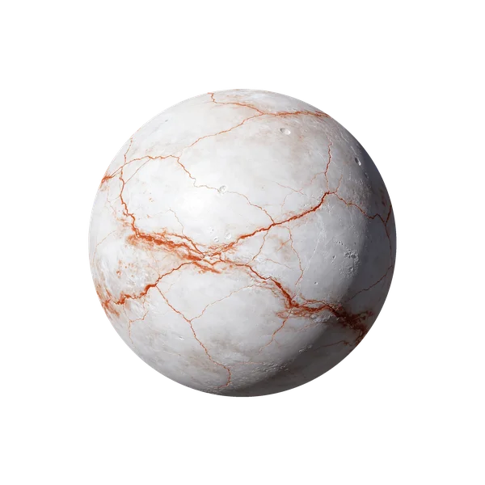

      

        
木卫二Europa

        
冰壳之下藏有全球性液态海洋，搜寻地外生命的热门目标

        
4.8×10²² kg3,122 km3.01 g/cm³

      

      卫星
    </a>
  </article>
  <article class="astro-card" data-category="moon" data-name="木卫三 Ganymede" data-mass="1.4819e+23" data-radius="2631.2" data-density="1.94" data-temp="" data-period="7.154553" data-moons="0">
    <a class="astro-card-link" href="objects/ganymede/">
      
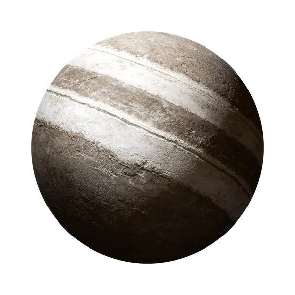

      

        
木卫三Ganymede

        
太阳系最大的卫星，比水星还大，且拥有自己的磁场

        
1.48×10²³ kg5,262 km1.94 g/cm³

      

      卫星
    </a>
  </article>
  <article class="astro-card" data-category="moon" data-name="木卫四 Callisto" data-mass="1.0759e+23" data-radius="2410.3" data-density="1.83" data-temp="" data-period="16.689017" data-moons="0">
    <a class="astro-card-link" href="objects/callisto/">
      
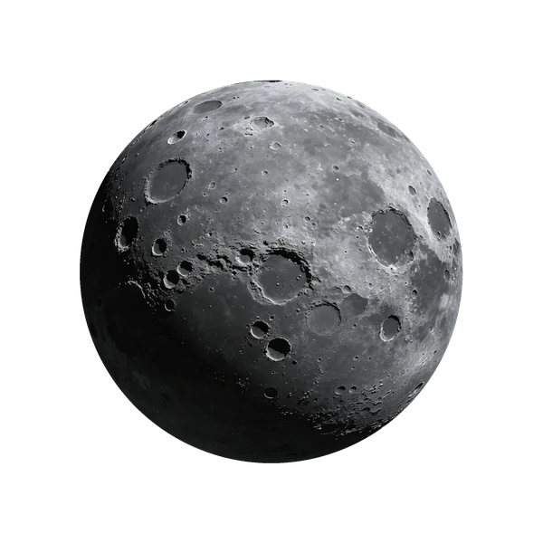

      

        
木卫四Callisto

        
太阳系撞击坑最密集的天体之一，表面几乎未被地质活动改造

        
1.08×10²³ kg4,821 km1.83 g/cm³

      

      卫星
    </a>
  </article>
  <article class="astro-card" data-category="moon" data-name="土卫一 Mimas" data-mass="3.79e+19" data-radius="198.7" data-density="1.15" data-temp="" data-period="0.9424218" data-moons="0">
    <a class="astro-card-link" href="objects/mimas/">
      
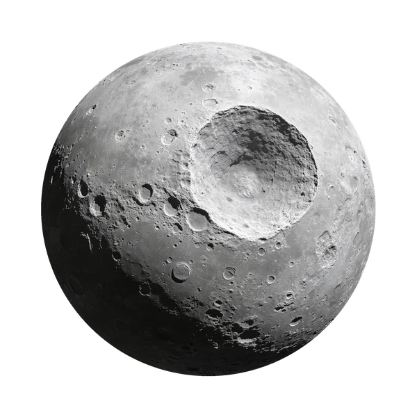

      

        
土卫一Mimas

        
被称为'死星'的卫星，赫歇尔撞击坑占其表面的三分之一

        
3.79×10¹⁹ kg397.4 km1.15 g/cm³

      

      卫星
    </a>
  </article>
  <article class="astro-card" data-category="moon" data-name="土卫二 Enceladus" data-mass="1.08e+20" data-radius="252.1" data-density="1.61" data-temp="" data-period="1.370218" data-moons="0">
    <a class="astro-card-link" href="objects/enceladus/">
      
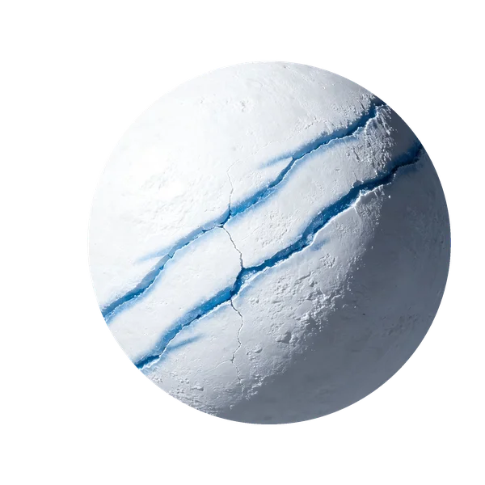

      

        
土卫二Enceladus

        
南极喷泉将地下海洋的物质直接送入太空的冰质小卫星

        
1.08×10²⁰ kg504.2 km1.61 g/cm³

      

      卫星
    </a>
  </article>
  <article class="astro-card" data-category="moon" data-name="土卫三 Tethys" data-mass="6.18e+20" data-radius="530.7" data-density="0.985" data-temp="" data-period="1.887802" data-moons="0">
    <a class="astro-card-link" href="objects/tethys/">
      
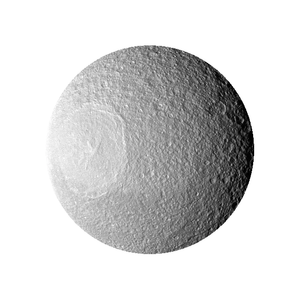

      

        
土卫三Tethys

        
冰质卫星，表面的伊萨卡峡谷绵延约 2000 公里

        
6.18×10²⁰ kg1,061 km0.985 g/cm³

      

      卫星
    </a>
  </article>
  <article class="astro-card" data-category="moon" data-name="土卫四 Dione" data-mass="1.1e+21" data-radius="561.4" data-density="1.478" data-temp="" data-period="2.736915" data-moons="0">
    <a class="astro-card-link" href="objects/dione/">
      
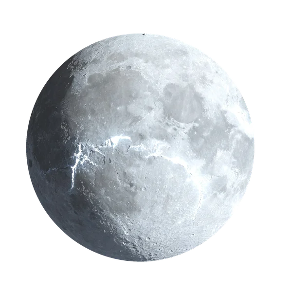

      

        
土卫四Dione

        
冰质卫星，纵横的冰壳悬崖记录着古老的地质活动

        
1.1×10²¹ kg1,123 km1.478 g/cm³

      

      卫星
    </a>
  </article>
  <article class="astro-card" data-category="moon" data-name="土卫五 Rhea" data-mass="2.31e+21" data-radius="763.8" data-density="1.236" data-temp="" data-period="4.5175" data-moons="0">
    <a class="astro-card-link" href="objects/rhea/">
      
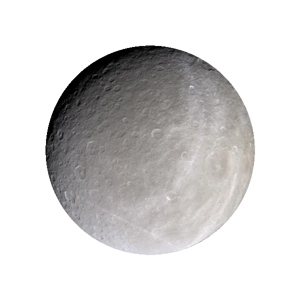

      

        
土卫五Rhea

        
土星第二大卫星，由约三分之二的冰与三分之一的岩石构成

        
2.31×10²¹ kg1,528 km1.236 g/cm³

      

      卫星
    </a>
  </article>
  <article class="astro-card" data-category="moon" data-name="土卫六 Titan" data-mass="1.3455e+23" data-radius="2575.5" data-density="1.881" data-temp="-179" data-period="15.945421" data-moons="0">
    <a class="astro-card-link" href="objects/titan/">
      
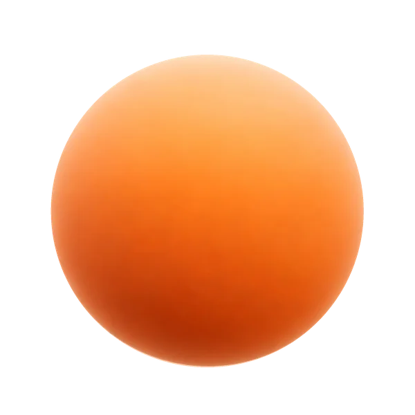

      

        
土卫六Titan

        
太阳系唯一拥有浓厚大气的卫星，地表有液态甲烷的湖泊与河流

        
1.35×10²³ kg5,151 km94 K

      

      卫星
    </a>
  </article>
  <article class="astro-card" data-category="moon" data-name="土卫七 Hyperion" data-mass="5.6e+18" data-radius="138.7" data-density="0.55" data-temp="" data-period="21.276609" data-moons="0">
    <a class="astro-card-link" href="objects/hyperion/">
      
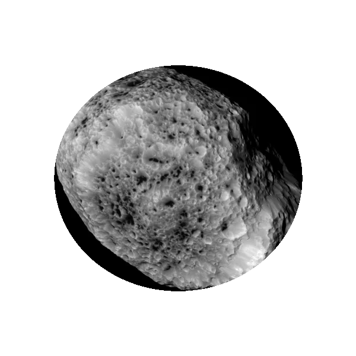

      

        
土卫七Hyperion

        
形状极不规则的卫星，混沌自转使它的朝向无法预测

        
5.6×10¹⁸ kg277.4 km0.55 g/cm³

      

      卫星
    </a>
  </article>
  <article class="astro-card" data-category="moon" data-name="土卫八 Iapetus" data-mass="1.81e+21" data-radius="734.5" data-density="1.088" data-temp="" data-period="79.330183" data-moons="0">
    <a class="astro-card-link" href="objects/iapetus/">
      
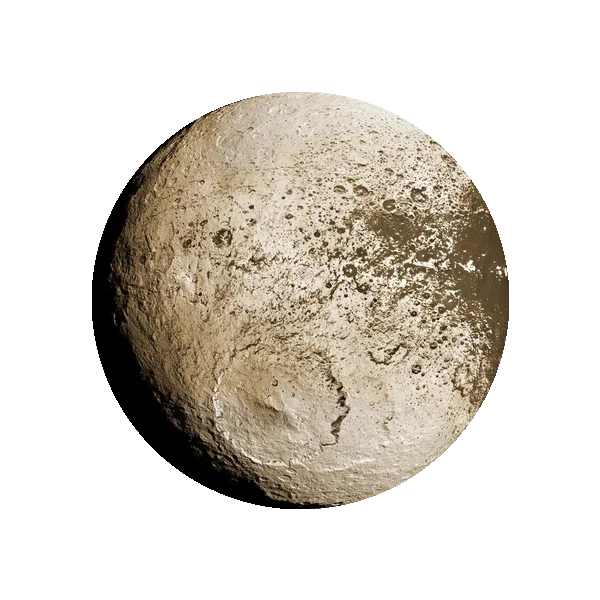

      

        
土卫八Iapetus

        
'阴阳脸'卫星，一面亮如雪一面黑如炭，赤道还有一道奇异山脊

        
1.81×10²¹ kg1,469 km1.088 g/cm³

      

      卫星
    </a>
  </article>
  <article class="astro-card" data-category="moon" data-name="海卫一 Triton" data-mass="2.14e+22" data-radius="1353.4" data-density="2.05" data-temp="-235" data-period="5.876854" data-moons="0">
    <a class="astro-card-link" href="objects/triton/">
      
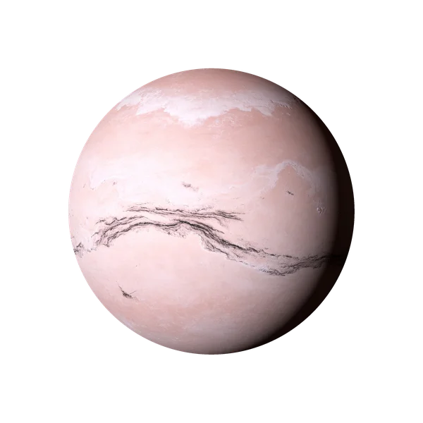

      

        
海卫一Triton

        
沿逆行轨道运行的卫星，或为被俘获的柯伊伯带天体

        
2.14×10²² kg2,707 km38 K

      

      卫星
    </a>
  </article>
  <article class="astro-card" data-category="moon" data-name="天卫五 Miranda" data-mass="6.6e+19" data-radius="235.8" data-density="1.2" data-temp="" data-period="1.413479" data-moons="0">
    <a class="astro-card-link" href="objects/miranda/">
      
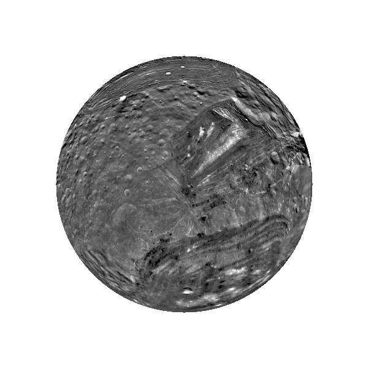

      

        
天卫五Miranda

        
天王星系统中地质最奇特的卫星，断崖与沟槽密布

        
6.6×10¹⁹ kg471.6 km1.2 g/cm³

      

      卫星
    </a>
  </article>
  <article class="astro-card" data-category="moon" data-name="天卫一 Ariel" data-mass="1.29e+21" data-radius="578.9" data-density="1.59" data-temp="" data-period="2.520379" data-moons="0">
    <a class="astro-card-link" href="objects/ariel/">
      
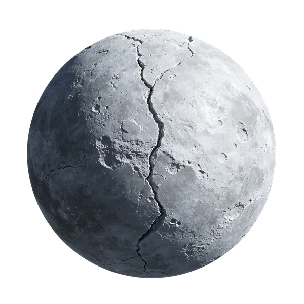

      

        
天卫一Ariel

        
天王星系统中最明亮的卫星，表面峡谷纵横

        
1.29×10²¹ kg1,158 km1.59 g/cm³

      

      卫星
    </a>
  </article>
  <article class="astro-card" data-category="moon" data-name="天卫二 Umbriel" data-mass="1.22e+21" data-radius="584.7" data-density="1.46" data-temp="" data-period="4.144176" data-moons="0">
    <a class="astro-card-link" href="objects/umbriel/">
      
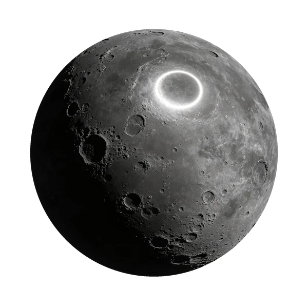

      

        
天卫二Umbriel

        
天王星系统中最暗的卫星，表面古老撞击坑密布

        
1.22×10²¹ kg1,169 km1.46 g/cm³

      

      卫星
    </a>
  </article>
  <article class="astro-card" data-category="moon" data-name="天卫三 Titania" data-mass="3.42e+21" data-radius="788.9" data-density="1.66" data-temp="" data-period="8.705867" data-moons="0">
    <a class="astro-card-link" href="objects/titania/">
      
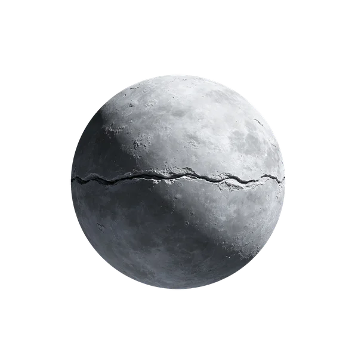

      

        
天卫三Titania

        
天王星最大的卫星，表面有巨大的地堑系统

        
3.42×10²¹ kg1,578 km1.66 g/cm³

      

      卫星
    </a>
  </article>
  <article class="astro-card" data-category="moon" data-name="天卫四 Oberon" data-mass="2.88e+21" data-radius="761.4" data-density="1.56" data-temp="" data-period="13.463234" data-moons="0">
    <a class="astro-card-link" href="objects/oberon/">
      
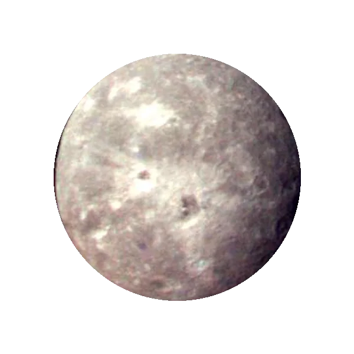

      

        
天卫四Oberon

        
天王星最外侧的大卫星，表面遍布撞击坑与深色物质

        
2.88×10²¹ kg1,523 km1.56 g/cm³

      

      卫星
    </a>
  </article>
  <article class="astro-card" data-category="star" data-name="手枪星 Pistol Star" data-mass="" data-radius="214275600.0" data-density="" data-temp="11526.9" data-period="" data-moons="">
    <a class="astro-card-link" href="objects/pistol_star/">
      

      

        
手枪星Pistol Star

        
银河系中心附近的蓝色特超巨星，曾抛出手枪星云，是已知最明亮的恒星之一

        
428,551,200 km6.35×10³² W

      

      恒星
    </a>
  </article>
  <article class="astro-card" data-category="star" data-name="史蒂文森2-18 Stephenson 2-18" data-mass="2.38608e+31" data-radius="1495755000.0" data-density="1.7e-09" data-temp="2926.8" data-period="" data-moons="">
    <a class="astro-card-link" href="objects/stephenson_2_18/">
      
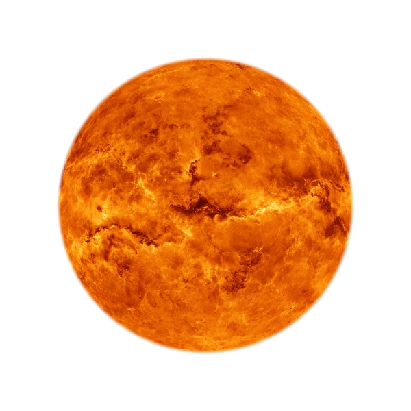

      

        
史蒂文森2-18Stephenson 2-18

        
位于盾牌座方向的红超巨星，是目前已知体积最大的恒星之一

        
2.39×10³¹ kg2.99×10⁹ km1.67×10³² W

      

      恒星
    </a>
  </article>
  <article class="astro-card" data-category="star" data-name="大角星 Arcturus" data-mass="2.1474720000000002e+30" data-radius="17670780.0" data-density="9.291198545853535e-05" data-temp="4016.7999999999997" data-period="" data-moons="">
    <a class="astro-card-link" href="objects/arcturus/">
      
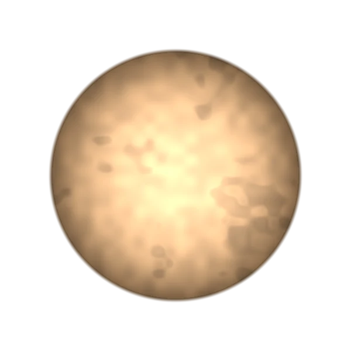

      

        
大角星Arcturus

        
牧夫座的最亮星，一颗橙色的红巨星，是夜空中最亮的恒星之一

        
2.15×10³⁰ kg35,341,560 km6.51×10²⁸ W

      

      恒星
    </a>
  </article>
  <article class="astro-card" data-category="star" data-name="心宿二 Antares" data-mass="" data-radius="473076000.0" data-density="" data-temp="3126.8" data-period="" data-moons="">
    <a class="astro-card-link" href="objects/antares/">
      

      

        
心宿二Antares

        
天蝎座α，代表“蝎子的心脏”，一颗明亮的红超巨星（“大火”）

        
946,152,000 km2.91×10³¹ W

      

      恒星
    </a>
  </article>
  <article class="astro-card" data-category="star" data-name="参宿七 Rigel" data-mass="4.17564e+31" data-radius="54264600.0" data-density="6.238563813011839e-05" data-temp="11826.9" data-period="" data-moons="">
    <a class="astro-card-link" href="objects/rigel/">
      
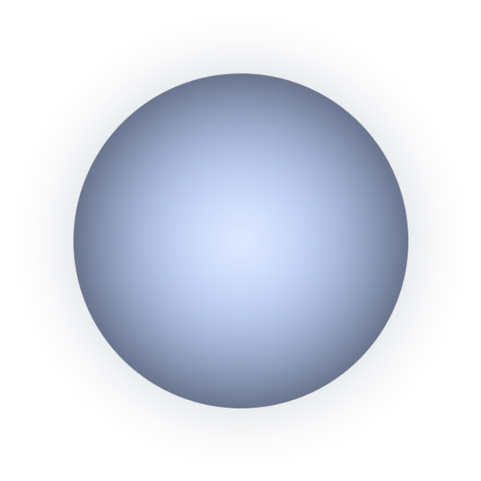

      

        
参宿七Rigel

        
猎户座β，全天第七亮星，一颗蓝白色的蓝超巨星

        
4.18×10³¹ kg108,529,200 km4.59×10³¹ W

      

      恒星
    </a>
  </article>
  <article class="astro-card" data-category="star" data-name="参宿四 Betelgeuse" data-mass="2.78376e+31" data-radius="531514800.0" data-density="4.43e-08" data-temp="3326.8" data-period="" data-moons="">
    <a class="astro-card-link" href="objects/betelgeuse/">
      

      

        
参宿四Betelgeuse

        
猎户座α，一颗著名的红超巨星，亮度不规则变化，最接近地球的红超巨星之一

        
2.78×10³¹ kg1.06×10⁹ km3.33×10³¹ W

      

      恒星
    </a>
  </article>
  <article class="astro-card" data-category="star" data-name="织女星 Vega" data-mass="4.2551760000000005e+30" data-radius="1641852.0" data-density="0.22952336348533148" data-temp="9326.9" data-period="" data-moons="">
    <a class="astro-card-link" href="objects/vega/">
      
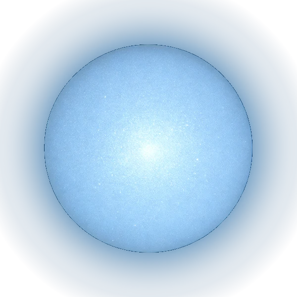

      

        
织女星Vega

        
天琴座α，夏季大三角的顶点，一颗 A 型主序星，曾是北极星

        
4.26×10³⁰ kg3,283,704 km1.53×10²⁸ W

      

      恒星
    </a>
  </article>
  <article class="astro-card" data-category="star" data-name="天狼星A Sirius A" data-mass="4.096104e+30" data-radius="1189647.0" data-density="0.5808018944705612" data-temp="9666.9" data-period="" data-moons="">
    <a class="astro-card-link" href="objects/sirius_a/">
      
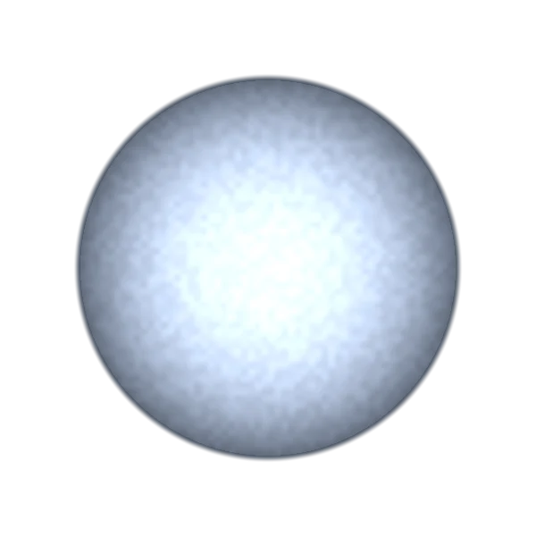

      

        
天狼星ASirius A

        
大犬座α的主星，夜空中最亮的恒星，一颗 A 型主序星

        
4.1×10³⁰ kg2,379,294 km9.57×10²⁷ W

      

      恒星
    </a>
  </article>
  <article class="astro-card" data-category="star" data-name="比邻星 Proxima Centauri" data-mass="2.425848e+29" data-radius="107137.8" data-density="47.091964" data-temp="2766.8" data-period="199791750.0" data-moons="">
    <a class="astro-card-link" href="objects/proxima_centauri/">
      
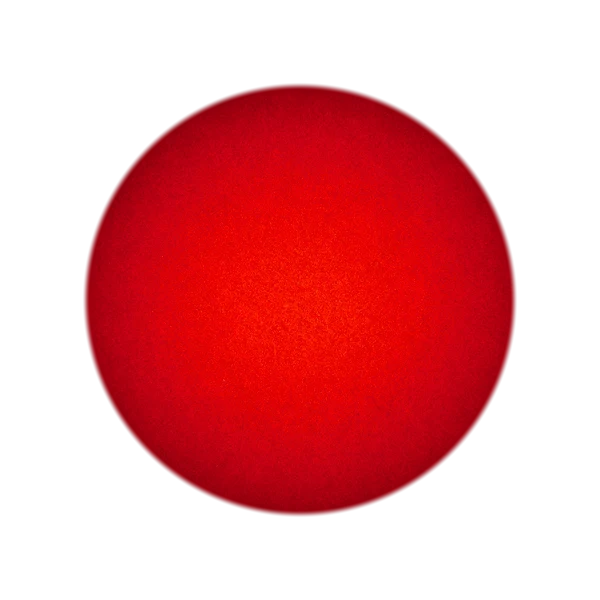

      

        
比邻星Proxima Centauri

        
半人马座α三星系统的成员，距离太阳最近的恒星，一颗暗弱的红矮星

        
2.43×10²⁹ kg214,276 km6.51×10²³ W

      

      恒星
    </a>
  </article>
  <article class="astro-card" data-category="black_hole" data-name="M87* M87*" data-mass="1.29246e+40" data-radius="19196125520.0" data-density="" data-temp="" data-period="" data-moons="">
    <a class="astro-card-link" href="objects/m87_star/">
      
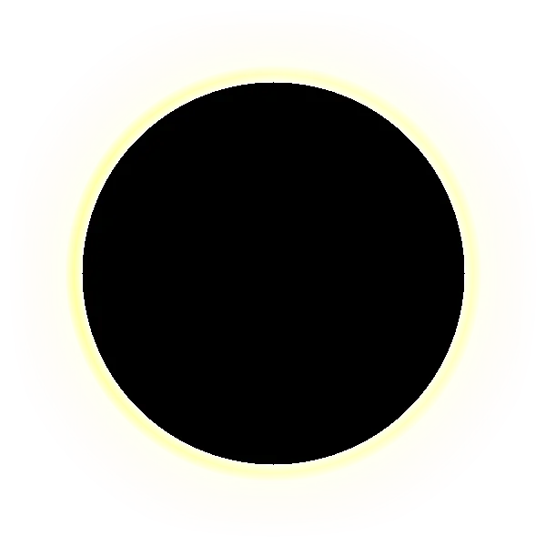

      

        
M87*M87*

        
人类拍下的第一张黑洞照片主角，室女座星系团中心的超大质量黑洞

        
1.29×10⁴⁰ kg3.84×10¹⁰ km

      

      黑洞
    </a>
  </article>
  <article class="astro-card" data-category="black_hole" data-name="人马座A* Sagittarius A*" data-mass="8.5441548e+36" data-radius="12690115.59376" data-density="" data-temp="" data-period="" data-moons="">
    <a class="astro-card-link" href="objects/sgr_a_star/">
      
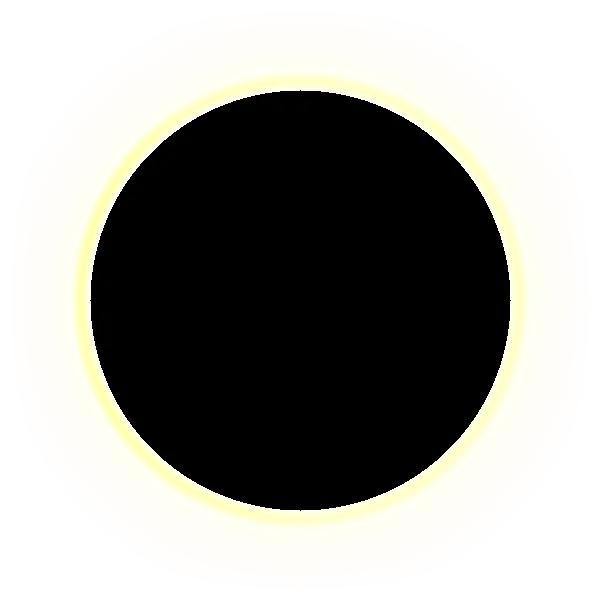

      

        
人马座A*Sagittarius A*

        
银河系中心的超大质量黑洞，2022 年人类拍下第二张黑洞照片

        
8.54×10³⁶ kg25,380,231 km

      

      黑洞
    </a>
  </article>
  <article class="astro-card" data-category="black_hole" data-name="TON 618 TON 618" data-mass="1.312344e+41" data-radius="194914505280.0" data-density="" data-temp="" data-period="" data-moons="">
    <a class="astro-card-link" href="objects/ton618/">
      
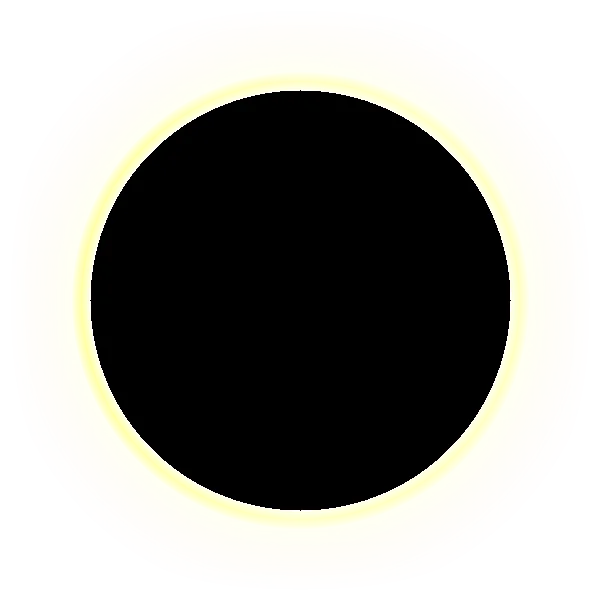

      

        
TON 618TON 618

        
已知质量最大的黑洞之一，660 亿倍太阳质量的类星体引擎

        
1.31×10⁴¹ kg3.9×10¹¹ km

      

      黑洞
    </a>
  </article>
  <article class="astro-card" data-category="black_hole" data-name="IC 1101 中心黑洞 IC 1101 black hole" data-mass="9.942e+40" data-radius="147662504000.0" data-density="" data-temp="" data-period="" data-moons="">
    <a class="astro-card-link" href="objects/ic1101_bh/">
      
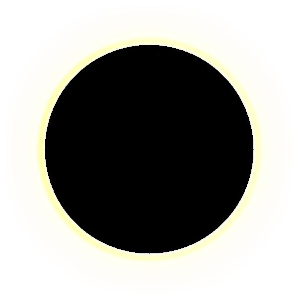

      

        
IC 1101 中心黑洞IC 1101 black hole

        
IC 1101 星系核心的黑洞，质量估值在天文界争议极大

        
9.94×10⁴⁰ kg2.95×10¹¹ km

      

      黑洞
    </a>
  </article>
  <article class="astro-card" data-category="black_hole" data-name="天鹅座 X-1 Cygnus X-1" data-mass="4.215408e+31" data-radius="62.608901696000004" data-density="" data-temp="" data-period="" data-moons="">
    <a class="astro-card-link" href="objects/cyg_x1/">
      
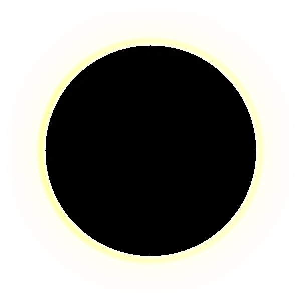

      

        
天鹅座 X-1Cygnus X-1

        
人类确认的第一个恒星级黑洞，霍金打赌输掉的那位

        
4.22×10³¹ kg125.2 km

      

      黑洞
    </a>
  </article>
  <article class="astro-card" data-category="black_hole" data-name="V404 天鹅座 V404 Cygni" data-mass="1.7895599999999999e+31" data-radius="26.57925072" data-density="" data-temp="" data-period="" data-moons="">
    <a class="astro-card-link" href="objects/v404_cyg/">
      
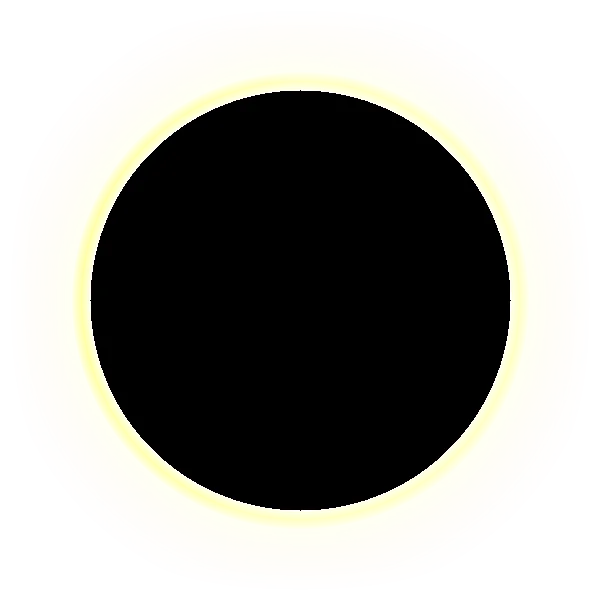

      

        
V404 天鹅座V404 Cygni

        
低质量 X 射线双星，2015 年剧烈爆发出名的黑洞

        
1.79×10³¹ kg53.2 km

      

      黑洞
    </a>
  </article>
  <article class="astro-card" data-category="nebula" data-name="猎户座大星云 Orion Nebula (M42)" data-mass="3.9768e+33" data-radius="113528400000000.0" data-density="" data-temp="9727" data-period="" data-moons="">
    <a class="astro-card-link" href="objects/m42/">
      
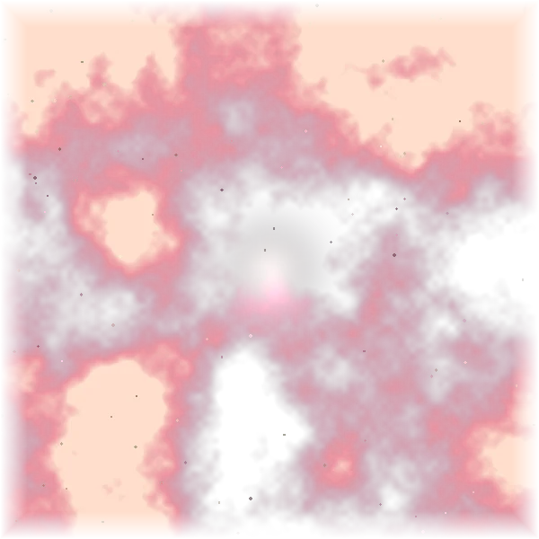

      

        
猎户座大星云Orion Nebula (M42)

        
冬夜最亮的星云，银河系最近的恒星摇篮之一

        
3.98×10³³ kg24 光年10,000 K

      

      星云
    </a>
  </article>
  <article class="astro-card" data-category="nebula" data-name="蟹状星云 Crab Nebula (M1)" data-mass="9.942e+30" data-radius="52033850000000.0" data-density="" data-temp="" data-period="" data-moons="">
    <a class="astro-card-link" href="objects/m1/">
      
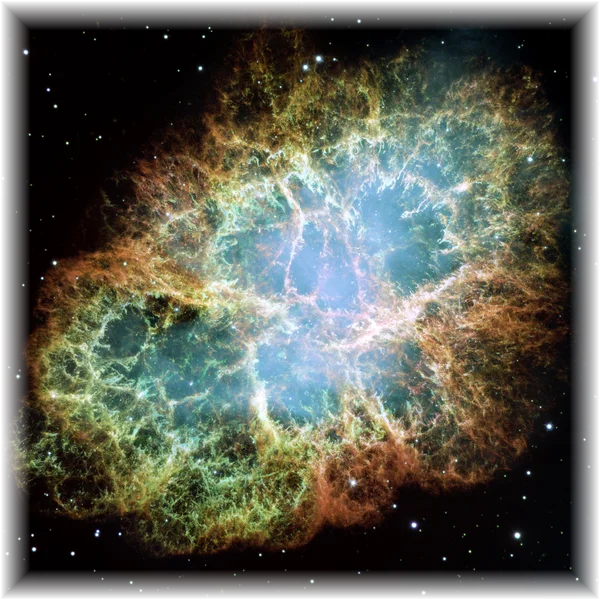

      

        
蟹状星云Crab Nebula (M1)

        
北宋天文学家见证的超新星残骸，宇宙中最著名的遗迹星云

        
9.94×10³⁰ kg11 光年

      

      星云
    </a>
  </article>
  <article class="astro-card" data-category="nebula" data-name="鹰状星云 Eagle Nebula (M16)" data-mass="1.19304e+34" data-radius="331124500000000.0" data-density="" data-temp="" data-period="" data-moons="">
    <a class="astro-card-link" href="objects/m16/">
      
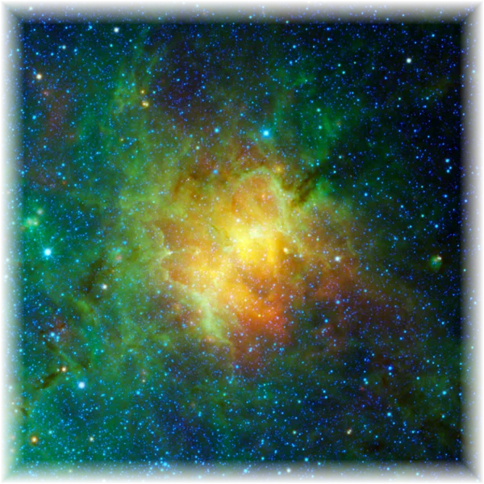

      

        
鹰状星云Eagle Nebula (M16)

        
哈勃「创生之柱」的故乡，巨蛇座里的恒星工厂

        
1.19×10³⁴ kg70 光年

      

      星云
    </a>
  </article>
  <article class="astro-card" data-category="nebula" data-name="三叶星云 Trifid Nebula (M20)" data-mass="3.38028e+33" data-radius="189214000000000.0" data-density="" data-temp="" data-period="" data-moons="">
    <a class="astro-card-link" href="objects/m20/">
      

      

        
三叶星云Trifid Nebula (M20)

        
发射、反射与暗带三合一的彩色星云，人马座里的调色盘

        
3.38×10³³ kg40 光年

      

      星云
    </a>
  </article>
  <article class="astro-card" data-category="nebula" data-name="礁湖星云 Lagoon Nebula (M8)" data-mass="1.59072e+34" data-radius="425731500000000.0" data-density="" data-temp="" data-period="" data-moons="">
    <a class="astro-card-link" href="objects/m8/">
      

      

        
礁湖星云Lagoon Nebula (M8)

        
人马座里的巨大发射星云，肉眼可见的银河宝库

        
1.59×10³⁴ kg90 光年

      

      星云
    </a>
  </article>
  <article class="astro-card" data-category="nebula" data-name="马头星云 Horsehead Nebula" data-mass="4.971e+32" data-radius="16556225000000.0" data-density="" data-temp="" data-period="" data-moons="">
    <a class="astro-card-link" href="objects/horsehead/">
      

      

        
马头星云Horsehead Nebula

        
猎户座腰带旁的暗尘埃剪影，夜空最 recognizable 的剪影

        
4.97×10³² kg3.5 光年

      

      星云
    </a>
  </article>
  <article class="astro-card" data-category="nebula" data-name="环状星云 Ring Nebula (M57)" data-mass="3.9768e+29" data-radius="12298910000000.0" data-density="" data-temp="" data-period="" data-moons="">
    <a class="astro-card-link" href="objects/m57/">
      

      

        
环状星云Ring Nebula (M57)

        
天琴座里的太空烟圈，恒星暮年的典型肖像

        
3.98×10²⁹ kg2.6 光年

      

      星云
    </a>
  </article>
  <article class="astro-card" data-category="nebula" data-name="螺旋星云 Helix Nebula (NGC 7293)" data-mass="2.9826e+29" data-radius="27152209000000.0" data-density="" data-temp="" data-period="" data-moons="">
    <a class="astro-card-link" href="objects/ngc7293/">
      

      

        
螺旋星云Helix Nebula (NGC 7293)

        
宝瓶座里的「上帝之眼」，离地球最近的行星状星云

        
2.98×10²⁹ kg5.74 光年

      

      星云
    </a>
  </article>
  <article class="astro-card" data-category="nebula" data-name="双喷射星星云 M2-9 (Twin Jet Nebula)" data-mass="1.9884e+29" data-radius="6622490000000.0" data-density="" data-temp="" data-period="" data-moons="">
    <a class="astro-card-link" href="objects/m2_9/">
      

      

        
双喷射星星云M2-9 (Twin Jet Nebula)

        
蛇夫座里的蝶翼状星云，双极喷流的活样本

        
1.99×10²⁹ kg1.4 光年

      

      星云
    </a>
  </article>
  <article class="astro-card" data-category="nebula" data-name="玫瑰星云 Rosette Nebula" data-mass="1.9884e+34" data-radius="614945500000000.0" data-density="" data-temp="" data-period="" data-moons="">
    <a class="astro-card-link" href="objects/rosette/">
      

      

        
玫瑰星云Rosette Nebula

        
麒麟座里盛开的宇宙玫瑰，直径逾百光年的发射星云

        
1.99×10³⁴ kg130 光年

      

      星云
    </a>
  </article>
  <article class="astro-card" data-category="nebula" data-name="巴纳德环 Barnard's Loop" data-mass="1.332228e+34" data-radius="1419105000000000.0" data-density="" data-temp="" data-period="" data-moons="">
    <a class="astro-card-link" href="objects/barnards_loop/">
      

      

        
巴纳德环Barnard's Loop

        
横跨猎户座大半边的巨大圆弧，可能源于数百万年前的一次超新星

        
1.33×10³⁴ kg300 光年

      

      星云
    </a>
  </article>
  <article class="astro-card" data-category="nebula" data-name="蜘蛛星云 Tarantula Nebula (30 Doradus)" data-mass="1.9884e+36" data-radius="4730350000000000.0" data-density="" data-temp="" data-period="" data-moons="">
    <a class="astro-card-link" href="objects/tarantula/">
      

      

        
蜘蛛星云Tarantula Nebula (30 Doradus)

        
大麦哲伦云里的巨型恒星工厂，本星系群最活跃的星云

        
1.99×10³⁶ kg1,000 光年

      

      星云
    </a>
  </article>
  <article class="astro-card" data-category="galaxy" data-name="银河系 Milky Way" data-mass="2.9826e+42" data-radius="4.73035e+17" data-density="" data-temp="" data-period="" data-moons="">
    <a class="astro-card-link" href="objects/milky_way/">
      

      

        
银河系Milky Way

        
我们的家园星系，太阳系所在的棒旋星系

        
2.98×10⁴² kg100,000 光年9.57×10³⁶ W

      

      星系
    </a>
  </article>
  <article class="astro-card" data-category="galaxy" data-name="仙女座星系 Andromeda Galaxy (M31)" data-mass="2.9826e+42" data-radius="1.040677e+18" data-density="" data-temp="" data-period="" data-moons="">
    <a class="astro-card-link" href="objects/m31/">
      

      

        
仙女座星系Andromeda Galaxy (M31)

        
本星系群最大的星系，肉眼可见的银河系近邻

        
2.98×10⁴² kg220,000 光年

      

      星系
    </a>
  </article>
  <article class="astro-card" data-category="galaxy" data-name="三角座星系 Triangulum Galaxy (M33)" data-mass="9.942e+40" data-radius="2.89118992e+17" data-density="" data-temp="" data-period="" data-moons="">
    <a class="astro-card-link" href="objects/m33/">
      

      

        
三角座星系Triangulum Galaxy (M33)

        
本星系群第三大星系，肉眼极限的松散旋涡

        
9.94×10⁴⁰ kg61,120 光年

      

      星系
    </a>
  </article>
  <article class="astro-card" data-category="galaxy" data-name="大麦哲伦云 Large Magellanic Cloud" data-mass="1.9884e+40" data-radius="6.62249e+16" data-density="" data-temp="" data-period="" data-moons="">
    <a class="astro-card-link" href="objects/lmc/">
      

      

        
大麦哲伦云Large Magellanic Cloud

        
银河系最大的卫星星系，南天夜空中挂着的模糊云块

        
1.99×10⁴⁰ kg14,000 光年

      

      星系
    </a>
  </article>
  <article class="astro-card" data-category="galaxy" data-name="小麦哲伦云 Small Magellanic Cloud" data-mass="1.29246e+40" data-radius="3.311245e+16" data-density="" data-temp="" data-period="" data-moons="">
    <a class="astro-card-link" href="objects/smc/">
      

      

        
小麦哲伦云Small Magellanic Cloud

        
大麦哲伦云的伴侣，南天第二矮星系

        
1.29×10⁴⁰ kg7,000 光年

      

      星系
    </a>
  </article>
  <article class="astro-card" data-category="galaxy" data-name="室女座A Messier 87" data-mass="4.77216e+42" data-radius="1.135284e+18" data-density="" data-temp="" data-period="" data-moons="">
    <a class="astro-card-link" href="objects/m87/">
      

      

        
室女座AMessier 87

        
室女座星系团中心的巨型椭圆星系，万亿级恒星都会

        
4.77×10⁴² kg240,000 光年

      

      星系
    </a>
  </article>
  <article class="astro-card" data-category="galaxy" data-name="草帽星系 Sombrero Galaxy (M104)" data-mass="1.59072e+42" data-radius="2.365175e+17" data-density="" data-temp="" data-period="" data-moons="">
    <a class="astro-card-link" href="objects/m104/">
      

      

        
草帽星系Sombrero Galaxy (M104)

        
侧视的旋涡星系，草帽外形来自它巨大的核球与尘埃环

        
1.59×10⁴² kg50,000 光年

      

      星系
    </a>
  </article>
  <article class="astro-card" data-category="galaxy" data-name="涡状星系 Whirlpool Galaxy (M51)" data-mass="3.18144e+41" data-radius="3.63763915e+17" data-density="" data-temp="" data-period="" data-moons="">
    <a class="astro-card-link" href="objects/m51/">
      

      

        
涡状星系Whirlpool Galaxy (M51)

        
人类发现旋涡结构的第一个星系，与伴星系共舞的经典标范

        
3.18×10⁴¹ kg76,900 光年

      

      星系
    </a>
  </article>
  <article class="astro-card" data-category="galaxy" data-name="波德星系 Messier 81" data-mass="1.3918799999999999e+42" data-radius="4.446529e+17" data-density="" data-temp="" data-period="" data-moons="">
    <a class="astro-card-link" href="objects/m81/">
      

      

        
波德星系Messier 81

        
北斗七星附近的完美旋涡，与 M82 组成经典相互作用对

        
1.39×10⁴² kg94,000 光年

      

      星系
    </a>
  </article>
  <article class="astro-card" data-category="galaxy" data-name="雪茄星系 Messier 82 (Cigar Galaxy)" data-mass="1.9884e+41" data-radius="1.7502295e+17" data-density="" data-temp="" data-period="" data-moons="">
    <a class="astro-card-link" href="objects/m82/">
      

      

        
雪茄星系Messier 82 (Cigar Galaxy)

        
著名的星暴星系，恒星诞生的速度是银河系的十倍

        
1.99×10⁴¹ kg37,000 光年

      

      星系
    </a>
  </article>
  <article class="astro-card" data-category="galaxy" data-name="NGC 1300 NGC 1300" data-mass="1.9884e+41" data-radius="5.203385e+17" data-density="" data-temp="" data-period="" data-moons="">
    <a class="astro-card-link" href="objects/ngc1300/">
      

      

        
NGC 1300NGC 1300

        
棒旋星系的教科书标本，波江座里的巨大风车

        
1.99×10⁴¹ kg110,000 光年

      

      星系
    </a>
  </article>
  <article class="astro-card" data-category="galaxy" data-name="IC 1101 IC 1101" data-mass="6.76056e+42" data-radius="8.041595e+18" data-density="" data-temp="" data-period="" data-moons="">
    <a class="astro-card-link" href="objects/ic1101/">
      

      

        
IC 1101IC 1101

        
已知直径最大的星系之一，宇宙中的巨型椭圆巨兽

        
6.76×10⁴² kg1,700,000 光年

      

      星系
    </a>
  </article>
  <article class="astro-card" data-category="galaxy" data-name="斯蒂芬五重星系 Stephan's Quintet" data-mass="1.9884e+42" data-radius="1.6556225e+18" data-density="" data-temp="" data-period="" data-moons="">
    <a class="astro-card-link" href="objects/stephens_quintet/">
      

      

        
斯蒂芬五重星系Stephan's Quintet

        
五个星系的引力共舞，韦布镜头下的宇宙慢镜头并合

        
1.99×10⁴² kg350,000 光年

      

      星系
    </a>
  </article>
  <article class="astro-card" data-category="cluster" data-name="昴星团 Pleiades (M45)" data-mass="1.59072e+33" data-radius="67170970000000.0" data-density="" data-temp="" data-period="" data-moons="">
    <a class="astro-card-link" href="objects/m45/">
      

      

        
昴星团Pleiades (M45)

        
七姐妹星团，冬夜最易辨认的蓝色小勺

        
1.59×10³³ kg14.2 光年

      

      星团
    </a>
  </article>
  <article class="astro-card" data-category="cluster" data-name="毕星团 Hyades" data-mass="7.9536e+32" data-radius="69536145000000.0" data-density="" data-temp="" data-period="" data-moons="">
    <a class="astro-card-link" href="objects/hyades/">
      

      

        
毕星团Hyades

        
金牛座的 V 形头部，离太阳最近的疏散星团之一

        
7.95×10³² kg14.7 光年

      

      星团
    </a>
  </article>
  <article class="astro-card" data-category="cluster" data-name="蜂巢星团 Beehive Cluster (M44)" data-mass="1.09362e+33" data-radius="75685600000000.0" data-density="" data-temp="" data-period="" data-moons="">
    <a class="astro-card-link" href="objects/m44/">
      

      

        
蜂巢星团Beehive Cluster (M44)

        
巨蟹座腹中的蜂巢，双筒望远镜里的经典星团

        
1.09×10³³ kg16 光年

      

      星团
    </a>
  </article>
  <article class="astro-card" data-category="cluster" data-name="梅西耶67 Messier 67" data-mass="2.18724e+33" data-radius="94607000000000.0" data-density="" data-temp="" data-period="" data-moons="">
    <a class="astro-card-link" href="objects/m67/">
      

      

        
梅西耶67Messier 67

        
著名的古老疏散星团，曾被猜想为太阳的出生地

        
2.19×10³³ kg20 光年

      

      星团
    </a>
  </article>
  <article class="astro-card" data-category="cluster" data-name="R136 星团 R136" data-mass="1.9884e+35" data-radius="47303500000000.0" data-density="" data-temp="" data-period="" data-moons="">
    <a class="astro-card-link" href="objects/r136/">
      

      

        
R136 星团R136

        
蜘蛛星云核心的超级星团，已知最亮恒星的故乡

        
1.99×10³⁵ kg10 光年

      

      星团
    </a>
  </article>
  <article class="astro-card" data-category="cluster" data-name="武仙座球状星团 Messier 13" data-mass="1.19304e+36" data-radius="685900750000000.0" data-density="" data-temp="" data-period="" data-moons="">
    <a class="astro-card-link" href="objects/m13/">
      

      

        
武仙座球状星团Messier 13

        
北天最壮观的球状星团，武仙座里的 30 万颗恒星球

        
1.19×10³⁶ kg145 光年

      

      星团
    </a>
  </article>
  <article class="astro-card" data-category="cluster" data-name="梅西耶22 Messier 22" data-mass="" data-radius="473035000000000.0" data-density="" data-temp="" data-period="" data-moons="">
    <a class="astro-card-link" href="objects/m22/">
      

      

        
梅西耶22Messier 22

        
人马座里的明亮球状星团，肉眼可见的古老恒星城

        
100 光年

      

      星团
    </a>
  </article>
  <article class="astro-card" data-category="cluster" data-name="半人马座ω Omega Centauri" data-mass="7.9536e+36" data-radius="785238100000000.0" data-density="" data-temp="" data-period="" data-moons="">
    <a class="astro-card-link" href="objects/omega_cen/">
      

      

        
半人马座ωOmega Centauri

        
银河系最大的球状星团，疑为被吞噬矮星系的残核

        
7.95×10³⁶ kg166 光年

      

      星团
    </a>
  </article>
  <article class="astro-card" data-category="structure" data-name="本星系群 Local Group" data-mass="5.9652e+42" data-radius="4.73035e+19" data-density="" data-temp="" data-period="" data-moons="">
    <a class="astro-card-link" href="objects/local_group/">
      

      

        
本星系群Local Group

        
银河系所属的星系社群，80 多个星系的小团体

        
5.97×10⁴² kg10,000,000 光年

      

      大尺度结构
    </a>
  </article>
  <article class="astro-card" data-category="structure" data-name="室女座星系团 Virgo Cluster" data-mass="2.38608e+45" data-radius="7.095525e+19" data-density="" data-temp="" data-period="" data-moons="">
    <a class="astro-card-link" href="objects/virgo_cluster/">
      

      

        
室女座星系团Virgo Cluster

        
离我们最近的大型星系团，上千个星系的引力都会

        
2.39×10⁴⁵ kg15,000,000 光年

      

      大尺度结构
    </a>
  </article>
  <article class="astro-card" data-category="structure" data-name="拉尼亚凯亚超星系团 Laniakea Supercluster" data-mass="1.9884e+47" data-radius="2.459782e+21" data-density="" data-temp="" data-period="" data-moons="">
    <a class="astro-card-link" href="objects/laniakea/">
      

      

        
拉尼亚凯亚超星系团Laniakea Supercluster

        
银河系所在的家园超星系团，十万个星系的洪流盆地

        
1.99×10⁴⁷ kg520,000,000 光年

      

      大尺度结构
    </a>
  </article>
  <article class="astro-card" data-category="structure" data-name="巨引源 Great Attractor" data-mass="1.9884e+46" data-radius="1.89214e+21" data-density="" data-temp="" data-period="" data-moons="">
    <a class="astro-card-link" href="objects/great_attractor/">
      

      

        
巨引源Great Attractor

        
隐匿在银河盘面背后的引力深渊，牵引着本超星系团

        
1.99×10⁴⁶ kg400,000,000 光年

      

      大尺度结构
    </a>
  </article>
  <article class="astro-card" data-category="structure" data-name="武仙-北冕座长城 Hercules–Corona Borealis Great Wall" data-mass="1.9884e+48" data-radius="4.73035e+22" data-density="" data-temp="" data-period="" data-moons="">
    <a class="astro-card-link" href="objects/hercules_corona_wall/">
      

      

        
武仙-北冕座长城Hercules–Corona Borealis Great Wall

        
已知最大的宇宙结构之一，横跨百亿光年的星系巨墙

        
1.99×10⁴⁸ kg10,000,000,000 光年

      

      大尺度结构
    </a>
  </article>
  <article class="astro-card" data-category="structure" data-name="宇宙微波背景 Cosmic Microwave Background" data-mass="" data-radius="4.3235399e+23" data-density="" data-temp="-270.425" data-period="" data-moons="">
    <a class="astro-card-link" href="objects/cmb/">
      

      

        
宇宙微波背景Cosmic Microwave Background

        
大爆炸的余晖，宇宙最古老的光（最后散射面）

        
91,400,000,000 光年3 K

      

      大尺度结构
    </a>
  </article>
  <article class="astro-card" data-category="structure" data-name="可观测宇宙 Observable Universe" data-mass="1.5e+53" data-radius="4.3992255e+23" data-density="" data-temp="-270.42" data-period="" data-moons="">
    <a class="astro-card-link" href="objects/observable_universe/">
      

      

        
可观测宇宙Observable Universe

        
以地球为球心的粒子视界，人类信息的全部边疆

        
1.5×10⁵³ kg93,000,000,000 光年3 K

      

      大尺度结构
    </a>
  </article>
  <article class="astro-card" data-category="nebula" data-name="天鹅星云 Omega Nebula" data-mass="1.59072e+33" data-radius="189214000000000.0" data-density="" data-temp="" data-period="" data-moons="">
    <a class="astro-card-link" href="objects/m17/">
      

      

        
天鹅星云Omega Nebula

        
银河系中最亮的发射星云之一，形似一只展翅的天鹅

        
1.59×10³³ kg40 光年

      

      星云
    </a>
  </article>
  <article class="astro-card" data-category="nebula" data-name="哑铃星云 Dumbbell Nebula" data-mass="3.9768e+29" data-radius="11825875000000.0" data-density="" data-temp="" data-period="" data-moons="">
    <a class="astro-card-link" href="objects/m27/">
      

      

        
哑铃星云Dumbbell Nebula

        
人类发现的第一个行星状星云，形似一只哑铃

        
3.98×10²⁹ kg2.5 光年

      

      星云
    </a>
  </article>
  <article class="astro-card" data-category="nebula" data-name="船底座星云 Carina Nebula" data-mass="1.78956e+36" data-radius="2175961000000000.0" data-density="" data-temp="" data-period="" data-moons="">
    <a class="astro-card-link" href="objects/ngc3372/">
      

      

        
船底座星云Carina Nebula

        
全天最大最亮的星云之一，藏着最不稳定的巨星海山二

        
1.79×10³⁶ kg460 光年

      

      星云
    </a>
  </article>
  <article class="astro-card" data-category="nebula" data-name="北美洲星云 North America Nebula" data-mass="7.9536e+33" data-radius="425731500000000.0" data-density="" data-temp="" data-period="" data-moons="">
    <a class="astro-card-link" href="objects/ngc7000/">
      

      

        
北美洲星云North America Nebula

        
形状酷似北美洲大陆的发射星云

        
7.95×10³³ kg90 光年

      

      星云
    </a>
  </article>
  <article class="astro-card" data-category="galaxy" data-name="风车星系 Pinwheel Galaxy" data-mass="1.9884e+42" data-radius="8.041595e+17" data-density="" data-temp="" data-period="" data-moons="">
    <a class="astro-card-link" href="objects/m101/">
      

      

        
风车星系Pinwheel Galaxy

        
正面朝我们的旋涡星系，旋臂上缀满红色恒星育婴室

        
1.99×10⁴² kg170,000 光年9.95×10³⁶ W

      

      星系
    </a>
  </article>
  <article class="astro-card" data-category="galaxy" data-name="黑眼星系 Black Eye Galaxy" data-mass="2.38608e+41" data-radius="2.554389e+17" data-density="" data-temp="" data-period="" data-moons="">
    <a class="astro-card-link" href="objects/m64/">
      

      

        
黑眼星系Black Eye Galaxy

        
壮丽旋臂前横着一条暗尘埃带，像一只乌黑的眼睛

        
2.39×10⁴¹ kg54,000 光年

      

      星系
    </a>
  </article>
  <article class="astro-card" data-category="galaxy" data-name="南风车星系 Southern Pinwheel Galaxy" data-mass="3.9768e+41" data-radius="2.6016925e+17" data-density="" data-temp="" data-period="" data-moons="">
    <a class="astro-card-link" href="objects/m83/">
      

      

        
南风车星系Southern Pinwheel Galaxy

        
南天最亮的旋涡星系之一，恒星爆发此起彼伏

        
3.98×10⁴¹ kg55,000 光年

      

      星系
    </a>
  </article>
  <article class="astro-card" data-category="galaxy" data-name="半人马 A Centaurus A" data-mass="1.78956e+42" data-radius="2.83821e+17" data-density="" data-temp="" data-period="" data-moons="">
    <a class="astro-card-link" href="objects/ngc5128/">
      

      

        
半人马 ACentaurus A

        
被一条厚重尘埃带拦腰横穿的并合遗迹星系

        
1.79×10⁴² kg60,000 光年

      

      星系
    </a>
  </article>
  <article class="astro-card" data-category="galaxy" data-name="天线星系 Antennae Galaxies" data-mass="1.19304e+42" data-radius="2.365175e+18" data-density="" data-temp="" data-period="" data-moons="">
    <a class="astro-card-link" href="objects/ngc4038/">
      

      

        
天线星系Antennae Galaxies

        
两个正在撕扯合并的旋涡星系，甩出两条长长的潮汐尾

        
1.19×10⁴² kg500,000 光年

      

      星系
    </a>
  </article>
  <article class="astro-card" data-category="cluster" data-name="野鸭星团 Wild Duck Cluster" data-mass="" data-radius="236517500000000.0" data-density="" data-temp="" data-period="" data-moons="">
    <a class="astro-card-link" href="objects/m11/">
      

      

        
野鸭星团Wild Duck Cluster

        
数千颗恒星挤成三角阵，像一群列队飞翔的野鸭

        
50 光年

      

      星团
    </a>
  </article>
  <article class="astro-card" data-category="cluster" data-name="托勒密星团 Ptolemy Cluster" data-mass="" data-radius="108798050000000.0" data-density="" data-temp="" data-period="" data-moons="">
    <a class="astro-card-link" href="objects/m7/">
      

      

        
托勒密星团Ptolemy Cluster

        
两千年前就被古人记进星表的疏散星团

        
23 光年

      

      星团
    </a>
  </article>
  <article class="astro-card" data-category="cluster" data-name="珠宝盒星团 Jewel Box Cluster" data-mass="" data-radius="87984510000000.0" data-density="" data-temp="" data-period="" data-moons="">
    <a class="astro-card-link" href="objects/ngc4755/">
      

      

        
珠宝盒星团Jewel Box Cluster

        
蓝超巨星与红超巨星挤在一起，像一匣彩色宝石

        
18.6 光年

      

      星团
    </a>
  </article>
  <article class="astro-card" data-category="star" data-name="海山二 Eta Carinae" data-mass="" data-radius="41742000.0" data-density="" data-temp="" data-period="" data-moons="">
    <a class="astro-card-link" href="objects/eta_carinae/">
      

      

        
海山二Eta Carinae

        
银河系内最亮的高光度蓝变星，随时可能爆发为超新星

        
83,484,000 km1.91×10³³ W

      

      恒星
    </a>
  </article>
  <article class="astro-card" data-category="asteroid" data-name="灶神星 4 Vesta" data-mass="2.59076e+20" data-radius="262.7" data-density="3.4116019619256095" data-temp="" data-period="1325.5" data-moons="">
    <a class="astro-card-link" href="objects/vesta/">
      

      

        
灶神星4 Vesta

        
小行星带的巨型原行星，南极有一个直径 500 公里的超级撞击坑

        
2.59×10²⁰ kg525.4 km3.4116 g/cm³

      

      小行星
    </a>
  </article>
  <article class="astro-card" data-category="comet" data-name="哈雷彗星 1P/Halley" data-mass="220000000000000.0" data-radius="5.5" data-density="0.6" data-temp="" data-period="27509" data-moons="">
    <a class="astro-card-link" href="objects/halley/">
      

      

        
哈雷彗星1P/Halley

        
每 76 年回归一次的著名周期彗星，肉眼可见的脏雪球

        
2.2×10¹⁴ kg11.0 km0.6 g/cm³

      

      彗星
    </a>
  </article>
  <article class="astro-card" data-category="star" data-name="天狼星B Sirius B" data-mass="2.0241912e+30" data-radius="5634.0" data-density="2702168.3024109127" data-temp="24726.85" data-period="18299.025" data-moons="">
    <a class="astro-card-link" href="objects/sirius_b/">
      

      

        
天狼星BSirius B

        
质量与太阳相当，体积却只有地球大小——最早被发现的白矮星

        
2.02×10³⁰ kg11,268 km9.38×10²⁴ W

      

      恒星
    </a>
  </article>
  <article class="astro-card" data-category="star" data-name="波江座40A 40 Eridani A" data-mass="1.550952e+30" data-radius="559342.8" data-density="2.1158047682469387" data-temp="4852.85" data-period="" data-moons="">
    <a class="astro-card-link" href="objects/eridani_40a/">
      

      

        
波江座40A40 Eridani A

        
《星际迷航》中瓦肯人的太阳，一颗宁静的橙黄矮星

        
1.55×10³⁰ kg1,118,686 km1.53×10²⁶ W

      

      恒星
    </a>
  </article>
  <article class="astro-card" data-category="star" data-name="波江座40B 40 Eridani B" data-mass="1.1095272000000001e+30" data-radius="9099.756" data-density="351528.1447195368" data-temp="16926.85" data-period="" data-moons="">
    <a class="astro-card-link" href="objects/eridani_40b/">
      

      

        
波江座40B40 Eridani B

        
肉眼不可见的白矮星，人类最早确认的白矮星之一

        
1.11×10³⁰ kg18,200 km5.16×10²⁴ W

      

      恒星
    </a>
  </article>
  <article class="astro-card" data-category="star" data-name="蟹云脉冲星 Crab Pulsar" data-mass="2.78376e+30" data-radius="10.0" data-density="664573746572241.9" data-temp="" data-period="" data-moons="">
    <a class="astro-card-link" href="objects/crab_pulsar/">
      

      

        
蟹云脉冲星Crab Pulsar

        
蟹状星云中心高速自转的中子星，每 33 毫秒转一圈

        
2.78×10³⁰ kg20.0 km2.87×10³¹ W

      

      恒星
    </a>
  </article>
  <article class="astro-card" data-category="star" data-name="船帆脉冲星 Vela Pulsar" data-mass="2.78376e+30" data-radius="" data-density="" data-temp="1199726.85" data-period="" data-moons="">
    <a class="astro-card-link" href="objects/vela_pulsar/">
      

      

        
船帆脉冲星Vela Pulsar

        
船帆座超新星遗迹中心的中子星，自转突变的经典样本

        
2.78×10³⁰ kg7.66×10³⁰ W

      

      恒星
    </a>
  </article>
  <article class="astro-card" data-category="star" data-name="SGR 1806-20 SGR 1806-20" data-mass="" data-radius="10.0" data-density="" data-temp="" data-period="" data-moons="">
    <a class="astro-card-link" href="objects/sgr_1806_20/">
      

      

        
SGR 1806-20SGR 1806-20

        
银河系最强的磁星，一次巨耀斑曾照亮半个银河

        
20.0 km

      

      恒星
    </a>
  </article>
  <article class="astro-card" data-category="star" data-name="南门二A Alpha Centauri A" data-mass="2.18724e+30" data-radius="851119.38" data-density="0.8469083051441878" data-temp="5516.85" data-period="" data-moons="">
    <a class="astro-card-link" href="objects/alphacen_a/">
      

      

        
南门二AAlpha Centauri A

        
距太阳系最近的恒星系统主星，与太阳宛如孪生

        
2.19×10³⁰ kg1,702,239 km5.81×10²⁶ W

      

      恒星
    </a>
  </article>
  <article class="astro-card" data-category="star" data-name="南门二B Alpha Centauri B" data-mass="1.8034788e+30" data-radius="600528.24" data-density="1.9880263075929232" data-temp="4986.85" data-period="" data-moons="">
    <a class="astro-card-link" href="objects/alphacen_b/">
      

      

        
南门二BAlpha Centauri B

        
南门二系统的橙矮星伴星，肉眼与主星不可分

        
1.8×10³⁰ kg1,201,056 km1.91×10²⁶ W

      

      恒星
    </a>
  </article>
  <article class="astro-card" data-category="star_system" data-name="北河二 Castor" data-mass="4.7144964e+30" data-radius="1453317.3" data-density="0.36666154925252775" data-temp="10012.85" data-period="" data-moons="">
    <a class="astro-card-link" href="objects/castor/">
      

      

        
北河二Castor

        
六颗恒星组成的聚星系统，冬季大三角的一角

        
4.71×10³⁰ kg2,906,635 km1.15×10²⁸ W

      

      聚星系统
    </a>
  </article>
  <article class="astro-card" data-category="star" data-name="北河三 Pollux" data-mass="3.7978439999999995e+30" data-radius="6122160.000000001" data-density="0.003951249791118462" data-temp="4312.85" data-period="" data-moons="">
    <a class="astro-card-link" href="objects/pollux/">
      

      

        
北河三Pollux

        
双子座最亮的星，一颗拥有系外行星的橙巨星

        
3.8×10³⁰ kg12,244,320 km4,586 K

      

      恒星
    </a>
  </article>
  <article class="astro-card" data-category="star_system" data-name="五车二 Capella" data-mass="5.110187999999999e+30" data-radius="8348400.0" data-density="0.002096710742367298" data-temp="4696.85" data-period="" data-moons="">
    <a class="astro-card-link" href="objects/capella/">
      

      

        
五车二Capella

        
御夫座最亮的星，四星系统金光耀眼

        
5.11×10³⁰ kg16,696,800 km3.01×10²⁸ W

      

      聚星系统
    </a>
  </article>
  <article class="astro-card" data-category="star" data-name="毕宿五 Aldebaran" data-mass="2.3065439999999998e+30" data-radius="30701241.0" data-density="1.902853449951671e-05" data-temp="3636.85" data-period="" data-moons="">
    <a class="astro-card-link" href="objects/aldebaran/">
      

      

        
毕宿五Aldebaran

        
金牛座的红眼睛，一颗正在充气膨胀的红巨星

        
2.31×10³⁰ kg61,402,482 km1.68×10²⁹ W

      

      恒星
    </a>
  </article>
  <article class="astro-card" data-category="star" data-name="角宿一 Spica" data-mass="2.2727411999999997e+31" data-radius="5196879.0" data-density="0.038657481795493776" data-temp="22126.85" data-period="5.2596" data-moons="">
    <a class="astro-card-link" href="objects/spica/">
      

      

        
角宿一Spica

        
室女座最亮的星，蓝白双星四天互绕一周

        
2.27×10³¹ kg10,393,758 km4.63×10³⁰ W

      

      恒星
    </a>
  </article>
  <article class="astro-card" data-category="star" data-name="轩辕十四 Regulus" data-mass="7.55592e+30" data-radius="3026294.9999999995" data-density="0.06508260996577071" data-temp="12186.85" data-period="" data-moons="">
    <a class="astro-card-link" href="objects/regulus/">
      

      

        
轩辕十四Regulus

        
狮子座的心脏，一颗飞速自转的蓝白恒星

        
7.56×10³⁰ kg6,052,590 km1.21×10²⁹ W

      

      恒星
    </a>
  </article>
  <article class="astro-card" data-category="star" data-name="北落师门 Fomalhaut" data-mass="3.817728e+30" data-radius="1280088.0" data-density="0.43450711740662584" data-temp="8316.85" data-period="" data-moons="">
    <a class="astro-card-link" href="objects/formalhaut/">
      

      

        
北落师门Fomalhaut

        
南天孤独的亮星，拥有著名的尘埃碎屑盘

        
3.82×10³⁰ kg2,560,176 km6.35×10²⁷ W

      

      恒星
    </a>
  </article>
  <article class="astro-card" data-category="star" data-name="河鼓二 Altair" data-mass="3.698424e+30" data-radius="" data-density="" data-temp="7426.85" data-period="" data-moons="">
    <a class="astro-card-link" href="objects/altair/">
      

      

        
河鼓二Altair

        
牛郎星，夏季大三角的一角，扁球状飞速自转

        
3.7×10³⁰ kg4.06×10²⁷ W

      

      恒星
    </a>
  </article>
  <article class="astro-card" data-category="star" data-name="天津四 Deneb" data-mass="3.77796e+31" data-radius="141227100.0" data-density="3.2019505631847814e-06" data-temp="8251.85" data-period="" data-moons="">
    <a class="astro-card-link" href="objects/deneb/">
      

      

        
天津四Deneb

        
夏季大三角最远的一角，已知最亮的蓝白超巨星之一

        
3.78×10³¹ kg282,454,200 km7.5×10³¹ W

      

      恒星
    </a>
  </article>
  <article class="astro-card" data-category="star" data-name="天船三 Mirfak" data-mass="1.69014e+31" data-radius="47307600.0" data-density="3.81102083152135e-05" data-temp="6076.85" data-period="" data-moons="">
    <a class="astro-card-link" href="objects/mirfak/">
      

      

        
天船三Mirfak

        
英仙座最亮的星，年轻星团核心的黄白超巨星

        
1.69×10³¹ kg94,615,200 km1.91×10³⁰ W

      

      恒星
    </a>
  </article>
  <article class="astro-card" data-category="star" data-name="娄宿三 Hamal" data-mass="2.843412e+30" data-radius="10567683.0" data-density="0.0005751906939725946" data-temp="4279.85" data-period="" data-moons="">
    <a class="astro-card-link" href="objects/hamal/">
      

      

        
娄宿三Hamal

        
白羊座最亮的星，一颗步入暮年的橙巨星

        
2.84×10³⁰ kg21,135,366 km4,553 K

      

      恒星
    </a>
  </article>
  <article class="astro-card" data-category="star" data-name="室宿一 Markab" data-mass="7.9536e+30" data-radius="" data-density="" data-temp="10726.85" data-period="" data-moons="">
    <a class="astro-card-link" href="objects/markab/">
      

      

        
室宿一Markab

        
飞马座四边形的一角，正值暮年的蓝白巨星

        
7.95×10³⁰ kg6.12×10²⁸ W

      

      恒星
    </a>
  </article>
  <article class="astro-card" data-category="star" data-name="壁宿二 Alpheratz" data-mass="7.217892e+30" data-radius="2045358.0" data-density="0.2013788094075996" data-temp="11676.85" data-period="4.74825" data-moons="">
    <a class="astro-card-link" href="objects/alpheratz/">
      

      

        
壁宿二Alpheratz

        
仙女座与飞马座共用的一角，蓝白亚巨星

        
7.22×10³⁰ kg4,090,716 km6.05×10²⁸ W

      

      恒星
    </a>
  </article>
  <article class="astro-card" data-category="star" data-name="奎宿九 Mirach" data-mass="6.9594e+30" data-radius="69570000.0" data-density="4.9342048909873235e-06" data-temp="3526.85" data-period="" data-moons="">
    <a class="astro-card-link" href="objects/mirach/">
      

      

        
奎宿九Mirach

        
仙女座第二亮的星，通往仙女座大星系的路标

        
6.96×10³⁰ kg139,140,000 km6.89×10²⁹ W

      

      恒星
    </a>
  </article>
  <article class="astro-card" data-category="star" data-name="弧矢一 Wezen" data-mass="2.962716e+31" data-radius="130791600.0" data-density="3.161271934468102e-06" data-temp="5876.85" data-period="" data-moons="">
    <a class="astro-card-link" href="objects/wezen/">
      

      

        
弧矢一Wezen

        
大犬座第二亮星，直径约太阳 188 倍的黄白超巨星

        
2.96×10³¹ kg261,583,200 km1.68×10³¹ W

      

      恒星
    </a>
  </article>
  <article class="astro-card" data-category="star" data-name="弧矢七 Adhara" data-mass="2.505384e+31" data-radius="9670230.0" data-density="0.0066141688778469186" data-temp="22626.85" data-period="" data-moons="">
    <a class="astro-card-link" href="objects/adhara/">
      

      

        
弧矢七Adhara

        
470 万年前它曾是夜空最亮的星，强极紫外光源

        
2.51×10³¹ kg19,340,460 km22,900 K

      

      恒星
    </a>
  </article>
  <article class="astro-card" data-category="star" data-name="弧矢二 Aludra" data-mass="3.8157396e+31" data-radius="39167910.0" data-density="0.00015159990364814935" data-temp="14726.85" data-period="" data-moons="">
    <a class="astro-card-link" href="objects/aludra/">
      

      

        
弧矢二Aludra

        
大犬座的蓝白超巨星，将以超新星结束一生

        
3.82×10³¹ kg78,335,820 km4.04×10³¹ W

      

      恒星
    </a>
  </article>
  <article class="astro-card" data-category="star" data-name="造父四 Mu Cephei" data-mass="3.817728e+31" data-radius="876582000.0" data-density="1.3531275249818263e-08" data-temp="3476.85" data-period="" data-moons="">
    <a class="astro-card-link" href="objects/mu_cephei/">
      

      

        
造父四Mu Cephei

        
血红色的特超巨星，肉眼可见的最大恒星之一

        
3.82×10³¹ kg1.75×10⁹ km1.19×10³² W

      

      恒星
    </a>
  </article>
  <article class="astro-card" data-category="star" data-name="盾牌座UY UY Scuti" data-mass="1.69014e+31" data-radius="632391300.0" data-density="1.5954250663497506e-08" data-temp="3276.85" data-period="" data-moons="">
    <a class="astro-card-link" href="objects/uy_scuti/">
      

      

        
盾牌座UYUY Scuti

        
体积最大的已知恒星之一，盾牌座的红超巨星

        
1.69×10³¹ kg1.26×10⁹ km4.75×10³¹ W

      

      恒星
    </a>
  </article>
  <article class="astro-card" data-category="star" data-name="仙王座 RW RW Cephei" data-mass="2.763876e+31" data-radius="765270000.0" data-density="1.4722646342110935e-08" data-temp="3726.85" data-period="" data-moons="">
    <a class="astro-card-link" href="objects/rw_cephei/">
      

      

        
仙王座 RWRW Cephei

        
会不规则变暗的特超巨星，2022 年经历创纪录变暗

        
2.76×10³¹ kg1.53×10⁹ km1.34×10³² W

      

      恒星
    </a>
  </article>
  <article class="astro-card" data-category="star" data-name="英仙座 S S Persei" data-mass="3.9768e+31" data-radius="834840000.0" data-density="1.6316815115698818e-08" data-temp="3226.85" data-period="" data-moons="">
    <a class="astro-card-link" href="objects/s_persei/">
      

      

        
英仙座 SS Persei

        
英仙座双星团方向的红超巨星，半规则变星

        
3.98×10³¹ kg1.67×10⁹ km5.74×10³¹ W

      

      恒星
    </a>
  </article>
  <article class="astro-card" data-category="star" data-name="蒭藁增二 Mira" data-mass="2.3463119999999997e+30" data-radius="255321900.0" data-density="3.365371012591315e-08" data-temp="2776.85" data-period="" data-moons="">
    <a class="astro-card-link" href="objects/mira/">
      

      

        
蒭藁增二Mira

        
人类发现的第一颗变星，约 332 天完成一次呼吸

        
2.35×10³⁰ kg510,643,800 km3.4×10³⁰ W

      

      恒星
    </a>
  </article>
  <article class="astro-card" data-category="star" data-name="天鹅座 P P Cygni" data-mass="7.35708e+31" data-radius="52873200.0" data-density="0.00011882561817016417" data-temp="18426.85" data-period="" data-moons="">
    <a class="astro-card-link" href="objects/p_cygni/">
      

      

        
天鹅座 PP Cygni

        
1600 年无预警增亮的'新星'，至今仍在抛射物质

        
7.36×10³¹ kg105,746,400 km2.34×10³² W

      

      恒星
    </a>
  </article>
  <article class="astro-card" data-category="star" data-name="弧矢增二十二 Zeta Puppis" data-mass="" data-radius="9739800.0" data-density="" data-temp="41726.85" data-period="" data-moons="">
    <a class="astro-card-link" href="objects/naos/">
      

      

        
弧矢增二十二Zeta Puppis

        
船尾座最亮的星，肉眼可见最热的恒星之一

        
19,479,600 km42,000 K

      

      恒星
    </a>
  </article>
  <article class="astro-card" data-category="star" data-name="R136a1 R136a1" data-mass="5.786244e+32" data-radius="29706390.000000004" data-density="0.005269367627358669" data-temp="45726.85" data-period="" data-moons="">
    <a class="astro-card-link" href="objects/r136a1/">
      

      

        
R136a1R136a1

        
目前已知质量最大的恒星，藏在蜘蛛星云核心

        
5.79×10³² kg59,412,780 km46,000 K

      

      恒星
    </a>
  </article>
  <article class="astro-card" data-category="star" data-name="大陵五 Algol" data-mass="6.303228e+30" data-radius="1899261.0" data-density="0.21964456240174957" data-temp="12726.85" data-period="10.227" data-moons="">
    <a class="astro-card-link" href="objects/algol/">
      

      

        
大陵五Algol

        
中国古代记为会变亮的'魔星'，实为相互遮挡的食双星

        
6.3×10³⁰ kg3,798,522 km13,000 K

      

      恒星
    </a>
  </article>
  <article class="astro-card" data-category="star" data-name="渐台二 Beta Lyrae" data-mass="5.905548e+30" data-radius="10574640.0" data-density="0.001192270560693877" data-temp="13026.85" data-period="7.1589" data-moons="">
    <a class="astro-card-link" href="objects/sheliak/">
      

      

        
渐台二Beta Lyrae

        
物质正从一颗星流向另一颗的食双星

        
5.91×10³⁰ kg21,149,280 km2.49×10³⁰ W

      

      恒星
    </a>
  </article>
  <article class="astro-card" data-category="star" data-name="御夫座ε Epsilon Aurigae" data-mass="2.985e+31" data-radius="99485100.0" data-density="7.237383795491711e-06" data-temp="7476.85" data-period="9898.275" data-moons="">
    <a class="astro-card-link" href="objects/almaaz/">
      

      

        
御夫座εEpsilon Aurigae

        
每 27 年才发生一次罕见星食的'柱一'

        
2.99×10³¹ kg198,970,200 km1.45×10³¹ W

      

      恒星
    </a>
  </article>
  <article class="astro-card" data-category="star" data-name="开普勒452 Kepler-452" data-mass="2.0619707999999997e+30" data-radius="772227.0000000001" data-density="1.0689538483393863" data-temp="5483.85" data-period="" data-moons="">
    <a class="astro-card-link" href="objects/kepler_452/">
      

      

        
开普勒452Kepler-452

        
拥有'地球表哥' Kepler-452b 的类太阳恒星

        
2.06×10³⁰ kg1,544,454 km4.21×10²⁶ W

      

      恒星
    </a>
  </article>
  <article class="astro-card" data-category="star" data-name="开普勒22 Kepler-22" data-mass="1.7040588e+30" data-radius="604563.3" data-density="1.8410713835994599" data-temp="5322.85" data-period="" data-moons="">
    <a class="astro-card-link" href="objects/kepler_22/">
      

      

        
开普勒22Kepler-22

        
拥有首颗宜居带系外行星的类太阳恒星

        
1.7×10³⁰ kg1,209,127 km3.02×10²⁶ W

      

      恒星
    </a>
  </article>
  <article class="astro-card" data-category="star" data-name="特拉比斯特 1 TRAPPIST-1" data-mass="1.7855832000000002e+29" data-radius="82927.44" data-density="74.74750579876563" data-temp="2292.85" data-period="" data-moons="">
    <a class="astro-card-link" href="objects/trappist_1/">
      

      

        
特拉比斯特 1TRAPPIST-1

        
拥有七颗地球大小行星的红矮星，系外行星研究圣地

        
1.79×10²⁹ kg165,855 km2.17×10²³ W

      

      恒星
    </a>
  </article>
  <article class="astro-card" data-category="star" data-name="格利泽581 Gliese 581" data-mass="6.16404e+29" data-radius="208710.0" data-density="16.18628059477323" data-temp="3206.85" data-period="" data-moons="">
    <a class="astro-card-link" href="objects/gliese_581/">
      

      

        
格利泽581Gliese 581

        
拥有多颗系外行星的红矮星，宜居性争论的经典目标

        
6.16×10²⁹ kg417,420 km4.98×10²⁴ W

      

      恒星
    </a>
  </article>
  <article class="astro-card" data-category="star" data-name="开普勒186 Kepler-186" data-mass="1.0816896e+30" data-radius="363851.10000000003" data-density="5.36096495458673" data-temp="3481.85" data-period="" data-moons="">
    <a class="astro-card-link" href="objects/kepler_186/">
      

      

        
开普勒186Kepler-186

        
拥有宜居带'地球大小'行星的红矮星

        
1.08×10³⁰ kg727,702 km2.11×10²⁵ W

      

      恒星
    </a>
  </article>
  <article class="astro-card" data-category="star" data-name="巨蟹座55 55 Cancri" data-mass="1.88898e+30" data-radius="800054.9999999999" data-density="0.8806010912774288" data-temp="5099.85" data-period="" data-moons="">
    <a class="astro-card-link" href="objects/cancri_55/">
      

      

        
巨蟹座5555 Cancri

        
已发现五颗行星的双星系统，含一颗'岩浆海'超级地球

        
1.89×10³⁰ kg1,600,110 km2.41×10²⁶ W

      

      恒星
    </a>
  </article>
  <article class="astro-card" data-category="star" data-name="飞马座51 51 Pegasi" data-mass="2.207124e+30" data-radius="855711.0" data-density="0.8409240622011027" data-temp="5519.85" data-period="" data-moons="">
    <a class="astro-card-link" href="objects/pegasi_51/">
      

      

        
飞马座5151 Pegasi

        
人类发现第一颗系外行星的恒星，2019 年诺贝尔物理学奖

        
2.21×10³⁰ kg1,711,422 km5.74×10²⁶ W

      

      恒星
    </a>
  </article>
  <article class="astro-card" data-category="star" data-name="绘架座β Beta Pictoris" data-mass="3.559236e+30" data-radius="1064421.0" data-density="0.7045760452821527" data-temp="7780.85" data-period="" data-moons="">
    <a class="astro-card-link" href="objects/beta_pictoris/">
      

      

        
绘架座βBeta Pictoris

        
第一个被直接拍到碎屑盘的恒星，年轻星群的命名来源

        
3.56×10³⁰ kg2,128,842 km3.33×10²⁷ W

      

      恒星
    </a>
  </article>
  <article class="astro-card" data-category="star_system" data-name="南河三 Procyon" data-mass="2.97e+30" data-radius="" data-density="" data-temp="6256.85" data-period="" data-moons="">
    <a class="astro-card-link" href="objects/procyon_a/">
      

      

        
南河三Procyon

        
小犬座最亮恒星，夜空中第八亮恒星，距离地球约11.5光年。

        
2.97×10³⁰ kg2.64×10²⁷ W

      

      聚星系统
    </a>
  </article>
  <article class="astro-card" data-category="dwarf_planet" data-name="亡神星 Orcus" data-mass="6.34e+20" data-radius="455" data-density="1.6068171506641575" data-temp="-228.14999999999998" data-period="89559.3" data-moons="1">
    <a class="astro-card-link" href="objects/orcus/">
      

      

        
亡神星Orcus

        
柯伊伯带 plutino 矮行星，与海王星3:2共振，拥有卫星范斯。

        
6.34×10²⁰ kg910.0 km45 K

      

      矮行星
    </a>
  </article>
  <article class="astro-card" data-category="moon" data-name="范斯 Vanth" data-mass="3e+19" data-radius="220" data-density="0.67" data-temp="-229.14999999999998" data-period="9.533025" data-moons="0">
    <a class="astro-card-link" href="objects/vanth/">
      

      

        
范斯Vanth

        
柯伊伯带矮行星亡神星（Orcus）的唯一已知卫星

        
3×10¹⁹ kg440.0 km44 K

      

      卫星
    </a>
  </article>
  <article class="astro-card" data-category="dwarf_planet" data-name="共工星 225088 Gonggong" data-mass="" data-radius="615" data-density="" data-temp="-243.14999999999998" data-period="202483.6425" data-moons="1">
    <a class="astro-card-link" href="objects/gonggong_225088/">
      

      

        
共工星225088 Gonggong

        
柯伊伯带离散盘冰质矮行星，以中国水神共工命名

        
1,230 km30 K

      

      矮行星
    </a>
  </article>
  <article class="astro-card" data-category="asteroid" data-name="智神星 Pallas" data-mass="2.11e+20" data-radius="256" data-density="3.002437322651439" data-temp="-103.14999999999998" data-period="1687.455" data-moons="0">
    <a class="astro-card-link" href="objects/pallas/">
      

      

        
智神星Pallas

        
小行星带第二大天体，形状极不规则，轨道倾角极大。

        
2.11×10²⁰ kg512.0 km170 K

      

      小行星
    </a>
  </article>
  <article class="astro-card" data-category="asteroid" data-name="婚神星 Juno" data-mass="2.67e+19" data-radius="136" data-density="2.5339960113913382" data-temp="-110.14999999999998" data-period="1592.49" data-moons="0">
    <a class="astro-card-link" href="objects/juno/">
      

      

        
婚神星Juno

        
第3号小行星，主带大型石质小行星，最早发现的小行星之一

        
2.67×10¹⁹ kg272.0 km163 K

      

      小行星
    </a>
  </article>
  <article class="astro-card" data-category="asteroid" data-name="健神星 Hygiea" data-mass="8.3e+19" data-radius="217" data-density="1.9391449855706093" data-temp="-113.14999999999998" data-period="2030.79" data-moons="0">
    <a class="astro-card-link" href="objects/hygiea/">
      

      

        
健神星Hygiea

        
主小行星带大型小行星，曾被认定为矮行星候选天体

        
8.3×10¹⁹ kg434.0 km160 K

      

      小行星
    </a>
  </article>
  <article class="astro-card" data-category="dwarf_planet" data-name="赛德娜 Sedna" data-mass="1e+21" data-radius="995" data-density="0.24234951138901298" data-temp="-261.15" data-period="4163850.0" data-moons="0">
    <a class="astro-card-link" href="objects/sedna/">
      

      

        
赛德娜Sedna

        
外海王星矮行星，轨道极扁，远日点极其遥远

        
1×10²¹ kg1,990 km12 K

      

      矮行星
    </a>
  </article>
  <article class="astro-card" data-category="moon" data-name="阋卫一 Dysnomia" data-mass="8.2e+19" data-radius="350" data-density="0.456584" data-temp="-243.14999999999998" data-period="15.7859" data-moons="0">
    <a class="astro-card-link" href="objects/disnomia/">
      

      

        
阋卫一Dysnomia

        
阋神星唯一已知卫星，2005年被发现

        
8.2×10¹⁹ kg700.0 km30 K

      

      卫星
    </a>
  </article>
  <article class="astro-card" data-category="dwarf_planet" data-name="创神星 Quaoar" data-mass="1.2e+21" data-radius="555" data-density="1.6757672065954143" data-temp="-231.14999999999998" data-period="105009.375" data-moons="1">
    <a class="astro-card-link" href="objects/quaoar/">
      

      

        
创神星Quaoar

        
柯伊伯带矮行星，拥有行星环，位于海王星轨道外侧

        
1.2×10²¹ kg1,110 km42 K

      

      矮行星
    </a>
  </article>
  <article class="astro-card" data-category="asteroid" data-name="凯龙星 Chiron" data-mass="3.7e+18" data-radius="106" data-density="0.741644" data-temp="-183.14999999999998" data-period="18415.905" data-moons="">
    <a class="astro-card-link" href="objects/chiron/">
      

      

        
凯龙星Chiron

        
半人马型小天体，位于土星与天王星之间，兼具彗星特征

        
3.7×10¹⁸ kg212.0 km90 K

      

      小行星
    </a>
  </article>
  <article class="astro-card" data-category="black_hole" data-name="OJ 287 OJ 287" data-mass="3.6498149999999996e+40" data-radius="54205785705.14808" data-density="" data-temp="" data-period="4353.78" data-moons="">
    <a class="astro-card-link" href="objects/oj_287/">
      

      

        
OJ 287OJ 287

        
巨蟹座耀变体，由一对超大质量双黑洞构成，约12年周期性爆发

        
3.65×10⁴⁰ kg1.08×10¹¹ km

      

      黑洞
    </a>
  </article>
  <article class="astro-card" data-category="black_hole" data-name="J2157-3602 J2157-3602" data-mass="6.76e+40" data-radius="100402185379.19936" data-density="" data-temp="" data-period="" data-moons="">
    <a class="astro-card-link" href="objects/j2157-3602/">
      

      

        
J2157-3602J2157-3602

        
已知增长最快的超大质量黑洞，位于遥远类星体核心

        
6.76×10⁴⁰ kg2.01×10¹¹ km

      

      黑洞
    </a>
  </article>
  <article class="astro-card" data-category="black_hole" data-name="凤凰座A Phoenix A" data-mass="1.989e+41" data-radius="295414122365.7212" data-density="" data-temp="" data-period="" data-moons="">
    <a class="astro-card-link" href="objects/phoenix_a/">
      

      

        
凤凰座APhoenix A

        
凤凰座A是凤凰座星系团中心的超大质量黑洞

        
1.99×10⁴¹ kg5.91×10¹¹ km

      

      黑洞
    </a>
  </article>
  <article class="astro-card" data-category="black_hole" data-name="盖亚BH1 Gaia BH1" data-mass="1.95e+31" data-radius="28.962168859384434" data-density="" data-temp="" data-period="" data-moons="">
    <a class="astro-card-link" href="objects/gaia_bh1/">
      

      

        
盖亚BH1Gaia BH1

        
距离地球约1560光年的休眠恒星级黑洞，拥有一颗G型伴星

        
1.95×10³¹ kg57.9 km

      

      黑洞
    </a>
  </article>
  <article class="astro-card" data-category="planet" data-name="飞马座51b 51 Pegasi b" data-mass="6.75e+26" data-radius="" data-density="0.37" data-temp="926.85" data-period="4.16385" data-moons="">
    <a class="astro-card-link" href="objects/51_pegasi_b/">
      

      

        
飞马座51b51 Pegasi b

        
首颗被发现围绕类太阳恒星运转的热木星

        
6.75×10²⁶ kg1,200 K

      

      行星
    </a>
  </article>
  <article class="astro-card" data-category="planet" data-name="比邻星b Proxima Centauri b" data-mass="" data-radius="7070.0" data-density="5.1" data-temp="-39.14999999999998" data-period="" data-moons="">
    <a class="astro-card-link" href="objects/proxima_centauri_b/">
      

      

        
比邻星bProxima Centauri b

        
比邻星的类地系外行星，位于宜居带内

        
14,140 km234 K

      

      行星
    </a>
  </article>
  <article class="astro-card" data-category="planet" data-name="开普勒452b Kepler-452b" data-mass="" data-radius="12600.0" data-density="" data-temp="-8.149999999999977" data-period="151.21349999999998" data-moons="">
    <a class="astro-card-link" href="objects/kepler_452b/">
      

      

        
开普勒452bKepler-452b

        
位于天鹅座的系外类地行星，常被称为地球2.0

        
25,200 km265 K

      

      行星
    </a>
  </article>
  <article class="astro-card" data-category="planet" data-name="开普勒22b Kepler-22b" data-mass="" data-radius="15200.0" data-density="" data-temp="-11.149999999999977" data-period="233.76" data-moons="">
    <a class="astro-card-link" href="objects/kepler_22b/">
      

      

        
开普勒22bKepler-22b

        
位于宜居带的系外行星，环绕恒星开普勒22运行

        
30,400 km262 K

      

      行星
    </a>
  </article>
  <article class="astro-card" data-category="planet" data-name="K2-18 b K2-18 b" data-mass="" data-radius="" data-density="2.6" data-temp="-3.1499999999999773" data-period="" data-moons="">
    <a class="astro-card-link" href="objects/k2-18_b/">
      

      

        
K2-18 bK2-18 b

        
位于狮子座的系外行星，被认为是氢海行星，大气中检测到二甲硫醚

        
270 K

      

      行星
    </a>
  </article>
  <article class="astro-card" data-category="planet" data-name="LHS 1140 b LHS 1140 b" data-mass="3.34442344041e+25" data-radius="11034.11317076" data-density="5.9432" data-temp="-47.14999999999998" data-period="24.73723" data-moons="">
    <a class="astro-card-link" href="objects/lhs_1140_b/">
      

      

        
LHS 1140 bLHS 1140 b

        
位于宜居带的岩石超级地球，环绕红矮星LHS 1140

        
3.34×10²⁵ kg22,068 km226 K

      

      行星
    </a>
  </article>
  <article class="astro-card" data-category="planet" data-name="WASP-12 b WASP-12 b" data-mass="2.7902511e+27" data-radius="140481.78" data-density="0.240267" data-temp="2326.85" data-period="1.091418901" data-moons="">
    <a class="astro-card-link" href="objects/wasp-12_b/">
      

      

        
WASP-12 bWASP-12 b

        
一颗距离母星极近的热木星，正在被恒星潮汐吞噬

        
2.79×10²⁷ kg280,964 km2,600 K

      

      行星
    </a>
  </article>
  <article class="astro-card" data-category="planet" data-name="巨蟹座55e 55 Cancri e" data-mass="4.77175266399e+25" data-radius="11958.9172396" data-density="6.660606" data-temp="2126.85" data-period="0.7365474" data-moons="">
    <a class="astro-card-link" href="objects/55_cancri_e/">
      

      

        
巨蟹座55e55 Cancri e

        
巨蟹座55A周围的超级地球，极热碳行星，被称为钻石行星

        
4.77×10²⁵ kg23,918 km2,400 K

      

      行星
    </a>
  </article>
  <article class="astro-card" data-category="planet" data-name="HD 189733 b HD 189733 b" data-mass="2.1448868999999997e+27" data-radius="80785.95999999999" data-density="0.971199" data-temp="926.85" data-period="2.21857567" data-moons="">
    <a class="astro-card-link" href="objects/hd_189733_b/">
      

      

        
HD 189733 bHD 189733 b

        
位于狐狸座的热木星，呈深蓝色，存在硅酸盐雨

        
2.14×10²⁷ kg161,572 km1,200 K

      

      行星
    </a>
  </article>
  <article class="astro-card" data-category="planet" data-name="WASP-107 b WASP-107 b" data-mass="" data-radius="" data-density="0.12" data-temp="456.85" data-period="" data-moons="">
    <a class="astro-card-link" href="objects/wasp_107_b/">
      

      

        
WASP-107 bWASP-107 b

        
一颗低密度热木星，大气富含甲烷与水蒸气

        
730 K

      

      行星
    </a>
  </article>
  <article class="astro-card" data-category="planet" data-name="开普勒16b Kepler-16b" data-mass="6.320772900000001e+26" data-radius="53890.6696" data-density="0.964142" data-temp="14.850000000000023" data-period="228.776" data-moons="">
    <a class="astro-card-link" href="objects/kepler_16b/">
      

      

        
开普勒16bKepler-16b

        
环绕双星系统开普勒16的系外行星，是首个被证实的环双星行星

        
6.32×10²⁶ kg107,781 km288 K

      

      行星
    </a>
  </article>
  <article class="astro-card" data-category="star" data-name="老人星 Canopus" data-mass="1.591136e+31" data-radius="49394700.0" data-density="3.152e-05" data-temp="7126.85" data-period="" data-moons="">
    <a class="astro-card-link" href="objects/canopus/">
      

      

        
老人星Canopus

        
船底座α，全天第二亮恒星，A9 II 型亮巨星，距地球约 310 光年

        
1.59×10³¹ kg98,789,400 km4.1×10³⁰ W

      

      恒星
    </a>
  </article>
  <article class="astro-card" data-category="star" data-name="巴纳德星 Barnard's Star" data-mass="2.8640447999999997e+29" data-radius="136357.2" data-density="26.96851131" data-temp="2860.85" data-period="" data-moons="">
    <a class="astro-card-link" href="objects/barnard_s_star/">
      

      

        
巴纳德星Barnard's Star

        
蛇夫座红矮星（M4V），距太阳仅约 5.96 光年，以极高的自行著称

        
2.86×10²⁹ kg272,714 km1.34×10²⁴ W

      

      恒星
    </a>
  </article>
  <article class="astro-card" data-category="moon" data-name="木卫五 Amalthea" data-mass="2.08e+18" data-radius="83.5" data-density="0.8529" data-temp="-153" data-period="0.4982" data-moons="0">
    <a class="astro-card-link" href="objects/amalthea/">
      

      

        
木卫五Amalthea

        
木星内侧形状不规则的小卫星，表面呈暗红色

        
2.08×10¹⁸ kg167.0 km120 K

      

      卫星
    </a>
  </article>
  <article class="astro-card" data-category="moon" data-name="木卫六 Himalia" data-mass="9.56e+18" data-radius="85.0" data-density="3.7163" data-temp="-160" data-period="250.57" data-moons="0">
    <a class="astro-card-link" href="objects/himalia/">
      

      

        
木卫六Himalia

        
木星希玛利亚群最大卫星

        
9.56×10¹⁸ kg170.0 km113 K

      

      卫星
    </a>
  </article>
  <article class="astro-card" data-category="moon" data-name="木卫七 Elara" data-mass="8.7e+17" data-radius="43.0" data-density="2.6123" data-temp="-149.15" data-period="259.6528" data-moons="0">
    <a class="astro-card-link" href="objects/elara/">
      

      

        
木卫七Elara

        
木星不规则卫星，希玛利亚群成员

        
8.7×10¹⁷ kg86.0 km124 K

      

      卫星
    </a>
  </article>
  <article class="astro-card" data-category="moon" data-name="木卫八 Pasiphae" data-mass="3e+17" data-radius="30.0" data-density="2.6526" data-temp="-149.15" data-period="764.082032" data-moons="0">
    <a class="astro-card-link" href="objects/pasiphae/">
      

      

        
木卫八Pasiphae

        
木星逆行不规则卫星，帕西法尔群原型

        
3×10¹⁷ kg60.0 km124 K

      

      卫星
    </a>
  </article>
  <article class="astro-card" data-category="moon" data-name="土卫九 Phoebe" data-mass="8.292e+18" data-radius="106.5" data-density="1.6388" data-temp="-198" data-period="550.48" data-moons="0">
    <a class="astro-card-link" href="objects/phoebe/">
      

      

        
土卫九Phoebe

        
土星逆行捕获卫星，黑暗冰岩天体

        
8.29×10¹⁸ kg213.0 km75 K

      

      卫星
    </a>
  </article>
  <article class="astro-card" data-category="moon" data-name="海卫二 Nereid" data-mass="2e+19" data-radius="170.0" data-density="0.9718" data-temp="" data-period="360.13619" data-moons="0">
    <a class="astro-card-link" href="objects/nereid/">
      

      

        
海卫二Nereid

        
拥有极高偏心率轨道的海王星卫星

        
2×10¹⁹ kg340.0 km0.9718 g/cm³

      

      卫星
    </a>
  </article>
  <article class="astro-card" data-category="moon" data-name="海卫八 Proteus" data-mass="4.4e+19" data-radius="209.0" data-density="1.1506" data-temp="-220" data-period="1.12231477" data-moons="0">
    <a class="astro-card-link" href="objects/proteus/">
      

      

        
海卫八Proteus

        
海王星第二大卫星，形状不规则的冰岩卫星

        
4.4×10¹⁹ kg418.0 km53 K

      

      卫星
    </a>
  </article>
  <article class="astro-card" data-category="moon" data-name="冥卫一 Charon" data-mass="1.586e+21" data-radius="606.0" data-density="1.7014" data-temp="-220" data-period="6.387" data-moons="0">
    <a class="astro-card-link" href="objects/charon/">
      

      

        
冥卫一Charon

        
冥王星的伴星，互相潮汐锁定

        
1.59×10²¹ kg1,212 km53 K

      

      卫星
    </a>
  </article>
  <article class="astro-card" data-category="moon" data-name="冥卫二 Nix" data-mass="5e+16" data-radius="18.0" data-density="2.0467" data-temp="-230" data-period="24.8546" data-moons="0">
    <a class="astro-card-link" href="objects/nix/">
      

      

        
冥卫二Nix

        
冥王星的小型不规则卫星

        
5×10¹⁶ kg36.0 km43 K

      

      卫星
    </a>
  </article>
  <article class="astro-card" data-category="moon" data-name="冥卫三 Hydra" data-mass="3e+16" data-radius="20.0" data-density="0.8952" data-temp="-240" data-period="38.206" data-moons="0">
    <a class="astro-card-link" href="objects/hydra/">
      

      

        
冥卫三Hydra

        
冥王星最外侧卫星

        
3×10¹⁶ kg40.0 km33 K

      

      卫星
    </a>
  </article>
  <article class="astro-card" data-category="star" data-name="五车二Aa Capella Aa" data-mass="5.108938804e+30" data-radius="8334486.0" data-density="0.002107" data-temp="4696.85" data-period="" data-moons="">
    <a class="astro-card-link" href="objects/capella_aa/">
      

      

        
五车二AaCapella Aa

        
五车二 A 子系统的亮巨星主星

        
5.11×10³⁰ kg16,668,972 km3.01×10²⁸ W

      

      恒星
    </a>
  </article>
  <article class="astro-card" data-category="star" data-name="五车二Ab Capella Ab" data-mass="4.938090576e+30" data-radius="6143031.0" data-density="0.005085" data-temp="5456.85" data-period="" data-moons="">
    <a class="astro-card-link" href="objects/capella_ab/">
      

      

        
五车二AbCapella Ab

        
五车二 A 子系统的次巨星伴星

        
4.94×10³⁰ kg12,286,062 km2.78×10²⁸ W

      

      恒星
    </a>
  </article>
  <article class="astro-card" data-category="star" data-name="五车二Ba Capella Ba" data-mass="1.0541276e+30" data-radius="333936.0" data-density="6.757948" data-temp="3426.85" data-period="" data-moons="">
    <a class="astro-card-link" href="objects/capella_ba/">
      

      

        
五车二BaCapella Ba

        
五车二系统远端红矮星

        
1.05×10³⁰ kg667,872 km2.3×10²⁵ W

      

      恒星
    </a>
  </article>
  <article class="astro-card" data-category="star" data-name="五车二Bb Capella Bb" data-mass="1.0541276e+30" data-radius="375678.0" data-density="4.746323" data-temp="3426.85" data-period="" data-moons="">
    <a class="astro-card-link" href="objects/capella_bb/">
      

      

        
五车二BbCapella Bb

        
五车二系统暗弱红矮星伴星

        
1.05×10³⁰ kg751,356 km1.53×10²⁵ W

      

      恒星
    </a>
  </article>
  <article class="astro-card" data-category="star" data-name="北河二A1 Castor A1" data-mass="5.489419199999999e+30" data-radius="1669680.0" data-density="0.281539" data-temp="10012.85" data-period="" data-moons="">
    <a class="astro-card-link" href="objects/castor_a1/">
      

      

        
北河二A1Castor A1

        
北河二主星，A型主序星

        
5.49×10³⁰ kg3,339,360 km1.3×10²⁸ W

      

      恒星
    </a>
  </article>
  <article class="astro-card" data-category="star" data-name="北河二A2 Castor A2" data-mass="1.1933519999999999e+30" data-radius="417420.0" data-density="3.91706" data-temp="3526.85" data-period="" data-moons="">
    <a class="astro-card-link" href="objects/castor_a2/">
      

      

        
北河二A2Castor A2

        
北河二A的伴星，红矮星耀星

        
1.19×10³⁰ kg834,840 km2.68×10²⁵ W

      

      恒星
    </a>
  </article>
  <article class="astro-card" data-category="star" data-name="北河二B1 Castor B1" data-mass="5.9269816e+30" data-radius="2295810.0" data-density="0.116933" data-temp="8568.85" data-period="" data-moons="">
    <a class="astro-card-link" href="objects/castor_b1/">
      

      

        
北河二B1Castor B1

        
北河二六合星系统B子系统主星

        
5.93×10³⁰ kg4,591,620 km5.36×10²⁷ W

      

      恒星
    </a>
  </article>
  <article class="astro-card" data-category="star" data-name="北河二B2 Castor B2" data-mass="9.9446e+29" data-radius="347850.0" data-density="5.640566" data-temp="3426.85" data-period="" data-moons="">
    <a class="astro-card-link" href="objects/castor_b2/">
      

      

        
北河二B2Castor B2

        
北河二 B 子系统的红矮星伴星

        
9.94×10²⁹ kg695,700 km1.53×10²⁵ W

      

      恒星
    </a>
  </article>
  <article class="astro-card" data-category="star" data-name="北河二C1 Castor C1" data-mass="1.1933519999999999e+30" data-radius="431334.0" data-density="3.550086" data-temp="3526.85" data-period="" data-moons="">
    <a class="astro-card-link" href="objects/castor_c1/">
      

      

        
北河二C1Castor C1

        
北河二六合星系统的红矮星子星

        
1.19×10³⁰ kg862,668 km9.95×10²⁴ W

      

      恒星
    </a>
  </article>
  <article class="astro-card" data-category="star" data-name="北河二C2 Castor C2" data-mass="9.9446e+29" data-radius="347850.0" data-density="5.640566" data-temp="3426.85" data-period="" data-moons="">
    <a class="astro-card-link" href="objects/castor_c2/">
      

      

        
北河二C2Castor C2

        
北河二六合星系统中的红矮星

        
9.94×10²⁹ kg695,700 km2.3×10²⁵ W

      

      恒星
    </a>
  </article>
  <article class="astro-card" data-category="star" data-name="开普勒16A Kepler-16 A" data-mass="1.3717581239999998e+30" data-radius="451439.73000000004" data-density="3.559505" data-temp="4176.85" data-period="" data-moons="">
    <a class="astro-card-link" href="objects/kepler_16_a/">
      

      

        
开普勒16AKepler-16 A

        
开普勒16双星系统的 K 型主星

        
1.37×10³⁰ kg902,879 km5.67×10²⁵ W

      

      恒星
    </a>
  </article>
  <article class="astro-card" data-category="star" data-name="开普勒16B Kepler-16 B" data-mass="4.02955192e+29" data-radius="157367.34" data-density="24.6845" data-temp="2886.85" data-period="" data-moons="">
    <a class="astro-card-link" href="objects/kepler_16_b/">
      

      

        
开普勒16BKepler-16 B

        
开普勒16双星系统的 M 型伴星

        
4.03×10²⁹ kg314,735 km4.44×10²⁴ W

      

      恒星
    </a>
  </article>
  <article class="astro-card" data-category="star" data-name="南河三B Procyon B" data-mass="1.17744064e+30" data-radius="8584.938" data-density="444261.750169" data-temp="7466.85" data-period="" data-moons="">
    <a class="astro-card-link" href="objects/procyon_b/">
      

      

        
南河三BProcyon B

        
第三亮白矮星

        
1.18×10³⁰ kg17,170 km1.88×10²³ W

      

      恒星
    </a>
  </article>
  <article class="astro-card" data-category="planet" data-name="TRAPPIST-1 b TRAPPIST-1 b" data-mass="8.205528000000001e+24" data-radius="7110.036000000001" data-density="5.45" data-temp="399" data-period="1.510826" data-moons="0">
    <a class="astro-card-link" href="objects/trappist_1_b/">
      

      

        
TRAPPIST-1 bTRAPPIST-1 b

        
TRAPPIST-1 系统最内侧的岩质行星，一年仅 1.5 天

        
8.21×10²⁴ kg14,220 km672 K

      

      行星
    </a>
  </article>
  <article class="astro-card" data-category="planet" data-name="TRAPPIST-1 c TRAPPIST-1 c" data-mass="7.811376000000001e+24" data-radius="6988.987" data-density="5.463" data-temp="341" data-period="2.421937" data-moons="0">
    <a class="astro-card-link" href="objects/trappist_1_c/">
      

      

        
TRAPPIST-1 cTRAPPIST-1 c

        
TRAPPIST-1 系统中第二近的岩质行星

        
7.81×10²⁴ kg13,978 km614 K

      

      行星
    </a>
  </article>
  <article class="astro-card" data-category="planet" data-name="TRAPPIST-1 d TRAPPIST-1 d" data-mass="2.317136e+24" data-radius="5020.348" data-density="4.372" data-temp="300" data-period="4.049219" data-moons="0">
    <a class="astro-card-link" href="objects/trappist_1_d/">
      

      

        
TRAPPIST-1 dTRAPPIST-1 d

        
TRAPPIST-1 中最小的行星之一，可能拥有水

        
2.32×10²⁴ kg10,041 km573 K

      

      行星
    </a>
  </article>
  <article class="astro-card" data-category="planet" data-name="TRAPPIST-1 e TRAPPIST-1 e" data-mass="4.1326239999999997e+24" data-radius="5861.320000000001" data-density="4.899" data-temp="251" data-period="6.101013" data-moons="0">
    <a class="astro-card-link" href="objects/trappist_1_e/">
      

      

        
TRAPPIST-1 eTRAPPIST-1 e

        
TRAPPIST-1 中位于宜居带内的岩质行星

        
4.13×10²⁴ kg11,723 km524 K

      

      行星
    </a>
  </article>
  <article class="astro-card" data-category="planet" data-name="TRAPPIST-1 f TRAPPIST-1 f" data-mass="6.204907999999999e+24" data-radius="6657.695" data-density="5.02" data-temp="218" data-period="9.20754" data-moons="0">
    <a class="astro-card-link" href="objects/trappist_1_f/">
      

      

        
TRAPPIST-1 fTRAPPIST-1 f

        
TRAPPIST-1 外侧的岩质行星

        
6.2×10²⁴ kg13,315 km491 K

      

      行星
    </a>
  </article>
  <article class="astro-card" data-category="planet" data-name="TRAPPIST-1 g TRAPPIST-1 g" data-mass="7.889012000000001e+24" data-radius="7192.859" data-density="5.061" data-temp="197" data-period="12.352446" data-moons="0">
    <a class="astro-card-link" href="objects/trappist_1_g/">
      

      

        
TRAPPIST-1 gTRAPPIST-1 g

        
TRAPPIST-1 中质量较大的岩质行星

        
7.89×10²⁴ kg14,386 km470 K

      

      行星
    </a>
  </article>
  <article class="astro-card" data-category="planet" data-name="TRAPPIST-1 h TRAPPIST-1 h" data-mass="1.946872e+24" data-radius="4810.1050000000005" data-density="4.176" data-temp="171" data-period="18.772866" data-moons="0">
    <a class="astro-card-link" href="objects/trappist_1_h/">
      

      

        
TRAPPIST-1 hTRAPPIST-1 h

        
TRAPPIST-1 系统最外侧、最小的行星

        
1.95×10²⁴ kg9,620 km444 K

      

      行星
    </a>
  </article>
  <article class="astro-card" data-category="planet" data-name="比邻星c Proxima Centauri c" data-mass="4.1804e+25" data-radius="" data-density="" data-temp="39" data-period="1928" data-moons="0">
    <a class="astro-card-link" href="objects/proxima_centauri_c/">
      

      

        
比邻星cProxima Centauri c

        
比邻星外侧的冷超级地球候选体

        
4.18×10²⁵ kg312 K

      

      行星
    </a>
  </article>
  <article class="astro-card" data-category="planet" data-name="比邻星d Proxima Centauri d" data-mass="1.5527200000000002e+24" data-radius="" data-density="" data-temp="" data-period="5.15" data-moons="0">
    <a class="astro-card-link" href="objects/proxima_centauri_d/">
      

      

        
比邻星dProxima Centauri d

        
迄今径向速度法探测到的最轻系外行星之一

        
1.55×10²⁴ kg

      

      行星
    </a>
  </article>
  <article class="astro-card" data-category="planet" data-name="北河三b Pollux b" data-mass="4.3653999999999995e+27" data-radius="" data-density="" data-temp="" data-period="589.64" data-moons="0">
    <a class="astro-card-link" href="objects/pollux_b/">
      

      

        
北河三bPollux b

        
围绕明亮巨星北河三的气体巨行星

        
4.37×10²⁷ kg

      

      行星
    </a>
  </article>
  <article class="astro-card" data-category="planet" data-name="格利泽581b Gliese 581 b" data-mass="9.435760000000001e+25" data-radius="" data-density="" data-temp="" data-period="5.3686" data-moons="0">
    <a class="astro-card-link" href="objects/gliese_581_b/">
      

      

        
格利泽581bGliese 581 b

        
格利泽581系统中质量最大的行星

        
9.44×10²⁵ kg

      

      行星
    </a>
  </article>
  <article class="astro-card" data-category="planet" data-name="格利泽581c Gliese 581 c" data-mass="3.3741800000000003e+25" data-radius="" data-density="" data-temp="" data-period="12.92" data-moons="0">
    <a class="astro-card-link" href="objects/gliese_581_c/">
      

      

        
格利泽581cGliese 581 c

        
曾被称为‘宜居带超级地球’的行星

        
3.37×10²⁵ kg

      

      行星
    </a>
  </article>
  <article class="astro-card" data-category="planet" data-name="格利泽581e Gliese 581 e" data-mass="1.13468e+25" data-radius="" data-density="" data-temp="" data-period="3.1481" data-moons="0">
    <a class="astro-card-link" href="objects/gliese_581_e/">
      

      

        
格利泽581eGliese 581 e

        
格利泽581系统最内侧的轻质量行星

        
1.13×10²⁵ kg

      

      行星
    </a>
  </article>

没有匹配的天体，换个关键词或分类试试。

<section class="astro-articles" id="articles">
  <h2>科普文章</h2>
  
每颗天体的数据页之下，附一篇深度科普：

  <ul class="astro-article-list">
    <li><a href="objects/mercury/" data-en="Mercury">水星（Mercury）</a></li>
    <li><a href="objects/venus/" data-en="Venus">金星（Venus）</a></li>
    <li><a href="objects/mars/" data-en="Mars">火星（Mars）</a></li>
    <li><a href="objects/jupiter/" data-en="Jupiter">木星（Jupiter）</a></li>
    <li><a href="objects/saturn/" data-en="Saturn">土星（Saturn）</a></li>
    <li><a href="objects/pluto/" data-en="Pluto">冥王星（Pluto）</a></li>
    <li><a href="objects/trappist_1_b/" data-en="TRAPPIST-1 b">TRAPPIST-1 b（TRAPPIST-1 b）</a></li>
    <li><a href="objects/trappist_1_c/" data-en="TRAPPIST-1 c">TRAPPIST-1 c（TRAPPIST-1 c）</a></li>
    <li><a href="objects/trappist_1_d/" data-en="TRAPPIST-1 d">TRAPPIST-1 d（TRAPPIST-1 d）</a></li>
    <li><a href="objects/trappist_1_e/" data-en="TRAPPIST-1 e">TRAPPIST-1 e（TRAPPIST-1 e）</a></li>
    <li><a href="objects/trappist_1_f/" data-en="TRAPPIST-1 f">TRAPPIST-1 f（TRAPPIST-1 f）</a></li>
    <li><a href="objects/trappist_1_g/" data-en="TRAPPIST-1 g">TRAPPIST-1 g（TRAPPIST-1 g）</a></li>
    <li><a href="objects/trappist_1_h/" data-en="TRAPPIST-1 h">TRAPPIST-1 h（TRAPPIST-1 h）</a></li>
    <li><a href="objects/proxima_centauri_c/" data-en="Proxima Centauri c">比邻星c（Proxima Centauri c）</a></li>
    <li><a href="objects/proxima_centauri_d/" data-en="Proxima Centauri d">比邻星d（Proxima Centauri d）</a></li>
    <li><a href="objects/pollux_b/" data-en="Pollux b">北河三b（Pollux b）</a></li>
    <li><a href="objects/gliese_581_b/" data-en="Gliese 581 b">格利泽581b（Gliese 581 b）</a></li>
    <li><a href="objects/gliese_581_c/" data-en="Gliese 581 c">格利泽581c（Gliese 581 c）</a></li>
    <li><a href="objects/gliese_581_e/" data-en="Gliese 581 e">格利泽581e（Gliese 581 e）</a></li>
  </ul>
</section>

<section class="astro-note">
  <h2>数据说明</h2>
  
全部数值整理自 NASA / JPL / Wikipedia 等公开天文资料，每个天体页面均标注来源与核对日期（最近核对：2026-11-12）。发现数据错误？欢迎到 <a href="https://github.com/yufengwolf/astro-blog/issues">GitHub Issues</a> 反馈。

</section>

数据版本 v1.9 · 收录 213 个天体（全部配图）

