

  <h1>天体数据库</h1>
  
35 个天体的质量 · 半径 · 密度 · 温度 · 轨道 · 卫星数据，一键筛选，按数值排序

  

    <b>1</b> 恒星
    <b>8</b> 行星
    <b>5</b> 矮行星
    <b>21</b> 卫星
  

  
<a href="#articles">科普文章</a>·<a href="objects/">天体库总表</a>

  <input type="search" id="astro-search" placeholder="搜索天体名称（中/英文）…" aria-label="搜索天体">
  

    <button type="button" class="chip active" data-filter="all">全部</button>
    <button type="button" class="chip" data-filter="star">恒星</button>
    <button type="button" class="chip" data-filter="planet">行星</button>
    <button type="button" class="chip" data-filter="dwarf_planet">矮行星</button>
    <button type="button" class="chip" data-filter="moon">卫星</button>
  

  <label class="astro-sort-label">排序
    <select id="astro-sort" aria-label="排序方式">
      <option value="name">名称</option>
      <option value="mass">质量 ↓</option>
      <option value="radius">半径 ↓</option>
      <option value="density">密度 ↓</option>
      <option value="temp">表面温度 ↓</option>
      <option value="period">轨道周期 ↓</option>
      <option value="moons">卫星数量 ↓</option>
    </select>
  </label>

  <article class="astro-card" data-category="star" data-name="太阳 Sun" data-mass="1.9884e+30" data-radius="695700" data-density="1.408" data-temp="5499" data-period="" data-moons="">
    <a class="astro-card-link" href="objects/sun/">
      
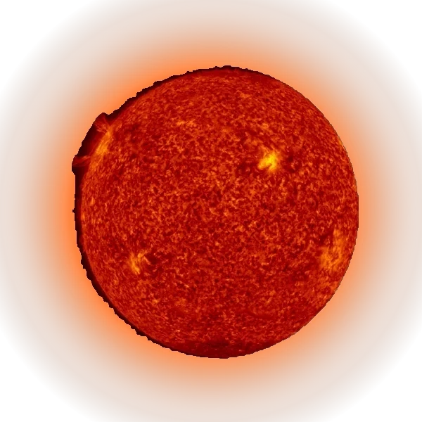

      

        
太阳Sun

        
太阳系的中心恒星，独占太阳系总质量的 99.86%

        
1.99×10³⁰ kg695,700 km5499 °C

      

      恒星
    </a>
  </article>
  <article class="astro-card" data-category="planet" data-name="水星 Mercury" data-mass="3.301e+23" data-radius="2439.7" data-density="5.429" data-temp="167" data-period="87.97" data-moons="0">
    <a class="astro-card-link" href="objects/mercury/">
      
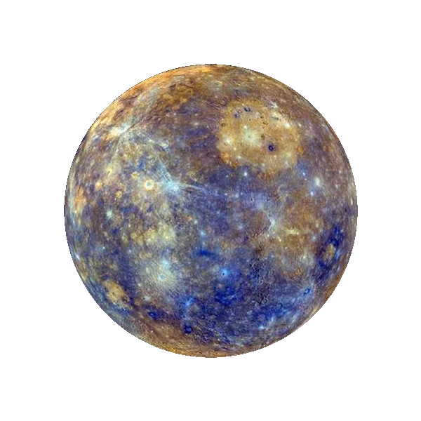

      

        
水星Mercury

        
离太阳最近的行星，一个太阳日比一个水星年还长

        
3.3×10²³ kg2,440 km167 °C

      

      行星
    </a>
  </article>
  <article class="astro-card" data-category="planet" data-name="金星 Venus" data-mass="4.8685e+24" data-radius="6051.8" data-density="5.243" data-temp="464" data-period="224.7" data-moons="0">
    <a class="astro-card-link" href="objects/venus/">
      
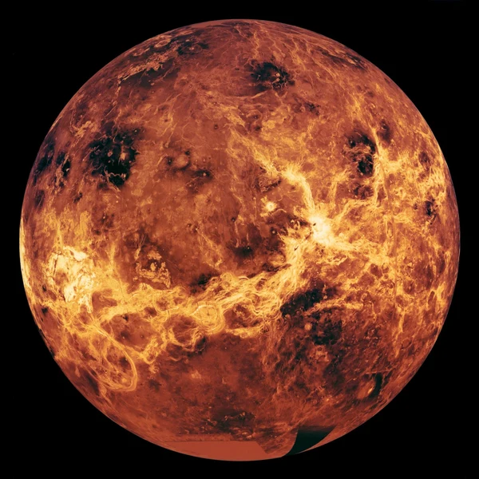

      

        
金星Venus

        
被浓厚二氧化碳大气包裹的炽热世界，太阳系表面最热的行星

        
4.87×10²⁴ kg6,052 km464 °C

      

      行星
    </a>
  </article>
  <article class="astro-card" data-category="planet" data-name="地球 Earth" data-mass="5.9724e+24" data-radius="6371.0" data-density="5.514" data-temp="15" data-period="365.26" data-moons="1">
    <a class="astro-card-link" href="objects/earth/">
      
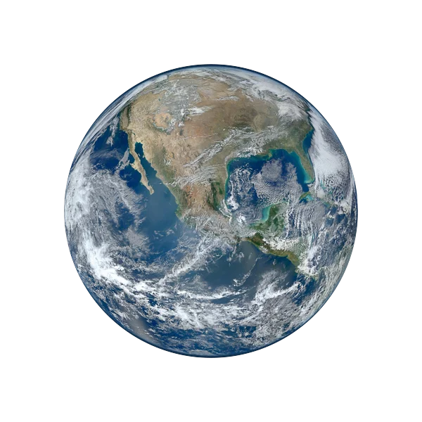

      

        
地球Earth

        
目前已知唯一存在生命的行星，约 71% 表面被液态水覆盖

        
5.97×10²⁴ kg6,371 km15 °C

      

      行星
    </a>
  </article>
  <article class="astro-card" data-category="planet" data-name="火星 Mars" data-mass="6.4169e+23" data-radius="3389.5" data-density="3.934" data-temp="-59" data-period="686.98" data-moons="2">
    <a class="astro-card-link" href="objects/mars/">
      
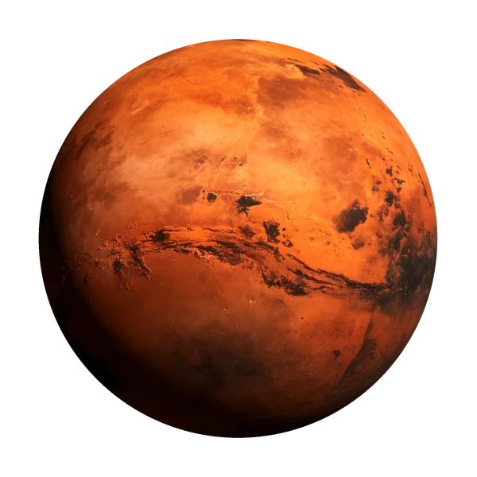

      

        
火星Mars

        
红色的沙漠行星，拥有太阳系最高的火山与最深的峡谷

        
6.42×10²³ kg3,390 km-59 °C

      

      行星
    </a>
  </article>
  <article class="astro-card" data-category="planet" data-name="木星 Jupiter" data-mass="1.89813e+27" data-radius="69911" data-density="1.326" data-temp="-110" data-period="4332.59" data-moons="95">
    <a class="astro-card-link" href="objects/jupiter/">
      
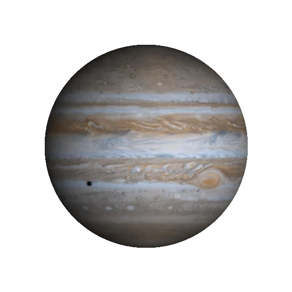

      

        
木星Jupiter

        
太阳系最大的行星，质量超过其余七颗行星的总和

        
1.9×10²⁷ kg69,911 km-110 °C

      

      行星
    </a>
  </article>
  <article class="astro-card" data-category="planet" data-name="土星 Saturn" data-mass="5.6832e+26" data-radius="58232" data-density="0.687" data-temp="-140" data-period="10755.7" data-moons="274">
    <a class="astro-card-link" href="objects/saturn/">
      
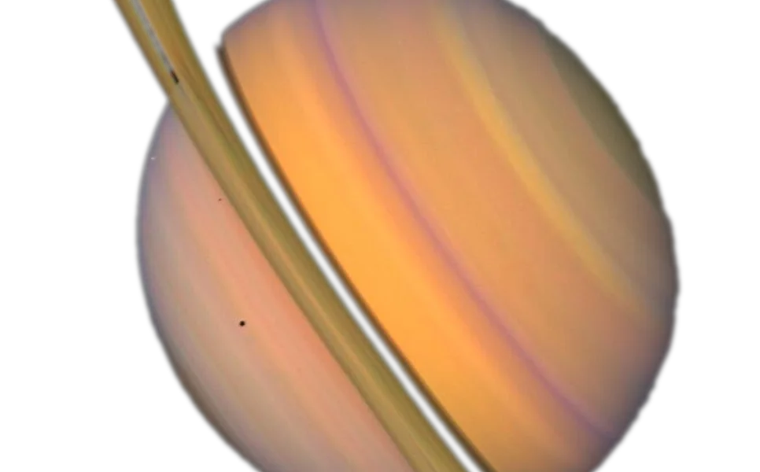

      

        
土星Saturn

        
以壮观环系闻名的气态巨行星，平均密度比水还小

        
5.68×10²⁶ kg58,232 km-140 °C

      

      行星
    </a>
  </article>
  <article class="astro-card" data-category="planet" data-name="天王星 Uranus" data-mass="8.6813e+25" data-radius="25559" data-density="1.27" data-temp="-195" data-period="30589" data-moons="28">
    <a class="astro-card-link" href="objects/uranus/">
      
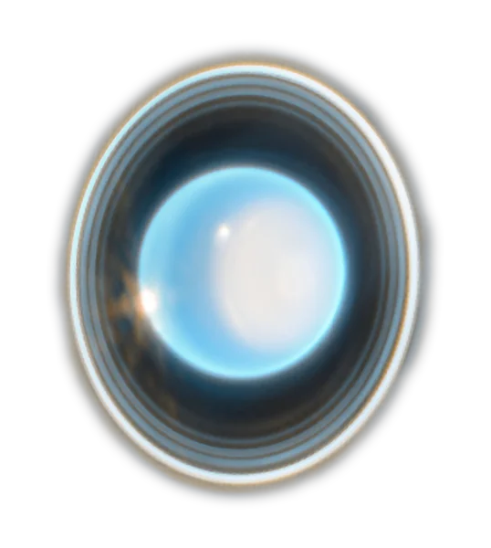

      

        
天王星Uranus

        
躺着自转的冰巨星，自转轴倾角约 98 度

        
8.68×10²⁵ kg25,559 km-195 °C

      

      行星
    </a>
  </article>
  <article class="astro-card" data-category="planet" data-name="海王星 Neptune" data-mass="1.0241e+26" data-radius="24764" data-density="1.638" data-temp="-200" data-period="59800" data-moons="16">
    <a class="astro-card-link" href="objects/neptune/">
      
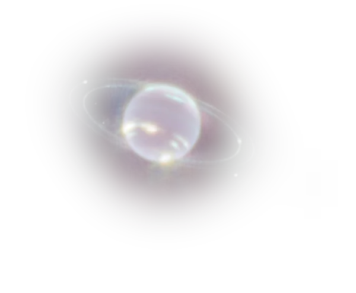

      

        
海王星Neptune

        
太阳系最外侧的行星，风速可达每小时 2100 公里

        
1.02×10²⁶ kg24,764 km-200 °C

      

      行星
    </a>
  </article>
  <article class="astro-card" data-category="dwarf_planet" data-name="冥王星 Pluto" data-mass="1.303e+22" data-radius="1188.3" data-density="1.85" data-temp="-225" data-period="90560" data-moons="5">
    <a class="astro-card-link" href="objects/pluto/">
      
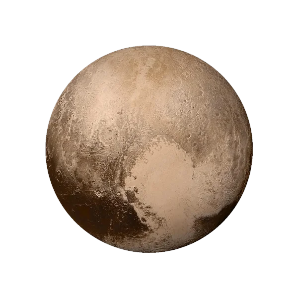

      

        
冥王星Pluto

        
曾被列为第九大行星，与卫星卡戎构成双天体系统

        
1.3×10²² kg1,188 km-225 °C

      

      矮行星
    </a>
  </article>
  <article class="astro-card" data-category="dwarf_planet" data-name="谷神星 Ceres" data-mass="9.3846e+20" data-radius="469.7" data-density="2.162" data-temp="" data-period="1682.0" data-moons="0">
    <a class="astro-card-link" href="objects/ceres/">
      
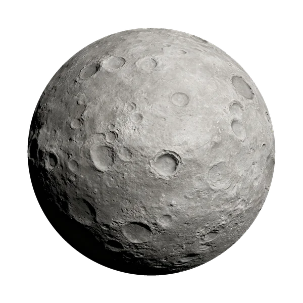

      

        
谷神星Ceres

        
小行星带中最大的天体，唯一位于内太阳系的矮行星

        
9.38×10²⁰ kg469.7 km2.162 g/cm³

      

      矮行星
    </a>
  </article>
  <article class="astro-card" data-category="dwarf_planet" data-name="鸟神星 Makemake" data-mass="" data-radius="" data-density="" data-temp="" data-period="112364.81" data-moons="1">
    <a class="astro-card-link" href="objects/makemake/">
      
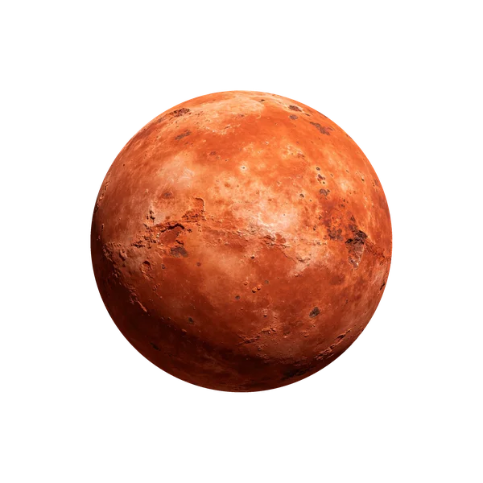

      

        
鸟神星Makemake

        
柯伊伯带最大的经典天体之一，表面覆盖甲烷冰

        

      

      矮行星
    </a>
  </article>
  <article class="astro-card" data-category="dwarf_planet" data-name="妊神星 Haumea" data-mass="" data-radius="" data-density="" data-temp="" data-period="103208.12" data-moons="2">
    <a class="astro-card-link" href="objects/haumea/">
      
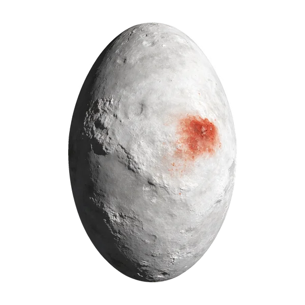

      

        
妊神星Haumea

        
自转极快的椭球状矮行星，拥有光环

        

      

      矮行星
    </a>
  </article>
  <article class="astro-card" data-category="dwarf_planet" data-name="阋神星 Eris" data-mass="" data-radius="" data-density="" data-temp="" data-period="204516.66" data-moons="1">
    <a class="astro-card-link" href="objects/eris/">
      
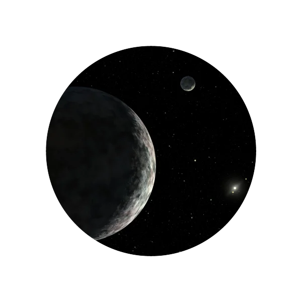

      

        
阋神星Eris

        
质量最大的矮行星，它的发现促使冥王星降级

        

      

      矮行星
    </a>
  </article>
  <article class="astro-card" data-category="moon" data-name="月球 Moon" data-mass="7.346e+22" data-radius="1737.4" data-density="3.344" data-temp="-20" data-period="27.3217" data-moons="0">
    <a class="astro-card-link" href="objects/moon/">
      
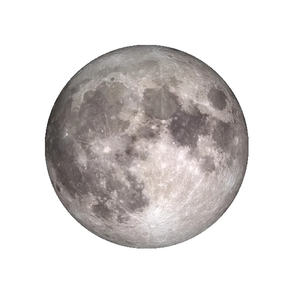

      

        
月球Moon

        
地球唯一的天然卫星，潮汐锁定使它永远以同一面朝向地球

        
7.35×10²² kg1,737 km-20 °C

      

      卫星
    </a>
  </article>
  <article class="astro-card" data-category="moon" data-name="火卫一 Phobos" data-mass="1.06e+16" data-radius="11.27" data-density="1.9" data-temp="" data-period="0.31891" data-moons="0">
    <a class="astro-card-link" href="objects/phobos/">
      
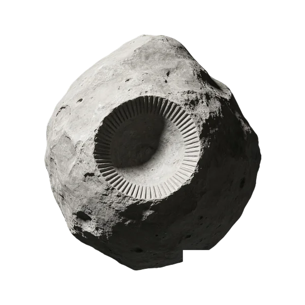

      

        
火卫一Phobos

        
火星较大的卫星，正以每百年约 1.8 米的速度靠近火星

        
1.06×10¹⁶ kg11.3 km1.9 g/cm³

      

      卫星
    </a>
  </article>
  <article class="astro-card" data-category="moon" data-name="火卫二 Deimos" data-mass="2400000000000000.0" data-radius="6.3" data-density="1.75" data-temp="" data-period="1.26244" data-moons="0">
    <a class="astro-card-link" href="objects/deimos/">
      
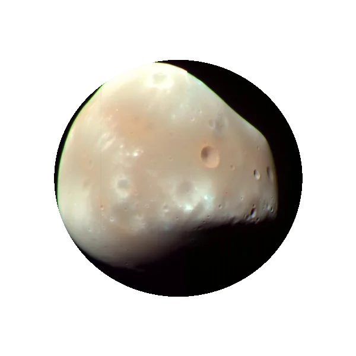

      

        
火卫二Deimos

        
火星较小的卫星，形状极不规则，表面覆盖细腻的风化层

        
2.4×10¹⁵ kg6.3 km1.75 g/cm³

      

      卫星
    </a>
  </article>
  <article class="astro-card" data-category="moon" data-name="木卫一 Io" data-mass="8.932e+22" data-radius="1821.5" data-density="3.53" data-temp="" data-period="1.769138" data-moons="0">
    <a class="astro-card-link" href="objects/io/">
      
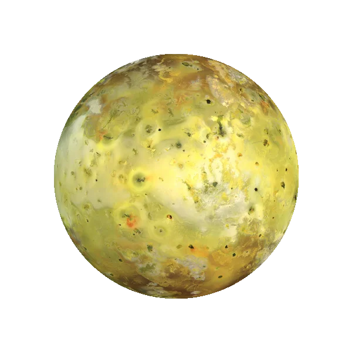

      

        
木卫一Io

        
太阳系火山活动最剧烈的天体，表面遍布硫磺沉积物

        
8.93×10²² kg1,822 km3.53 g/cm³

      

      卫星
    </a>
  </article>
  <article class="astro-card" data-category="moon" data-name="木卫二 Europa" data-mass="4.8e+22" data-radius="1560.8" data-density="3.01" data-temp="" data-period="3.551181" data-moons="0">
    <a class="astro-card-link" href="objects/europa/">
      
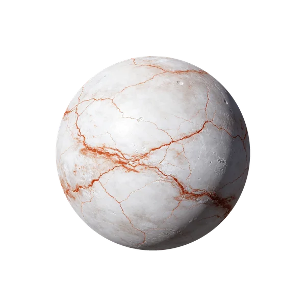

      

        
木卫二Europa

        
冰壳之下藏有全球性液态海洋，搜寻地外生命的热门目标

        
4.8×10²² kg1,561 km3.01 g/cm³

      

      卫星
    </a>
  </article>
  <article class="astro-card" data-category="moon" data-name="木卫三 Ganymede" data-mass="1.4819e+23" data-radius="2631.2" data-density="1.94" data-temp="" data-period="7.154553" data-moons="0">
    <a class="astro-card-link" href="objects/ganymede/">
      
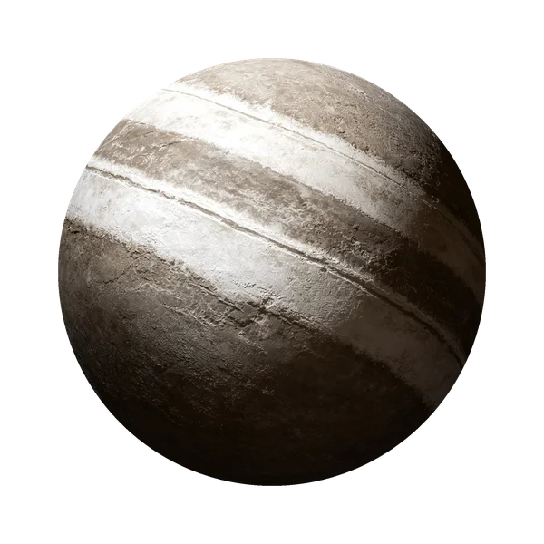

      

        
木卫三Ganymede

        
太阳系最大的卫星，比水星还大，且拥有自己的磁场

        
1.48×10²³ kg2,631 km1.94 g/cm³

      

      卫星
    </a>
  </article>
  <article class="astro-card" data-category="moon" data-name="木卫四 Callisto" data-mass="1.0759e+23" data-radius="2410.3" data-density="1.83" data-temp="" data-period="16.689017" data-moons="0">
    <a class="astro-card-link" href="objects/callisto/">
      
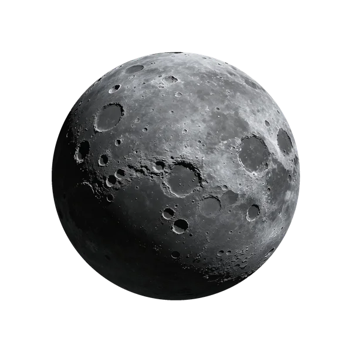

      

        
木卫四Callisto

        
太阳系撞击坑最密集的天体之一，表面几乎未被地质活动改造

        
1.08×10²³ kg2,410 km1.83 g/cm³

      

      卫星
    </a>
  </article>
  <article class="astro-card" data-category="moon" data-name="土卫一 Mimas" data-mass="3.79e+19" data-radius="198.7" data-density="1.15" data-temp="" data-period="0.9424218" data-moons="0">
    <a class="astro-card-link" href="objects/mimas/">
      
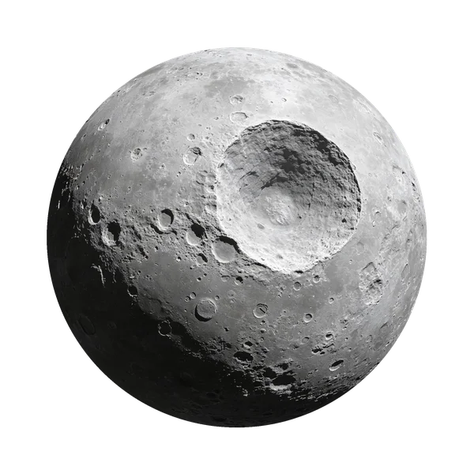

      

        
土卫一Mimas

        
被称为'死星'的卫星，赫歇尔撞击坑占其表面的三分之一

        
3.79×10¹⁹ kg198.7 km1.15 g/cm³

      

      卫星
    </a>
  </article>
  <article class="astro-card" data-category="moon" data-name="土卫二 Enceladus" data-mass="1.08e+20" data-radius="252.1" data-density="1.61" data-temp="" data-period="1.370218" data-moons="0">
    <a class="astro-card-link" href="objects/enceladus/">
      
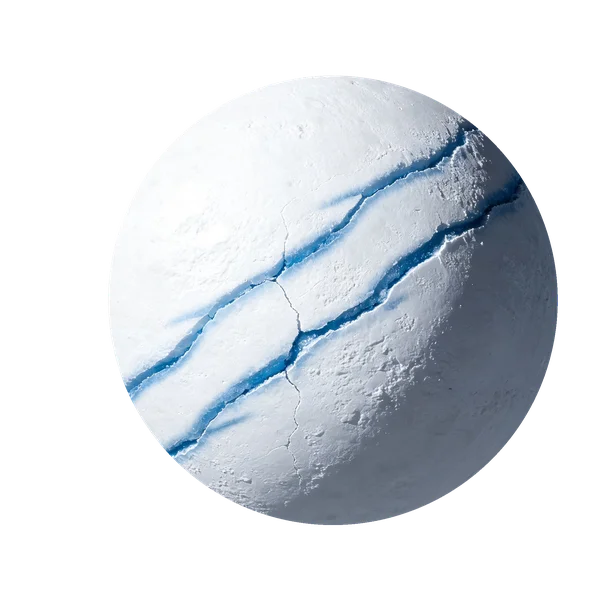

      

        
土卫二Enceladus

        
南极喷泉将地下海洋的物质直接送入太空的冰质小卫星

        
1.08×10²⁰ kg252.1 km1.61 g/cm³

      

      卫星
    </a>
  </article>
  <article class="astro-card" data-category="moon" data-name="土卫三 Tethys" data-mass="6.18e+20" data-radius="530.7" data-density="0.985" data-temp="" data-period="1.887802" data-moons="0">
    <a class="astro-card-link" href="objects/tethys/">
      
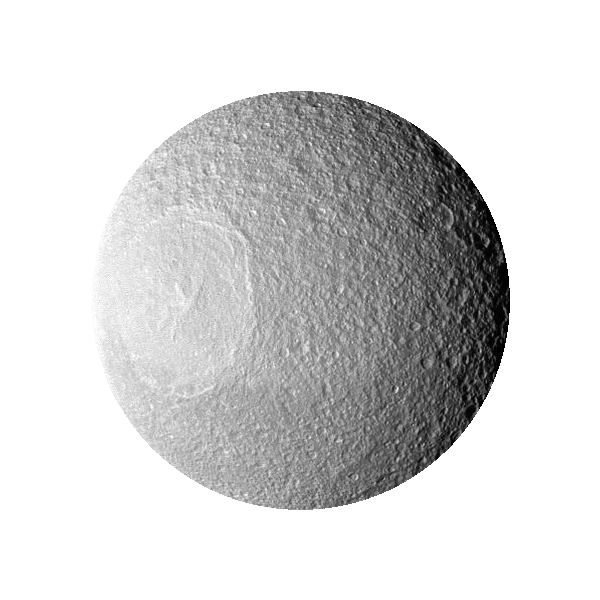

      

        
土卫三Tethys

        
冰质卫星，表面的伊萨卡峡谷绵延约 2000 公里

        
6.18×10²⁰ kg530.7 km0.985 g/cm³

      

      卫星
    </a>
  </article>
  <article class="astro-card" data-category="moon" data-name="土卫四 Dione" data-mass="1.1e+21" data-radius="561.4" data-density="1.478" data-temp="" data-period="2.736915" data-moons="0">
    <a class="astro-card-link" href="objects/dione/">
      
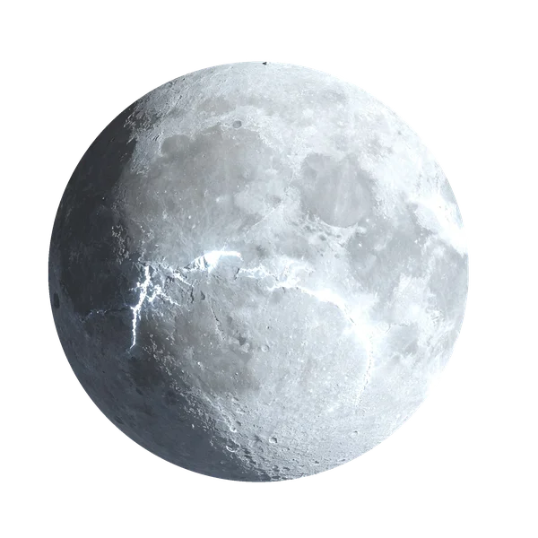

      

        
土卫四Dione

        
冰质卫星，纵横的冰壳悬崖记录着古老的地质活动

        
1.1×10²¹ kg561.4 km1.478 g/cm³

      

      卫星
    </a>
  </article>
  <article class="astro-card" data-category="moon" data-name="土卫五 Rhea" data-mass="2.31e+21" data-radius="763.8" data-density="1.236" data-temp="" data-period="4.5175" data-moons="0">
    <a class="astro-card-link" href="objects/rhea/">
      
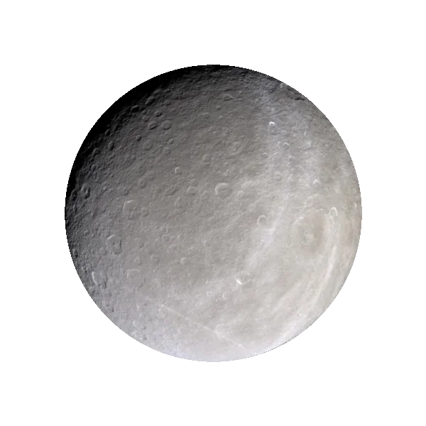

      

        
土卫五Rhea

        
土星第二大卫星，由约三分之二的冰与三分之一的岩石构成

        
2.31×10²¹ kg763.8 km1.236 g/cm³

      

      卫星
    </a>
  </article>
  <article class="astro-card" data-category="moon" data-name="土卫六 Titan" data-mass="1.3455e+23" data-radius="2575.5" data-density="1.881" data-temp="-179" data-period="15.945421" data-moons="0">
    <a class="astro-card-link" href="objects/titan/">
      
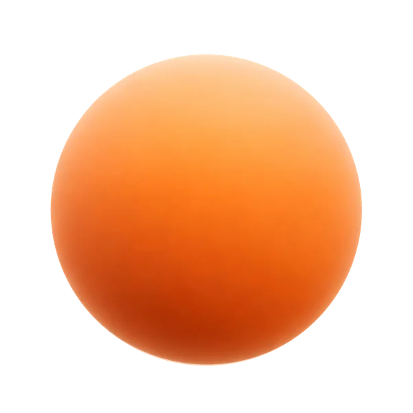

      

        
土卫六Titan

        
太阳系唯一拥有浓厚大气的卫星，地表有液态甲烷的湖泊与河流

        
1.35×10²³ kg2,576 km-179 °C

      

      卫星
    </a>
  </article>
  <article class="astro-card" data-category="moon" data-name="土卫七 Hyperion" data-mass="5.6e+18" data-radius="138.7" data-density="0.55" data-temp="" data-period="21.276609" data-moons="0">
    <a class="astro-card-link" href="objects/hyperion/">
      
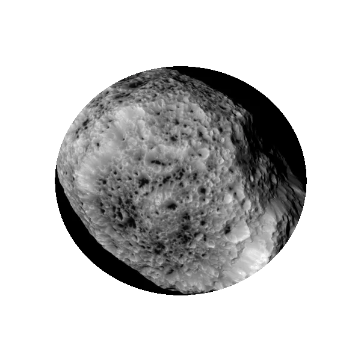

      

        
土卫七Hyperion

        
形状极不规则的卫星，混沌自转使它的朝向无法预测

        
5.6×10¹⁸ kg138.7 km0.55 g/cm³

      

      卫星
    </a>
  </article>
  <article class="astro-card" data-category="moon" data-name="土卫八 Iapetus" data-mass="1.81e+21" data-radius="734.5" data-density="1.088" data-temp="" data-period="79.330183" data-moons="0">
    <a class="astro-card-link" href="objects/iapetus/">
      
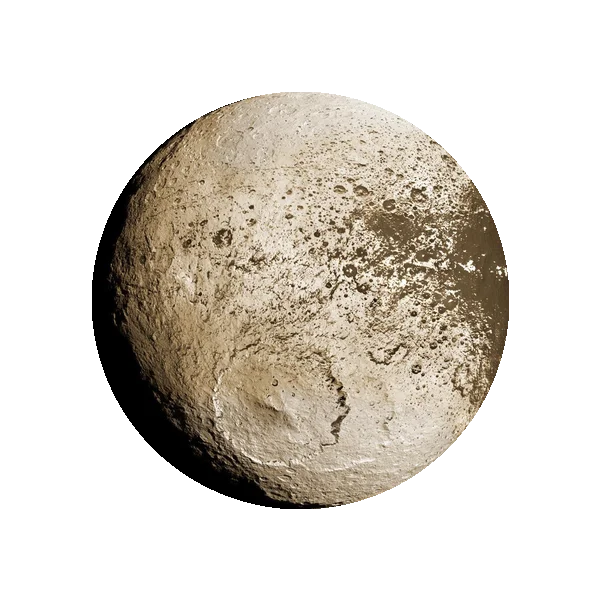

      

        
土卫八Iapetus

        
'阴阳脸'卫星，一面亮如雪一面黑如炭，赤道还有一道奇异山脊

        
1.81×10²¹ kg734.5 km1.088 g/cm³

      

      卫星
    </a>
  </article>
  <article class="astro-card" data-category="moon" data-name="海卫一 Triton" data-mass="2.14e+22" data-radius="1353.4" data-density="2.05" data-temp="-235" data-period="5.876854" data-moons="0">
    <a class="astro-card-link" href="objects/triton/">
      
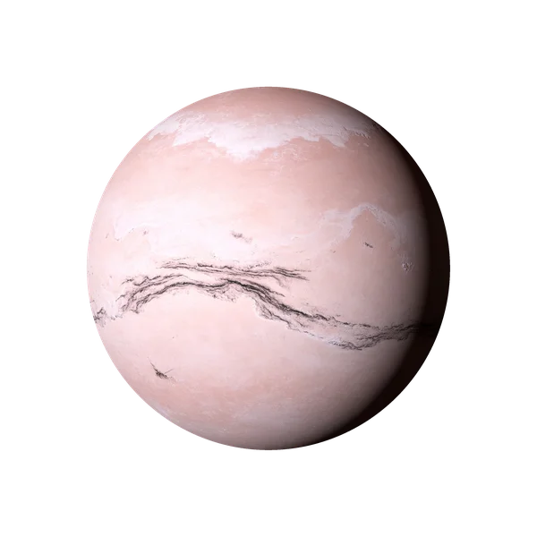

      

        
海卫一Triton

        
沿逆行轨道运行的卫星，或为被俘获的柯伊伯带天体

        
2.14×10²² kg1,353 km-235 °C

      

      卫星
    </a>
  </article>
  <article class="astro-card" data-category="moon" data-name="天卫五 Miranda" data-mass="6.6e+19" data-radius="235.8" data-density="1.2" data-temp="" data-period="1.413479" data-moons="0">
    <a class="astro-card-link" href="objects/miranda/">
      
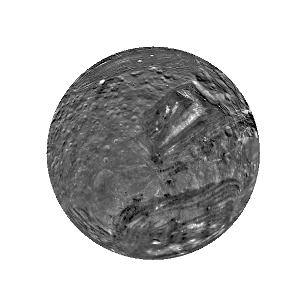

      

        
天卫五Miranda

        
天王星系统中地质最奇特的卫星，断崖与沟槽密布

        
6.6×10¹⁹ kg235.8 km1.2 g/cm³

      

      卫星
    </a>
  </article>
  <article class="astro-card" data-category="moon" data-name="天卫一 Ariel" data-mass="1.29e+21" data-radius="578.9" data-density="1.59" data-temp="" data-period="2.520379" data-moons="0">
    <a class="astro-card-link" href="objects/ariel/">
      
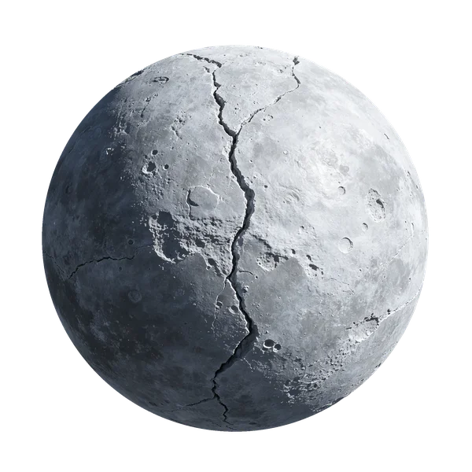

      

        
天卫一Ariel

        
天王星系统中最明亮的卫星，表面峡谷纵横

        
1.29×10²¹ kg578.9 km1.59 g/cm³

      

      卫星
    </a>
  </article>
  <article class="astro-card" data-category="moon" data-name="天卫二 Umbriel" data-mass="1.22e+21" data-radius="584.7" data-density="1.46" data-temp="" data-period="4.144176" data-moons="0">
    <a class="astro-card-link" href="objects/umbriel/">
      
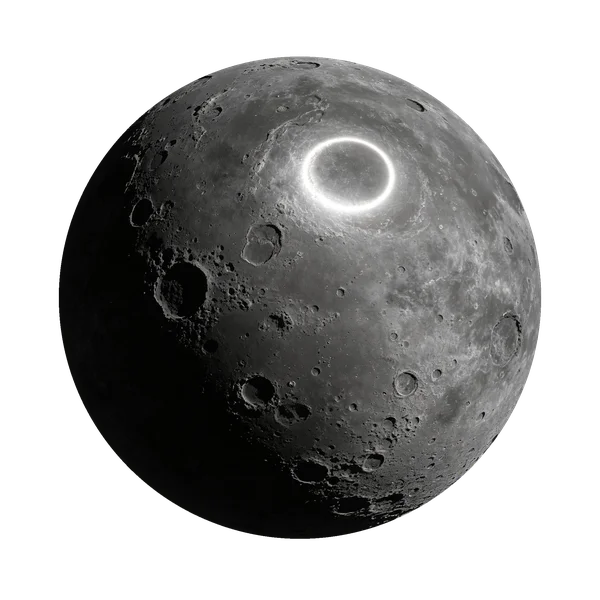

      

        
天卫二Umbriel

        
天王星系统中最暗的卫星，表面古老撞击坑密布

        
1.22×10²¹ kg584.7 km1.46 g/cm³

      

      卫星
    </a>
  </article>
  <article class="astro-card" data-category="moon" data-name="天卫三 Titania" data-mass="3.42e+21" data-radius="788.9" data-density="1.66" data-temp="" data-period="8.705867" data-moons="0">
    <a class="astro-card-link" href="objects/titania/">
      
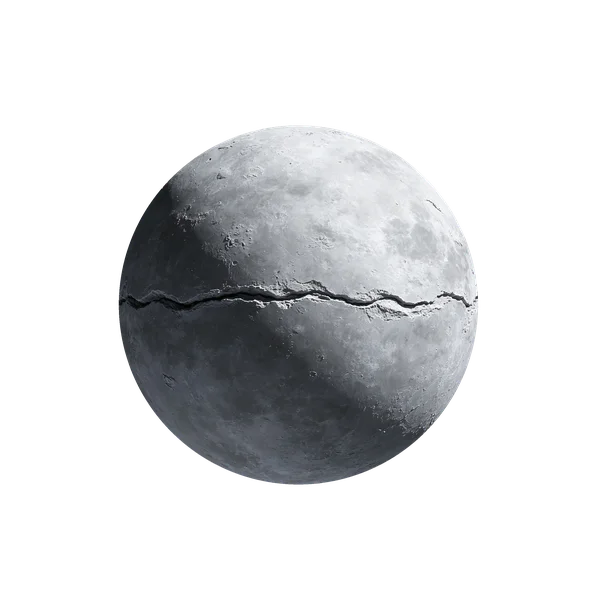

      

        
天卫三Titania

        
天王星最大的卫星，表面有巨大的地堑系统

        
3.42×10²¹ kg788.9 km1.66 g/cm³

      

      卫星
    </a>
  </article>
  <article class="astro-card" data-category="moon" data-name="天卫四 Oberon" data-mass="2.88e+21" data-radius="761.4" data-density="1.56" data-temp="" data-period="13.463234" data-moons="0">
    <a class="astro-card-link" href="objects/oberon/">
      
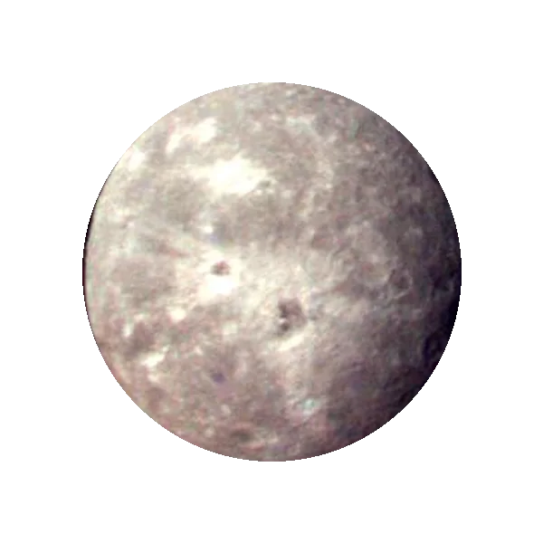

      

        
天卫四Oberon

        
天王星最外侧的大卫星，表面遍布撞击坑与深色物质

        
2.88×10²¹ kg761.4 km1.56 g/cm³

      

      卫星
    </a>
  </article>

没有匹配的天体，换个关键词或分类试试。

<section class="astro-articles" id="articles">
  <h2>科普文章</h2>
  
每颗天体的数据页之下，附一篇深度科普：

  <ul class="astro-article-list">
    <li><a href="objects/mercury/">水星（Mercury）</a></li>
    <li><a href="objects/venus/">金星（Venus）</a></li>
    <li><a href="objects/mars/">火星（Mars）</a></li>
    <li><a href="objects/jupiter/">木星（Jupiter）</a></li>
    <li><a href="objects/saturn/">土星（Saturn）</a></li>
    <li><a href="objects/pluto/">冥王星（Pluto）</a></li>
  </ul>
</section>

<section class="astro-note">
  <h2>数据说明</h2>
  
全部数值整理自 NASA 公开资料（公共领域），每个天体页面均标注来源与核对日期（最近核对：2026-10-18）。发现数据错误？欢迎到 <a href="https://github.com/yufengwolf/astro-blog/issues">GitHub Issues</a> 反馈。

</section>

数据版本 v1.4 · 收录 35 个天体（全部配图）

