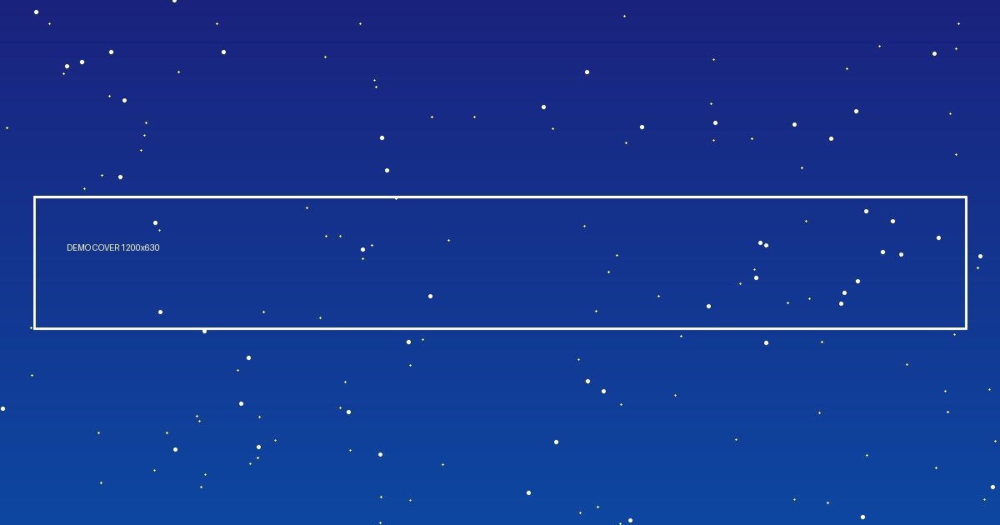

# 星野笔记

> 通俗有趣的天文科普：从太阳系行星到深空天体，把宇宙讲成故事。

---

## 专栏导航

-   :material-book-open-variant:{ .lg .middle } __专题一__

    ---

    这里写专题一的一句话描述，告诉读者点进去能获得什么。

    [:octicons-arrow-right-24: 进入专栏](topic1/index.md)

-   :material-earth:{ .lg .middle } __专题二__

    ---

    这里写专题二的一句话描述，告诉读者点进去能获得什么。

    [:octicons-arrow-right-24: 进入专栏](topic2/index.md)

## 排版能力演示

!!! note "提示框"
    用于名词解释、注意事项、延伸阅读。

??? tip "折叠块（点击展开）"
    用于进阶内容、参考文献、推导过程，保持正文简洁。

