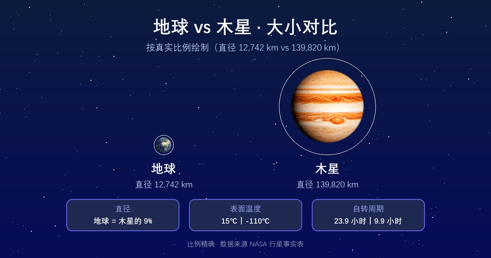

  

  

    行星
    <h1>木星 <small>Jupiter</small></h1>
    
太阳系最大的行星，质量超过其余七颗行星的总和

    

      1.9×10²⁷ kg
      69,911 km
      -110 °C
      1.326 g/cm³
    

  

母天体：<a href="../sun/">太阳</a> · 分类：行星

  <button type="button" id="astro-compare-toggle" class="cmp-btn" aria-expanded="false" aria-controls="astro-compare">⚖ 与其他天体对比</button>
  从数据库中任选天体（可多选）逐参数对比，链接可分享

<section class="obj-compare" id="astro-compare" hidden data-current="jupiter">
  

    <input type="search" id="cmp-search" placeholder="搜索要对比的天体（中/英文）…" aria-label="搜索对比天体">
    <ul class="cmp-results" id="cmp-results" hidden></ul>
  

  
<table class="cmp-table" id="cmp-table"></table>

  
对比在该页本地完成；点击列标题旁的 × 可移除该天体。

</section>

## 物理参数

| 参数 | 数值 |
|---|---|
| 质量 | 1.9×10²⁷ kg |
| 平均半径 | 69,911 km |
| 平均密度 | 1.326 g/cm³ |
| 表面重力 | 25.92 m/s² |
| 逃逸速度 | 59.50 km/s |
| 平均表面温度 | -110 °C |
| 有效温度（black-body 口径） | -163.25 °C |
| 表面气压 | — |
| 反照率 | 0.34（Bond 0.343 / Geometric 0.538） |

## 轨道参数

| 参数 | 数值 |
|---|---|
| 半长轴 | 778,479,000 km（5.2 AU） |
| 轨道周期 | 11.9 年（4,333 天） |
| 平均轨道速度 | 13.06 km/s |
| 轨道倾角 | 1.304° |
| 轨道偏心率 | 0.0487 |
| 转轴倾角 | 3.13° |
| 自转周期 | 9.93 小时 |

## 其他特征

| 项目 | 数值 |
|---|---|
| 大气成分 | 氢 89.8%、氦 10.2%（其余为甲烷、氨等微量） |
| 全球磁场 | 是 |
| 环系 | 是 |
| 已确认卫星 | 95 颗（ notable：<a href="../io/">木卫一</a>、<a href="../europa/">木卫二</a>、<a href="../ganymede/">木卫三</a>、<a href="../callisto/">木卫四</a>） |
| 发现 | 史前 |

<section class="obj-source">
  <h2>数据来源</h2>
  
来源标识：nssdc_jupiterfact；核对日期：2026-10-18。数值整理自 NASA NSSDC / JPL 公开资料（公共领域）。发现错误请到 <a href="https://github.com/yufengwolf/astro-blog/issues">GitHub Issues</a> 反馈。

</section>

<section class="obj-articles">
  <h2>相关文章</h2>
  <ul class="astro-article-list">
    <li><a href="#article-jupiter">木星体积能装1300个地球，为何被称作地球守护神？</a></li>
  </ul>
</section>

<section class="obj-article" id="article-jupiter">
  <h2>延伸阅读：木星体积能装1300个地球，为何被称作地球守护神？</h2>

木星能容纳约1300个地球，凭借太阳系行星里最强的引力，长期清理太阳系内的彗星、小行星，减少小天体撞击内行星的概率，这就是“地球守护神”说法的来源。但它并非万能盾牌，也会把部分天体甩向内侧轨道。

## 太阳系巨无霸：极速自转撑出扁球外形
木星直径约13.98万公里，对比地球约1.27万公里的直径，体量差距直观。它是太阳系唯一一颗质量超过其余所有行星总和的气态巨行星，质量约等于318个地球。

木星拥有太阳系行星中最快自转速度，自转一圈不到10小时。这么快的旋转产生巨大离心力，把赤道向外拉扯，两极被压缩，形成明显扁球状。赤道直径比两极直径多出约一万公里，差距几乎等于地球直径。

它没有固态岩石地表，外层是氢与氦构成的浓厚大气，越往内部压力越高，氢气会转变为液态金属氢。这层液态金属氢的流动，催生太阳系行星里最强的磁场。木星磁场强度远高于地球，周围辐射带能量极强，没有专门防护的探测器进入辐射带，电子设备会快速失效。

## 大红斑：持续数百年的巨型永恒风暴
大红斑是木星大气上的巨型反气旋风暴，人类观测记录已经持续数百年。风暴横向尺度最大时，可以并排放下两到三个地球。它不是固定的山体，是大气漩涡，会缓慢收缩、改变形状，至今没有完全消散。

地球上的台风，依靠海洋热量维持，最多维持几周就会消散。木星没有海洋，风暴能量来自行星内部持续向外释放的热量。内部热源源源不断供给能量，让风暴可以持续数百年，这是地球风暴无法比拟的时间尺度。

大红斑内部气流高速旋转，风暴内部温度、气压和周围大气存在巨大差异。近年观测显示大红斑正在缓慢缩小，未来是否会彻底消失，目前天文学家还没有确定结论。

## 引力吸尘器：守护地球，也暗藏风险
木星巨大质量带来极强引力，就像太阳系的引力吸尘器。很多从外太阳系向内飞来的彗星和小行星，经过木星附近时，会被引力捕获，最终坠入木星大气，在木星上留下撞击痕迹。

最知名的案例是1994年苏梅克-列维9号彗星，这颗彗星被木星引力撕碎，碎片连续撞击木星。如果没有木星，这类天体有一部分可能飞向地球轨道，大幅提升撞击风险。

但**木星不是纯粹的保护者**。引力不只会捕获天体，也会改变天体轨道。部分小行星经过木星引力弹弓效应，会被甩进内太阳系，反而增加地球遭遇撞击的可能性。守护是统计层面的长期效应，不是绝对的防护屏障。

## 四颗伽利略卫星：巨行星身边的小世界
伽利略在1610年发现四颗围绕木星运转的大型卫星，也就是伽利略卫星，四颗天体各自拥有完全不同的环境。

- 木卫一：太阳系火山活动最密集的天体。木星潮汐力持续拉扯内部，不断产生热量，地表遍布活火山，持续喷发熔岩。
- 木卫二：表面覆盖厚厚的冰壳，冰层下方存在液态水海洋。海洋水量总量远超地球全部海洋，是太阳系最受关注的潜在宜居天体。
- 木卫三：太阳系最大卫星，体积比水星还大，自身拥有磁场。
- 木卫四：表面布满古老撞击坑，地质活动相对平静，冰壳之下同样可能存在地下海洋。

这四颗卫星和木星之间形成复杂的引力共振，潮汐加热塑造了卫星内部环境，也让它们成为地外生命搜寻的重点目标。

## 常见误区
- 很多人以为木星是固态大行星。其实木星是气态巨行星，没有岩石固态地表，越往内部压力升高，氢逐步转变为液态金属氢，不存在可以登陆的地面。
- 很多人认为大红斑永远不会消失。大红斑一直在缓慢收缩，历史上它的尺寸比现在更大，未来有可能慢慢消散，只是短时间内不会完全消失。
- 很多人觉得木星能完全挡住所有小行星撞击。木星引力会改变天体轨道，一部分天体被捕获，也有一部分被弹射到内太阳系，只能降低撞击概率，无法做到完全防护。
- 很多人认为木星大气风暴和地球台风原理一致。地球台风依靠海水蒸发供热；木星风暴依靠行星内部释放的热量驱动，能量来源完全不同，寿命差距巨大。

## 常见问题
**木星能装下多少个地球？**
按体积计算大约可以容纳1300个地球，质量约等于318个地球。

**大红斑到底有多大？**
巅峰时期横向宽度可以并排放下两到三个地球，现在尺寸正在缓慢缩小。

**木星的一天为什么这么短？**
木星形成时保留了原始星云的旋转动量，加上气态行星没有固态地表摩擦，自转速度极快，自转周期不到10小时。

**木卫二的海洋有可能存在生命吗？**
冰下液态海洋具备液态水、能量、化学物质等条件，是寻找地外生命的优先目标，但目前没有发现生命存在的直接证据。

**木星辐射为什么危险？**
液态金属氢产生极强磁场，捕获带电粒子形成高能辐射带，未加装防护的探测器会被高能粒子损坏设备。

木星的引力作用，改变了太阳系早期行星的分布格局。在太阳系形成初期，木星的迁移影响了小行星带的形成，阻止大量岩石物质聚集形成另一颗行星。这一远古时期的引力扰动，也间接塑造了后来内行星的环境。

</section>

← 上一颗：<a href="../mars/">火星</a>

下一颗：<a href="../saturn/">土星</a> →

数据版本 v1.2（2026-10-18 核对）· 32 个天体已全部配图

