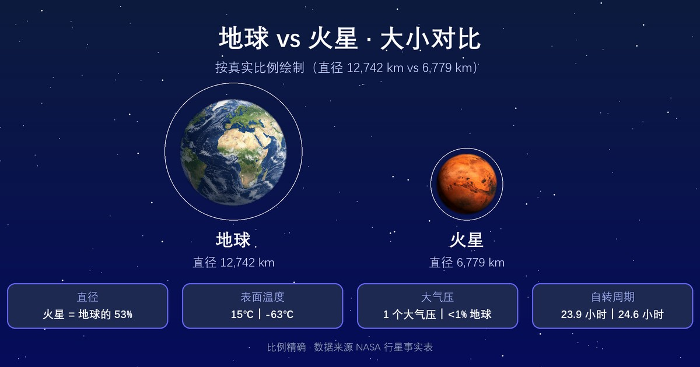

  

影像：<a href="https://images.nasa.gov/details/PIA00407" target="_blank" rel="noopener">NASA/JPL · 海盗号全球彩色视图</a>

  

    行星
    <h1>火星 <small>Mars</small></h1>
    
红色的沙漠行星，拥有太阳系最高的火山与最深的峡谷

    

      6.42×10²³ kg
      3,390 km
      -59 °C
      3.934 g/cm³
    

  

母天体：<a href="../sun/">太阳</a> · 分类：行星

## 物理参数

| 参数 | 数值 |
|---|---|
| 质量 | 6.42×10²³ kg |
| 平均半径 | 3,390 km |
| 平均密度 | 3.934 g/cm³ |
| 表面重力 | 3.73 m/s² |
| 逃逸速度 | 5.03 km/s |
| 平均表面温度 | -59 °C |
| 有效温度（black-body 口径） | -63.4 °C |
| 表面气压 | 0.00636 bar |
| 反照率 | 0.25（Bond 0.25 / Geometric 0.17） |

## 轨道参数

| 参数 | 数值 |
|---|---|
| 半长轴 | 227,956,000 km（1.52 AU） |
| 轨道周期 | 687.0 天 |
| 平均轨道速度 | 24.08 km/s |
| 轨道倾角 | 1.848° |
| 轨道偏心率 | 0.0935 |
| 转轴倾角 | 25.19° |
| 自转周期 | 24.62 小时 |

## 其他特征

| 项目 | 数值 |
|---|---|
| 大气成分 | 二氧化碳 95.1%、氮 2.6%、氩 1.9%（其余为氧、一氧化碳等微量） |
| 全球磁场 | 否 |
| 环系 | 否 |
| 已确认卫星 | 2 颗（ notable：<a href="../phobos/">火卫一</a>、<a href="../deimos/">火卫二</a>） |
| 发现 | 史前 |

<section class="obj-source">
  <h2>数据来源</h2>
  
数据来源：<a href="https://nssdc.gsfc.nasa.gov/planetary/factsheet/marsfact.html" target="_blank" rel="noopener">NASA NSSDC · Mars Fact Sheet</a>；核对日期：2026-10-18。数值整理自 NASA NSSDC / JPL / Wikipedia 等公开天文资料。发现错误请到 <a href="https://github.com/yufengwolf/astro-blog/issues">GitHub Issues</a> 反馈。

</section>

<section class="obj-articles">
  <h2>相关文章</h2>
  <ul class="astro-article-list">
    <li><a href="#article-mars">火星为什么被定为人类星际探索的下一站？</a></li>
  </ul>
</section>

<section class="obj-article" id="article-mars">
  <h2>延伸阅读：火星为什么被定为人类星际探索的下一站？</h2>

火星之所以被视作人类星际探索的下一站，核心不是它最宜居，而是它在太阳系里，拥有最接近地球的基础条件，同时保留着震撼的地质遗迹。它直径约6779公里，大约是地球的一半，地表富含氧化铁，也就是铁锈，所以呈现标志性的橘红色。

## 火星的地质尺度：太阳系里的巨型地貌博物馆
### 奥林帕斯山：太阳系最高火山
奥林帕斯山高出周边平原约22公里，大约是珠穆朗玛峰高度的2.5倍。这座巨型盾状火山底座宽度超过500公里，相当于一座覆盖整个浙江省的巨型山体。
火星引力仅为地球的38%，板块运动几乎停止，火山可以持续喷发、堆积上亿年，才能长出如此夸张的体量。地球板块会不断移动，火山无法固定在同一个位置无限增高。

### 水手谷：撕裂星球的巨型峡谷系统
水手谷沿着火星赤道南侧绵延约4000公里，最深可达7公里，是太阳系最大峡谷系统。4000公里的长度，差不多能横跨整个中国国土。
对比地球科罗拉多大峡谷，长度不足450公里，最深约1.8公里，体量远不及水手谷。它不是单一断裂形成，是多段地堑拼接而成的巨型裂谷带，由远古地质活动与流水侵蚀共同塑造。

## 从湿润蓝灰色星球到红色荒漠
远古火星曾经拥有河流、湖泊，地表遍布古河道、三角洲、湖床沉积岩，证明它曾经拥有稳定液态水。
火星磁场消失后，大气被太阳风持续剥离，气压急剧下降，液态水无法稳定存在于地表。如今地表水基本消失，两极留存冰冠，地下岩层之下大概率埋藏大量水冰。南极冰盖内的水冰，如果全部融化铺开，足以在火星表面形成一层约11米厚的水层。

火星大气极其稀薄，主要成分是二氧化碳，气压不足地球地表的1%。全球沙尘暴可以持续数月，沙尘悬浮在大气中，把整个星球染成昏红，遮挡阳光，改变地表温度。

## 两颗被俘获的小卫星：火卫一与火卫二
火星拥有两颗形状不规则的小型卫星，火卫一福波斯、火卫二得摩斯。它们体积很小，不是球形，外观和小行星高度相似，主流假说认为是火星引力捕获的小行星。
火卫一距离火星很近，轨道正在缓慢衰减，数千万年后，它会被火星潮汐力撕碎，形成环绕火星的碎石环。火卫二轨道则缓慢远离火星。从地球普通望远镜里，很难分辨两颗卫星的细节。

## 火星观测指南：什么时候看、用什么设备
观测火星的最佳窗口是**火星冲日**，大约每26个月发生一次。冲日时地球位于太阳与火星之间，火星日落升起、日出落下，整夜可见，距离地球最近，亮度达到峰值。
- 肉眼：城市光污染环境下，能看见一颗稳定的橙红色亮星，不会像恒星那样闪烁剧烈。
- 双筒望远镜（7×50或10×50）：能看出火星是小小的圆面，不再是光点，但看不到表面地貌。
- 小型天文望远镜：大气条件好的夜晚，可观测到白色的极地冰冠，明暗不一的地表色块；沙尘暴爆发时，冰冠会被沙尘遮蔽。
手机星图软件使用方法：打开APP搜索“火星”，开启AR实景，手机朝向夜空，跟随屏幕箭头定位目标天体。

## 常见误区
- 很多人以为火星温度很高，红色代表炎热。其实火星地表平均温度约-63℃，红色只是氧化铁，并非高温。
- 很多人以为火星有浓厚大气，能直接呼吸。火星大气稀薄，几乎没有氧气，无法直接呼吸，紫外线强度极高。
- 很多人认为火星地下存在大面积液态淡水湖。目前雷达探测到的南极冰盖下疑似水体，是高盐咸水，且存在争议，并非可直接取用的淡水。
- 很多人以为奥林帕斯山是山峰直冲云霄。它坡度极缓，站在山体表面，你看不到山顶，因为山体曲率会把山顶藏在地平线之外。

## 人类探测与基地前景
火星是太阳系内探测最密集的行星。从轨道探测器、着陆器到火星车，多国持续开展探测，寻找水、有机物与古生命痕迹。
它被选为人类下一站，核心优势：昼夜时长接近地球，火星一天约24小时37分；拥有水冰资源，可以提取水、制造氧气与燃料；距离地球相对近，发射窗口周期性出现。
但建立基地依然面临巨大障碍：宇宙辐射、低温、全球性沙尘暴、土壤含有高氯酸盐有毒物质。短期只能建造封闭人工栖息地，无法直接露天生存。

## 常见问题
Q：火星上能看到地球吗？
A：可以，在火星夜空，地球是一颗明亮的淡蓝色星，肉眼直接可见。
Q：火星的红色会随季节变化吗？
A：会，沙尘暴季节红色会更深，沙尘沉降后，地表原有暗区会重新显现。
Q：火星两极冰冠全是冰吗？
A：冰冠包含干冰（固态二氧化碳）和水冰，夏季干冰升华，水冰永久留存。
Q：火星上的山比地球更容易攀登？
A：引力更低，但极端低温、无大气、辐射、崎岖地形，不适合人类直接徒手攀登。
Q：火星沙尘暴会吹到地球吗？
A：不会，火星大气独立，没有物质通道将沙尘输送到地球。

水手谷和奥林帕斯山记录着火星剧烈地质年代，而遍布全球的古河道，记录着它从湿润星球走向荒漠的漫长转变。

</section>

← 上一颗：<a href="../earth/">地球</a>

下一颗：<a href="../jupiter/">木星</a> →

数据版本 v1.6（2026-10-24 核对）· 178 个天体已全部配图

