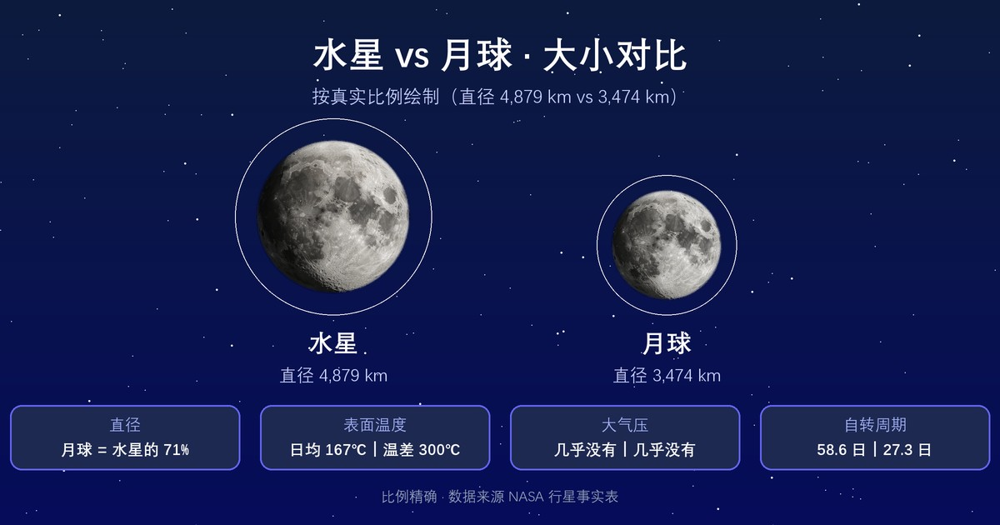

  

影像：<a href="https://images.nasa.gov/details/GSFC_20171208_Archive_e001545" target="_blank" rel="noopener">NASA/MESSENGER · 全球彩色合成（增强色）</a>

  

    行星
    <h1>水星 <small>Mercury</small></h1>
    
离太阳最近的行星，一个太阳日比一个水星年还长

    

      3.3×10²³ kg
      2,440 km
      167 °C
      5.429 g/cm³
    

  

母天体：<a href="../sun/">太阳</a> · 分类：行星

## 物理参数

| 参数 | 数值 |
|---|---|
| 质量 | 3.3×10²³ kg |
| 平均半径 | 2,440 km |
| 平均密度 | 5.429 g/cm³ |
| 表面重力 | 3.70 m/s² |
| 逃逸速度 | 4.30 km/s |
| 平均表面温度 | 167 °C |
| 有效温度（black-body 口径） | 166.4 °C |
| 表面气压 | — |
| 反照率 | 0.14（Bond 0.068 / Geometric 0.142） |

## 轨道参数

| 参数 | 数值 |
|---|---|
| 半长轴 | 57,910,000 km（0.387 AU） |
| 轨道周期 | 88.0 天 |
| 平均轨道速度 | 47.40 km/s |
| 轨道倾角 | 7° |
| 轨道偏心率 | 0.206 |
| 转轴倾角 | 0.034° |
| 自转周期 | 58.65 天 |

## 其他特征

| 项目 | 数值 |
|---|---|
| 大气成分 | — |
| 全球磁场 | 是 |
| 环系 | 否 |
| 已确认卫星 | 0 颗 |
| 发现 | 史前 |

<section class="obj-source">
  <h2>数据来源</h2>
  
数据来源：<a href="https://nssdc.gsfc.nasa.gov/planetary/factsheet/mercuryfact.html" target="_blank" rel="noopener">NASA NSSDC · Mercury Fact Sheet</a>；核对日期：2026-10-18。数值整理自 NASA NSSDC / JPL / Wikipedia 等公开天文资料。发现错误请到 <a href="https://github.com/yufengwolf/astro-blog/issues">GitHub Issues</a> 反馈。

</section>

<section class="obj-articles">
  <h2>相关文章</h2>
  <ul class="astro-article-list">
    <li><a href="#article-mercury">水星离太阳最近，为何不是最热行星？</a></li>
  </ul>
</section>

<section class="obj-article" id="article-mercury">
  <h2>延伸阅读：水星离太阳最近，为何不是最热行星？</h2>

水星距离太阳最近，但它并不是太阳系最热行星。它拥有太阳系行星里最悬殊的昼夜温差，迷你体型、极短的公转周期和超长太阳日叠加在一起，造就了这颗冰火并存的奇特星球。

## 太阳系最小行星，体型只略大于月球
水星直径约4879公里，月球直径约3474公里，二者尺度差距不大，水星只是稍微大一圈。它比地球小得多，地球直径大约是水星的2.6倍。

水星几乎没有大气，没有厚重外壳包裹，地表直接暴露在宇宙空间。肉眼看外观，水星和月球高度相似，表面密密麻麻铺满陨石坑，没有大气缓冲，数十亿年里不断承受小型天体撞击。

没有大气也意味着，热量无法在星球表面流动传递。被太阳直射的区域急剧升温，背阳面热量会快速散失到太空，无法留存。

## 白昼430℃、黑夜-180℃，太阳系最强温差
水星白昼赤道区域温度可达约430℃，黑夜区域骤降至约-180℃，温差超过600℃，是太阳系行星中温差最大的天体。

金星才是太阳系最热行星，它靠浓密二氧化碳温室效应锁住热量，表面稳定维持在460℃左右。水星没有大气保温，白天被烤到高温，一旦转入黑夜，热量瞬间流失，温度暴跌。

水星轨道偏心率在八大行星里最大，轨道是明显的椭圆形。在近日点，水星接收到的阳光总量，是远日点的两倍有余。靠近太阳时，地表受热强度会大幅提升，进一步放大环境的极端性。

## 一年88天，一个太阳日却等于176个地球日
水星绕太阳一圈只需要88个地球日，也就是水星上的“一年”。但它自转速度很慢，自转和公转产生3:2的轨道共振，带来反常识的时间效果。

水星自转一圈约59个地球日，但因为同时在高速绕太阳公转，**从一次日出到下一次日出，要经历176个地球日**。水星上的一个白天，相当于地球上88天，夜晚同样长达88天。

简单理解：水星的一年，只够经历一次完整的昼夜交替。如果你站在水星赤道，会看到太阳缓慢移动，漫长白昼之后，便是长达数月的极寒黑夜。

## 离太阳最近，极地深坑却封存水冰
水星赤道区域高温足以熔化铅，但是南北极深处的永久阴影陨石坑，永远接收不到阳光。坑内温度常年维持在极低水平，能够稳定保存水冰。

这些冰不是来自太阳附近的蒸发，而是彗星撞击、内部释放的水汽，落到永久阴影坑后被永久锁住。离太阳最近的行星，极地却保有固态水冰，是水星最颠覆直觉的特征。

## 水星观测指南：只能在大距窗口期寻找
水星和太阳角距离最大不超过28度，常年淹没在太阳的霞光里，是肉眼最难捕捉的行星。只有**大距（东大距、西大距）**前后一周是观测窗口。

- **东大距（傍晚）**：日落后30分钟，看向西方低空，找没有建筑、树木遮挡的开阔地点。天气通透、视力良好的人，肉眼可以直接看到，亮度约0.5等。
- **西大距（清晨）**：日出前约一小时，面向东方低空观测。
- 双筒望远镜：更容易定位水星，能看到它类似月亮的月牙相位；小型望远镜只能看到小小的亮盘，很难分辨地表陨石坑。
- 手机星图：打开星图APP，定位太阳位置，在太阳附近低空搜索水星。
> 安全提醒：绝对不要在太阳还高挂时，用双筒或望远镜对准太阳，会造成永久性眼部损伤。

## 常见误区
- 很多人以为离太阳最近的行星温度最高，其实不是。水星缺少大气，无法锁住热量；金星依靠厚重温室大气，表面温度更高。
- 很多人以为水星上一年很短，昼夜也很短。其实水星公转快、自转慢叠加轨道共振，一个完整昼夜要176地球日，比它的公转周期更长。
- 很多人觉得靠近太阳的星球不可能存在冰。水星极地深坑永久不见阳光，温度足够低，水冰可以稳定保存数十亿年。

## 常见问题
Q：水星上能生存吗？
A：不能，极端温差、几乎无大气，地表辐射极强，无法支持生命。
Q：水星肉眼能看见吗？
A：大气通透、无遮挡的大距窗口期可以看见，其余时间被太阳光掩盖，很难找到。
Q：水星为什么没有大气？
A：质量太小，引力弱，靠近太阳的高温会把气体分子吹散到太空，无法留住大气层。
Q：水星的水冰储量多吗？
A：主要集中在南北极永久阴影坑，总量不算巨大，但证实了近太阳区域可以保存水。
Q：水星的陨石坑和月球一样吗？
A：外观很像，但水星坑底物质成分、撞击演化历史和月球存在区别。

水星的轨道共振，让它的昼夜节律完全脱离地球认知。在近日点时，水星地表的太阳亮度会翻倍，在漫长白昼烘烤岩石，而极地阴影坑，始终安静封存着远古的冰。

</section>

← 上一颗：<a href="../sun/">太阳</a>

下一颗：<a href="../venus/">金星</a> →

数据版本 v1.6（2026-10-24 核对）· 178 个天体已全部配图

