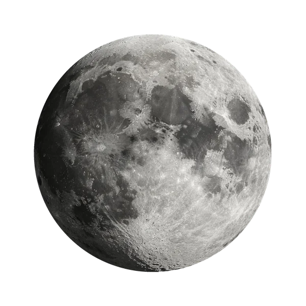

  

  

    卫星
    <h1>月球 <small>Moon</small></h1>
    
地球唯一的天然卫星，潮汐锁定使它永远以同一面朝向地球

    

      7.35×10²² kg
      1,737 km
      -20 °C
      3.344 g/cm³
    

  

母天体：<a href="../earth/">地球</a> · 分类：卫星

## 物理参数

| 参数 | 数值 |
|---|---|
| 质量 | 7.35×10²² kg |
| 平均半径 | 1,737 km |
| 平均密度 | 3.344 g/cm³ |
| 表面重力 | 1.62 m/s² |
| 逃逸速度 | 2.38 km/s |
| 平均表面温度 | -20 °C |
| 表面气压 | — |
| 反照率 | 0.12 |

## 轨道参数

| 参数 | 数值 |
|---|---|
| 半长轴 | 384,400 km |
| 轨道周期 | 27.3 天 |
| 平均轨道速度 | 1.02 km/s |
| 轨道倾角 | 5.145° |
| 轨道偏心率 | 0.0549 |
| 转轴倾角 | 6.68° |
| 自转周期 | 27.32 天 |

## 其他特征

| 项目 | 数值 |
|---|---|
| 大气成分 | — |
| 全球磁场 | 否 |
| 环系 | 否 |
| 已确认卫星 | 0 颗 |
| 发现 | 史前 |

<section class="obj-source">
  <h2>数据来源</h2>
  
来源标识：nssdc_moonfact；核对日期：2026-10-18。数值整理自 NASA NSSDC / JPL 公开资料（公共领域）。发现错误请到 <a href="https://github.com/yufengwolf/astro-blog/issues">GitHub Issues</a> 反馈。

</section>

← 上一颗：<a href="../ceres/">谷神星</a>

下一颗：<a href="../phobos/">火卫一</a> →

