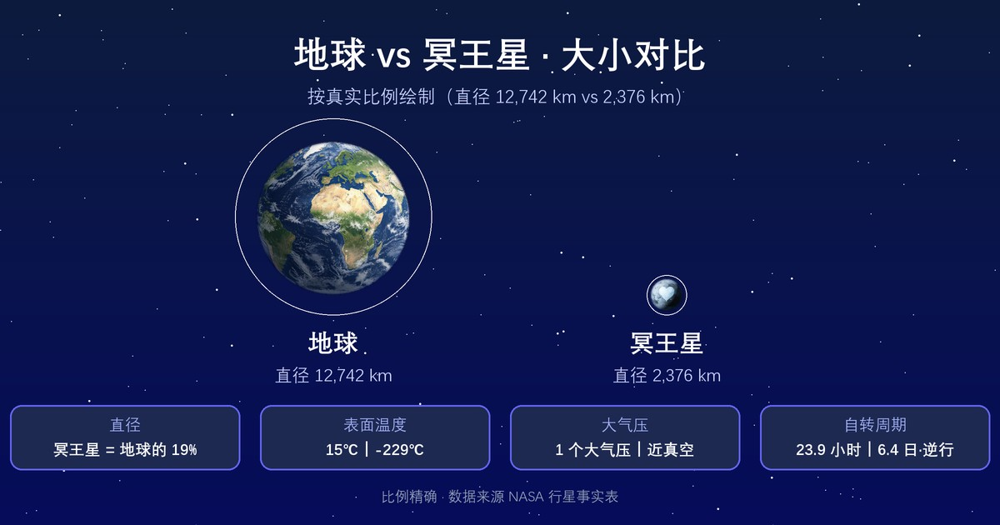
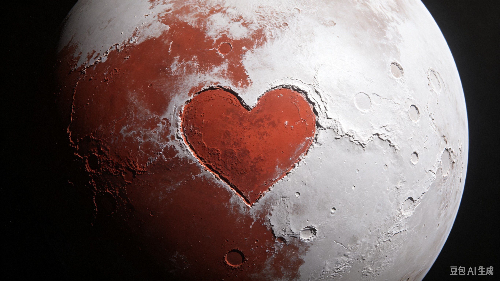

  

  

    矮行星
    <h1>冥王星 <small>Pluto</small></h1>
    
曾被列为第九大行星，与卫星卡戎构成双天体系统

    

      1.3×10²² kg
      1,188 km
      -225 °C
      1.85 g/cm³
    

  

母天体：<a href="../sun/">太阳</a> · 分类：矮行星

  <button type="button" id="astro-compare-toggle" class="cmp-btn" aria-expanded="false" aria-controls="astro-compare">⚖ 与其他天体对比</button>
  从数据库中任选天体（可多选）逐参数对比，链接可分享

<section class="obj-compare" id="astro-compare" hidden data-current="pluto">
  

    <input type="search" id="cmp-search" placeholder="搜索要对比的天体（中/英文）…" aria-label="搜索对比天体">
    <ul class="cmp-results" id="cmp-results" hidden></ul>
  

  
<table class="cmp-table" id="cmp-table"></table>

  
对比在该页本地完成；点击列标题旁的 × 可移除该天体。

</section>

## 物理参数

| 参数 | 数值 |
|---|---|
| 质量 | 1.3×10²² kg |
| 平均半径 | 1,188 km |
| 平均密度 | 1.85 g/cm³ |
| 表面重力 | 0.62 m/s² |
| 逃逸速度 | 1.21 km/s |
| 平均表面温度 | -225 °C |
| 表面气压 | 1×10⁻⁵ bar |
| 反照率 | — |

## 轨道参数

| 参数 | 数值 |
|---|---|
| 半长轴 | 5,906,376,272 km（39.5 AU） |
| 轨道周期 | 247.9 年（90,560 天） |
| 平均轨道速度 | 4.67 km/s |
| 轨道倾角 | 17.16° |
| 轨道偏心率 | 0.244 |
| 转轴倾角 | 119.5° |
| 自转周期 | 逆行自转 · 6.39 天 |

## 其他特征

| 项目 | 数值 |
|---|---|
| 大气成分 | — |
| 全球磁场 | 未知 |
| 环系 | 否 |
| 已确认卫星 | 5 颗（ notable：卡戎） |
| 发现 | 克莱德·汤博，1930 年 |

<section class="obj-source">
  <h2>数据来源</h2>
  
来源标识：nssdc_planetary_factsheet；核对日期：2026-10-18。数值整理自 NASA NSSDC / JPL 公开资料（公共领域）。发现错误请到 <a href="https://github.com/yufengwolf/astro-blog/issues">GitHub Issues</a> 反馈。

</section>

<section class="obj-articles">
  <h2>相关文章</h2>
  <ul class="astro-article-list">
    <li><a href="#article-pluto">冥王星比月球还小，当年凭什么是第九大行星？</a></li>
  </ul>
</section>

<section class="obj-article" id="article-pluto">
  <h2>延伸阅读：冥王星比月球还小，当年凭什么是第九大行星？</h2>

冥王星直径仅约2370公里，比月球更小，体积只有地球的约1/150，质量仅地球的0.0022倍。它能维持76年“第九大行星”身份，不是因为个头大，而是当年人类对柯伊伯带一无所知。2006年国际天文联合会投票，把它重新归类为矮行星。

## 尺度反差：曾经的第九行星，个头还不如月球
冥王星直径大约2370公里，月球直径约3474公里，冥王星直径大约只有月球的三分之二，不到地球的五分之一。如果把地球比作一个篮球，月球大约是网球，冥王星只有高尔夫球大小。

它的质量差距更夸张，只有月球质量的六分之一。如此微弱的引力，不足以清空轨道周边的碎片，这也是它被降级的核心原因。

冥王星的一年等于248个地球年。它的自转周期约6.4个地球日，自转很慢，一天漫长而冰冷。

## 极端偏心轨道：在柯伊伯带来回穿梭
冥王星位于海王星外侧的柯伊伯带，这片区域是太阳系外缘大量冰质小天体的聚集地。它的轨道偏心率极大，不是接近正圆，而是明显拉长的椭圆。

远日点时距离太阳约49.3天文单位，近日点约30.1天文单位，**近日点甚至比海王星轨道还要靠近太阳**。它和海王星存在轨道共振，不会相撞，却共享这片区域，轨道附近遍布大量柯伊伯带天体。

这就是关键矛盾：行星的判定标准要求天体**清空轨道附近区域**，冥王星做不到。柯伊伯带还有阋神星、鸟神星等同类冰质天体，阋神星质量甚至略大于冥王星。如果冥王星保留行星身份，柯伊伯带会多出一大堆行星，行星定义就失去意义。

## 汤博区：冥王星独一无二的心形冰原
2015年新视野号飞掠冥王星，传回人类第一组高清影像，最震撼的发现就是心形平原汤博区。这片巨大的浅色区域，以冥王星发现者汤博命名。

汤博区主体是氮冰平原，表层覆盖流动的氮冰，下方存在固态甲烷冰、一氧化碳冰。氮冰可以缓慢流动，类似冰川，却没有高山挤压形成的褶皱。新视野号没有在这里发现大量撞击坑，说明这片区域地质年龄很年轻，可能不足1亿年。

这片冰原颠覆了旧认知：很多人以为冥王星是死寂、布满古老陨石坑的冰球，但它仍存在活跃的地表重塑。内部放射性元素衰变产生热量，维持地表冰层缓慢运动。

## 冰壳与低温：很冷，但不是太阳系最冷天体
冥王星表面平均温度大约-232℃。这里遍布氮冰、甲烷冰，当靠近太阳时，表层氮冰会少量升华，形成一层极薄的大气；远离太阳时大气会重新凝结落回地表。

很多人默认离太阳越远就越冷，冥王星理应是太阳系最冷天体。事实并非如此。月球南北极永久阴影坑，温度可以低至-249℃，比冥王星表面更冷。这些深坑永远接收不到阳光，没有大气保温，热量持续散失。

冥王星虽远，但仍能接收到微弱的太阳辐射，稀薄大气还会产生一定保温效应，所以温度高于月球永久阴影坑。

## 2006除名争议：不是“开除”，是重新定义
2006年IAU确立三条行星判定标准：
1. 围绕太阳公转
2. 自身引力足以塑造成球形
3. 清空轨道周边的天体

冥王星满足前两条，但第三条无法达标。这次投票不是科学家单纯“嫌弃冥王星太小”，而是阋神星的发现，迫使天文学界统一行星定义。

争议一直延续至今。反对者认为，**清空轨道**这个标准带有主观色彩，投票参与人数有限，不该仅凭一次投票就改写冥王星的身份。不少行星科学家至今仍主张恢复冥王星的行星地位。支持者则认为，分类体系要统一，不能双重标准。

> 冥王星的身份争议，本质是人类对太阳系边界认知更新的产物，不是天体本身发生了变化。

## 常见误区
- 很多人以为冥王星被踢出太阳系。其实它依旧在太阳系，只是分类从行星改成矮行星，位置没有任何改变。
- 很多人以为冥王星完全没有大气。它存在稀薄大气，由氮气、甲烷、一氧化碳组成，只是大气会随轨道远近反复凝结、消散。
- 很多人以为汤博区是撞击坑。心形轮廓不是撞击形成，是氮冰沉积、地表物质迁移共同塑造的平原。
- 很多人以为冥王星和海王星会相撞。二者存在3:2轨道共振，轨道交叉，但永远不会相遇。

## 常见问题
**Q：冥王星最大的卫星叫什么？**
A：冥卫一卡戎，体积很大，二者质心落在冥王星外部，可看作一对双矮行星系统。

**Q：柯伊伯带还有哪些矮行星？**
A：阋神星、鸟神星、妊神星，加上谷神星，共同构成IAU认可的五颗矮行星。

**Q：新视野号之后还有探测器造访冥王星吗？**
A：目前没有新的冥王星探测任务，后续只有远距离观测。

**Q：冥王星表面的冰是水冰吗？**
A：表层主要是氮冰、甲烷冰；水冰埋藏在更深处，构成冥王星坚硬的岩石冰壳。

同轨道区域其他天体的总质量数倍于冥王星，它无力清除周边物质，这是它无法回到行星行列的硬性事实。

</section>

← 上一颗：<a href="../neptune/">海王星</a>

下一颗：<a href="../ceres/">谷神星</a> →

数据版本 v1.1（2026-10-18 核对）· 32 个天体已全部配图

