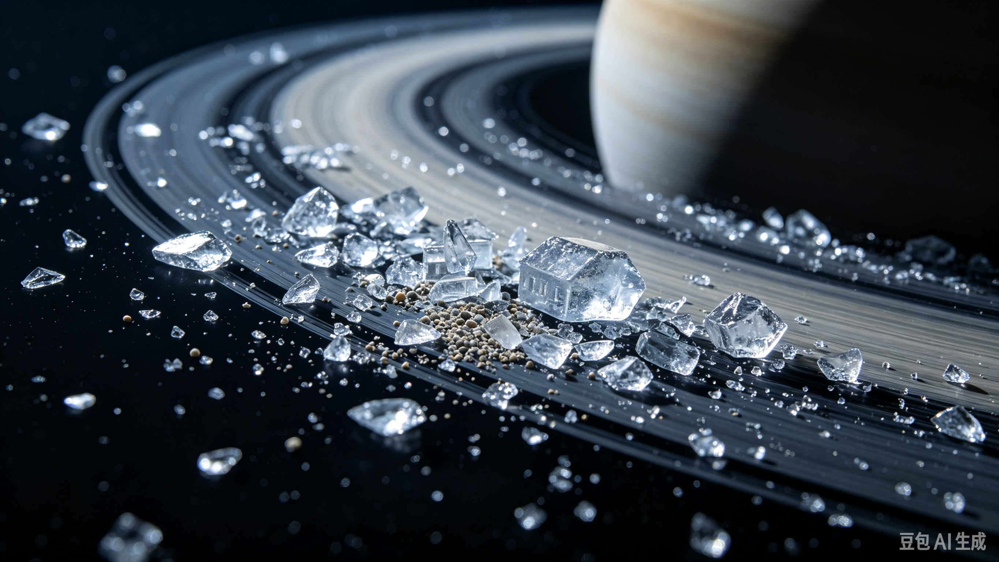
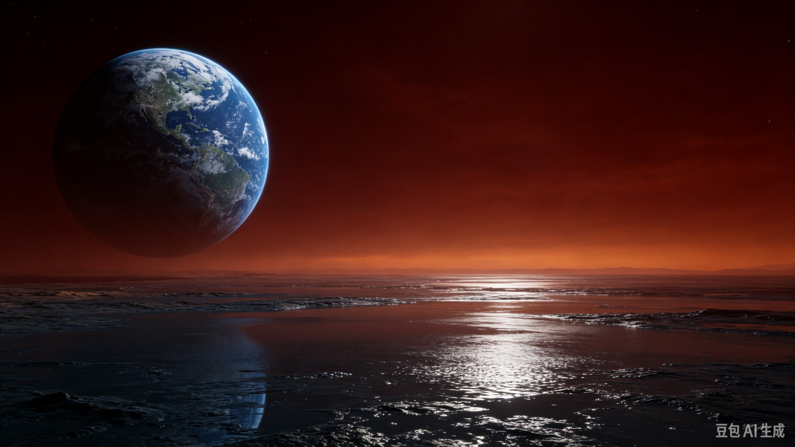

  

  

    行星
    <h1>土星 <small>Saturn</small></h1>
    
以壮观环系闻名的气态巨行星，平均密度比水还小

    

      5.68×10²⁶ kg
      58,232 km
      -140 °C
      0.687 g/cm³
    

  

母天体：<a href="../sun/">太阳</a> · 分类：行星

  <button type="button" id="astro-compare-toggle" class="cmp-btn" aria-expanded="false" aria-controls="astro-compare">⚖ 与其他天体对比</button>
  从数据库中任选天体（可多选）逐参数对比，链接可分享

<section class="obj-compare" id="astro-compare" hidden data-current="saturn">
  

    <input type="search" id="cmp-search" placeholder="搜索要对比的天体（中/英文）…" aria-label="搜索对比天体">
    <ul class="cmp-results" id="cmp-results" hidden></ul>
  

  
<table class="cmp-table" id="cmp-table"></table>

  
对比在该页本地完成；点击列标题旁的 × 可移除该天体。

</section>

## 物理参数

| 参数 | 数值 |
|---|---|
| 质量 | 5.68×10²⁶ kg |
| 平均半径 | 58,232 km |
| 平均密度 | 0.687 g/cm³ |
| 表面重力 | 11.19 m/s² |
| 逃逸速度 | 35.50 km/s |
| 平均表面温度 | -140 °C |
| 表面气压 | — |
| 反照率 | 0.34 |

## 轨道参数

| 参数 | 数值 |
|---|---|
| 半长轴 | 1,432,041,000 km（9.57 AU） |
| 轨道周期 | 29.4 年（10,756 天） |
| 平均轨道速度 | 9.67 km/s |
| 轨道倾角 | 2.486° |
| 轨道偏心率 | 0.052 |
| 转轴倾角 | 26.73° |
| 自转周期 | 10.66 小时 |

## 其他特征

| 项目 | 数值 |
|---|---|
| 大气成分 | 氢 96.3%、氦 3.25%（其余为甲烷、氨等微量） |
| 全球磁场 | 是 |
| 环系 | 是 |
| 已确认卫星 | 274 颗（ notable：<a href="../titan/">土卫六</a>、<a href="../rhea/">土卫五</a>、<a href="../iapetus/">土卫八</a>） |
| 发现 | 史前 |

<section class="obj-source">
  <h2>数据来源</h2>
  
来源标识：nssdc_saturnfact；核对日期：2026-10-18。数值整理自 NASA NSSDC / JPL 公开资料（公共领域）。发现错误请到 <a href="https://github.com/yufengwolf/astro-blog/issues">GitHub Issues</a> 反馈。

</section>

<section class="obj-articles">
  <h2>相关文章</h2>
  <ul class="astro-article-list">
    <li><a href="#article-saturn">土星环宽达28万公里，为什么却只有几十米厚？</a></li>
  </ul>
</section>

<section class="obj-article" id="article-saturn">
  <h2>延伸阅读：土星环宽达28万公里，为什么却只有几十米厚？</h2>

土星环的横向跨度可达282000公里，足以放下22个地球并排，但主环垂直厚度大多仅10到20米。这是太阳系最极致的尺度反差，也是土星最标志性的奇观。它不是固态圆盘，而是无数独立绕转的冰与岩石碎块，每一块碎片都相当于微型卫星。

## 行星环并非土星独有，为何它最耀眼
木星、天王星、海王星同样拥有行星环，但它们的环由暗色尘埃构成，暗淡纤细，普通望远镜无法观测。土星环以水冰为主，冰的高反照率让它在太阳系中格外明亮。

冰粒尺寸跨度极大，从烟尘般的冰晶，到房屋大小的冰块，混杂少量岩石碎屑。这些碎片被土星引力束缚在同一平面，形成薄如纸片的巨大圆盘。

普通天文爱好者使用小型折射望远镜，就能在地面观测到土星环。这也是它最早被伽利略发现的原因，只是当时他无法分辨环的真实形态。

## 密度比水更小，土星真的可以浮在水面
土星平均密度约0.69g/cm³，低于液态水的密度。理论上如果存在足够巨大的水体，整颗土星能够漂浮在水面之上。

这个反差来自土星的构成：它是气态巨行星，没有固态岩石表面，内部是氢与氦在高压下压缩形成的液态层。土星质量是地球的95倍，但体积可以容纳730个地球，巨大的体积拉低了整体密度。

土星自转极快，一圈仅约10.7小时。高速旋转把赤道向外甩开，两极被压缩，造就明显扁球状外观，赤道直径比两极直径多出约10%。

土星已确认的卫星数量在太阳系行星中名列前茅，从直径数千公里的大卫星，到仅几公里的微小岩石碎片，共同构成庞大的土星卫星系统。

## 两颗卫星：冰壳之下，生命存在的可能性
土星本体是气态行星，没有固态表面，很难孕育生命，但它的卫星系统提供了完全不同的环境。

### 土卫六泰坦：拥有液态湖泊的类早期地球
土卫六是土星最大卫星，体积比水星还要大。它是太阳系唯一拥有浓厚大气层的卫星，大气主要成分是氮气，和地球大气基底成分相似。

地表温度约-179℃，水冰如同坚硬岩石，液态物质是甲烷与乙烷。在土卫六表面，存在稳定的液态甲烷湖，有蒸发、降雨、汇聚成湖的完整碳循环。这套循环机制，被认为和数十亿年前早期地球的碳循环高度相似。

这里没有液态水，但丰富的有机分子持续生成，是研究生命起源前化学演化的重要目标。NASA的蜻蜓号探测器计划前往土卫六，实地探测湖泊与有机物质。

### 土卫二恩克拉多斯：南极喷流泄露冰下海洋
卡西尼号探测器观测到土卫二南极区域持续向外喷射冰晶羽流。喷流来自冰壳下方的全球性咸水海洋，海水通过裂缝向外喷发，进入太空。

喷出的冰晶样本检测出液态水、有机物，还有生命必需的磷元素。岩石海底会发生化学反应，提供化学能量。液态水、有机物、能量源，生命所需的三大基础条件在这里全部集齐。

目前没有直接证据证明生命存在，但土卫二是太阳系中最有希望找到地外生命的候选天体之一。喷流的物质还会持续补充土星的E环，维持这层微弱外环的存在。

## 常见误区
- 很多人以为土星环是固态实体圆盘。其实环是无数独立碎片，每一块都独自绕土星公转，碎片之间存在巨大空隙，不是连续固体。
- 很多人以为土星整体很轻，所以土星内部物质密度很低。土星外层氢氦密度低，但内部深处，巨大压力会把物质压缩成极高密度，平均密度才是0.69g/cm³。
- 很多人认为土卫二的喷流是火山喷发。喷流不是岩浆，而是冰壳裂缝喷出的液态水与冰晶，属于冰火山，温度远低于地球火山。
- 很多人以为土星环永久存在。观测与模型显示，环的物质会持续落向土星，数亿年后，土星环大概率会逐渐消失。

## 常见问题
Q：土星环是什么时候形成的？
A：目前没有确定结论，主流猜想是一颗卫星破碎后形成，形成时间可能在1亿到2亿年前。

Q：土星能直接登陆吗？
A：不能，土星没有固态地表，越往内部压力越高，探测器会被高压高温摧毁。

Q：土卫六的甲烷湖可以支持生命吗？
A：可以存在基于甲烷溶剂的另类生命，但目前没有发现任何生命信号。

Q：土卫二海洋有多深？
A：估算约几十公里，被厚厚的冰壳覆盖，冰壳厚度随位置变化。

Q：为什么土星自转快就会变扁？
A：高速自转产生离心力，赤道区域物质向外凸起，两极方向被压缩，形成扁球形态。

土星环的物质总量并不高，全部质量加起来，只相当于一颗小型卫星。宏大外观与微薄质量的强烈反差，让这道宇宙冰环，成为太阳系最迷人的结构。

</section>

← 上一颗：<a href="../jupiter/">木星</a>

下一颗：<a href="../uranus/">天王星</a> →

数据版本 v1.2（2026-10-18 核对）· 32 个天体已全部配图

