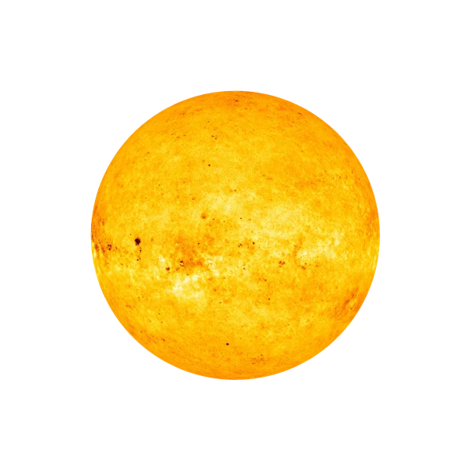

  

  

    恒星
    <h1>太阳 <small>Sun</small></h1>
    
太阳系的中心恒星，独占太阳系总质量的 99.86%

    

      1.99×10³⁰ kg
      695,700 km
      5499 °C
      1.408 g/cm³
    

  

分类：恒星

## 物理参数

| 参数 | 数值 |
|---|---|
| 质量 | 1.99×10³⁰ kg |
| 平均半径 | 695,700 km |
| 平均密度 | 1.408 g/cm³ |
| 表面重力 | 274.00 m/s² |
| 逃逸速度 | 617.60 km/s |
| 平均表面温度 | 5499 °C |
| 表面气压 | 8.68×10⁻⁴ bar |
| 反照率 | — |
| 光谱型 | G2V |
| 光度 | 3.83e+26 W |

## 轨道参数

| 参数 | 数值 |
|---|---|
| 半长轴 | — |
| 轨道周期 | — |
| 平均轨道速度 | — |
| 轨道倾角 | — |
| 轨道偏心率 | — |
| 转轴倾角 | 7.25° |
| 自转周期 | 25.38 天 |

## 其他特征

| 项目 | 数值 |
|---|---|
| 大气成分 | 光球层：氢 90.97%、氦 8.89%（其余为氧、碳、氖等微量） |
| 全球磁场 | 是 |
| 环系 | 未知 |
| 发现 | 史前 |

<section class="obj-source">
  <h2>数据来源</h2>
  
来源标识：nssdc_sunfact；核对日期：2026-10-18。数值整理自 NASA NSSDC / JPL 公开资料（公共领域）。发现错误请到 <a href="https://github.com/yufengwolf/astro-blog/issues">GitHub Issues</a> 反馈。

</section>

下一颗：<a href="../mercury/">水星</a> →

