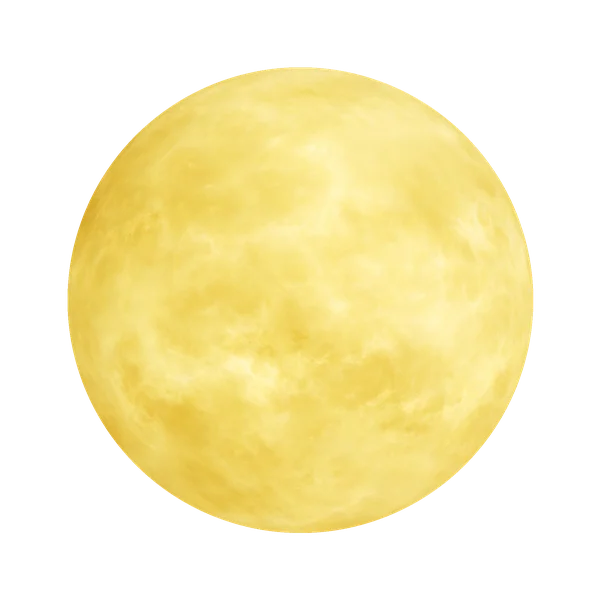

  

  

    行星
    <h1>金星 <small>Venus</small></h1>
    
被浓厚二氧化碳大气包裹的炽热世界，太阳系表面最热的行星

    

      4.87×10²⁴ kg
      6,052 km
      464 °C
      5.243 g/cm³
    

  

母天体：<a href="../sun/">太阳</a> · 分类：行星

## 物理参数

| 参数 | 数值 |
|---|---|
| 质量 | 4.87×10²⁴ kg |
| 平均半径 | 6,052 km |
| 平均密度 | 5.243 g/cm³ |
| 表面重力 | 8.87 m/s² |
| 逃逸速度 | 10.36 km/s |
| 平均表面温度 | 464 °C |
| 表面气压 | 92 bar |
| 反照率 | — |

## 轨道参数

| 参数 | 数值 |
|---|---|
| 半长轴 | 108,210,000 km（0.723 AU） |
| 轨道周期 | 224.7 天 |
| 平均轨道速度 | 35.02 km/s |
| 轨道倾角 | 3.39° |
| 轨道偏心率 | 0.007 |
| 转轴倾角 | 177.4° |
| 自转周期 | 逆行自转 · 243.02 天 |

## 其他特征

| 项目 | 数值 |
|---|---|
| 大气成分 | — |
| 全球磁场 | 否 |
| 环系 | 否 |
| 已确认卫星 | 0 颗 |
| 发现 | 史前 |

<section class="obj-source">
  <h2>数据来源</h2>
  
来源标识：nssdc_planetary_factsheet；核对日期：2026-10-18。数值整理自 NASA NSSDC / JPL 公开资料（公共领域）。发现错误请到 <a href="https://github.com/yufengwolf/astro-blog/issues">GitHub Issues</a> 反馈。

</section>

<section class="obj-article">
  <h2>延伸阅读：金星</h2>

## 看似是地球姊妹，实则是高温地狱
金星直径约12104公里，约为地球的0.95倍，体积、质量都和地球最接近，被称作地球的姊妹星。但这只是视觉与尺度上的假象，地表环境完全是生命禁区。

金星表面平均温度约460℃，比离太阳更近的水星还要热。热量被浓密大气牢牢锁住，这就是**失控温室效应**。金星大气96%以上是二氧化碳，厚厚的气体层允许阳光射入，却阻止地表红外辐射向外逃逸，热量不断累积。

它的地表大气压是地球的约92倍，相当于潜入海面下900米承受的水压。云层由硫酸液滴构成，硫酸雨滴在落地前就会被高温蒸发，无法抵达地表。探测器着陆后，往往几十分钟就会被高温高压损毁。

## 逆向自转：金星上的时间倒流
太阳系绝大多数行星自西向东自转，金星反向旋转，也就是逆向自转。站在金星表面，太阳会从西边升起，向东落下，和地球完全相反。

金星的恒星日，也就是自转一圈，需要243个地球日；绕太阳公转一圈仅225个地球日。**金星自转一圈的时间，比它一整年还要长**。

这里要区分两个概念。恒星日是行星自身旋转一周的时长，而金星的太阳日（一次日出到下一次日出）约117个地球日。漫长的白昼与黑夜，叠加反向日出，就是大家所说的“时间倒流”的天象来源。

## 隐藏的火山：仍在活跃的炼狱地表
金星地表遍布大量火山，数量远超地球。目前没有直接观测证据确认持续喷发，但多项探测数据显示，金星是太阳系火山活动最活跃的候选天体之一。

高温与浓密大气掩盖了火山喷发的直观信号。云层中短暂出现的二氧化硫浓度波动，被科学家推测是火山喷发向大气释放气体留下的痕迹。火山持续释放二氧化碳，进一步维持了金星的极端温室状态。

## 金星观测指南
最佳观测窗口为**大距**，分为东大距（黄昏长庚星）、西大距（黎明启明星）。大距时金星离太阳的角距离最大，地平线高度更高，不容易被暮光淹没。

- 肉眼：黎明东方或黄昏西方，全天最亮的稳定银白色光点，不会像恒星那样闪烁，极易识别。
- 双筒望远镜：能看到明亮的小圆盘，条件合适可隐约分辨月牙形相位。
- 小型天文望远镜：可以清晰观测金星的盈亏变化，和月球月相原理一致。
- 找星方法：打开手机星图App，定位太阳附近，寻找亮度最高的目标。金星永远不会远离太阳，不会出现在午夜高空。

## 常见误区
- 很多人以为金星离太阳更近，所以温度更高。其实水星距离太阳更近，金星高温来自失控温室效应，不是单纯太阳辐射。水星夜晚温度会骤降到零下一百多度，金星全球昼夜温差极小。
- 很多人以为金星的“一天比一年长”，日出日落间隔就超过243地球日。这是混淆恒星日与太阳日。金星自转周期243地球日，但公转叠加逆向自转，两次日出间隔约117地球日。
- 很多人以为金星的硫酸云会降下硫酸雨落到地表。硫酸雨滴在高空形成，下落过程中会被460℃高温直接汽化，无法抵达地面。

## 常见问题
Q：金星为什么逆向自转？
A：主流猜想是远古时期大型天体撞击，翻转了金星自转轴，形成逆向自转。
Q：金星上有可能存在生命吗？
A：地表环境完全不可能；高层云层温度压力相对温和，仅存在理论上的微生物猜想，尚无证据。
Q：金星为什么这么亮？
A：浓密硫酸云反射约78%的太阳光，反射率极高，所以在夜空格外耀眼。
Q：金星可以用肉眼随时看到吗？
A：不能，它是地内行星，只能在日出前或日落后短暂出现，午夜无法观测。

金星没有液态水海洋，二氧化碳被锁在大气中，最终演化成失控温室的极端环境。它和地球的巨大反差，展示了两颗尺度相近行星，完全不同的演化结局。

</section>

← 上一颗：<a href="../mercury/">水星</a>

下一颗：<a href="../earth/">地球</a> →

