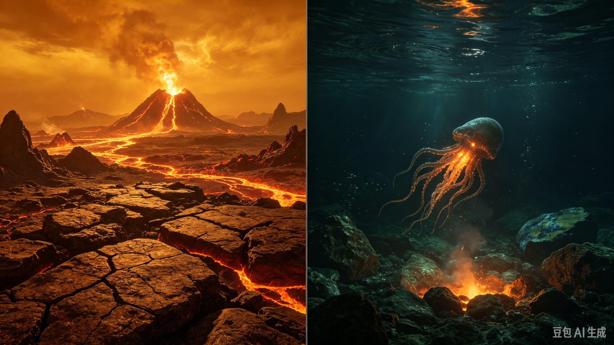
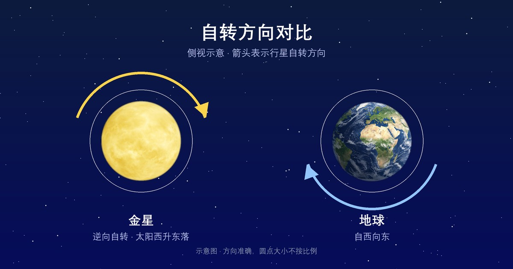

  

影像：<a href="https://images.nasa.gov/details/S91-50688" target="_blank" rel="noopener">NASA/JPL · 麦哲伦雷达全球视图</a>

  

    行星
    <h1>金星 <small>Venus</small></h1>
    
被浓厚二氧化碳大气包裹的炽热世界，太阳系表面最热的行星

    
平均直径 12,104 km · 质量 4.87×10²⁴ kg

  

母天体：<a href="../sun/">太阳</a> · 分类：行星

  

    3D 交互可视化
    
  

  

    <iframe src="https://astro-solar-3d.pages.dev/?view=venus" title="真实三维系统" loading="lazy" allowfullscreen allow="fullscreen"></iframe>
  

  
由外部 3D 项目（astro-solar-3d）提供，与本站数据独立维护；加载慢或无法显示时可直接打开原站。

<section class="obj-data-block">
<h2 id="physical">物理参数</h2>
<table>
<thead><tr><th>参数</th><th>数值</th></tr></thead>
<tbody>
<tr><th scope="row">质量</th><td>4.87×10²⁴ kg（0.815 M⊕）</td></tr>
<tr><th scope="row">平均直径</th><td>12,104 km（0.95 × 地球直径）</td></tr>
<tr><th scope="row">平均密度</th><td>5.243 g/cm³</td></tr>
<tr><th scope="row">表面重力</th><td>8.87 m/s²</td></tr>
<tr><th scope="row">逃逸速度</th><td>10.36 km/s</td></tr>
<tr><th scope="row">平均表面温度</th><td>737 K（464 °C）</td></tr>
<tr><th scope="row">有效温度（black-body 口径）</th><td>227 K（-46.5 °C）</td></tr>
<tr><th scope="row">表面气压</th><td>92 bar</td></tr>
<tr><th scope="row">反照率</th><td>0.69（Bond 0.77 / Geometric 0.689）</td></tr>
</tbody>
</table>
</section>
<section class="obj-data-block">
<h2 id="orbit">轨道参数</h2>
<table>
<thead><tr><th>参数</th><th>数值</th></tr></thead>
<tbody>
<tr><th scope="row">半长轴</th><td>108,210,000 km（0.723 AU）</td></tr>
<tr><th scope="row">轨道周期</th><td>224.7 天</td></tr>
<tr><th scope="row">平均轨道速度</th><td>35.02 km/s</td></tr>
<tr><th scope="row">轨道倾角</th><td>3.39°</td></tr>
<tr><th scope="row">轨道偏心率</th><td>0.007</td></tr>
<tr><th scope="row">转轴倾角</th><td>177.4°</td></tr>
<tr><th scope="row">自转周期</th><td>逆行自转 · 243.02 天</td></tr>
</tbody>
</table>
</section>
<section class="obj-data-block">
<h2 id="features">其他特征</h2>
<table>
<thead><tr><th>参数</th><th>数值</th></tr></thead>
<tbody>
<tr><th scope="row">全球磁场</th><td>否</td></tr>
<tr><th scope="row">环系</th><td>否</td></tr>
<tr><th scope="row">已确认卫星</th><td>0 颗</td></tr>
<tr><th scope="row">发现</th><td>史前</td></tr>
</tbody>
</table>
</section>

<section class="obj-source">
  <h2>数据来源</h2>
  
数据来源：<a href="https://nssdc.gsfc.nasa.gov/planetary/factsheet/venusfact.html" target="_blank" rel="noopener">NASA NSSDC · Venus Fact Sheet</a>；核对日期：2026-10-18。数值整理自 NASA NSSDC / JPL / Wikipedia 等公开天文资料。发现错误请到 <a href="https://github.com/yufengwolf/astro-blog/issues">GitHub Issues</a> 反馈。

</section>

<section class="obj-articles">
  <h2>相关文章</h2>
  <ul class="astro-article-list">
    <li><a href="#article-venus">金星：地球姊妹星，为何是西升东落的地狱？</a></li>
  </ul>
</section>

<section class="obj-article" id="article-venus">
  <h2>延伸阅读：金星：地球姊妹星，为何是西升东落的地狱？</h2>

## 看似是地球姊妹，实则是高温地狱
金星直径约12104公里，约为地球的0.95倍，体积、质量都和地球最接近，被称作地球的姊妹星。但这只是视觉与尺度上的假象，地表环境完全是生命禁区。

金星表面平均温度约460℃，比离太阳更近的水星还要热。热量被浓密大气牢牢锁住，这就是**失控温室效应**。金星大气96%以上是二氧化碳，厚厚的气体层允许阳光射入，却阻止地表红外辐射向外逃逸，热量不断累积。

它的地表大气压是地球的约92倍，相当于潜入海面下900米承受的水压。云层由硫酸液滴构成，硫酸雨滴在落地前就会被高温蒸发，无法抵达地表。探测器着陆后，往往几十分钟就会被高温高压损毁。

## 逆向自转：金星上的时间倒流
太阳系绝大多数行星自西向东自转，金星反向旋转，也就是逆向自转。站在金星表面，太阳会从西边升起，向东落下，和地球完全相反。

金星的恒星日，也就是自转一圈，需要243个地球日；绕太阳公转一圈仅225个地球日。**金星自转一圈的时间，比它一整年还要长**。

这里要区分两个概念。恒星日是行星自身旋转一周的时长，而金星的太阳日（一次日出到下一次日出）约117个地球日。漫长的白昼与黑夜，叠加反向日出，就是大家所说的“时间倒流”的天象来源。

## 隐藏的火山：仍在活跃的炼狱地表
金星地表遍布大量火山，数量远超地球。目前没有直接观测证据确认持续喷发，但多项探测数据显示，金星是太阳系火山活动最活跃的候选天体之一。

高温与浓密大气掩盖了火山喷发的直观信号。云层中短暂出现的二氧化硫浓度波动，被科学家推测是火山喷发向大气释放气体留下的痕迹。火山持续释放二氧化碳，进一步维持了金星的极端温室状态。

## 金星观测指南
最佳观测窗口为**大距**，分为东大距（黄昏长庚星）、西大距（黎明启明星）。大距时金星离太阳的角距离最大，地平线高度更高，不容易被暮光淹没。

- 肉眼：黎明东方或黄昏西方，全天最亮的稳定银白色光点，不会像恒星那样闪烁，极易识别。
- 双筒望远镜：能看到明亮的小圆盘，条件合适可隐约分辨月牙形相位。
- 小型天文望远镜：可以清晰观测金星的盈亏变化，和月球月相原理一致。
- 找星方法：打开手机星图App，定位太阳附近，寻找亮度最高的目标。金星永远不会远离太阳，不会出现在午夜高空。

## 常见误区
- 很多人以为金星离太阳更近，所以温度更高。其实水星距离太阳更近，金星高温来自失控温室效应，不是单纯太阳辐射。水星夜晚温度会骤降到零下一百多度，金星全球昼夜温差极小。
- 很多人以为金星的“一天比一年长”，日出日落间隔就超过243地球日。这是混淆恒星日与太阳日。金星自转周期243地球日，但公转叠加逆向自转，两次日出间隔约117地球日。
- 很多人以为金星的硫酸云会降下硫酸雨落到地表。硫酸雨滴在高空形成，下落过程中会被460℃高温直接汽化，无法抵达地面。

## 常见问题
Q：金星为什么逆向自转？
A：主流猜想是远古时期大型天体撞击，翻转了金星自转轴，形成逆向自转。
Q：金星上有可能存在生命吗？
A：地表环境完全不可能；高层云层温度压力相对温和，仅存在理论上的微生物猜想，尚无证据。
Q：金星为什么这么亮？
A：浓密硫酸云反射约78%的太阳光，反射率极高，所以在夜空格外耀眼。
Q：金星可以用肉眼随时看到吗？
A：不能，它是地内行星，只能在日出前或日落后短暂出现，午夜无法观测。

金星没有液态水海洋，二氧化碳被锁在大气中，最终演化成失控温室的极端环境。它和地球的巨大反差，展示了两颗尺度相近行星，完全不同的演化结局。

</section>

← 上一颗：<a href="../mercury/">水星</a>

下一颗：<a href="../earth/">地球</a> →

数据版本 v1.9（2026-10-24 核对）· 178 个天体已全部配图

