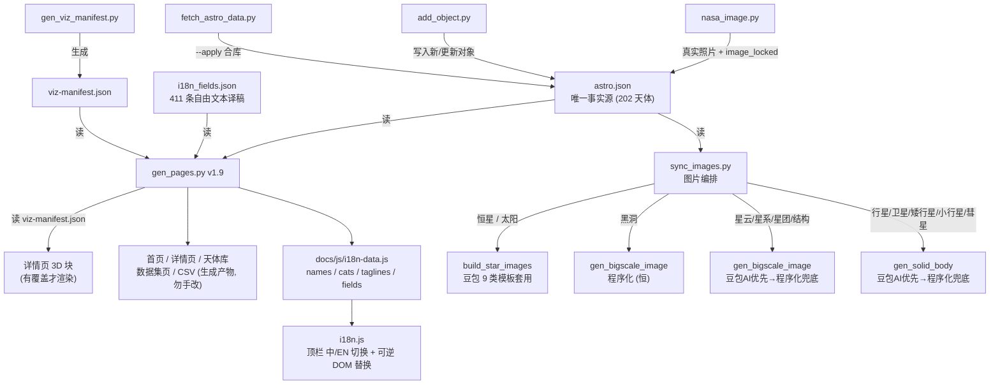
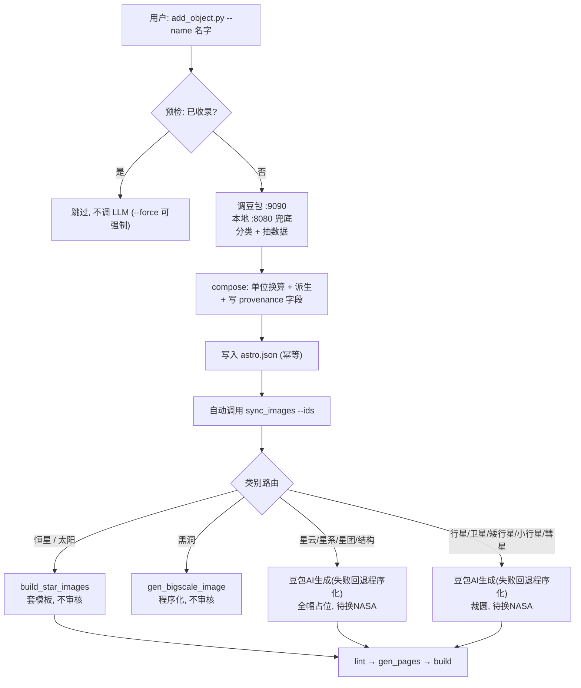
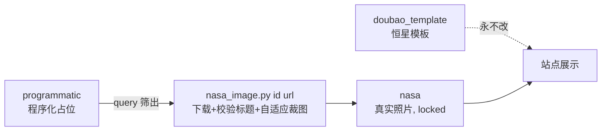
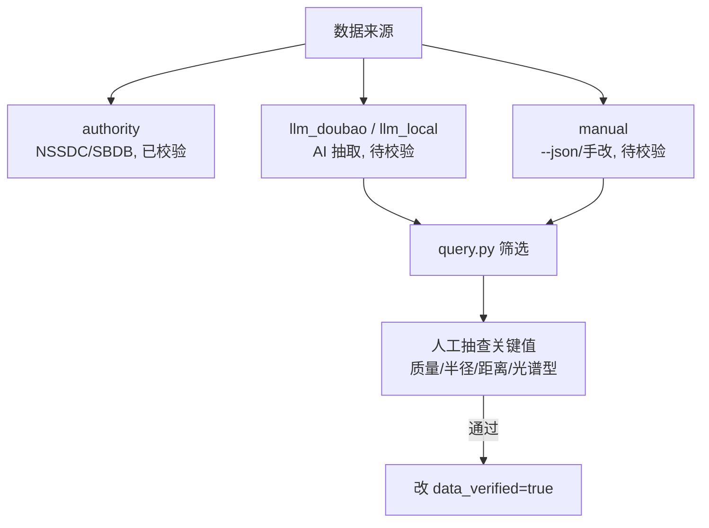
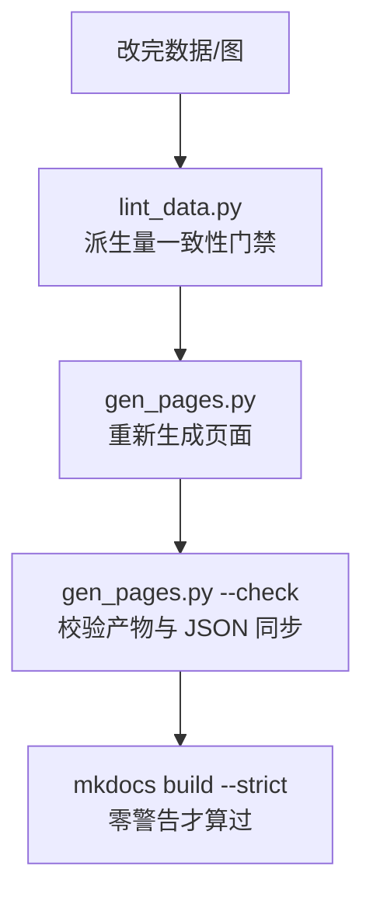
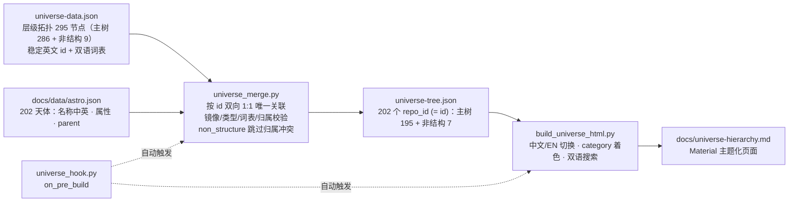
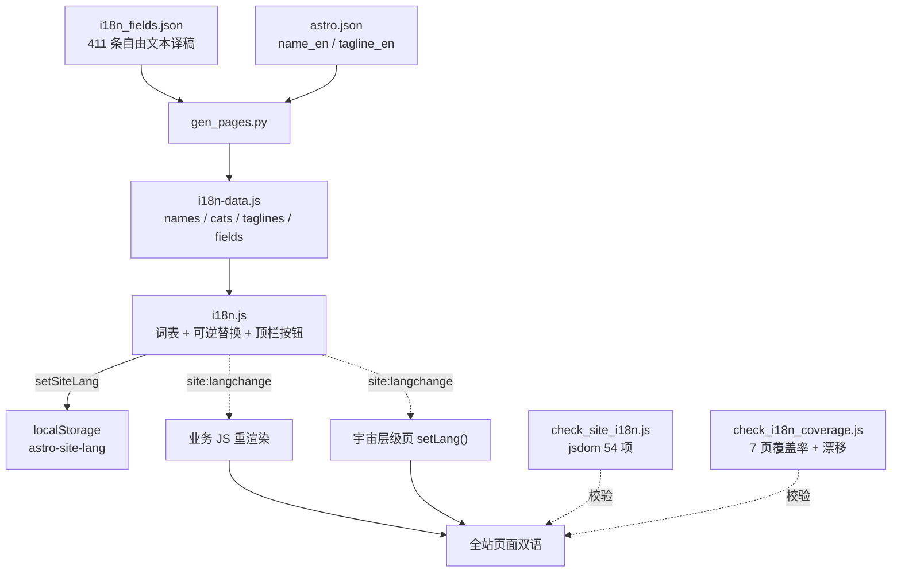
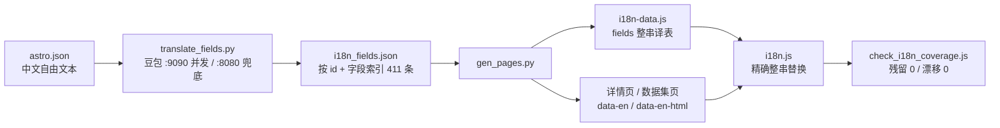
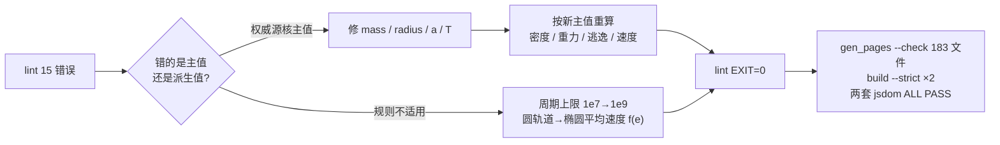

# 天体数据库维护指南（自助版）

> ⚠️ **文档维护约定（最高优先级）**：本站任何**脚本或工作流变更**（新增/修改/删除脚本、增删命令参数、改图片路由规则、改 astro.json 字段结构）都**必须在同一轮改动中同步更新本指南 + README.md**（对应章节与流程图），并随代码一起提交。**不要等用户提醒**。具体清单见文末[第十章](#十文档维护约定每次改代码必改文档)。

当前站点规模：**202 个天体、11 类**（恒星 71 / 卫星 33 / 行星 19 / 星系 18 / 星云 16 / 黑洞 12 / 星团 11 / 矮行星 9 / 大尺度结构 7 / 小行星 5 / 彗星 1）。已是覆盖太阳系到恒星/星云/星系/黑洞的全域数据站。

---

## 〇、全局架构与数据流



**铁律**：`docs/data/astro.json` 是全站唯一事实源。所有页面、CSV、贴图都从它生成；不要手改 `docs/objects/`、`docs/index.md`、`docs/data.md`、`docs/data/astro_flat.csv`（这些是生成产物，会被 `gen_pages.py` 覆盖）。

### 详情页页面结构（v1.7 起）

改动集中在 `scripts/gen_pages.py` / `docs/stylesheets/site.css` / `docs/js/astro-explore.js`，**`astro.json` 一行未动**：

| 层 | 实现 | 注意 |
|---|---|---|
| frontmatter | `hide: [toc]` | 去掉右侧 TOC 栏，正文列 764px → 1014px（1440 视口）/ 1418px（1920） |
| hero | `<p class="obj-summary">`：只留「直径 + 质量」2 项单行速览 | 原 `obj-keystats` 是 4 个数值 chip，与下方物理参数表重复展示，已删除；v1.8 起"半径"统一改"直径"（=2×半径） |
| 参数区 | `<div class="obj-data-grid">` 包 3 个 `<section class="obj-data-block">` | ≥1024px 双列（奇数个区块时末块跨两列），<1024px 单列；**块内不得插空行**，否则 Python-Markdown 会提前结束 raw HTML 块 |
| 表格 | `table_html(rows)` 输出裸 HTML `<table>` | 空值行（`None`/`""`/`—`）直接不渲染，全空则整块跳过；表格不带 class，Material 的 `.md-typeset table` 样式照常生效 |
| 横滚 | `astro-explore.js` 按 `thead` 列数加 `table-scroll--wide`（≥3 列） | 两列参数表不再吃 `min-width:40rem`；Material 运行时的 `.md-typeset__scrollwrap` 负边距（`1em -0.8rem`）在 `site.css` 中归零，消除双重包装造成的恒定 16px 横溢 |

**验收（改布局后必跑）**：

```bash
python scripts/gen_pages.py && python scripts/gen_pages.py --check
CODEBUDDY_SAFE_DELETE_ENABLED=0 mkdocs build --strict
node scripts/cdp_shot.js "http://127.0.0.1:8001/objects/earth/" 1440 900 1 /tmp/earth_1440.png
node scripts/cdp_shot.js "http://127.0.0.1:8001/objects/earth/" 375 812 2 /tmp/earth_375.png
```

判据：所有 `.table-scroll` 的 `clientWidth === scrollWidth`、`document.documentElement.scrollWidth === innerWidth`；移动端只能用 CDP 真设备模拟，**不能用 Edge `--window-size` 截图**。v1.7 实测：1440 双列各 489px、1920 各 689px、移动 343px 单列，三档均无横溢。

> 页面版本戳 `VERSION` 每次布局/数据批量更新都要递增（当前 1.9）。`extra_css` / `extra_javascript` URL 固定无 hash，已缓存客户端靠版本戳 + `docs/_headers` 的 `no-cache` 判断。

### 展示单位规则（v1.8 起）

P2 把"半径"口径统一改成"直径"，并让全站只有 `gen_pages.py` 一个地方实现单位格式化（`compare.js` 不再自带第二套）。核心规则：

**底层不动，展示层换算**：`astro.json` 的 `radius_km` 仍存**半径**（已抽样核对：M42 note 写"直径约 24 光年"、黑洞 note 写"史瓦西半径约 128 AU"），展示统一 `直径 = 2 × 半径`，**零数据迁移**。

| 维度 | 规则 |
|---|---|
| 直径主单位 | 直径 ≥ 1e12 km（≈0.1 光年）→ 光年（星云/星系/大尺度结构，不给 km 辅单位）；否则 km（≥1e9 科学计数、≥1000 千分位、更小 1 位小数） |
| 直径辅单位 | 黑洞给 AU（大质量）；直径 ≥ 0.5 个太阳直径 →「× 太阳直径」；否则「× 地球直径」 |
| 质量 | 主单位 kg 科学计数；≥ 0.01 M☉ → 括注 M☉，否则 M⊕ |
| 光度 | 主单位 W 科学计数；括注 L☉ |
| 温度 | **统一 K 主单位**（此前恒星/星云 K、行星 ℃ 双口径）；有表面温度类别（行星/矮行星/卫星/小行星/彗星/系外行星）额外括注 ℃ |
| 黑洞口径 | "事件视界直径"（不再"史瓦西半径"）；延展天体口径"直径（等效球径）" |
| compact vs 完整 | 卡片 / 总表 / SEO description 用 `compact=True`（只主单位，控长度）；详情页物理参数表用完整格式（带辅单位）。两者走同一 `fmt_*` 函数 |

**唯一实现 + payload 传递**：`gen_pages.py` 的 `fmt_diameter` / `fmt_mass` / `fmt_lum` / `fmt_temp` 是唯一真相；`sizecompare_payload()` 额外产出 `diameter_text` / `mass_text` / `temp_text` / `lum_text` 四个字符串，`compare.js` 直接读它们（删掉了旧的 `fmtRadius` / `fmtMassCat` / `fmtTemp` / `fmtLum`）。改单位规则**只改 `gen_pages.py`**，对比页自动同步。

**缓存破版（硬规则）**：`mkdocs.yml` 的 `extra_css` / `extra_javascript` 已挂 `?v=2.2` 查询串（i18n 两个脚本也在其中，顺序固定：i18n-data → i18n → 业务脚本）。每次改 `site.css` 或 `docs/js/*.js`，**必须同步把这里的 `v=` 递增**（静态资源戳，与页面版本 `gen_pages.VERSION` 相互独立，不必相等），否则已缓存旧 JS/CSS 的客户端拿不到新版。

---

## 一、核心概念：可追溯体系（provenance）

为让你能"一条命令筛出哪些数据/图片是 AI 吐的、哪些是真图、哪些还没人工校验"，每个对象带 4 个机器可读字段：

| 字段 | 取值 | 含义 |
|---|---|---|
| `data_source` | `authority` / `llm_doubao` / `llm_local` / `manual` | 数据来源：权威源 / 豆包抽取 / 本地模型抽取 / 手填 |
| `data_verified` | `true` / `false` | 是否经**人工校验**（区别于 `verified`=录入日期） |
| `image_source` | `nasa` / `programmatic` / `doubao_template` / `doubao` | 图片来源：真实照片 / 程序化占位 / 恒星模板 / 豆包单图生成 |
| `image_locked` | `true` / `false` | 是否锁定（锁定的不会被 sync 覆盖） |

> 注意：`verified` 字段保留为"本站核对日期"（字符串），不要用它判断"是否校验过"——那是 `data_verified` 的职责。
> 这 4 个字段已由 `scripts/migrate_provenance.py` 一次性回填到全部 152 对象（日常不用再跑）。

---

## 二、新增一个天体（主路径：AI 编排层 + 自动出图）

### 2.1 端到端流程图



### 2.2 三种录入模式

```bash
python scripts/add_object.py --name "南河三"              # ① 只给名字 → 豆包自动分类+抽数据
python scripts/add_object.py --facts "一些检索到的文本"    # ② 从你提供的文本抽取
python scripts/add_object.py --json '{"id":...,"category":...}'  # ③ 直接结构化 JSON (绕过 LLM)
python scripts/add_object.py --name "参宿四" --dry-run    # 先看草稿不落盘 (也不出图)
```

- **LLM 路由**：豆包 `:9090` 默认优先，本地 `:8080` 兜底（本地模型不能联网，数据来自训练记忆）。
- **契约（数据填写原则，2026-10-26 修订）**：对**知名/有文献记录**的天体，LLM 必须给出训练知识中可知的**最佳近似值**（半径、质量、轨道半长轴/周期/偏心率等），允许近似但量级与单位须合理；**仅在完全无法估计时才 `null`**。不再用「拿不准一律 null」——那会把知名天体的真实参数也逼成空（曾导致亡神星零参数）。不确定性在 `note` 注明，绝不编造明显荒谬的值（如矮行星质量写成恒星量级）。
- **JSON 契约含 `orbit` 块**：`semimajor_axis_au` / `orbital_period_years` / `orbital_velocity_km_s` / `inclination_deg` / `eccentricity` / `obliquity_deg` / `rotation_period_hours`（旧版合同漏了 orbit，导致所有轨道参数为空，已补）；`compose` 自动把 AU→km、年→天，对齐站点 schema。
- **单位换算 + 派生**：太阳质量→kg、太阳半径→km、光年→km、AU→km、年→天；有 M/R 即派生重力/逃逸速度/密度（保证 lint 自洽）。
- **数值鲁棒性**：LLM 偶把数字以**字符串**返回（如 `"215"`、`"2.0e26"`）。`compose`/`normalize` 在算术前对全部物理量、轨道量、`distance_ly` 统一 `_num()` 归一成 float；无法解析（如带单位的 `"2.0e26 kg"`）安全退回 `None`，**绝不因脏数据中断整批写入**。
- **幂等**：id 已存在则原地补非空字段，不覆盖既有值；`--force` 可强制覆盖（重抽取）。**`--force` 重抽取会保留既有已生成的图片标记**（`image_source`/`image_credit`/`image_url`/`image_locked`，避免把豆包/NASA 图回退成占位）。
- **预检跳过**：写入前先查 astro.json，名字命中已收录就直接跳过（避免白烧一次 LLM 调用）；`--force` 可绕过预检强制重抽取。
- **数据质量门**：抽取/写入后检查固态体（行星/矮行星/卫星/小行星/彗星）是否半径**且**质量缺失、或轨道半长轴**且**周期缺失；若关键参数仍为空，亮红灯提示用 `--facts` 或 `--json --force` 补录，避免产生"有名无参数"的占位记录。
- **自动出图**：写入成功后末尾自动调用 `sync_images.py --ids <新id>` 出图；`--no-sync` 可关闭。
- **自动上线**：出图后自动重新生成站点页面并 `mkdocs build --strict`；`--no-pages` 可关闭（关闭后需手动 `gen_pages + mkdocs build` 才能在网页看到）。

### 2.2.1 批量模式（`--batch`，2026-10-27 新增）

一次性录入一批天体，**三阶段解耦**以隔离故障域、稳定不崩：

```bash
python scripts/add_object.py --batch names.txt        # names.txt：每行一个天体名，# 开头为注释、空行忽略
python scripts/add_object.py --batch names.txt --dry-run   # 只打印将写入的对象，不落盘、不出图
python scripts/add_object.py --batch names.txt --no-sync   # 只录入数据，不出图（后续手动 sync_images）
python scripts/add_object.py --batch names.txt --force     # 已收录的也强制覆盖重抽取
```

**设计要点（稳定性）**：
- **两发一致性对拍**：每个天体在豆包 `:9090` 上连抽 **2 次**（各自带 3 轮指数退避重试），比对关键数值字段（`mass_sun/radius_km/lum_sun/semimajor_axis_au/orbital_period_years/...` 等）。**两边都给了值且相对差 <15% 且 `category` 一致** → 判"一致"并采用；**不一致 → 逐字段合并**：一致字段保留（单边缺失时补第 2 发的非空值），**有争议的字段（两边都给值却相差大）一律置 null，绝不误填任一方第 1 发值**，并打 `needs_review` 标记进待审清单，对象 `note` 注明哪些字段被置空待补。用户 2026-10-27 明确要求"有争议的数据不要填入，只填其他一致的数据"。单边缺失（一侧 null）不算矛盾（视为一致，可补值）。
  - ⚠️ 一致性 ≠ 准确：模型若**系统性编造同一错值**，两发也会一致。这只能过滤随机幻觉/格式错乱，最终核定仍靠人工（`query.py --unverified`）。这是纯 LLM 架构的物理上限，除非接权威 API。
- **三阶段串行、写盘一次**：① 并发抽数（线程池 pool=3，结果攒内存）→ ② 写盘**只做一次**（单线程，避免并发写损坏 JSON）→ ③ `sync_images` 出图 + 一次性 `mkdocs build`。批量绝不在循环里反复 build。
- **故障不中断整批**：LLM 双发皆挂 → 该条标 `failed` 进报告，其余继续；已存在 id（按 `name/name_en/id` 三者 slugify 比对，防"牛郎星/河鼓二"近重复）直接 `skip`。整批可反复重跑（幂等）。
- **统计与待审清单**：结束打印「新增 / 跳过 / 失败 / 待审」四数 + 待审对象明细（两发不一致 / 仅 1 发成功 / 质量门红灯），供你事后用 `query.py` 逐条核定。
- **`data_verified` 恒为 `false`**：批量录入的数据全未经人工校验，与单条一致。

> 提示：豆包 `:9090` 偶发 502（环境波动）时批量会整批 `failed`——这是端点问题非代码 bug，端点恢复后重跑即可（幂等，已写入的不重复）。

### 2.2.2 复校模式（`--recheck`，2026-10-27 新增）

对**已有对象**重新抽数做数据清洗——解决"已存在对象被去重跳过、无法更新"的痛点。按字段级别：
- **现有非空 + 候选非空 + 相差 >15%** → **置空**（有争议，不盲信任任一方；派生量 gravity/escape/density 随 `compose` 一并归零，不残留旧值）；
- **现有为空 + 候选非空**（候选已是 2 发一致/单边）→ **填充**；
- 其余（都空 / 现有非空候选空 / 都非空且一致）→ **维持现状**。

```bash
python scripts/add_object.py --recheck                       # 全量复校（所有类别）
python scripts/add_object.py --recheck --category star       # 只复校恒星
python scripts/add_object.py --recheck --category planet     # 只复校行星
python scripts/add_object.py --recheck --name "天狼星"        # 只复校单个指定对象
python scripts/add_object.py --recheck --batch recheck.txt   # 按名单复校（名单内已存在的对象）
python scripts/add_object.py --recheck --dry-run             # 先预览将置空/填充的字段，不落盘
python scripts/add_object.py --recheck --no-pages            # 复校后不重构建页面
```

**设计要点**：
- **2 发一致性**：每个对象在豆包 `:9090` 连抽 2 次（同批量模式），`merge_two` 先把两发合并（争议字段置空）→ 再与库里现有值 `recheck_merge` 逐字段对拍（规则见上），最后 `compose` 统一重算归一化/派生量回写。
- **来源保护跳过**：`data_source ∈ {official_api}` 的对象默认跳过（官方权威数据不交由 AI 复校），`--force` 可强制复校。未来 `fetch_astro_data.py` 若写库，标 `official_api` 即自动受保护。
- **三阶段同样解耦**：并发抽数（pool=3）→ 写盘一次 → 重建页面（不出图，数值变更不影响贴图）。整批可反复重跑（幂等）。
- `note` 自动追加「AI复校 日期：置空[...]/填充[...]」；`data_verified` 仍保持 `false`（AI 数据仍需人工核定）。

### 2.3 写入后发生了什么

- 自动登记 `source_registry`（若有来源链接）；
- `data_source` 按实际模型填（`llm_doubao` / `llm_local` / `manual`），`data_verified=false`；
- `image_source` 初值：恒星→`doubao_template`、黑洞→`programmatic`；其余类别由 `sync_images` 实际生成后回填（`doubao` 或 `programmatic`）。
- 末尾 `sync_images` 按类别生成贴图（见第三章），并把实际来源写回 `image_source`。

> **出图优先级（2026-10-26 定）**：固态球类与大尺度先尝试【豆包 AI 生成】（`doubao-image` 接口，固态裁圆、大尺度全幅占位），**豆包不可用/裁圆失败则自动回退【程序化兜底】**；恒星套 9 类模板；黑洞恒程序化。NASA 真图由你手动锁定（`image_locked=true`），不参与自动生成。
>
> **豆包不支持透明背景（2026-10-26 实测）**：加 `background:"transparent"` 参数也只返回 RGB、无 alpha 通道——「透明」是 alpha 通道属性，提示词控制不了，所以固态抠圆这步不可省。裁圆 v2 算法：Otsu 分离亮盘 → 迭代 trim 估圆心/两轴半径（面积法+bbox，抗星点污染）→ **x/y 直径分别归一到 420（r=210，消除豆包「正圆」实测 ±6% 的椭圆度）** → 轮廓用盘自身 mask 高斯羽化（贴合内容，杜绝旧版硬几何圆蒙版的切盘/露缝瑕疵）→ 出图后按角度自检轮廓规整度（目标 210±10px），不合格自动重试 1 次、仍失败回退程序化。

---

## 三、图片体系与替换

### 3.1 三类来源与路由表



`sync_images.py` 内部路由（跑 `add_object` 末尾或单独执行）：

| 类别 | 图片来源（优先级） | 是否需人工审核 |
|---|---|---|
| `star`（恒星）/ `sun` | `build_star_images.py`：9 光谱型豆包 AI 代表图 + limb 圆拟合切圆 + 个体色相微调 | 否（套模板） |
| `black_hole` | `gen_bigscale_image.py` 程序化（吸积盘+事件视界），**恒程序化、不走豆包** | 否（程序化） |
| `nebula` / `galaxy` / `cluster` / `structure` | **优先豆包 AI 占位**（`doubao-image`，全幅缩放+边缘渐隐）；失败回退程序化 | 占位无需；**换真图需人工挑** |
| `planet` / `dwarf_planet` / `moon` / `asteroid` / `comet` | **优先豆包 AI 生成**（提示词约束正方形+球体居中 → 默认【图心为球心切几何正圆】r=210，射线陡降临边估半径，无边缘点/离散度过大才回退）；失败回退程序化兜底 | 占位无需；**换真图需人工挑** |

> 固态球类的豆包图若返回背景不干净/裁圆检测失败，会自动回退程序化兜底并标 `image_source=programmatic`；你可在 `query.py --image-source programmatic` 里捞出这类、或重跑 `sync_images.py --ids <id> --force` 重试豆包。
>
> **裁圆默认逻辑（2026-10-26 第三版定稿）**：AI 球体走「图心为球心 + 射线陡降临边估半径」——提示词合同保证【正方形 + 球体居中】，圆心直接取图心（智神星实测真球心距图心仅 ~2%）；半径 R 由 360 条射线找「陡峭负梯度」边缘点（8px 窗口降幅超阈值 + 内侧显著亮于外侧，从外向内第一条），取点到图心距离的中位数。**不用阈值蒙版质心**（豆包球常强明暗，暗面亮度 12~27 与背景 4~7 无法用阈值区分，Otsu=93 会把暗半球当背景切掉、质心被亮面拉偏 → 切圆偏位）；**不做自由圆拟合**（暗面无边缘点，只剩亮侧半圈弧，部分圆弧退化会拟出错误圆）；**不用「亮过再落入背景」判定**（亮侧辉光缓变会把边缘推到球外）。边缘点 <50 或距离离散度 >±10% 或 R 越界（0.15m~0.42m）→ 返回 False 回退程序化。豆包右下角固定水印区（y>0.92H 且 x>0.70W）预处理置零。输出几何正圆 r=210 居中、必过自检。不规则真实天体（小行星/彗星土豆形）**不走此函数**，走 `nasa_image.py` 的 `irregular` 轮廓模式（贴合真实形状）。
>
> **裁圆自检误杀排查**：`nasa_image.py <名> ai` 报 `轮廓自检不合格（盘不规整）` 是 `_silhouette_check` 把 360° 轮廓半径扫出来越界（容差 r≈210±18），**不是网络超时**——豆包 `POST /v1/images/generations` 返回 200 即已成功下载。旧版用 Otsu 阈值蒙版当 alpha 会让球体明暗边缘锯齿化、半径忽大忽小而误杀；现改为几何正圆输出，自检不再误杀；豆包真出烂图（无边缘点/离散度过大）会正确回退。豆包生图超时已放宽到 300s 作保险。
>
> **网页署名（`image_credit`）面向访客，统一短文案**：豆包图=「AI 生成」、程序化=「程序化示意图」、NASA 真图保留"机构 · 设备"式署名。不要把"待人工审核/占位图/可替换"之类的维护性文案写进 `image_credit`——那是给你看的流程信息，不是给访客看的。

### 3.2 替换程序化占位为 NASA 真图（你提供地址，人工保底）

```bash
# 你给一个 NASA 网页或直链，脚本下载→校验标题是否含该天体名→自适应裁图→入库锁定
python scripts/nasa_image.py <id> <url>
# 例：
python scripts/nasa_image.py ic1101 https://images.nasa.gov/details/PIA04921
```

- **自适应抠图**：按"类别 + 图像内容"自动选 `circle`（球状）/ `ellipse`（扁长体，rx/ry>1.12）/ `irregular`（**小行星/彗星不规则体：Otsu 亮盘 alpha 贴合真实轮廓，绝不硬切成圆**）/ `rings`（带环）/ `frame`（星系星云全幅延展），不用你手选；也可 `--ellipse` / `--irregular` / `--crop` 显式覆盖。
- **标题校验**：下载后检查 NASA 标题/描述是否含该天体名的**核心词**（去编号前缀，如 `4 Vesta`→`vesta`、`1P/Halley`→`halley`，同时比对描述，容忍大小写）；不符只**警告**让你确认，不擅自装错图。
- **入库**：写 `image` + `image_credit` + `image_url`，并打 `image_source=nasa`、`image_locked=true`（此后 sync 不会用程序化图覆盖它）。
- 旧的 `--search` / `--auto-batch` 仍保留为"试一次"的可选自动路径（AI 看图筛选不可靠，**主用你给的 URL**）。

### 3.2.1 AI 图重生成（豆包失败/不满意时的补救入口）

`add_object` 出图是"豆包优先、程序化兜底"——网络抖动（如 502）或豆包随机波动
导致落了程序化图时，可用本子命令**按名字重试豆包出图**，默认重试 3 次：

```bash
python scripts/nasa_image.py 智神星 ai              # 按中文名/英文名/id 解析，重试豆包
python scripts/nasa_image.py gonggong_225088 ai --retries 5   # 改重试次数
python scripts/nasa_image.py 共工星 ai --no-pages   # 不自动重建站点（只换图）
```

- 复用 `sync_images.regenerate_ai`：豆包优先，最多 `1+retries` 次尝试（网络错误/轮廓
  自检不过自动重试），全失败回退程序化；恒星走模板重建、大尺度/固态走对应生成器。
- **安全**：`image_locked=true` 的 NASA 真图**不覆盖**（打印"已锁定(跳过)"）；名字
  解析不到打印"未找到"，不误伤其它对象。
- 跑完默认自动 `gen_pages.py` + `mkdocs build --strict`，避免网页不更新（`--no-pages` 关）。

### 3.3 完全手动（用自己的图）

1. 图存 `docs/assets/planets/<id>.webp`（建议 600px 见方、透明背景；任意尺寸也行）。
2. astro.json 对应对象填：`"image": "assets/planets/<id>.webp"`、`"image_credit": "署名"`、`"image_url": "原页链接(可选)"`、`"image_source": "nasa"`、`"image_locked": true`。
3. `python scripts/gen_pages.py` 重新生成。

> 历史上曾有 `blog-pipeline` 仓库的 `gen_images.py`/`sync_textures.py` 做 AI 贴图，现已不在本站主管线，仅作参考，不建议混用。

---

## 四、数据可靠性与人工校验



**关键事实**：`add_object --name` 走的是 **AI 抽取**——把名字塞进提示词发给豆包/本地模型，LLM 凭训练记忆（或代理是否开联网搜索）吐 JSON，**不碰任何天文 API、无权威源对拍闸**。吐出的数字直接进库。权威源取数只有 `fetch_astro_data.py`（NSSDC + JPL SBDB），且仅覆盖太阳系。

> **数据填写政策（2026-10-26 修订）**：AI 抽取虽无权威对拍，但合同已要求 LLM 对**知名天体给出训练知识中的最佳近似真值**（半径/质量/轨道等），**仅真未知才 null**——不再用「拿不准一律 null」（那曾让亡神星零参数）。近似值的可靠性仍靠你用 `query.py --unverified/--missing` 筛出后人工抽查，通过再 `data_verified=true`。

用 `scripts/query.py` 把"待校验"对象筛出来逐个核：

```bash
python scripts/query.py --unverified                       # 所有未校验 (目前 115)
python scripts/query.py --unverified --category star        # 未校验恒星
python scripts/query.py --data-source llm_doubao            # 全是 AI 吐的 (目前仅 procyon_a)
python scripts/query.py --missing radius,mass               # 缺关键字段的
python scripts/query.py --image-source programmatic         # 程序化占位图 (22)
python scripts/query.py --image-source nasa                 # 真实照片 (75)
python scripts/query.py --data-source llm_doubao --csv out.csv  # 导出 CSV 方便逐行核对
```

核对通过后，把该对象的 `data_verified` 改为 `true`（直接手改 astro.json，或后续给 query.py 加 `--mark-verified`）。

---

## 五、太阳系权威核查（fetch_astro_data.py）

适合**行星/卫星/矮行星/TNO**，用权威源逐项对照。**自动拉取只产提案，永不自动改库**：

```bash
python scripts/fetch_astro_data.py status              # 零网络本地体检（建议先跑）
python scripts/fetch_astro_data.py --propose quaoar    # 生成候选骨架 (有值填真值, 无则 null)
# 人工至少补 tagline (lint 门禁) →
python scripts/fetch_astro_data.py --apply quaoar      # 合库 (全链路唯一写库入口之一)
```

- **数据源**：NSSDC Planetary Fact Sheets（NASA Goddard）+ JPL SBDB API（免 key）。恒星/星系/星云取不到（走 add_object）。
- **产物**：`reports/astro_fetch_<时间戳>.md`（人读，`reports/` 已 gitignore）。
- 实测教训：直接 `--apply` 没补 `tagline` 的骨架，`lint_data.py` 会报 `缺少字段 tagline` 并拒绝——故意门禁。**全站双语后还必须同时补 `tagline_en`**，否则同样被 `lint_data.py` 拦下。

---

## 六、校验 + 生成 + 构建（每次维护收尾必跑）



```bash
python scripts/lint_data.py            # 不过则阻断
python scripts/gen_pages.py            # 重新生成页面
python scripts/gen_pages.py --check    # 校验产物与 JSON 同步 (不同步则不让你构建)
mkdocs build --strict                  # 零警告才算过
```

> 沙箱内跑 `mkdocs build` 需加前缀 `CODEBUDDY_SAFE_DELETE_ENABLED=0`（避免清理 `site/` 被拦截）；本机 MINGW64 终端可省略。

---

## 七、更新已有天体的数据

```bash
python scripts/fetch_astro_data.py status              # 本地体检
python scripts/fetch_astro_data.py --objects mars,moon # 针对性拉取 (不传则全量)
# 审 reports/ 报告 → 手动改 docs/data/astro.json
python scripts/add_object.py --json '{...}' --force    # 或用编排层覆盖更新
python scripts/lint_data.py && python scripts/gen_pages.py && mkdocs build --strict
```

**已固化的人工裁定先例**：NSSDC 卫星页反照率只有 2 位有效数字 → 不据此改库；SBDB 与 NSSDC 偏心率微小差异 → 取 SBDB 2021 轨道解；太阳是恒星没有反照率，保持 null。

---

## 八、发一篇科普文章

1. 文章写至仓库根 `articles/<slug>.md`（H1 或 frontmatter `title` 成为详情页「延伸阅读」标题）。
2. `astro.json` 对应天体的 `article` 字段填 `<slug>`。
3. `python scripts/gen_pages.py`——文章自动合成进该天体详情页。

---

## 九、常见问题

| 症状 | 原因与解法 |
|---|---|
| 详情页图片 404 | MkDocs `use_directory_urls` 默认 true，详情页 URL 是 `/objects/<id>/`，站根资源退两级 `../../`。生成器已处理 |
| 贴图周围一圈白环 | 旧图白底缩放遗留；现固态/恒星图圆外全透明，仍有旧白边就重跑对应生成脚本 |
| AI 贴图把 NASA 真图覆盖了 | 不会。`image_locked: true` 的对象 sync 会跳过 |
| lint 报"缺少字段 tagline" | 新对象入队前必须人工写一句话简介，这是门禁 |
| 页面看着是旧版 | MkDocs 自定义 `extra_javascript`/`extra_css` 不带 hash、URL 固定，长期缓存 → 已加 `docs/_headers` 全局 `no-cache`；且 `mkdocs.yml` 里挂了 `?v=<VERSION>` 查询串（每次改 css/js 要同步递增，与 `gen_pages.VERSION` 一致）强制破版；本地用 `serve_nocache.py` 预览 |
| 改了脚本不生效 | Bash 内联 Python 正则会被 shell 吃反斜杠——内联脚本一律先 Write 落成 .py 再跑 |
| 移动端布局怎么验 | 用 `node scripts/cdp_shot.js`（真设备模拟）；别用 Edge `--screenshot`（只是左 375 裁剪） |
| 详情页表格总能横滚约 16px | Material 运行时又给 `<table>` 包了一层 `.md-typeset__scrollwrap`（自带 `margin:1em -0.8rem`），与我们的 `.table-scroll` 双重叠加；`site.css` 已把内层负边距 / padding / overflow 归零，横滚统一交给外层。别再给两列表加 `min-width:40rem` |
| 详情页三张表右侧大片空白 | 桌面由 `.obj-data-grid` 排双列、正文列 `hide: [toc]` 后铺满；若单列说明视口 <1024px 或 CSS 未生效（查缓存） |
| `lint_data.py` 报派生量不一致 | **2026-11-11 已清零**（15 个既有错误全部核完，见第十五章）。若新录入天体后再报，先区分「主值错」与「派生值错」：**只改主值再按主值重算派生量**，绝不反向用派生值覆盖正确的主值；高偏心率轨道请用 `ellipse_mean_factor()` 的椭圆平均速度口径判断，别拿圆轨道 `2πa/T` 当唯一真值 |
| add_object 后没出图 | 检查是否用了 `--no-sync`；或该对象类别无生成器（看 sync 输出）；可手动 `python scripts/sync_images.py --ids <id>` |
| 不知道哪些图是程序化/真图 | `python scripts/query.py --image-source programmatic` / `--image-source nasa` |
| 不知道哪些数据没校验 | `python scripts/query.py --unverified` |

---

## 十、命令速查

```bash
# 数据（新增/更新）
python scripts/add_object.py --name <名字>              # AI 录入 (任意类型, 推荐, 末尾自动出图)
python scripts/add_object.py --name <名字> --no-sync    # 录入但不自动出图
python scripts/add_object.py --batch names.txt          # 批量录入 (豆包两发一致性对拍, 三阶段解耦)
python scripts/add_object.py --batch names.txt --dry-run  # 先预览将写入的对象, 不落盘
python scripts/add_object.py --recheck --category all   # AI 复校全量 (争议置空/空缺补填, 可按 --category/--name/--batch 筛选)
python scripts/add_object.py --recheck --dry-run        # 先预览将置空/填充的字段, 不落盘
python scripts/add_object.py --json '{...}' --force     # 结构化直写/覆盖
python scripts/fetch_astro_data.py status               # 太阳系体检
python scripts/fetch_astro_data.py --propose <id>       # 候选骨架
python scripts/fetch_astro_data.py --apply <id>         # 合库

# 图片
python scripts/sync_images.py [--ids ...|--force|--no-gen-star]   # 全量编排 (add_object 已自动调)
python scripts/nasa_image.py <id> <url>                # 你给 NASA 地址 → 下载+校验+自适应裁图+锁定
python scripts/nasa_image.py --search <关键词>          # NASA 真图找图 (可选自动路径)

# 校验与筛选（人工校验用）
python scripts/query.py --unverified                   # 未校验数据
python scripts/query.py --data-source llm_doubao        # AI 抽取的数据
python scripts/query.py --image-source programmatic     # 程序化占位图
python scripts/query.py --missing radius,mass           # 缺字段

# 校验与构建
python scripts/lint_data.py
python scripts/gen_pages.py                # 或 --check 只校验同步
mkdocs build --strict                      # 沙箱加 CODEBUDDY_SAFE_DELETE_ENABLED=0
python scripts/serve_nocache.py 8001 site  # 本地预览 (带 no-cache)
mkdocs serve -a 127.0.0.1:8001            # 8000 被御风 Home 占用, 换端口
```

---

## 十一、文档维护约定（每次改代码必改文档）

**这是硬规则，适用所有维护者（含 AI 助手）：**

1. **触发条件**：只要动了以下任一项，就必须同步更新本指南与 README.md——
   - 新增 / 删除 / 重命名任何 `scripts/*.py`；
   - 修改脚本命令参数（增删 `--flag`、改必填项）；
   - 修改 `sync_images` 的图片路由规则或出图逻辑；
   - 修改 `astro.json` 的字段结构或 `compose()` 写入逻辑；
   - 修改 LLM 路由（默认模型/兜底）、数据来源策略、可靠性边界；
   - 修改 3D 嵌入页结构、iframe 源地址或 `docs/js/solar-embed.js`（见第十二章）。
2. **必改位置**：
   - 本指南「〇、全局架构」流程图与脚本清单；
   - 对应章节（新增天体 / 图片 / 数据校验 / 命令速查）；
   - README.md 的目录结构、工作流图、命令示例。
3. **流程图同步**：任何流程变动（如新增自动步骤、改变路由分支）必须同步更新对应 Mermaid 图。
4. **提交**：文档改动与代码改动在**同一个 commit** 提交，不拆分到"等用户提醒"的下一次。
5. **自查清单**（改动后过一遍）：
   - [ ] 脚本清单是否还准（有没有漏掉新脚本 / 残留已删脚本）
   - [ ] 命令示例能否直接复制执行（参数还对不对）
   - [ ] 流程图分支是否与代码实际一致
   - [ ] 规模数字（天体数/类别数）是否更新
   - [ ] 3D 嵌入页的 iframe 源地址是否仍指向正确的外站 URL（见第十二章）

---

## 十二、太阳系 3D 嵌入页（外站 iframe）

### 12.1 边界：3D 内容不在本仓库

| 项 | 位置 |
|---|---|
| 3D 工程源码 | `C://Users//99432//code//giants//astro-solar-3d`（GitHub: yufengwolf/astro-solar-3d） |
| 3D 线上站点 | https://astro-solar-3d.pages.dev （独立 Cloudflare Pages 项目） |
| 本仓库只含 | 1 个嵌入页 `docs/solar-demo.md`（iframe 嵌入 3D 导航主页）+ `docs/js/solar-embed.js` + `site.css` 的 `.solar-embed` 样式 |

历史做法是把 3D 的 `dist/`（约 20MB / 57 文件）直接拷进 `docs/solar/`。已废弃：
那样每次改 3D 都要重新拷贝并 push，还会连带触发 mkdocs 全量重建。
现在两边构建完全解耦——**改 3D 在本仓库没有任何动作**。

### 12.2 三类改动分别去哪里改

| 想改什么 | 去哪里改 |
|---|---|
| 天体、轨道、卫星、贴图、文案 | **3D 仓库**改后 push，CF Pages 自动部署 |
| 嵌入块样式、全屏按钮、横屏提示 | 本仓库 `site.css` / `docs/js/solar-embed.js` |
| 嵌入页上下的说明文字 | 本仓库对应 `docs/*.md` |
| 导航显示 | 本仓库 `mkdocs.yml` 的 `nav` |

### 12.3 URL 写法：用无扩展名形式

CF Pages 会把 `/jupiter.html` **308 重定向**到 `/jupiter`。浏览器能跟随，但多一跳，
且相对路径的解析基准会变。统一写成：

```
https://astro-solar-3d.pages.dev/jupiter      ← 用这个
https://astro-solar-3d.pages.dev/jupiter.html ← 会被 308 重定向
```

太阳系总览在 `https://astro-solar-3d.pages.dev/overview`；根路径 `https://astro-solar-3d.pages.dev/` 是导航主页（列出全部系统，供直接浏览选择进入）。本站只嵌入这一个导航主页，不再为每个子系统各开一页。

### 12.4 在本站新增/调整 3D 入口的步骤

1. 3D 仓库里加/改系统（`vite.base.js` 的 `ENTRIES` + `src/xxx.html` + `src/systems/xxx.js`），push 等部署——主页卡片会自动随 3D 站变化
2. 若想让本站再开一个独立嵌入页（非主页卡片式），复制 `docs/solar-demo.md` 改标题、iframe `src`、页尾兜底链接
3. 改导航显示名 → `mkdocs.yml` 的 `nav` 加/改一行

### 12.5 嵌入结构（改样式时对照）

```html
<div class="solar-embed" data-home-src="https://astro-solar-3d.pages.dev/">
  <div class="solar-bar">
    <span class="solar-title">太阳系 3D 交互站</span>
    <span class="solar-bar-btns">
      <button type="button" class="solar-home-btn">↺ 重新选择</button>
      <button type="button" class="solar-fs-btn">全屏</button>
    </span>
  </div>
  <div class="solar-frame">
    <iframe src="https://astro-solar-3d.pages.dev/"
            title="太阳系 3D 交互站" loading="lazy"
            allowfullscreen allow="fullscreen"></iframe>
    <div class="solar-rotate">…请旋转手机至横屏…</div>
  </div>
</div>
```

- `data-home-src` 是「↺ 重新选择」要复位回的导航主页地址（默认即 iframe 的初始 `src`）
- 宽度贴合正文列宽（不是全屏 break-out）；高度桌面 68vh、移动 58vh
- 全屏是**本站**元素调 `requestFullscreen()`，同源无需授权；
  iframe 上的 `allow="fullscreen"` 仅兜底，删掉也不影响当前实现
- `solar-embed.js` 只读取 `iframe.getAttribute('src')` 与 `data-home-src`，**不碰 `contentDocument`**，因此跨域安全

### 12.6 换域名时

改 `docs/solar-demo.md` 里的两处：`data-home-src=`、iframe 的 `src=`（以及兜底链接文案）。
一句话批量替换：把 `https://astro-solar-3d.pages.dev` 换成新域名即可。

### 12.7 详情页 3D 块（P3：viz-manifest.json 契约）

P3 起，**每个天体详情页**会在 hero 正下方、参数表之前条件渲染一个「3D 交互可视化」块（复用 `.solar-embed` 组件，全屏/横屏由 `solar-embed.js` 处理）。它与 12.1 的 `/solar-demo/` 导航页是两套独立机制：导航页是太阳系总入口，详情页块是**按天体**就近展示它的 3D。

**架构原则（用户拍板）**：本仓库只做「消费者」——提供 **窗口（iframe）** + **地址（`go.html?body=<id>&embed=1`）**，**绝不硬编码场景**。具体渲染成什么（地球单独 / 地月系统 / 太阳专属视角……）由外部仓库 `astro-solar-3d` 决定。`viz-manifest.json` 就是这份「契约表格」：本仓库只声明「哪些天体有 3D、透传哪个 id」，内容由外部仓库按 id 填充。

**契约来源 `viz-manifest.json`**（仓库根）：由 `scripts/gen_viz_manifest.py` **消费**外部仓库发布的 `links.json` 快照（仓库内 `scripts/solar3d_links.json`，`--sync` 从线上刷新）机械派生。结构：

```json
{ "version": 2,
  "generated_from": { "solar-3d": "https://astro-solar-3d.pages.dev",
                      "links_snapshot": "scripts/solar3d_links.json",
                      "note": "src 统一为 go.html?body=<id>&embed=1，场景由外部仓库决定" },
  "objects": { "<天体id>": [
      {"repo":"solar-3d","kind":"system","title":"真实三维系统","name":"地球",
       "src":"https://astro-solar-3d.pages.dev/go.html?body=<id>&embed=1",
       "full":"https://astro-solar-3d.pages.dev/go.html?body=<id>"} ] } }
```

- `gen_pages.py` 的 `viz_block(oid)` 读它：有条目 → 渲染块（嵌入 `src` 这个 iframe；note 段附「打开完整交互版 ↗」指向 `full`）；无条目 → 返回空串、**不渲染**（优雅降级，不占位置）。（当前仅 solar-3d 单来源，不渲染来源切换按钮；待 size-of-space 接入后，多来源会自动出现切换按钮。）
- 外部仓库新增天体 / 改 id 后：运行 `python scripts/gen_viz_manifest.py --sync` 刷新快照（或手动复制其部署产物的 `links.json` 到 `scripts/solar3d_links.json`），再重跑生成脚本；**通常无需改代码**。仅当**我库 id 与外部 id 命名不一致**时，在 `gen_viz_manifest.py` 顶部的 `ALIASES` 加一条（如 `sgr_a_star→sagA`、`cyg_x1→cygx1`、`51_pegasi_b→peg51`、`alphacen_a/b→alphaCen`）。

**当前唯一外部 3D 源**（不在本仓库，独立部署、独立维护）：

| 源 | 部署 | 覆盖 | 路由 |
|---|---|---|---|
| `astro-solar-3d` | Cloudflare Pages `astro-solar-3d.pages.dev`（我方自有） | 其 `links.json` 含 130 个天体（行星/卫星/冥王星/深空恒星星云），支持 `?body=<id>` 直达外链 | 万能入口 `go.html?body=<id>` + `&embed=1` 精简界面；场景由外部仓库决定 |

**size-of-space 暂未接入**：用户尚未把它部署到 CF Pages（fork `yufengwolf/size-of-space` 带 `deploy.yml` 但未开 Pages）。待部署后，在 `gen_viz_manifest.py` 的 `build()` 里加回第二个来源（其 hash 路由 `#<id>`），重跑生成契约即可。

**覆盖统计**：202 天体中 **80 个**（40%）当前有 3D 覆盖（仅 solar-3d，来自其 130 天体清单的交集 + 少量别名对齐）。

### 12.8 改 3D 覆盖度 / 加新天体时的步骤

1. 若 3D 仓库新增了天体：去 `astro-solar-3d` 仓库改并部署，然后在本仓库运行 `python scripts/gen_viz_manifest.py --sync` 刷新 `scripts/solar3d_links.json` 快照。
2. 若我库 id 与外部 id 命名不一致：在 `gen_viz_manifest.py` 的 `ALIASES` 加一条 `我库id: 外部id`，重跑生成脚本。
3. （待接入时）size-of-space 部署到 CF Pages 后，在 `build()` 加回第二个来源，重跑生成契约。
4. `python scripts/gen_viz_manifest.py` → `python scripts/gen_pages.py` 重新生成详情页 → `--check` 校验 → `mkdocs build --strict`。
5. 无 3D 覆盖的天体详情页不会渲染 3D 块，属预期（优雅降级）。

---

## 十三、宇宙天体层级思维导图

主题化页面 `docs/universe-hierarchy.md`（左侧导航「宇宙层级」直接打开，融入 Material 主题，含侧边栏 / 站内字体），用可折叠树呈现天体的**层级 / 从属关系**。天体本体数值准确性要求不高，**命名、类型与层级归属严格**。

**事实源分工（用户拍板）**：`universe-data.json` 只定义层级拓扑、容器与归属；天体的中文名、英文名、物理属性与来源一律以 `docs/data/astro.json` 为唯一事实源。两者靠**稳定英文 id 唯一关联**，`id` 不随任何语言翻译改变，因此改名 / 翻译不会断链，也不会出现「靠归一化容错掩盖数据漂移」。

### 13.1 三层数据 / 文件

| 文件 | 角色 | 生成方式 |
|---|---|---|
| `universe-data.json` | **层级拓扑事实源**（主树 286 + 非结构 9 = 295 节点；每节点稳定 ASCII `id` + `name` / `name_en` + 受控 `category`；顶层 `_convention` 11 条、`type_i18n` 106 条、`category_i18n` 12 条；非引力束缚对象（CMB / 引力波并合 / 类星体-AGN）单独存 `non_structure` 数组） | 手写维护，不自动改 |
| `universe-tree.json` | 融合后的完整数据源（页面唯一事实源；主树 195 + 非结构 7 个节点带 `repo_id`，且 `repo_id == id`） | `scripts/universe_merge.py` 按 id 关联骨架 + `astro.json` 生成（`non_structure` 节点同样校验、跳过归属冲突） |
| `docs/universe-hierarchy.md` | 主题化思维导图页面（内嵌 JSON + 交互脚本，样式用 Material CSS 变量，支持中文 / EN 切换） | `scripts/build_universe_html.py` 由 `universe-tree.json` 生成 |
| `universe_hook.py` | MkDocs 构建钩子：build 前自动重生成上面两者（内容无变化跳过写入，避免 `mkdocs serve` 重建死循环） | 自动（随 `mkdocs build` 执行） |



### 13.2 数据契约（`universe-data.json` 的 `_convention` 11 条）

1. **稳定 id**：每节点必有 `id`，全局唯一、仅 ASCII `[a-z0-9._-]`、一经确定不再改动。本站天体节点 `id == astro.json.id`；层级容器与本站未收录天体用 `c.` 前缀命名空间（实测 主树 195 + 非结构 7 = 202 repo_id、容器 91、主树含根 286 + 非结构 9 = 295，零重复、零冲突）。`non_structure` 内的非引力束缚节点同样使用稳定 id（ton618 / oj_287 / cmb 等），只移出层级树、不做名称匹配。
2. **唯一匹配**：融合只按 `id` 做双向 1:1 精确关联，**禁止** `lower()` / 去空白 / 去括号 / 星尾差异 / `alias` 兜底等任何名称模糊匹配。id 缺失、重复或找不到对应天体立即报错，改数据而不放宽匹配。
3. **名称镜像**：天体节点的 `name` / `name_en` 只是供人审阅的镜像，须与 `astro.json` 字节级一致（融合脚本强校验）；容器节点的中文名与标准英文译名在骨架定义。全节点 `name_en` 齐备。
4. **大小写有语义**：多星成员用大写后缀（`天狼星A`、`南门二B`），系外行星用小写后缀（`比邻星b`、`开普勒16b`）。大小写影响展示，但**不影响 id 关联**。
5. **格式**：括号统一全角 `（）`；名称内禁 `/`；罗马数字用半角 `I/II`；拉丁编号与序号间留一个半角空格（`IC 10`、`NGC 147`），中文与类别词间不加空格。
6. **受控分类与词表**：`type` 只写纯类型名；`category` 取自 12 词受控表。页面着色、大类筛选一律读节点显式 `category`，不靠 `type` 正则猜。顶层 `type_i18n`（106 条）/ `category_i18n`（12 条）为全节点共用的英文词表，融合脚本校验覆盖率（主树与 `non_structure` 一并统计）。
7. **双语**：页面按语言切换展示，只读取 `name` / `name_en` 与词表；`alias` 为通用编号不翻译。`expanded` 展开状态按 `id` 路径、`activeTypes` 按受控 `category` 存储，切换语言不丢失。
8. **归属严格 + 非结构分流**：父节点必须反映真实引力从属或包含关系；不确定的放进明确标注「归属未细化」的容器（如 `银河系内著名天体（旋臂归属未细化）`、`本星系群外近邻星系（超星系团归属未细化）`）。**近邻星系已查证真实归属**：M51 / M101 / M64 / 天线星系确属拉尼亚凯亚，下挂新建「星系群」容器；NGC 1300（属波江座星系团）、斯蒂芬五重星系（属飞马座星系团复合体）确不属拉尼亚凯亚，提升为独立顶层节点。**宇宙微波背景（CMB）、引力波并合事件、遥远类星体与活动星系核（TON 618 / OJ 287 等）不是引力束缚结构**，统一移入顶层 `non_structure` 数组，页内以「非结构 · 宇宙学现象」独立区块呈现，**绝不按类别一刀切塞进拉尼亚凯亚 / 猎户臂**。`IC 1101` 等宇宙学距离天体已查证后单独归类。

### 13.3 融合规则（universe_merge.py）

- **骨架即层级事实源**：已为全部 202 个仓库天体建好同 id 节点，融合只做「按 id 打 `repo_id`」，**不追加、不挪动、不按类别默认归属**。
- **双向 1:1 校验**：`body_ids`（非 `c.` 前缀）必须恰好等于 `astro.json` 的 id 集合；「孤立节点（骨架有 / astro 无）」与「未覆盖（astro 有 / 骨架无）」任一非零即报错。容器 id 与 astro id 冲突、id 重复 / 非 ASCII 同样报错。
- **一致性闸**：天体节点 `name` / `name_en` 镜像、`TYPE_MAP[astro.json.category] == 节点.category`、全部节点 `type` / `category` 在中英词表内——任一不一致都打印明细并以 EXIT=1 结束。
- **归属校验（容器兼容）**：`astro.json.parent` 表达物理母天体，骨架表达层级容器，两者都合法——母天体本身是骨架祖先（精确层级父），或母天体与子天体同属一个容器（分组式层级，如水星物理绕太阳、骨架归入「内行星系统」）均通过；祖先链一律按 `id` 比较。跨大类误挂（类星体挂进银河系）会被报成「归属冲突」。
- **校验摘要**：打印 `骨架节点 / 本站天体 / 容器 / id 精确命中 / 重复 / 非法 id / 孤立 / 未覆盖 / 名称镜像 / category / 词表缺项 / 归属冲突`，异常项必须归零。
- **写前比对**：内容无变化跳过写出，保留 mtime，防 `mkdocs serve` 死循环。

### 13.4 刷新流程与验证（改数据后必跑）

```bash
python scripts/universe_merge.py       # 必须 202 id 精确命中 / 0 镜像不一致 / 0 词表缺项 / 0 归属冲突
python scripts/build_universe_html.py  # universe-tree.json → docs/universe-hierarchy.md
python scripts/lint_data.py            # 数据 lint（当前 EXIT=0）
python scripts/gen_pages.py --check    # 产物同步校验（183 个文件）
mkdocs build --strict                  # 构建钩子再次自愈重生；连跑两次第二次应全「跳过写出」
node scripts/check_universe_dom.js     # jsdom 32 项：id 唯一 / 双语切换 / 英文名搜索 / 非结构区块渲染与双语
node scripts/check_site_i18n.js        # jsdom 54 项：全站双语 / 顶栏开关 / 可逆恢复
node scripts/check_i18n_coverage.js    # 7 页英文覆盖率 ≥99% / 译表漂移 0
```

**新增 / 改名一个天体**：`astro.json` 与 `universe-data.json` 必须同轮改，且骨架节点 `id == astro.json.id`、`name` / `name_en` 与 `astro.json` 字节级一致；`tagline_en` 同步补齐（否则 lint 拒绝）；新容器用 `c.<英文 slug>` 并补 `name_en`、在 `type_i18n` 登记新 `type`。否则融合直接 EXIT=1，不会静默「适应」。

### 13.5 交互与中英切换

搜索（中文名 / 英文名 / `alias` 编号 / `type` 中英 / `category` 中英 / `id`，`M42`、`Sgr A*` 可直接搜）、大类色块筛选（按受控 `category` 自动着色）、展开·折叠全部、点击节点显示层级路径（面包屑）、右上角 **中文 / EN** 切换（节点名、说明段落、类型徽章、大类 chips、图例、搜索提示、空态文案全双语）。**每个节点只占一行**（名称 + `alias` + 类型色标 + 后代计数）；**195 个**主树带 `repo_id` 的节点行尾有「↗」直达 `objects/<id>/` 详情卡片。展开状态按 id 路径存储，切换语言后保持。层级树下方另设**「非结构 · 宇宙学现象」独立区块**（CMB / 引力波并合事件 / 类星体-AGN，含 7 个带 `repo_id` 的天体详情链接），带独立标题与说明，同样支持双语与搜索过滤。

### 13.6 常驻回归

`scripts/check_universe_dom.js`（jsdom 实跑，32 项）除了原有的渲染 / alias / 详情链接 / 筛选 / 大小写搜索 / 展开折叠 / URL 校验，还校验：主树 286 节点 id 全 ASCII 且唯一、195 个主树天体 `id == repo_id`、91 个 `c.` 容器、全节点 `name_en`、`type_i18n` 106 / `category_i18n` 12、切换后 `data-lang=en` 且节点名 / chips / badge / 说明段落全英文、英文名搜索命中、切换语言前后展开数一致、可切回中文；**另校验「非结构 · 宇宙学现象」区块渲染 9 个节点且标题/说明双语可切换**。


---

## 十四、全站中英双语（顶栏 中 / EN 切换）

### 14.1 架构与职责边界

**一个语言状态、一个词表、一个数据出口**。`docs/js/i18n.js` 是全站唯一语言运行时；页面中文文案仍是源文本，运行时做**可逆替换**（`WeakMap` 保存每个文本节点 / 属性的原文，切回中文原样恢复），不生成第二套 HTML。

- 顶栏按钮：`i18n.js` 在 `form[data-md-component="palette"]`（Material 明暗模式切换）**前面**注入 `.site-lang-option > #site-lang-btn`，点击调 `setSiteLang()`；偏好存 `localStorage['astro-site-lang']`。
- 数据出口：`gen_pages.py` 合并 `astro.json` 与 `docs/data/i18n_fields.json`，生成 `docs/js/i18n-data.js`（`names` / `cats` / `taglines` / `fields` **四张表**，全部按 **id** 索引）。`fields` 是 411 条「中文原文 → 英文」精确整串译表；新增产物已纳入 `--check`，当前共 **183 个**。
- 精确属性通道：静态模板里含动态数字或复合串的单元由生成器写 `data-en`（纯文本）/ `data-en-html`（含链接），运行时按属性接管，不依赖文本匹配。`img_block()` 的影像署名带 `<a>` 来源链接，**只能用 `data-en-html`**。
- 漂移检测：所有翻译手段跑完后，`i18n.js` 把「英文模式下仍含中文的静态块」写入 `window.SITE_I18N_UNMATCHED`，由 `check_i18n_coverage.js` 逐页断言为 0。
- 加载顺序（`mkdocs.yml` 硬约束）：`i18n-data.js` → `i18n.js` → 三个业务脚本。业务脚本才能用 `window.siteT()` / `window.onSiteLang()`。所有 URL 带 `?v=2.2`，改任一 css/js 都要递增。
- 名称互换：卡片 `.astro-card-title`、详情页 `.obj-hero h1` 保留原有「主名 + 小字别名」版式，只交换主次（中文模式 `太阳 / Sun`，英文模式 `Sun / 太阳`），**不丢任何一侧文字**。
- `MANAGED` 容器清单：由业务脚本或 `swapNames` 独占的元素（名称、徽章、简介、计数、对比表、层级树）不被通用文本替换触碰，避免「先翻译一遍又重渲染一遍」互相覆盖。这是实跑踩过的坑：两类处理器曾共用同一个 `WeakMap`，导致名称互换读到字符串当对象用而中断整页渲染。



### 14.2 边界与维护动作

- **保留中文**：仅 `articles/` 科普长文正文（内容本地化，不做界面 i18n）。`note` / AI 复校标记 / 来源清单 / `subtype` 等数据层自由文本已由 `i18n_fields.json` 全量翻译。
- **新增 UI 文案**：在 `i18n.js` 的 `UI` 加 `[中文, English]`；动态渲染的文案用 `siteT('key')`；数值单元格的中文单位词加进 `CELL_SUB`（只在数据容器内生效，正文不受影响）；整段静态说明加进 `BLOCKS`（源文案改了必须同步，否则漂移检测报警）。
- **改了数据层中文原文**：`i18n_fields.json` 的 key 是「中文原文整串」，一改就失配。重跑 `python scripts/translate_fields.py`（增量，只译缺失项；`--dry-run` 先看条数，`--refresh` 全量重译），再 `gen_pages.py` 重新产出 `fields` 表。断点缓存在 `scripts/.cache/`（已 gitignore）。
- **新增天体**：`astro.json` 必须同时给 `name_en` 与 `tagline_en`，`lint_data.py` 已把二者列为必填；随后 `gen_pages.py` 自动产出对应双语数据。
- **验证**（必须先 `mkdocs build --strict`，脚本读 `site/` 构建产物）：`node scripts/check_site_i18n.js`（54 项）+ `node scripts/check_universe_dom.js`（30 项）+ `node scripts/check_i18n_coverage.js`（7 页覆盖率 ≥99%、漂移 0；`I18N_COV_VERBOSE=1` 可打印残留元素）。

### 14.3 数据层自由文本译稿链路

`astro.json` 的中文自由文本不做名称匹配、不靠模型实时翻译：先离线译成可审阅的 JSON，再由生成器按 **id + 字段** 拼成运行时词表。中文原文一旦改动，整串匹配立即失效，覆盖率检查的漂移检测会把它顶出来。



实测（2026-11-11）：首页 / 天体库 / 数据集 / 对比 / 3D / 宇宙层级 / 太阳详情页共 7 页，英文模式中文残留 **0**、译表漂移 **0**；顶栏 中 / EN 切换可逆，`img_block()` 的 NASA 来源 `<a>` 在两种语言下均保留。

---

## 十五、物理数值权威源核查与 lint 规则校正（2026-11-11）

### 15.1 为什么不能机械重算

改造前 `lint_data.py` 有 **15 个错误、EXIT=1**。抽查证实：**错的是主值**（周期 / 半长轴 / 质量 / 半径），而记录里的密度与轨道速度大多**恰好是权威真值**。若按 lint 公式把派生值重算覆盖，会把正确值改错。正确顺序是 **先用权威源修主值 → 再按修好的主值重算派生量**。

| 天体 | 错误主值 → 权威主值 | 印证 |
|---|---|---|
| `wasp-12_b` | 周期 3.5064 d → **1.0914189 d**、质量 0.795→**1.47 Mj**、半径 148000→**140482 km** | 重算密度 0.2403 对记录 0.24、速度 233 对记录 230 km/s |
| `hd_189733_b` | 周期 11.32275 d → **2.21857567 d**、质量 0.595→**1.13 Mj** | 重算速度 **152.01** 对记录 152 km/s |
| `55_cancri_e` | 周期 3.3603 d → **0.7365474 d**、质量/半径按 NASA 默认参数 | 密度回到 6.66 g/cm³ |
| `kepler_16b` / `lhs_1140_b` | 质量、半径按 NASA 0.333 / 0.0176 Mj 等校正 | 密度回到 0.964 / 5.94 |
| `proxima_centauri` | 半长轴 13000 AU → **8700 AU**（13000 是瞬时线性分离，不是 a） | Kervella et al. 2016：a=8700 AU、P=547000 yr、e=0.50 |
| `disnomia` | 半长轴 5.535e6 km → **37273 km**、周期 13.8795→**15.7859 d** | 与 Eris 质量的开普勒第三定律自洽；原值把 0.037 AU 误当半长轴 |
| `chiron` | 轨道速度 6.6 → **7.787 km/s** | JPL SBDB a=13.7 AU / P=18500 d / e=0.38 的椭圆平均速度 |
| `oj_287` | 主黑洞质量 3.65e41 → **3.65e40 kg**（1.835e10 M☉）、半径按 Rs 同步缩小 10 倍；逃逸速度 9.5e6 → **299785 km/s** | 原逃逸速度是把半径 km 数值当 m 代入（差 √1000 倍）；牛顿形式值即光速 c |
| `sedna` | **数值未改**（506 AU / 4.164e6 d / e=0.849 / 1.04 km/s 自洽） | 1.04 km/s 正是该椭圆轨道的时间平均速度，改它才是引入错误 |

权威源已登记进 `source_registry`：`nasa_exoplanet_archive`（NASA Exoplanet Archive `ps` 表 `default_flag=1`）、`jpl_sbdb_chiron` / `jpl_sbdb_sedna`、`kervella2016`、`valtonen2008`、`brown2007`。

### 15.2 lint 规则本身的两处修正

| 规则 | 原来 | 现在 |
|---|---|---|
| `orbital_period_days` 上限 | `1e7` 天（2.7 万年） | `1e9` 天（274 万年），覆盖比邻星绕南门二 54.7 万年这类长周期束缚轨道 |
| 轨道速度校验 | 必须等于 `2πa/T` ±6% | 允许区间 `[v_circ·f(e)·0.94, v_circ·1.06]`，其中 `f(e)=(2/π)E(e)` 为椭圆轨道**时间平均速度 / 圆轨道速度**（第二类完全椭圆积分，1024 点梯形求积）；`e→0` 时退化为原来的 ±6% 严格校验 |

**推导**（偏近点角 `E` 换元，`dt=(T/2π)(1-e·cosE)dE`）：`<v> = sqrt(GM/a)·(1/2π)∫₀^{2π} sqrt(1-e²cos²E) dE = (2πa/T)·(2/π)E(e)`。原规则只对圆轨道成立，会把 Sedna（e=0.849）、Halley（e=0.967）等正确记录误判。另把 `tagline_en` 加入必填字段（全站双语数据契约）。



改完后的完整验证链：`lint_data.py`（EXIT=0）→ `gen_pages.py` → `--check`（183 文件）→ `mkdocs build --strict` 连跑两次（第二次生成物 mtime 不变）→ `check_universe_dom.js`（30 项）+ `check_site_i18n.js`（54 项）+ `check_i18n_coverage.js`（7 页 100% / 漂移 0）。
