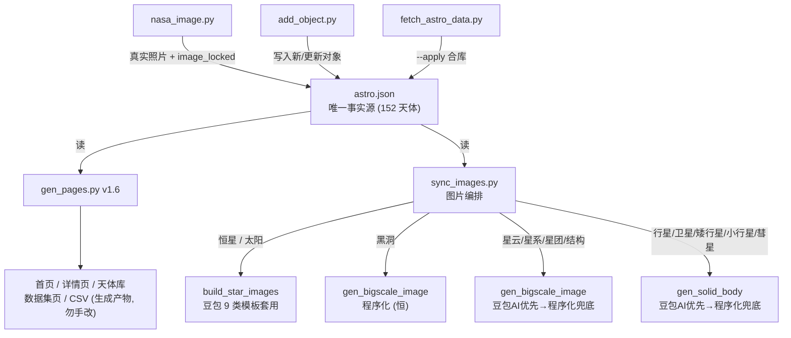
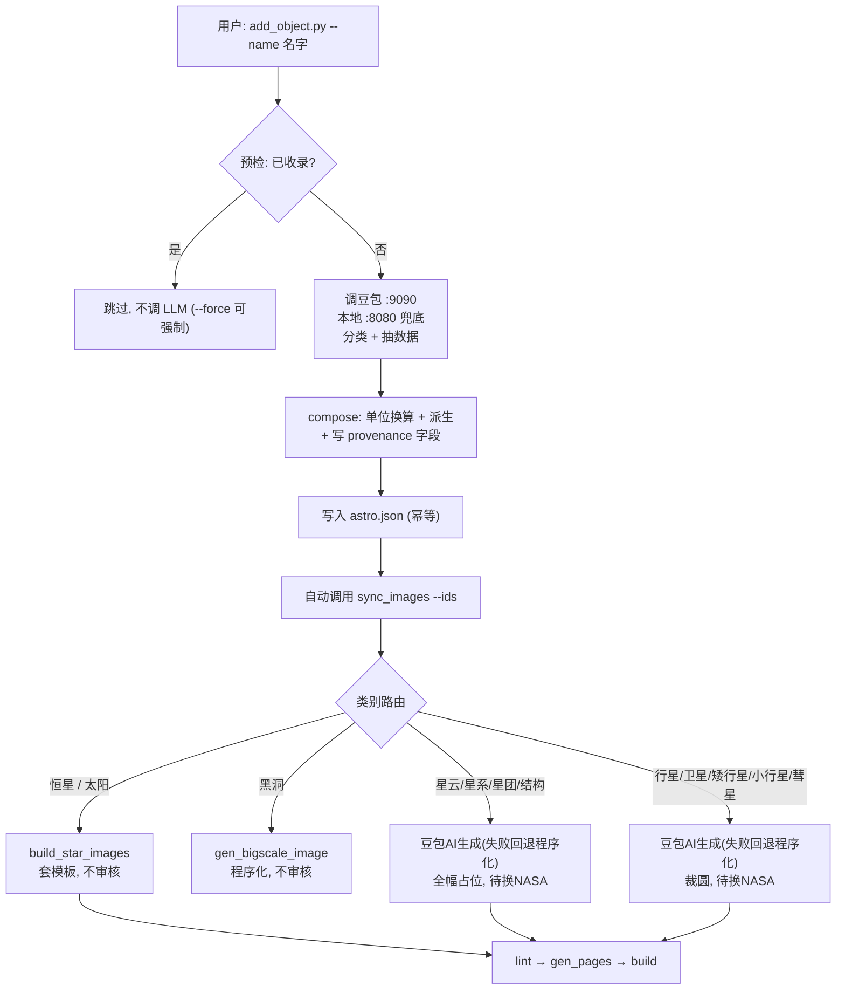
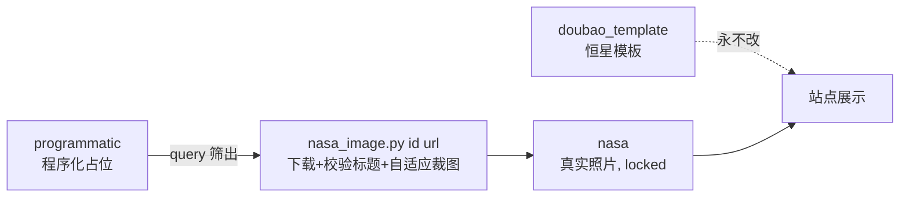
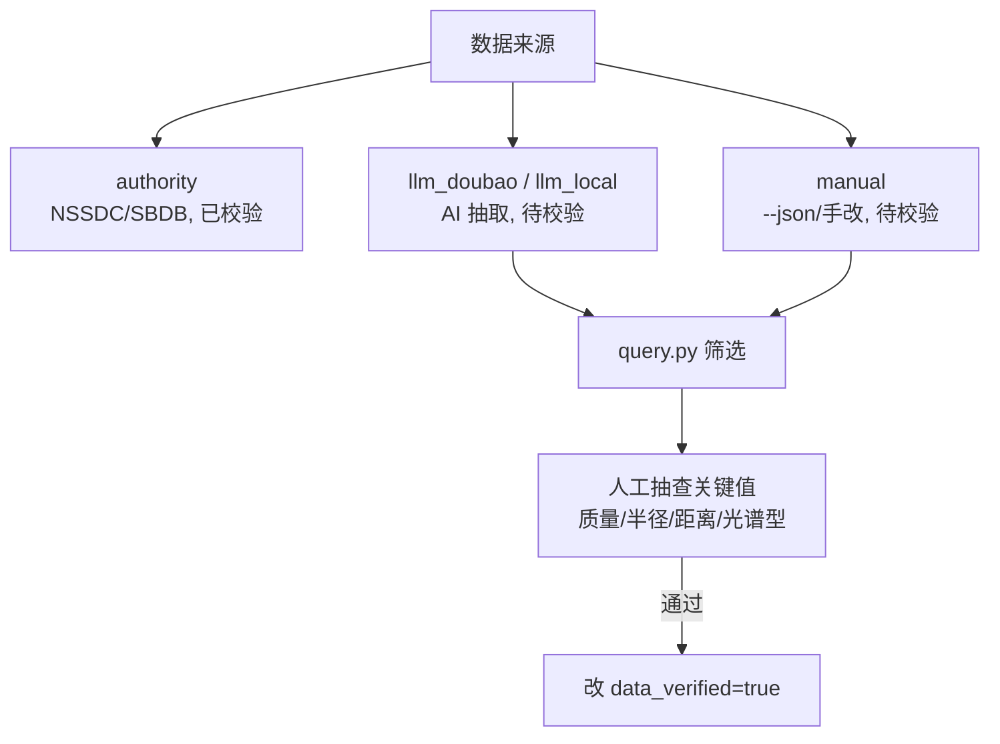
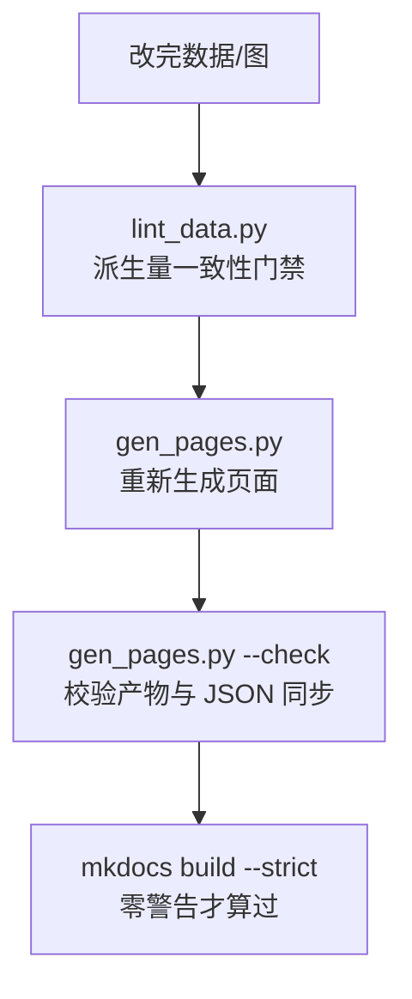

# 天体数据库维护指南（自助版）

> ⚠️ **文档维护约定（最高优先级）**：本站任何**脚本或工作流变更**（新增/修改/删除脚本、增删命令参数、改图片路由规则、改 astro.json 字段结构）都**必须在同一轮改动中同步更新本指南 + README.md**（对应章节与流程图），并随代码一起提交。**不要等用户提醒**。具体清单见文末[第十章](#十文档维护约定每次改代码必改文档)。

当前站点规模：**152 个天体、11 类**（恒星 56 / 卫星 21 / 星系 18 / 星云 16 / 星团 11 / 行星 8 / 黑洞 8 / 大尺度结构 7 / 矮行星 5 / 小行星 1 / 彗星 1）。已是覆盖太阳系到恒星/星云/星系/黑洞的全域数据站。

---

## 〇、全局架构与数据流



**铁律**：`docs/data/astro.json` 是全站唯一事实源。所有页面、CSV、贴图都从它生成；不要手改 `docs/objects/`、`docs/index.md`、`docs/data.md`、`docs/data/astro_flat.csv`（这些是生成产物，会被 `gen_pages.py` 覆盖）。

---

## 一、核心概念：可追溯体系（provenance）

为让你能"一条命令筛出哪些数据/图片是 AI 吐的、哪些是真图、哪些还没人工校验"，每个对象带 4 个机器可读字段：

| 字段 | 取值 | 含义 |
|---|---|---|
| `data_source` | `authority` / `llm_doubao` / `llm_local` / `manual` | 数据来源：权威源 / 豆包抽取 / 本地模型抽取 / 手填 |
| `data_verified` | `true` / `false` | 是否经**人工校验**（区别于 `verified`=录入日期） |
| `image_source` | `nasa` / `programmatic` / `doubao_template` / `doubao` | 图片来源：真实照片 / 程序化占位 / 恒星模板 / 豆包单图生成 |
| `image_locked` | `true` / `false` | 是否锁定（锁定的不会被 sync 覆盖） |

> 注意：`verified` 字段保留为"本站核对日期"（字符串），不要用它判断"是否校验过"——那是 `data_verified` 的职责。
> 这 4 个字段已由 `scripts/migrate_provenance.py` 一次性回填到全部 152 对象（日常不用再跑）。

---

## 二、新增一个天体（主路径：AI 编排层 + 自动出图）

### 2.1 端到端流程图



### 2.2 三种录入模式

```bash
python scripts/add_object.py --name "南河三"              # ① 只给名字 → 豆包自动分类+抽数据
python scripts/add_object.py --facts "一些检索到的文本"    # ② 从你提供的文本抽取
python scripts/add_object.py --json '{"id":...,"category":...}'  # ③ 直接结构化 JSON (绕过 LLM)
python scripts/add_object.py --name "参宿四" --dry-run    # 先看草稿不落盘 (也不出图)
```

- **LLM 路由**：豆包 `:9090` 默认优先，本地 `:8080` 兜底（本地模型不能联网，数据来自训练记忆）。
- **契约（数据填写原则，2026-10-26 修订）**：对**知名/有文献记录**的天体，LLM 必须给出训练知识中可知的**最佳近似值**（半径、质量、轨道半长轴/周期/偏心率等），允许近似但量级与单位须合理；**仅在完全无法估计时才 `null`**。不再用「拿不准一律 null」——那会把知名天体的真实参数也逼成空（曾导致亡神星零参数）。不确定性在 `note` 注明，绝不编造明显荒谬的值（如矮行星质量写成恒星量级）。
- **JSON 契约含 `orbit` 块**：`semimajor_axis_au` / `orbital_period_years` / `orbital_velocity_km_s` / `inclination_deg` / `eccentricity` / `obliquity_deg` / `rotation_period_hours`（旧版合同漏了 orbit，导致所有轨道参数为空，已补）；`compose` 自动把 AU→km、年→天，对齐站点 schema。
- **单位换算 + 派生**：太阳质量→kg、太阳半径→km、光年→km、AU→km、年→天；有 M/R 即派生重力/逃逸速度/密度（保证 lint 自洽）。
- **数值鲁棒性**：LLM 偶把数字以**字符串**返回（如 `"215"`、`"2.0e26"`）。`compose`/`normalize` 在算术前对全部物理量、轨道量、`distance_ly` 统一 `_num()` 归一成 float；无法解析（如带单位的 `"2.0e26 kg"`）安全退回 `None`，**绝不因脏数据中断整批写入**。
- **幂等**：id 已存在则原地补非空字段，不覆盖既有值；`--force` 可强制覆盖（重抽取）。**`--force` 重抽取会保留既有已生成的图片标记**（`image_source`/`image_credit`/`image_url`/`image_locked`，避免把豆包/NASA 图回退成占位）。
- **预检跳过**：写入前先查 astro.json，名字命中已收录就直接跳过（避免白烧一次 LLM 调用）；`--force` 可绕过预检强制重抽取。
- **数据质量门**：抽取/写入后检查固态体（行星/矮行星/卫星/小行星/彗星）是否半径**且**质量缺失、或轨道半长轴**且**周期缺失；若关键参数仍为空，亮红灯提示用 `--facts` 或 `--json --force` 补录，避免产生"有名无参数"的占位记录。
- **自动出图**：写入成功后末尾自动调用 `sync_images.py --ids <新id>` 出图；`--no-sync` 可关闭。
- **自动上线**：出图后自动重新生成站点页面并 `mkdocs build --strict`；`--no-pages` 可关闭（关闭后需手动 `gen_pages + mkdocs build` 才能在网页看到）。

### 2.2.1 批量模式（`--batch`，2026-10-27 新增）

一次性录入一批天体，**三阶段解耦**以隔离故障域、稳定不崩：

```bash
python scripts/add_object.py --batch names.txt        # names.txt：每行一个天体名，# 开头为注释、空行忽略
python scripts/add_object.py --batch names.txt --dry-run   # 只打印将写入的对象，不落盘、不出图
python scripts/add_object.py --batch names.txt --no-sync   # 只录入数据，不出图（后续手动 sync_images）
python scripts/add_object.py --batch names.txt --force     # 已收录的也强制覆盖重抽取
```

**设计要点（稳定性）**：
- **两发一致性对拍**：每个天体在豆包 `:9090` 上连抽 **2 次**（各自带 3 轮指数退避重试），比对关键数值字段（`mass_sun/radius_km/lum_sun/semimajor_axis_au/orbital_period_years/...` 等）。**两边都给了值且相对差 <15% 且 `category` 一致** → 判"一致"并采用；**不一致 → 逐字段合并**：一致字段保留（单边缺失时补第 2 发的非空值），**有争议的字段（两边都给值却相差大）一律置 null，绝不误填任一方第 1 发值**，并打 `needs_review` 标记进待审清单，对象 `note` 注明哪些字段被置空待补。用户 2026-10-27 明确要求"有争议的数据不要填入，只填其他一致的数据"。单边缺失（一侧 null）不算矛盾（视为一致，可补值）。
  - ⚠️ 一致性 ≠ 准确：模型若**系统性编造同一错值**，两发也会一致。这只能过滤随机幻觉/格式错乱，最终核定仍靠人工（`query.py --unverified`）。这是纯 LLM 架构的物理上限，除非接权威 API。
- **三阶段串行、写盘一次**：① 并发抽数（线程池 pool=3，结果攒内存）→ ② 写盘**只做一次**（单线程，避免并发写损坏 JSON）→ ③ `sync_images` 出图 + 一次性 `mkdocs build`。批量绝不在循环里反复 build。
- **故障不中断整批**：LLM 双发皆挂 → 该条标 `failed` 进报告，其余继续；已存在 id（按 `name/name_en/id` 三者 slugify 比对，防"牛郎星/河鼓二"近重复）直接 `skip`。整批可反复重跑（幂等）。
- **统计与待审清单**：结束打印「新增 / 跳过 / 失败 / 待审」四数 + 待审对象明细（两发不一致 / 仅 1 发成功 / 质量门红灯），供你事后用 `query.py` 逐条核定。
- **`data_verified` 恒为 `false`**：批量录入的数据全未经人工校验，与单条一致。

> 提示：豆包 `:9090` 偶发 502（环境波动）时批量会整批 `failed`——这是端点问题非代码 bug，端点恢复后重跑即可（幂等，已写入的不重复）。

### 2.2.2 复校模式（`--recheck`，2026-10-27 新增）

对**已有对象**重新抽数做数据清洗——解决"已存在对象被去重跳过、无法更新"的痛点。按字段级别：
- **现有非空 + 候选非空 + 相差 >15%** → **置空**（有争议，不盲信任任一方；派生量 gravity/escape/density 随 `compose` 一并归零，不残留旧值）；
- **现有为空 + 候选非空**（候选已是 2 发一致/单边）→ **填充**；
- 其余（都空 / 现有非空候选空 / 都非空且一致）→ **维持现状**。

```bash
python scripts/add_object.py --recheck                       # 全量复校（所有类别）
python scripts/add_object.py --recheck --category star       # 只复校恒星
python scripts/add_object.py --recheck --category planet     # 只复校行星
python scripts/add_object.py --recheck --name "天狼星"        # 只复校单个指定对象
python scripts/add_object.py --recheck --batch recheck.txt   # 按名单复校（名单内已存在的对象）
python scripts/add_object.py --recheck --dry-run             # 先预览将置空/填充的字段，不落盘
python scripts/add_object.py --recheck --no-pages            # 复校后不重构建页面
```

**设计要点**：
- **2 发一致性**：每个对象在豆包 `:9090` 连抽 2 次（同批量模式），`merge_two` 先把两发合并（争议字段置空）→ 再与库里现有值 `recheck_merge` 逐字段对拍（规则见上），最后 `compose` 统一重算归一化/派生量回写。
- **来源保护跳过**：`data_source ∈ {official_api}` 的对象默认跳过（官方权威数据不交由 AI 复校），`--force` 可强制复校。未来 `fetch_astro_data.py` 若写库，标 `official_api` 即自动受保护。
- **三阶段同样解耦**：并发抽数（pool=3）→ 写盘一次 → 重建页面（不出图，数值变更不影响贴图）。整批可反复重跑（幂等）。
- `note` 自动追加「AI复校 日期：置空[...]/填充[...]」；`data_verified` 仍保持 `false`（AI 数据仍需人工核定）。

### 2.3 写入后发生了什么

- 自动登记 `source_registry`（若有来源链接）；
- `data_source` 按实际模型填（`llm_doubao` / `llm_local` / `manual`），`data_verified=false`；
- `image_source` 初值：恒星→`doubao_template`、黑洞→`programmatic`；其余类别由 `sync_images` 实际生成后回填（`doubao` 或 `programmatic`）。
- 末尾 `sync_images` 按类别生成贴图（见第三章），并把实际来源写回 `image_source`。

> **出图优先级（2026-10-26 定）**：固态球类与大尺度先尝试【豆包 AI 生成】（`doubao-image` 接口，固态裁圆、大尺度全幅占位），**豆包不可用/裁圆失败则自动回退【程序化兜底】**；恒星套 9 类模板；黑洞恒程序化。NASA 真图由你手动锁定（`image_locked=true`），不参与自动生成。
>
> **豆包不支持透明背景（2026-10-26 实测）**：加 `background:"transparent"` 参数也只返回 RGB、无 alpha 通道——「透明」是 alpha 通道属性，提示词控制不了，所以固态抠圆这步不可省。裁圆 v2 算法：Otsu 分离亮盘 → 迭代 trim 估圆心/两轴半径（面积法+bbox，抗星点污染）→ **x/y 直径分别归一到 420（r=210，消除豆包「正圆」实测 ±6% 的椭圆度）** → 轮廓用盘自身 mask 高斯羽化（贴合内容，杜绝旧版硬几何圆蒙版的切盘/露缝瑕疵）→ 出图后按角度自检轮廓规整度（目标 210±10px），不合格自动重试 1 次、仍失败回退程序化。

---

## 三、图片体系与替换

### 3.1 三类来源与路由表



`sync_images.py` 内部路由（跑 `add_object` 末尾或单独执行）：

| 类别 | 图片来源（优先级） | 是否需人工审核 |
|---|---|---|
| `star`（恒星）/ `sun` | `build_star_images.py`：9 光谱型豆包 AI 代表图 + limb 圆拟合切圆 + 个体色相微调 | 否（套模板） |
| `black_hole` | `gen_bigscale_image.py` 程序化（吸积盘+事件视界），**恒程序化、不走豆包** | 否（程序化） |
| `nebula` / `galaxy` / `cluster` / `structure` | **优先豆包 AI 占位**（`doubao-image`，全幅缩放+边缘渐隐）；失败回退程序化 | 占位无需；**换真图需人工挑** |
| `planet` / `dwarf_planet` / `moon` / `asteroid` / `comet` | **优先豆包 AI 生成**（提示词约束正方形+球体居中 → 默认【图心为球心切几何正圆】r=210，射线陡降临边估半径，无边缘点/离散度过大才回退）；失败回退程序化兜底 | 占位无需；**换真图需人工挑** |

> 固态球类的豆包图若返回背景不干净/裁圆检测失败，会自动回退程序化兜底并标 `image_source=programmatic`；你可在 `query.py --image-source programmatic` 里捞出这类、或重跑 `sync_images.py --ids <id> --force` 重试豆包。
>
> **裁圆默认逻辑（2026-10-26 第三版定稿）**：AI 球体走「图心为球心 + 射线陡降临边估半径」——提示词合同保证【正方形 + 球体居中】，圆心直接取图心（智神星实测真球心距图心仅 ~2%）；半径 R 由 360 条射线找「陡峭负梯度」边缘点（8px 窗口降幅超阈值 + 内侧显著亮于外侧，从外向内第一条），取点到图心距离的中位数。**不用阈值蒙版质心**（豆包球常强明暗，暗面亮度 12~27 与背景 4~7 无法用阈值区分，Otsu=93 会把暗半球当背景切掉、质心被亮面拉偏 → 切圆偏位）；**不做自由圆拟合**（暗面无边缘点，只剩亮侧半圈弧，部分圆弧退化会拟出错误圆）；**不用「亮过再落入背景」判定**（亮侧辉光缓变会把边缘推到球外）。边缘点 <50 或距离离散度 >±10% 或 R 越界（0.15m~0.42m）→ 返回 False 回退程序化。豆包右下角固定水印区（y>0.92H 且 x>0.70W）预处理置零。输出几何正圆 r=210 居中、必过自检。不规则真实天体（小行星/彗星土豆形）**不走此函数**，走 `nasa_image.py` 的 `irregular` 轮廓模式（贴合真实形状）。
>
> **裁圆自检误杀排查**：`nasa_image.py <名> ai` 报 `轮廓自检不合格（盘不规整）` 是 `_silhouette_check` 把 360° 轮廓半径扫出来越界（容差 r≈210±18），**不是网络超时**——豆包 `POST /v1/images/generations` 返回 200 即已成功下载。旧版用 Otsu 阈值蒙版当 alpha 会让球体明暗边缘锯齿化、半径忽大忽小而误杀；现改为几何正圆输出，自检不再误杀；豆包真出烂图（无边缘点/离散度过大）会正确回退。豆包生图超时已放宽到 300s 作保险。
>
> **网页署名（`image_credit`）面向访客，统一短文案**：豆包图=「AI 生成」、程序化=「程序化示意图」、NASA 真图保留"机构 · 设备"式署名。不要把"待人工审核/占位图/可替换"之类的维护性文案写进 `image_credit`——那是给你看的流程信息，不是给访客看的。

### 3.2 替换程序化占位为 NASA 真图（你提供地址，人工保底）

```bash
# 你给一个 NASA 网页或直链，脚本下载→校验标题是否含该天体名→自适应裁图→入库锁定
python scripts/nasa_image.py <id> <url>
# 例：
python scripts/nasa_image.py ic1101 https://images.nasa.gov/details/PIA04921
```

- **自适应抠图**：按"类别 + 图像内容"自动选 `circle`（球状）/ `ellipse`（扁长体，rx/ry>1.12）/ `irregular`（**小行星/彗星不规则体：Otsu 亮盘 alpha 贴合真实轮廓，绝不硬切成圆**）/ `rings`（带环）/ `frame`（星系星云全幅延展），不用你手选；也可 `--ellipse` / `--irregular` / `--crop` 显式覆盖。
- **标题校验**：下载后检查 NASA 标题/描述是否含该天体名的**核心词**（去编号前缀，如 `4 Vesta`→`vesta`、`1P/Halley`→`halley`，同时比对描述，容忍大小写）；不符只**警告**让你确认，不擅自装错图。
- **入库**：写 `image` + `image_credit` + `image_url`，并打 `image_source=nasa`、`image_locked=true`（此后 sync 不会用程序化图覆盖它）。
- 旧的 `--search` / `--auto-batch` 仍保留为"试一次"的可选自动路径（AI 看图筛选不可靠，**主用你给的 URL**）。

### 3.2.1 AI 图重生成（豆包失败/不满意时的补救入口）

`add_object` 出图是"豆包优先、程序化兜底"——网络抖动（如 502）或豆包随机波动
导致落了程序化图时，可用本子命令**按名字重试豆包出图**，默认重试 3 次：

```bash
python scripts/nasa_image.py 智神星 ai              # 按中文名/英文名/id 解析，重试豆包
python scripts/nasa_image.py gonggong_225088 ai --retries 5   # 改重试次数
python scripts/nasa_image.py 共工星 ai --no-pages   # 不自动重建站点（只换图）
```

- 复用 `sync_images.regenerate_ai`：豆包优先，最多 `1+retries` 次尝试（网络错误/轮廓
  自检不过自动重试），全失败回退程序化；恒星走模板重建、大尺度/固态走对应生成器。
- **安全**：`image_locked=true` 的 NASA 真图**不覆盖**（打印"已锁定(跳过)"）；名字
  解析不到打印"未找到"，不误伤其它对象。
- 跑完默认自动 `gen_pages.py` + `mkdocs build --strict`，避免网页不更新（`--no-pages` 关）。

### 3.3 完全手动（用自己的图）

1. 图存 `docs/assets/planets/<id>.webp`（建议 600px 见方、透明背景；任意尺寸也行）。
2. astro.json 对应对象填：`"image": "assets/planets/<id>.webp"`、`"image_credit": "署名"`、`"image_url": "原页链接(可选)"`、`"image_source": "nasa"`、`"image_locked": true`。
3. `python scripts/gen_pages.py` 重新生成。

> 历史上曾有 `blog-pipeline` 仓库的 `gen_images.py`/`sync_textures.py` 做 AI 贴图，现已不在本站主管线，仅作参考，不建议混用。

---

## 四、数据可靠性与人工校验



**关键事实**：`add_object --name` 走的是 **AI 抽取**——把名字塞进提示词发给豆包/本地模型，LLM 凭训练记忆（或代理是否开联网搜索）吐 JSON，**不碰任何天文 API、无权威源对拍闸**。吐出的数字直接进库。权威源取数只有 `fetch_astro_data.py`（NSSDC + JPL SBDB），且仅覆盖太阳系。

> **数据填写政策（2026-10-26 修订）**：AI 抽取虽无权威对拍，但合同已要求 LLM 对**知名天体给出训练知识中的最佳近似真值**（半径/质量/轨道等），**仅真未知才 null**——不再用「拿不准一律 null」（那曾让亡神星零参数）。近似值的可靠性仍靠你用 `query.py --unverified/--missing` 筛出后人工抽查，通过再 `data_verified=true`。

用 `scripts/query.py` 把"待校验"对象筛出来逐个核：

```bash
python scripts/query.py --unverified                       # 所有未校验 (目前 115)
python scripts/query.py --unverified --category star        # 未校验恒星
python scripts/query.py --data-source llm_doubao            # 全是 AI 吐的 (目前仅 procyon_a)
python scripts/query.py --missing radius,mass               # 缺关键字段的
python scripts/query.py --image-source programmatic         # 程序化占位图 (22)
python scripts/query.py --image-source nasa                 # 真实照片 (75)
python scripts/query.py --data-source llm_doubao --csv out.csv  # 导出 CSV 方便逐行核对
```

核对通过后，把该对象的 `data_verified` 改为 `true`（直接手改 astro.json，或后续给 query.py 加 `--mark-verified`）。

---

## 五、太阳系权威核查（fetch_astro_data.py）

适合**行星/卫星/矮行星/TNO**，用权威源逐项对照。**自动拉取只产提案，永不自动改库**：

```bash
python scripts/fetch_astro_data.py status              # 零网络本地体检（建议先跑）
python scripts/fetch_astro_data.py --propose quaoar    # 生成候选骨架 (有值填真值, 无则 null)
# 人工至少补 tagline (lint 门禁) →
python scripts/fetch_astro_data.py --apply quaoar      # 合库 (全链路唯一写库入口之一)
```

- **数据源**：NSSDC Planetary Fact Sheets（NASA Goddard）+ JPL SBDB API（免 key）。恒星/星系/星云取不到（走 add_object）。
- **产物**：`reports/astro_fetch_<时间戳>.md`（人读，`reports/` 已 gitignore）。
- 实测教训：直接 `--apply` 没补 tagline 的骨架，`lint_data.py` 会报 `缺少字段 tagline` 并拒绝——故意门禁。

---

## 六、校验 + 生成 + 构建（每次维护收尾必跑）



```bash
python scripts/lint_data.py            # 不过则阻断
python scripts/gen_pages.py            # 重新生成页面
python scripts/gen_pages.py --check    # 校验产物与 JSON 同步 (不同步则不让你构建)
mkdocs build --strict                  # 零警告才算过
```

> 沙箱内跑 `mkdocs build` 需加前缀 `CODEBUDDY_SAFE_DELETE_ENABLED=0`（避免清理 `site/` 被拦截）；本机 MINGW64 终端可省略。

---

## 七、更新已有天体的数据

```bash
python scripts/fetch_astro_data.py status              # 本地体检
python scripts/fetch_astro_data.py --objects mars,moon # 针对性拉取 (不传则全量)
# 审 reports/ 报告 → 手动改 docs/data/astro.json
python scripts/add_object.py --json '{...}' --force    # 或用编排层覆盖更新
python scripts/lint_data.py && python scripts/gen_pages.py && mkdocs build --strict
```

**已固化的人工裁定先例**：NSSDC 卫星页反照率只有 2 位有效数字 → 不据此改库；SBDB 与 NSSDC 偏心率微小差异 → 取 SBDB 2021 轨道解；太阳是恒星没有反照率，保持 null。

---

## 八、发一篇科普文章

1. 文章写至仓库根 `articles/<slug>.md`（H1 或 frontmatter `title` 成为详情页「延伸阅读」标题）。
2. `astro.json` 对应天体的 `article` 字段填 `<slug>`。
3. `python scripts/gen_pages.py`——文章自动合成进该天体详情页。

---

## 九、常见问题

| 症状 | 原因与解法 |
|---|---|
| 详情页图片 404 | MkDocs `use_directory_urls` 默认 true，详情页 URL 是 `/objects/<id>/`，站根资源退两级 `../../`。生成器已处理 |
| 贴图周围一圈白环 | 旧图白底缩放遗留；现固态/恒星图圆外全透明，仍有旧白边就重跑对应生成脚本 |
| AI 贴图把 NASA 真图覆盖了 | 不会。`image_locked: true` 的对象 sync 会跳过 |
| lint 报"缺少字段 tagline" | 新对象入队前必须人工写一句话简介，这是门禁 |
| 页面看着是旧版 | MkDocs 自定义 `extra_javascript`/`extra_css` 不带 hash、URL 固定，长期缓存 → 已加 `docs/_headers` 全局 `no-cache`；本地用 `serve_nocache.py` 预览 |
| 改了脚本不生效 | Bash 内联 Python 正则会被 shell 吃反斜杠——内联脚本一律先 Write 落成 .py 再跑 |
| 移动端布局怎么验 | 用 `node scripts/cdp_shot.js`（真设备模拟）；别用 Edge `--screenshot`（只是左 375 裁剪） |
| add_object 后没出图 | 检查是否用了 `--no-sync`；或该对象类别无生成器（看 sync 输出）；可手动 `python scripts/sync_images.py --ids <id>` |
| 不知道哪些图是程序化/真图 | `python scripts/query.py --image-source programmatic` / `--image-source nasa` |
| 不知道哪些数据没校验 | `python scripts/query.py --unverified` |

---

## 十、命令速查

```bash
# 数据（新增/更新）
python scripts/add_object.py --name <名字>              # AI 录入 (任意类型, 推荐, 末尾自动出图)
python scripts/add_object.py --name <名字> --no-sync    # 录入但不自动出图
python scripts/add_object.py --batch names.txt          # 批量录入 (豆包两发一致性对拍, 三阶段解耦)
python scripts/add_object.py --batch names.txt --dry-run  # 先预览将写入的对象, 不落盘
python scripts/add_object.py --recheck --category all   # AI 复校全量 (争议置空/空缺补填, 可按 --category/--name/--batch 筛选)
python scripts/add_object.py --recheck --dry-run        # 先预览将置空/填充的字段, 不落盘
python scripts/add_object.py --json '{...}' --force     # 结构化直写/覆盖
python scripts/fetch_astro_data.py status               # 太阳系体检
python scripts/fetch_astro_data.py --propose <id>       # 候选骨架
python scripts/fetch_astro_data.py --apply <id>         # 合库

# 图片
python scripts/sync_images.py [--ids ...|--force|--no-gen-star]   # 全量编排 (add_object 已自动调)
python scripts/nasa_image.py <id> <url>                # 你给 NASA 地址 → 下载+校验+自适应裁图+锁定
python scripts/nasa_image.py --search <关键词>          # NASA 真图找图 (可选自动路径)

# 校验与筛选（人工校验用）
python scripts/query.py --unverified                   # 未校验数据
python scripts/query.py --data-source llm_doubao        # AI 抽取的数据
python scripts/query.py --image-source programmatic     # 程序化占位图
python scripts/query.py --missing radius,mass           # 缺字段

# 校验与构建
python scripts/lint_data.py
python scripts/gen_pages.py                # 或 --check 只校验同步
mkdocs build --strict                      # 沙箱加 CODEBUDDY_SAFE_DELETE_ENABLED=0
python scripts/serve_nocache.py 8001 site  # 本地预览 (带 no-cache)
mkdocs serve -a 127.0.0.1:8001            # 8000 被御风 Home 占用, 换端口
```

---

## 十一、文档维护约定（每次改代码必改文档）

**这是硬规则，适用所有维护者（含 AI 助手）：**

1. **触发条件**：只要动了以下任一项，就必须同步更新本指南与 README.md——
   - 新增 / 删除 / 重命名任何 `scripts/*.py`；
   - 修改脚本命令参数（增删 `--flag`、改必填项）；
   - 修改 `sync_images` 的图片路由规则或出图逻辑；
   - 修改 `astro.json` 的字段结构或 `compose()` 写入逻辑；
   - 修改 LLM 路由（默认模型/兜底）、数据来源策略、可靠性边界；
   - 修改 3D 嵌入页结构、iframe 源地址或 `docs/js/solar-embed.js`（见第十二章）。
2. **必改位置**：
   - 本指南「〇、全局架构」流程图与脚本清单；
   - 对应章节（新增天体 / 图片 / 数据校验 / 命令速查）；
   - README.md 的目录结构、工作流图、命令示例。
3. **流程图同步**：任何流程变动（如新增自动步骤、改变路由分支）必须同步更新对应 Mermaid 图。
4. **提交**：文档改动与代码改动在**同一个 commit** 提交，不拆分到"等用户提醒"的下一次。
5. **自查清单**（改动后过一遍）：
   - [ ] 脚本清单是否还准（有没有漏掉新脚本 / 残留已删脚本）
   - [ ] 命令示例能否直接复制执行（参数还对不对）
   - [ ] 流程图分支是否与代码实际一致
   - [ ] 规模数字（天体数/类别数）是否更新
   - [ ] 3D 嵌入页的 iframe 源地址是否仍指向正确的外站 URL（见第十二章）

---

## 十二、太阳系 3D 嵌入页（外站 iframe）

### 12.1 边界：3D 内容不在本仓库

| 项 | 位置 |
|---|---|
| 3D 工程源码 | `C://Users//99432//code//giants//astro-solar-3d`（GitHub: yufengwolf/astro-solar-3d） |
| 3D 线上站点 | https://astro-solar-3d.pages.dev （独立 Cloudflare Pages 项目） |
| 本仓库只含 | 8 个嵌入页 `docs/*.md` + `docs/js/solar-embed.js` + `site.css` 的 `.solar-embed` 样式 |

历史做法是把 3D 的 `dist/`（约 20MB / 57 文件）直接拷进 `docs/solar/`。已废弃：
那样每次改 3D 都要重新拷贝并 push，还会连带触发 mkdocs 全量重建。
现在两边构建完全解耦——**改 3D 在本仓库没有任何动作**。

### 12.2 三类改动分别去哪里改

| 想改什么 | 去哪里改 |
|---|---|
| 天体、轨道、卫星、贴图、文案 | **3D 仓库**改后 push，CF Pages 自动部署 |
| 嵌入块样式、全屏按钮、横屏提示 | 本仓库 `site.css` / `docs/js/solar-embed.js` |
| 嵌入页上下的说明文字 | 本仓库对应 `docs/*.md` |
| 导航显示 | 本仓库 `mkdocs.yml` 的 `nav` |

### 12.3 URL 写法：用无扩展名形式

CF Pages 会把 `/jupiter.html` **308 重定向**到 `/jupiter`。浏览器能跟随，但多一跳，
且相对路径的解析基准会变。统一写成：

```
https://astro-solar-3d.pages.dev/jupiter      ← 用这个
https://astro-solar-3d.pages.dev/jupiter.html ← 会被 308 重定向
```

太阳系总览用根路径 `https://astro-solar-3d.pages.dev/`。

### 12.4 新增一个子系统页的三步

1. 3D 仓库里加入口与页面（`vite.base.js` 的 `ENTRIES` + `src/xxx.html` + `src/systems/xxx.js`），push 等部署
2. 本仓库复制一个现有 `docs/xxx-system.md`，改标题、iframe `src`、页尾兜底链接
3. `mkdocs.yml` 的 `nav` 加一行

### 12.5 嵌入结构（改样式时对照）

```html
<div class="solar-embed">
  <div class="solar-bar">
    <span class="solar-title">木星系统</span>
    <button type="button" class="solar-fs-btn">全屏</button>
  </div>
  <div class="solar-frame">
    <iframe src="https://astro-solar-3d.pages.dev/jupiter"
            title="木星系统" loading="lazy"
            allowfullscreen allow="fullscreen"></iframe>
    <div class="solar-rotate">…请旋转手机至横屏…</div>
  </div>
</div>
```

- 宽度贴合正文列宽（不是全屏 break-out）；高度桌面 68vh、移动 58vh
- 全屏是**本站**元素调 `requestFullscreen()`，同源无需授权；
  iframe 上的 `allow="fullscreen"` 仅兜底，删掉也不影响当前实现
- `solar-embed.js` 只读取 `iframe.getAttribute('src')`，**不碰 `contentDocument`**，因此跨域安全

### 12.6 换域名时

改 8 个 md 里的两处：iframe 的 `src=` 和页尾「可直接打开 …」的兜底链接。
一句话批量替换：把 `https://astro-solar-3d.pages.dev` 换成新域名即可。
